# Healthcare Intel Digest

<strong>Week of November 2, 2026</strong>Market data through: October 30, 2026Narrative created: November 2, 2026

Weekly review of healthcare services, technology, distribution, and diagnostic company performance, changes, earnings activity, and strategy narrative.

## In the News

<nav class="strategy-narrative-links" aria-label="Strategy narrative sections">
<ul>
<li><a href="#strategy-executive-view-1-coverage-loss-not-utilization-becomes-the-hospital-margin-constraint">1. Coverage loss, not utilization, becomes the hospital margin constraint</a></li>
<li><a href="#strategy-executive-view-2-alignment-turns-a-claims-migration-into-a-medical-cost-event">2. Alignment turns a claims migration into a medical-cost event</a></li>
<li><a href="#strategy-executive-view-3-bon-secours-moves-from-asc-partnerships-to-a-national-ownership-platform">3. Bon Secours moves from ASC partnerships to a national ownership platform</a></li>
<li><a href="#strategy-executive-view-4-onc-preserves-prior-authorization-apis-while-removing-broader-certification-burden">4. ONC preserves prior-authorization APIs while removing broader certification burden</a></li>
<li><a href="#strategy-executive-view-5-cms-s-2-7-dialysis-increase-mostly-funds-phosphate-binders">5. CMS’s 2.7% dialysis increase mostly funds phosphate binders</a></li>
</ul>
</nav>

<h3 id="executive-view">Executive View</h3>

- Exchange coverage loss became a measurable hospital earnings problem: HCA estimated that higher uninsured volume reduced third-quarter pre-tax income by approximately $400 million. ([HCA Healthcare, *HCA Healthcare Reports Third Quarter 2026 Results*, October 27, 2026](https://investor.hcahealthcare.com/news/news-details/2026/HCA-Healthcare-Reports-Third-Quarter-2026-Results/default.aspx))
- Alignment showed that claims-platform migration can affect medical cost, as provider appeals and disputes contributed to a 240-basis-point increase in its medical benefits ratio despite strong membership growth. ([Alignment Healthcare, *Third Quarter 2026 Results*, October 29, 2026](https://ir.alignmenthealth.com/news-releases/news-release-details/alignment-healthcare-reports-third-quarter-2026-results-updates))
- Bon Secours Mercy Health-affiliated HealthSpan is acquiring Surgery Partners for $5.7 billion, moving a health-system affiliate toward ownership of a national outpatient surgical platform. ([Surgery Partners, *HealthSpan Partners to Acquire Surgery Partners*, October 26, 2026](https://ir.surgerypartners.com/node/12056))
- Federal policy improved developer economics and dialysis reimbursement: ONC reduced health-IT certification requirements, while CMS raised the dialysis bundle mainly to cover newly included phosphate binders. ([Federal Register, *HTI-5 Final Rule*, October 28, 2026](https://www.federalregister.gov/documents/2026/10/28/2026-21943/health-data-technology-and-interoperability-onc-deregulatory-actions-to-unleash-prosperity); [CMS, *CY 2027 ESRD PPS Final Rule*, October 28, 2026](https://www.cms.gov/newsroom/fact-sheets/calendar-year-cy-2027-end-stage-renal-disease-esrd-prospective-payment-system-final-rule-cms-1846-f))
- Overall environment: modestly deteriorated for payer and provider operating execution because coverage loss and claims-processing friction outweighed improved health-IT compliance costs and targeted dialysis reimbursement.

<h3 id="strategy-executive-view-1-coverage-loss-not-utilization-becomes-the-hospital-margin-constraint">1. Coverage loss, not utilization, becomes the hospital margin constraint</h3>

**Status:** UPDATE

**What happened**

HCA’s same-facility equivalent admissions increased 3.0% and emergency visits increased 5.1%, but the company estimated that a shift toward uninsured patients, primarily people who lost Exchange coverage, reduced third-quarter income before taxes by approximately $400 million. Adjusted EBITDA increased only 1.2%. Community Health Systems reported the same directional split: same-store adjusted admissions increased 3.6%, while adjusted EBITDA fell to $280 million from $376 million because of unfavorable payer mix, divestitures, higher specialist fees and other items. ([HCA Healthcare, *HCA Healthcare Reports Third Quarter 2026 Results*, October 27, 2026](https://investor.hcahealthcare.com/news/news-details/2026/HCA-Healthcare-Reports-Third-Quarter-2026-Results/default.aspx); [Community Health Systems, *Third Quarter 2026 Results*, October 28, 2026](https://chsnet.gcs-web.com/news-releases/news-release-details/community-health-systems-inc-announces-third-quarter-ended-3))

**Implication**

The results quantify the provider-side transmission from coverage attrition before CMS’s proposed 2028 annual Exchange verification process begins. Volume growth cannot protect margins when commercially insured encounters convert to uninsured care.

Hospitals now have stronger incentives to invest in eligibility surveillance, presumptive coverage, charity screening and patient collections. The exposure is largest for systems with limited payer leverage and thin cash margins; HCA’s scale absorbed the shock better than CHS, but did not eliminate it.

**Watch next**

Whether fourth-quarter uninsured admissions continue rising during 2027 open enrollment, and whether hospitals convert eligible patients back to subsidized coverage before claims become bad debt.

---

<h3 id="strategy-executive-view-2-alignment-turns-a-claims-migration-into-a-medical-cost-event">2. Alignment turns a claims migration into a medical-cost event</h3>

**Status:** NEW

**What happened**

Alignment grew health-plan membership 31.2% to 301,200 and revenue 36.7% to $1.36 billion, but its adjusted medical benefits ratio rose 240 basis points to 89.5% and adjusted EBITDA declined 32.8% to $21.8 million. The company lowered full-year adjusted gross-profit and EBITDA guidance, citing elevated provider appeals and disputes, catastrophic cases, skilled-nursing costs, Part D seasonality and clinical investments. ([Alignment Healthcare, *Third Quarter 2026 Results*, October 29, 2026](https://ir.alignmenthealth.com/news-releases/news-release-details/alignment-healthcare-reports-third-quarter-2026-results-updates))

Management said volatility associated with its Facets claims-system migration peaked in July and began stabilizing in August and September, but normalization exposed increased provider appeals and disputes in paid-claims data. ([OpenFilings, *Alignment Healthcare Q3 2026 Earnings Call Transcript*, October 29, 2026](https://openfilings.org/companies/us/ALHC/transcripts/65699a58-224c-4a43-9a77-6a99a21fd591))

**Implication**

The result weakens the assumption that core-administration modernization is primarily an SG&A project. Payment edits, appeals behavior and reserve accuracy can move the medical-cost ratio during migration.

Plans need parallel claims reconciliation, edit-governance controls and pre- versus post-pay monitoring during conversions. This supports demand for payment-integrity analytics and provider-dispute workflow, but raises implementation scrutiny for core-platform vendors.

**Watch next**

Whether Alignment’s fourth-quarter MBR shows that claims stabilization is reducing disputes, rather than merely improving processing speed.

---

<h3 id="strategy-executive-view-3-bon-secours-moves-from-asc-partnerships-to-a-national-ownership-platform">3. Bon Secours moves from ASC partnerships to a national ownership platform</h3>

**Status:** NEW

**What happened**

HealthSpan Partners, a contractual affiliate and supporting organization of Bon Secours Mercy Health, agreed to acquire Surgery Partners for approximately $5.7 billion in enterprise value. Public shareholders will receive $23.50 per share, while Bain Capital will roll its approximately 39% ownership into the acquiring entity. Surgery Partners adds more than 200 locations across 30 states and approximately 5,000 affiliated physicians. The parties expect the transaction to close in the first quarter of 2027, subject to shareholder and regulatory approvals. ([Surgery Partners, *HealthSpan Partners to Acquire Surgery Partners*, October 26, 2026](https://ir.surgerypartners.com/node/12056))

**Implication**

The transaction extends provider vertical integration beyond regional ambulatory joint ventures. HealthSpan gains a national platform spanning orthopedics, spine, cardiology, gastroenterology and ophthalmology, giving it more exposure to the continued shift of procedures away from hospital outpatient departments.

For payers, the economic question is whether national ownership preserves the lower unit cost of independent ASCs or creates additional contracting leverage for the affiliated health system. For technology vendors, a privately held national platform creates opportunities for standardized RCM, scheduling and supply-chain deployment, alongside greater point-solution displacement risk.

**Watch next**

Regulatory conditions, change-of-control notices under payer contracts and whether Surgery Partners maintains decentralized physician economics after closing.

---

<h3 id="strategy-executive-view-4-onc-preserves-prior-authorization-apis-while-removing-broader-certification-burden">4. ONC preserves prior-authorization APIs while removing broader certification burden</h3>

**Status:** RESOLVE

**What happened**

ONC’s final HTI-5 rule removes 14 of 60 health-IT certification criteria, revises seven and leaves 39 unchanged. The retained criteria include the electronic prior-authorization APIs and real-time prescription-benefit capabilities finalized under HTI-4. ONC also reduced real-world testing and Insights reporting obligations and removed model-card source-attribute requirements from the decision-support-interventions criterion. The agency estimates $1.55 billion in present-value savings and $108.1 million in annualized savings; most provisions take effect December 28. ([ONC, *HTI-5 Final Rule Overview*, October 26, 2026](https://healthit.gov/resources/health-data-technology-and-interoperability-onc-deregulatory-actions-to-unleash-prosperity-hti-5-final-rule/); [Federal Register, *HTI-5 Final Rule*, October 28, 2026](https://www.federalregister.gov/documents/2026/10/28/2026-21943/health-data-technology-and-interoperability-onc-deregulatory-actions-to-unleash-prosperity))

**Implication**

The rule lowers compliance costs for certified developers without weakening the immediate electronic prior-authorization implementation thesis. Payers, EHR vendors and providers still need the FHIR workflows already scheduled for 2027.

The trade-off shifts toward buyer diligence. Providers may need to validate functionality contractually where federal certification no longer supplies the same floor, particularly for decision-support documentation, testing and older exchange methods. ONC acknowledged that downstream end-user costs were not fully quantified.

**Watch next**

Whether ONC separately finalizes the information-blocking proposals it left under consideration and how buyers adjust AI-governance requirements after the model-card rollback.

---

<h3 id="strategy-executive-view-5-cms-s-2-7-dialysis-increase-mostly-funds-phosphate-binders">5. CMS’s 2.7% dialysis increase mostly funds phosphate binders</h3>

**Status:** NEW

**What happened**

CMS finalized a 2027 ESRD base rate of $297.52, up $15.81 from 2026, and projects a 2.7% increase in total dialysis-facility payments. However, $12.85, roughly four-fifths of the base-rate increase, explicitly funds phosphate binders newly incorporated into the bundle. The underlying market-basket update is 1.9%, while budget-neutral changes to the low-volume adjustment reduce the base rate by approximately 1.1%. CMS also increased the home and self-dialysis training add-on from $95.60 to $138.00. ([CMS, *CY 2027 ESRD PPS Final Rule*, October 28, 2026](https://www.cms.gov/newsroom/fact-sheets/calendar-year-cy-2027-end-stage-renal-disease-esrd-prospective-payment-system-final-rule-cms-1846-f))

**Implication**

The 2.7% headline is not a clean margin increase for DaVita, Fresenius or smaller operators. Facility economics will depend on phosphate-binder acquisition cost and utilization after responsibility moves inside the bundle.

The approximately 44% increase in home-training payment provides a clearer economic incentive, although CMS offset part of the cost through budget neutrality and a lower onset adjustment. The direction favors home modalities; the magnitude depends on patient conversion and training capacity.

**Watch next**

Binder acquisition spreads, home-training volumes and which facilities qualify under the expanded low-volume threshold.

<h3 id="what-to-watch-for">What to Watch For</h3>

- **December 15, 2026:** Comments close on CMS’s proposed MA provider-directory and Part D PBM accountability rule. ([Federal Register, *CMS-4214-P*, October 20, 2026](https://public-inspection.federalregister.gov/2026-21420.pdf))
- **December 28, 2026:** Most HTI-5 certification changes take effect. ([Federal Register, *HTI-5 Final Rule*, October 28, 2026](https://www.federalregister.gov/documents/2026/10/28/2026-21943/health-data-technology-and-interoperability-onc-deregulatory-actions-to-unleash-prosperity))
- **December 31, 2026:** ESRD facilities’ deadline to attest for the 2027 low-volume payment adjustment. ([CMS, *CY 2027 ESRD PPS Final Rule*, October 28, 2026](https://www.cms.gov/newsroom/fact-sheets/calendar-year-cy-2027-end-stage-renal-disease-esrd-prospective-payment-system-final-rule-cms-1846-f))
- **January 1, 2027:** Electronic prior-authorization capabilities begin for payers subject to CMS-0057 requirements. ([HHS, *Leading Employers Back Expansion of Electronic Prior Authorization*, October 21, 2026](https://www.hhs.gov/press-room/leading-employers-expand-electronic-prior-authorization-self-funded-health-plans.html))
- **January 15, 2027:** HealthCare.gov open enrollment for 2027 coverage closes. ([CMS, *Plan Year 2027 Marketplace Plans and Prices*, October 30, 2026](https://beta.cms.gov/newsroom/fact-sheets/plan-year-2027-marketplace-plans-prices-fact-sheet-0))

<h3 id="bottom-line">Bottom Line</h3>

The most consequential change is HCA’s quantification of a $400 million pre-tax hit from Exchange coverage loss, establishing that eligibility attrition can overwhelm otherwise healthy provider demand. Coverage-driven uncompensated care and claims-migration controls require the closest attention. The January 15 Marketplace enrollment close is the next confirmed event most likely to clarify the size of the 2027 coverage and payer-mix exposure.

<h3 id="sources">Sources</h3>
- [https://www.cms.gov/medicare/regulations-guidance/transmittals/2026-transmittals](https://www.cms.gov/medicare/regulations-guidance/transmittals/2026-transmittals)
- [https://www.hhs.gov/press-room/hhs-finalizes-hti-5-deregulatory-rule.html](https://www.hhs.gov/press-room/hhs-finalizes-hti-5-deregulatory-rule.html)
- [https://www.cms.gov/newsroom/articles](https://www.cms.gov/newsroom/articles)
- [https://www.cms.gov/newsroom/fact-sheets/transparency-coverage-final-rules-cms-9882-f](https://www.cms.gov/newsroom/fact-sheets/transparency-coverage-final-rules-cms-9882-f)
- [https://www.cms.gov/files/document/revised-final-cy26-key-dates-tables.pdf](https://www.cms.gov/files/document/revised-final-cy26-key-dates-tables.pdf)
- [https://www.hhs.gov/guidance/document/prior-authorization-process-certain-durable-medical-equipment-prosthetics-orthotics-and-1](https://www.hhs.gov/guidance/document/prior-authorization-process-certain-durable-medical-equipment-prosthetics-orthotics-and-1)
- [https://public-inspection.federalregister.gov/2026-13656.pdf?1782996328=](https://public-inspection.federalregister.gov/2026-13656.pdf?1782996328=)
- [https://www.cms.gov/medicare/enrollment-renewal/providers-suppliers/information-centers/hospices/news-announcements](https://www.cms.gov/medicare/enrollment-renewal/providers-suppliers/information-centers/hospices/news-announcements)
- [https://public-inspection.federalregister.gov/2026-15833.pdf](https://public-inspection.federalregister.gov/2026-15833.pdf)
- [https://www.justice.gov/atr/case/us-and-state-ohio-v-ohiohealth-corporation](https://www.justice.gov/atr/case/us-and-state-ohio-v-ohiohealth-corporation)
- [https://www.cms.gov/newsroom/fact-sheets/calendar-year-cy-2026-medicare-physician-fee-schedule-final-rule-cms-1832-f](https://www.cms.gov/newsroom/fact-sheets/calendar-year-cy-2026-medicare-physician-fee-schedule-final-rule-cms-1832-f)
- [https://www.cms.gov/newsroom/fact-sheets/hhs-notice-benefit-and-payment-parameters-2026-final-rule](https://www.cms.gov/newsroom/fact-sheets/hhs-notice-benefit-and-payment-parameters-2026-final-rule)
- [https://www.cms.gov/newsroom/press-releases/cms-final-rule-lowers-costs-cracks-down-fraud-expands-state-control](https://www.cms.gov/newsroom/press-releases/cms-final-rule-lowers-costs-cracks-down-fraud-expands-state-control)
- [https://www.cms.gov/medicare/regulations-guidance/transmittals/2026-transmittals/r13967otn](https://www.cms.gov/medicare/regulations-guidance/transmittals/2026-transmittals/r13967otn)
- [https://public-inspection.federalregister.gov/2026-16508.pdf?1786479307=](https://public-inspection.federalregister.gov/2026-16508.pdf?1786479307=)
- [https://www.cms.gov/files/document/key-application-actions-deadlines.pdf](https://www.cms.gov/files/document/key-application-actions-deadlines.pdf)
- [https://aspe.hhs.gov/sites/default/files/documents/82c3ee75ef9c2a49fa6304b3812a4855/aspe-workforce.pdf](https://aspe.hhs.gov/sites/default/files/documents/82c3ee75ef9c2a49fa6304b3812a4855/aspe-workforce.pdf)
- [https://www.cms.gov/newsroom/press-releases/cms-finalizes-rule-help-more-organs-reach-patients-strengthen-accountability-organ-procurement](https://www.cms.gov/newsroom/press-releases/cms-finalizes-rule-help-more-organs-reach-patients-strengthen-accountability-organ-procurement)
- [https://www.cms.gov/about-cms/contact/newsroom](https://www.cms.gov/about-cms/contact/newsroom)
- [https://www.cms.gov/newsroom/press-releases/cms-finalizes-new-mandatory-drug-payment-model-deliver-lower-drug-prices-beneficiaries-original](https://www.cms.gov/newsroom/press-releases/cms-finalizes-new-mandatory-drug-payment-model-deliver-lower-drug-prices-beneficiaries-original)
- [https://www.cms.gov/priorities/burden-reduction/overview/spotlight](https://www.cms.gov/priorities/burden-reduction/overview/spotlight)
- [https://www.cms.gov/files/document/nsg-attachments-rule-press-release.pdf](https://www.cms.gov/files/document/nsg-attachments-rule-press-release.pdf)
- [https://www.cms.gov/home-health-agency-news-announcements](https://www.cms.gov/home-health-agency-news-announcements)
- [https://www.cms.gov/newsroom/fact-sheets/2025-marketplace-integrity-and-affordability-final-rule](https://www.cms.gov/newsroom/fact-sheets/2025-marketplace-integrity-and-affordability-final-rule)
- [https://www.cms.gov/files/document/nsg-attachments-final-rule-press-release.pdf-0](https://www.cms.gov/files/document/nsg-attachments-final-rule-press-release.pdf-0)
- [https://www.cms.gov/files/document/snapshotupdate11282024.pdf](https://www.cms.gov/files/document/snapshotupdate11282024.pdf)
- [https://www.cms.gov/files/document/snapshotupdate01182024.pdf](https://www.cms.gov/files/document/snapshotupdate01182024.pdf)
- [https://www.cms.gov/files/document/snapshotupdate06272024.pdf](https://www.cms.gov/files/document/snapshotupdate06272024.pdf)
- [https://www.cms.gov/newsroom/fact-sheets/calendar-year-2027-hospital-outpatient-prospective-payment-system-opps-ambulatory-surgical-center](https://www.cms.gov/newsroom/fact-sheets/calendar-year-2027-hospital-outpatient-prospective-payment-system-opps-ambulatory-surgical-center)
- [https://www.cms.gov/newsroom/fact-sheets/calendar-year-cy-2027-home-health-prospective-payment-system-proposed-rule-fact-sheet-cms-1844-p](https://www.cms.gov/newsroom/fact-sheets/calendar-year-cy-2027-home-health-prospective-payment-system-proposed-rule-fact-sheet-cms-1844-p)
- [https://www.cms.gov/medicare/payment/prospective-payment-systems/home-health/home-health-prospective-payment-system-regulations-and-notices](https://www.cms.gov/medicare/payment/prospective-payment-systems/home-health/home-health-prospective-payment-system-regulations-and-notices)
- [https://www.cms.gov/newsroom/fact-sheets/calendar-year-cy-2027-medicare-physician-fee-schedule-proposed-rule](https://www.cms.gov/newsroom/fact-sheets/calendar-year-cy-2027-medicare-physician-fee-schedule-proposed-rule)
- [https://www.cms.gov/newsroom/fact-sheets/fy-2027-hospital-inpatient-prospective-payment-system-long-term-care-hospital-prospective-payment](https://www.cms.gov/newsroom/fact-sheets/fy-2027-hospital-inpatient-prospective-payment-system-long-term-care-hospital-prospective-payment)
- [https://www.cms.gov/medicare/payment/prospective-payment-systems/hospital-outpatient](https://www.cms.gov/medicare/payment/prospective-payment-systems/hospital-outpatient)
- [https://www.cms.gov/newsroom/fact-sheets/calendar-year-2026-hospital-outpatient-prospective-payment-system-opps-ambulatory-surgical-center](https://www.cms.gov/newsroom/fact-sheets/calendar-year-2026-hospital-outpatient-prospective-payment-system-opps-ambulatory-surgical-center)
- [https://www.cms.gov/newsroom/press-releases/cms-acts-strengthen-care-quality-cut-drug-costs-slash-out-pocket-expenses-medicare-beneficiaries](https://www.cms.gov/newsroom/press-releases/cms-acts-strengthen-care-quality-cut-drug-costs-slash-out-pocket-expenses-medicare-beneficiaries)
- [https://www.cms.gov/medicare/quality/home-health/home-health-qrp-spotlight-and-announcements](https://www.cms.gov/medicare/quality/home-health/home-health-qrp-spotlight-and-announcements)
- [https://www.cms.gov/newsroom/press-releases/cms-proposes-updates-strengthen-medicare-program-integrity-combat-fraud-expand-access-home-health](https://www.cms.gov/newsroom/press-releases/cms-proposes-updates-strengthen-medicare-program-integrity-combat-fraud-expand-access-home-health)
- [https://beta.cms.gov/newsroom/fact-sheets/calendar-year-cy-2027-medicare-physician-fee-schedule-proposed-rule-cms-1848-p-medicare-shared](https://beta.cms.gov/newsroom/fact-sheets/calendar-year-cy-2027-medicare-physician-fee-schedule-proposed-rule-cms-1848-p-medicare-shared)
- [https://www.cms.gov/Regulations-and-Guidance/Regulations-and-Policies/QuarterlyProviderUpdates/downloads/CMS1301F.pdf](https://www.cms.gov/Regulations-and-Guidance/Regulations-and-Policies/QuarterlyProviderUpdates/downloads/CMS1301F.pdf)
- [https://www.cms.gov/files/document/r14017cp.pdf](https://www.cms.gov/files/document/r14017cp.pdf)
- [https://www.cms.gov/files/document/2027-announcement.pdf](https://www.cms.gov/files/document/2027-announcement.pdf)
- [https://www.cms.gov/files/document/2027-advance-notice.pdf](https://www.cms.gov/files/document/2027-advance-notice.pdf)
- [https://www.cms.gov/files/document/r14019cp.pdf](https://www.cms.gov/files/document/r14019cp.pdf)
- [https://alignmenthealthcare.gcs-web.com/node/13426/ixbrl-viewer](https://alignmenthealthcare.gcs-web.com/node/13426/ixbrl-viewer)
- [https://www.sec.gov/Archives/edgar/data/1638833/000110465926119681/tm2628254d5_defa14a.htm](https://www.sec.gov/Archives/edgar/data/1638833/000110465926119681/tm2628254d5_defa14a.htm)
- [https://ir.surgerypartners.com/financial-information/sec-filings?field_nir_sec_date_filed_value=&items_per_page=10&items_per_page_toggle=1&mobile=1&order=field_nir_sec_date_filed&page=0&sort=desc](https://ir.surgerypartners.com/financial-information/sec-filings?field_nir_sec_date_filed_value=&items_per_page=10&items_per_page_toggle=1&mobile=1&order=field_nir_sec_date_filed&page=0&sort=desc)
- [https://www.beckershospitalreview.com/asc-transactions-and-valuation-issues/bon-secours-mercy-health-affiliate-to-acquire-surgery-partners-for-5-7b/](https://www.beckershospitalreview.com/asc-transactions-and-valuation-issues/bon-secours-mercy-health-affiliate-to-acquire-surgery-partners-for-5-7b/)
- [https://www.stocktitan.net/sec-filings/ALHC/10-q-alignment-healthcare-inc-quarterly-earnings-report-0d7f49fe2f48.html](https://www.stocktitan.net/sec-filings/ALHC/10-q-alignment-healthcare-inc-quarterly-earnings-report-0d7f49fe2f48.html)
- [https://www.sec.gov/Archives/edgar/data/1638833/000110465926118643/tm2628254d1_8k.htm](https://www.sec.gov/Archives/edgar/data/1638833/000110465926118643/tm2628254d1_8k.htm)
- [https://gloom.sh/stocks/alhc/transcripts/q3-2026](https://gloom.sh/stocks/alhc/transcripts/q3-2026)
- [https://www.paulweiss.com/insights/client-news/healthspan-partners-to-acquire-surgery-partners](https://www.paulweiss.com/insights/client-news/healthspan-partners-to-acquire-surgery-partners)
- [https://investor.aligntech.com/node/28296/pdf](https://investor.aligntech.com/node/28296/pdf)
- [https://investor.aligntech.com/static-files/f4fd7d9b-27d2-4af8-8cf9-e1b170939721](https://investor.aligntech.com/static-files/f4fd7d9b-27d2-4af8-8cf9-e1b170939721)
- [https://ir.alignmenthealth.com/static-files/2b28f50b-55c2-48f7-8e8b-14c6ceeeb4d6](https://ir.alignmenthealth.com/static-files/2b28f50b-55c2-48f7-8e8b-14c6ceeeb4d6)
- [https://ir.alignmenthealth.com/static-files/cb684665-58fc-4e6b-a732-0522e519ef63](https://ir.alignmenthealth.com/static-files/cb684665-58fc-4e6b-a732-0522e519ef63)
- [https://www.reddit.com/r/MarketFluxHub/comments/1xg9zeg/surgery_partners_agrees_to_57_billion_takeprivate/](https://www.reddit.com/r/MarketFluxHub/comments/1xg9zeg/surgery_partners_agrees_to_57_billion_takeprivate/)
- [https://www.reddit.com/r/MarketFluxHub/comments/1xg5c30/surgery_partners_to_be_taken_private_by_bon/](https://www.reddit.com/r/MarketFluxHub/comments/1xg5c30/surgery_partners_to_be_taken_private_by_bon/)
- [https://www.axios.com/newsletters/axios-pro-rata-2edf39bd-05a2-46c3-964d-def6d957a00e](https://www.axios.com/newsletters/axios-pro-rata-2edf39bd-05a2-46c3-964d-def6d957a00e)
- [https://www.axios.com/2026/10/26/bon-secours-surgery-partners](https://www.axios.com/2026/10/26/bon-secours-surgery-partners)
- [https://www.reddit.com/r/mergers/comments/1xg92eo/bon_secours_affiliate_to_acquire_surgery_partners/](https://www.reddit.com/r/mergers/comments/1xg92eo/bon_secours_affiliate_to_acquire_surgery_partners/)
- [https://www.axios.com/2017/12/15/bain-capital-leads-charge-in-surgery-partners-deal-1513302205](https://www.axios.com/2017/12/15/bain-capital-leads-charge-in-surgery-partners-deal-1513302205)
- [https://en.wikipedia.org/wiki/United_Surgical_Partners_International](https://en.wikipedia.org/wiki/United_Surgical_Partners_International)
- [https://en.wikipedia.org/wiki/Elevance_Health](https://en.wikipedia.org/wiki/Elevance_Health)
- [https://investor.tenethealth.com/press-releases/press-release-details/2026/Tenet-Reports-Strong-Third-Quarter-2026-Results-Raises-2026-Financial-Outlook/default.aspx](https://investor.tenethealth.com/press-releases/press-release-details/2026/Tenet-Reports-Strong-Third-Quarter-2026-Results-Raises-2026-Financial-Outlook/default.aspx)
- [https://investor.hcahealthcare.com/events-and-presentations/](https://investor.hcahealthcare.com/events-and-presentations/)
- [https://ir.uhs.com/static-files/ee9e776d-c82b-446c-baa0-e3942b532e3d](https://ir.uhs.com/static-files/ee9e776d-c82b-446c-baa0-e3942b532e3d)
- [https://investor.hcahealthcare.com/news/news-details/2026/HCA-Healthcare-Inc--3rd-Quarter-2026-Earnings-Conference-Call/default.aspx](https://investor.hcahealthcare.com/news/news-details/2026/HCA-Healthcare-Inc--3rd-Quarter-2026-Earnings-Conference-Call/default.aspx)
- [https://ir.uhs.com/node/20916/pdf](https://ir.uhs.com/node/20916/pdf)
- [https://investor.tenethealth.com/events-and-presentations/default.aspx?page=5](https://investor.tenethealth.com/events-and-presentations/default.aspx?page=5)
- [https://investor.hcahealthcare.com/overview/](https://investor.hcahealthcare.com/overview/)
- [https://ir.uhs.com/node/20916](https://ir.uhs.com/node/20916)
- [https://ir.uhs.com/static-files/af11f939-6f22-4375-8615-210f218f840c](https://ir.uhs.com/static-files/af11f939-6f22-4375-8615-210f218f840c)
- [https://ir.uhs.com/static-files/c58e84bd-0dad-436f-947f-0adc3b4dc700](https://ir.uhs.com/static-files/c58e84bd-0dad-436f-947f-0adc3b4dc700)
- [https://uhs.com/page/3/](https://uhs.com/page/3/)
- [https://ir.uhs.com/news-releases/news-release-details/universal-health-services-inc-announces-financial-results-3](https://ir.uhs.com/news-releases/news-release-details/universal-health-services-inc-announces-financial-results-3)
- [https://investor.hcahealthcare.com/news/default.aspx?page=3](https://investor.hcahealthcare.com/news/default.aspx?page=3)
- [https://ir.uhs.com/node/5986](https://ir.uhs.com/node/5986)
- [https://investor.hcahealthcare.com/news/news-details/2026/HCA-Healthcare-Reports-Second-Quarter-2026-Results/default.aspx](https://investor.hcahealthcare.com/news/news-details/2026/HCA-Healthcare-Reports-Second-Quarter-2026-Results/default.aspx)
- [https://www.sec.gov/Archives/edgar/data/1108109/000119312526437869/0001193125-26-437869-index.htm](https://www.sec.gov/Archives/edgar/data/1108109/000119312526437869/0001193125-26-437869-index.htm)
- [https://www.sec.gov/Archives/edgar/data/1108109/000119312526437869/cyh-20260930.htm](https://www.sec.gov/Archives/edgar/data/1108109/000119312526437869/cyh-20260930.htm)
- [https://chsnet.gcs-web.com/news-releases/news-release-details/community-health-systems-webcast-third-quarter-2026-conference](https://chsnet.gcs-web.com/news-releases/news-release-details/community-health-systems-webcast-third-quarter-2026-conference)
- [https://www.sec.gov/Archives/edgar/data/1108109/000119312526436229/cyh-20261028.htm](https://www.sec.gov/Archives/edgar/data/1108109/000119312526436229/cyh-20261028.htm)
- [https://www.sec.gov/Archives/edgar/data/1108109/000119312526436229/0001193125-26-436229-index.htm](https://www.sec.gov/Archives/edgar/data/1108109/000119312526436229/0001193125-26-436229-index.htm)
- [https://www.marketscreener.com/news/community-health-systems-inc-reports-earnings-results-for-the-third-quarter-and-nine-months-ended-ce785cd3da8ff521](https://www.marketscreener.com/news/community-health-systems-inc-reports-earnings-results-for-the-third-quarter-and-nine-months-ended-ce785cd3da8ff521)
- [https://fortune.com/company/community-health-systems/earnings/q3-2026/](https://fortune.com/company/community-health-systems/earnings/q3-2026/)
- [https://marketchameleon.com/Overview/CYH/PressReleases/](https://marketchameleon.com/Overview/CYH/PressReleases/)
- [https://stockanalysis.com/stocks/cyh/transcripts/714139-q3-2026/](https://stockanalysis.com/stocks/cyh/transcripts/714139-q3-2026/)
- [https://investor.wedbush.com/wedbush/news/publisher/community%20health%20systems%2C%20inc.](https://investor.wedbush.com/wedbush/news/publisher/community%20health%20systems%2C%20inc.)
- [https://ir.uhs.com/static-files/601160b9-fad7-49ac-b498-bced0008a7ba](https://ir.uhs.com/static-files/601160b9-fad7-49ac-b498-bced0008a7ba)
- [https://ir.uhs.com/static-files/21aaa179-3ad0-478e-b1da-df3b6db1c220](https://ir.uhs.com/static-files/21aaa179-3ad0-478e-b1da-df3b6db1c220)
- [https://www.sec.gov/Archives/edgar/data/1108109/000119312526140327/ars_-_2025.pdf](https://www.sec.gov/Archives/edgar/data/1108109/000119312526140327/ars_-_2025.pdf)
- [https://www.sec.gov/Archives/edgar/data/1520697/000114036126011134/ny20062977x3_ars.pdf](https://www.sec.gov/Archives/edgar/data/1520697/000114036126011134/ny20062977x3_ars.pdf)
- [https://hcpf.colorado.gov/sites/hcpf/files/2026%20Hospital%20Financial%20Transparency%20Report%20%5BFINAL%5D.pdf](https://hcpf.colorado.gov/sites/hcpf/files/2026%20Hospital%20Financial%20Transparency%20Report%20%5BFINAL%5D.pdf)
- [https://en.wikipedia.org/wiki/Geisinger_Health_System](https://en.wikipedia.org/wiki/Geisinger_Health_System)
- [https://ir.alignmenthealth.com/news-events/news-releases](https://ir.alignmenthealth.com/news-events/news-releases)
- [https://ir.alignmenthealth.com/financial-filings/sec-filings?field_nir_sec_cik_target_id=&field_nir_sec_date_filed_value=&items_per_page_toggle=0&page=81](https://ir.alignmenthealth.com/financial-filings/sec-filings?field_nir_sec_cik_target_id=&field_nir_sec_date_filed_value=&items_per_page_toggle=0&page=81)
- [https://ir.alignmenthealth.com/news-events/events-and-presentations](https://ir.alignmenthealth.com/news-events/events-and-presentations)
- [https://ir.alignmenthealth.com/node/13426/ixbrl-viewer](https://ir.alignmenthealth.com/node/13426/ixbrl-viewer)
- [https://www.sec.gov/Archives/edgar/data/1832466/000117184326006971](https://www.sec.gov/Archives/edgar/data/1832466/000117184326006971)
- [https://www.sec.gov/Archives/edgar/data/1832466/000162828026068247](https://www.sec.gov/Archives/edgar/data/1832466/000162828026068247)
- [https://ir.alignmenthealth.com/financial-filings/sec-filings](https://ir.alignmenthealth.com/financial-filings/sec-filings)
- [https://www.sec.gov/Archives/edgar/data/1832466/000117184326005078/0001171843-26-005078-index-headers.html](https://www.sec.gov/Archives/edgar/data/1832466/000117184326005078/0001171843-26-005078-index-headers.html)
- [https://ir.alignmenthealth.com/taxonomy/term/3991/](https://ir.alignmenthealth.com/taxonomy/term/3991/)
- [https://ir.alignmenthealth.com/news-releases/news-release-details/alignment-health-plan-and-astrana-health-partner-expand-access](https://ir.alignmenthealth.com/news-releases/news-release-details/alignment-health-plan-and-astrana-health-partner-expand-access)
- [https://www.sec.gov/Archives/edgar/data/1832466/000162828026027060/alhc-annualreportfy2025.pdf](https://www.sec.gov/Archives/edgar/data/1832466/000162828026027060/alhc-annualreportfy2025.pdf)
- [https://www.healthit.gov/hti5](https://www.healthit.gov/hti5)
- [https://www.federalregister.gov/d/2026-21943](https://www.federalregister.gov/d/2026-21943)
- [https://www.sec.gov/Archives/edgar/data/1071739/000107173926000194/cnc-20261027.htm](https://www.sec.gov/Archives/edgar/data/1071739/000107173926000194/cnc-20261027.htm)
- [https://www.fool.com/earnings/call-transcripts/2026/10/27/centene-cnc-q3-2026-earnings-call-transcript/](https://www.fool.com/earnings/call-transcripts/2026/10/27/centene-cnc-q3-2026-earnings-call-transcript/)
- [https://investors.centene.com/2026-10-27-CENTENE-CORPORATION-REPORTS-THIRD-QUARTER-2026-RESULTS](https://investors.centene.com/2026-10-27-CENTENE-CORPORATION-REPORTS-THIRD-QUARTER-2026-RESULTS)
- [https://www.zacks.com/stock/news/3017673/centene-q3-earnings-call-highlights-faster-recovery-and-medicaid-risks](https://www.zacks.com/stock/news/3017673/centene-q3-earnings-call-highlights-faster-recovery-and-medicaid-risks)
- [https://stockanalysis.com/stocks/cnc/transcripts/659096-q3-2026/](https://stockanalysis.com/stocks/cnc/transcripts/659096-q3-2026/)
- [https://investors.centene.com/Centene-Corporation-Third-Quarter-2026-Earnings](https://investors.centene.com/Centene-Corporation-Third-Quarter-2026-Earnings)
- [https://investors.centene.com/](https://investors.centene.com/)
- [https://www.marketbeat.com/earnings/reports/2026-10-27-centene-co-stock/](https://www.marketbeat.com/earnings/reports/2026-10-27-centene-co-stock/)
- [https://www.benzinga.com/news/26/10/62620191/centene-q3-2026-earnings-call-transcript](https://www.benzinga.com/news/26/10/62620191/centene-q3-2026-earnings-call-transcript)
- [https://equibles.com/stocks/cnc/calls/2026-q3](https://equibles.com/stocks/cnc/calls/2026-q3)
- [https://investors.centene.com/events-presentations](https://investors.centene.com/events-presentations)
- [https://drillr.ai/stocks/CNC/calls/2026-q3](https://drillr.ai/stocks/CNC/calls/2026-q3)
- [https://investors.centene.com/image/CNC_Reports_2Q_2026_Results_FINAL_07-27-26.pdf](https://investors.centene.com/image/CNC_Reports_2Q_2026_Results_FINAL_07-27-26.pdf)
- [https://investors.centene.com/image/Centene_Corporation_2026_Guidance_Presentation.pdf](https://investors.centene.com/image/Centene_Corporation_2026_Guidance_Presentation.pdf)
- [https://www.centene.com/content/dam/centenedotcom/investor_docs/CNC-2026-Proxy-2025-Annual-Report.pdf](https://www.centene.com/content/dam/centenedotcom/investor_docs/CNC-2026-Proxy-2025-Annual-Report.pdf)
- [https://www.reddit.com/r/MarketFluxHub/comments/1xgowth/centene_beats_q3_estimates_and_raises_fullyear/](https://www.reddit.com/r/MarketFluxHub/comments/1xgowth/centene_beats_q3_estimates_and_raises_fullyear/)
- [https://www.axios.com/2026/01/27/trump-medicare-advantage-humana-centene](https://www.axios.com/2026/01/27/trump-medicare-advantage-humana-centene)
- [https://www.reddit.com/r/ValueInvesting/comments/1n8lvsw/cnc_centene_corp_deep_value_near_term_2_bagger/](https://www.reddit.com/r/ValueInvesting/comments/1n8lvsw/cnc_centene_corp_deep_value_near_term_2_bagger/)
- [https://www.reddit.com/r/MarketFluxHub/comments/1xgpjpn/cocacola_ups_centene_and_hilton_lead_wave_of_q3/](https://www.reddit.com/r/MarketFluxHub/comments/1xgpjpn/cocacola_ups_centene_and_hilton_lead_wave_of_q3/)
- [https://www.reddit.com/r/Healthcare_Anon/comments/1rdv519/centene_q4_2025_earnings_analysis_earnings_call/](https://www.reddit.com/r/Healthcare_Anon/comments/1rdv519/centene_q4_2025_earnings_analysis_earnings_call/)
- [https://www.cms.gov/data-research/statistics-trends-and-reports/medicare-advantagepart-d-contract-and-enrollment-data/pdp-plan-directory](https://www.cms.gov/data-research/statistics-trends-and-reports/medicare-advantagepart-d-contract-and-enrollment-data/pdp-plan-directory)
- [https://www.cms.gov/files/document/medicare-gov-plan-finder-updates.pdf](https://www.cms.gov/files/document/medicare-gov-plan-finder-updates.pdf)
- [https://www.cms.gov/files/document/mpf-provider-directory-implementation-office-hours-qa-09162026-final-pdf.pdf](https://www.cms.gov/files/document/mpf-provider-directory-implementation-office-hours-qa-09162026-final-pdf.pdf)
- [https://www.cms.gov/newsroom/fact-sheets/medicare-program-implementation-sections-6219-6220-6224-consolidated-appropriations-act-2026-cms](https://www.cms.gov/newsroom/fact-sheets/medicare-program-implementation-sections-6219-6220-6224-consolidated-appropriations-act-2026-cms)
- [https://www.cms.gov/newsroom/press-releases/cms-proposes-reforms-strengthen-transparency-affordability-medicare-advantage-part-d](https://www.cms.gov/newsroom/press-releases/cms-proposes-reforms-strengthen-transparency-affordability-medicare-advantage-part-d)
- [https://www.cms.gov/about-cms/information-systems/hpms/hpms-memos-archive-weekly](https://www.cms.gov/about-cms/information-systems/hpms/hpms-memos-archive-weekly)
- [https://www.cms.gov/files/document/program-instructions-identifying-essential-pharmacies-affiliated-retail-pharmacy.pdf](https://www.cms.gov/files/document/program-instructions-identifying-essential-pharmacies-affiliated-retail-pharmacy.pdf)
- [https://www.cms.gov/oact/tr/2026](https://www.cms.gov/oact/tr/2026)
- [https://www.cms.gov/medicare/coverage/prescription-drug-coverage-contracting-resources/part-c-part-d-reporting-requirements](https://www.cms.gov/medicare/coverage/prescription-drug-coverage-contracting-resources/part-c-part-d-reporting-requirements)
- [https://www.cms.gov/marketplace-private-insurance/health-plans-issuers/drug-data-pricing-rebate-review](https://www.cms.gov/marketplace-private-insurance/health-plans-issuers/drug-data-pricing-rebate-review)
- [https://www.cms.gov/newsroom/fact-sheets/contract-year-2026-policy-and-technical-changes-medicare-advantage-program-medicare-prescription](https://www.cms.gov/newsroom/fact-sheets/contract-year-2026-policy-and-technical-changes-medicare-advantage-program-medicare-prescription)
- [https://www.cms.gov/medicare/coverage/prescription-drug-coverage-contracting/part-c-and-part-d-data-validation](https://www.cms.gov/medicare/coverage/prescription-drug-coverage-contracting/part-c-and-part-d-data-validation)
- [https://www.cms.gov/training-education/medicare-learning-network/newsletter/mln-connects-newsletter-october-22-2026](https://www.cms.gov/training-education/medicare-learning-network/newsletter/mln-connects-newsletter-october-22-2026)
- [https://www.cms.gov/initiatives/burden-reduction/overview/interoperability/frequently-asked-questions/provider-directory-api](https://www.cms.gov/initiatives/burden-reduction/overview/interoperability/frequently-asked-questions/provider-directory-api)
- [https://www.cms.gov/data-research/cms-data/qualified-entity-program](https://www.cms.gov/data-research/cms-data/qualified-entity-program)
- [https://qpp.cms.gov/eligibility-participation/eligibility/determination-periods](https://qpp.cms.gov/eligibility-participation/eligibility/determination-periods)

## Recent Earnings Highlights

Companies covered in this section:
<ul class="section-jump-list">
<li><a href="#earnings-hca">HCA Healthcare (HCA)</a></li>
<li><a href="#earnings-iqv">Iqvia (IQV)</a></li>
<li><a href="#earnings-cnc">Centene (CNC)</a></li>
<li><a href="#earnings-ilmn">Illumina (ILMN)</a></li>
<li><a href="#earnings-lh">Labcorp Holdings (LH)</a></li>
<li><a href="#earnings-thc">Tenet Health (THC)</a></li>
<li><a href="#earnings-ehc">Encompass Health (EHC)</a></li>
<li><a href="#earnings-btsg">BrightSpring Health Services (BTSG)</a></li>
<li><a href="#earnings-dva">Davita (DVA)</a></li>
<li><a href="#earnings-ensg">The Ensign Group (ENSG)</a></li>
<li><a href="#earnings-uhs">Universal Health Services (UHS)</a></li>
<li><a href="#earnings-tem">Tempus AI (TEM)</a></li>
<li><a href="#earnings-che">Chemed (Vitas) (CHE)</a></li>
<li><a href="#earnings-omcl">Omnicell (OMCL)</a></li>
<li><a href="#earnings-tdoc">Teladoc (TDOC)</a></li>
<li><a href="#earnings-alhc">Alignment Health (ALHC)</a></li>
<li><a href="#earnings-cyh">Community Health Systems (CYH)</a></li>
</ul>
<h3 id="earnings-hca">HCA Healthcare (HCA) +17.5% Last 3m</h3>

HCA Healthcare is a Nashville-based healthcare provider organization operating the largest collection of acute-care hospitals in the United States. As of December 2025, the firm owned and operated 190 hospitals and over 2,500 outpatient facillities across 19 states and a small foothold in the United Kingdom.

**Reported:** October 27, 2026 · [Google Finance earnings page](https://www.google.com/finance/quote/HCA:NYSE?tab=earnings&hl=en)

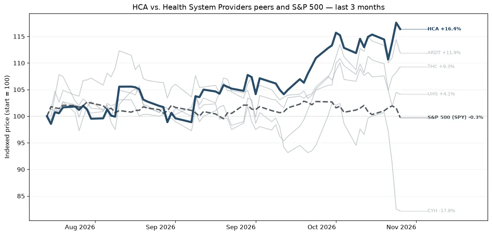

#### Reported Results

Q3 2026: EPS $7.22 vs. $6.63 est. (+8.95%); revenue $19.85B vs. $19.33B est. (+2.70%)

#### Earnings Call Summary

HCA Healthcare reported solid Q3 2026 demand growth, with same-facility adjusted admissions up 3% year-over-year compared to 2.3% year-to-date, marking the 22nd consecutive quarter of volume growth. Insured volumes grew faster than in the first half of the year, and a modest $50 million incremental net benefit was realized from Medicaid supplemental payment programs.

#### At a Glance

- **HCA Beats EPS and Revenue Estimates:** HCA Healthcare reported Q3 2026 Reported Adjusted EPS of $7.27, beating the estimated $6.627, and posted Reported Revenue of $19.849 billion, outperforming the estimated $19.328 billion.
- **Volume Metrics Rise Despite Surgical Headwinds:** Same facility admissions increased 2.7% and same facility equivalent admissions grew 3.0% year-over-year, though inpatient and outpatient surgical volumes declined 1.4% and 3.7% respectively.
- **Full-Year 2026 Guidance Tracks Upper Half:** Management anticipates full-year operating results to land in the upper half of its previously estimated 2026 guidance ranges, though early indications for 2027 point to flat growth due to upcoming headwinds.
- **Payer Mix Unfavorably Shifting to Uninsured:** The company experienced an approximate 19% year-over-year decline in exchange equivalent admissions as patients migrated nearly one-for-one to uninsured status, causing a $400 million hit to Q3 adjusted EBITDA.
- **Professional Fees Remain Major Cost Headwind:** Operating expenses were pressured by a 12% year-over-year surge in professional fees, primarily driven by higher costs in radiology and anesthesiology.

#### Key Moments from the Call

- **3m 47s — Medicaid Supplemental Benefit Volatility:** While full-year 2026 Medicaid supplemental benefits were favorably raised to $600 million–$800 million, HCA revealed a substantial $550 million to $650 million headwind for fiscal year 2027. This sharp reduction due to expiring grandfathered state programs creates near-term earnings volatility that caps 2027 growth expectations to flat year-over-year.
- **3m 47s — Flat 2027 Initial Profit Guidance:** Management's preliminary outlook that 2027 earnings will be generally consistent with 2026 figures will likely disappoint investors looking for sequential growth. The company must overcome severe commercial exchange shifts and falling Medicaid supplemental payments before returning to long-term compounding growth targets post-2027.
- **8m 6s — Severe Exchange-to-Uninsured Migration Drag:** A sharp 19% year-over-year decline in health insurance exchange volumes, coupled with an 80% direct migration into uninsured status, created a massive $400 million drag on Adjusted EBITDA in Q3 2026. This headwind will disappoint investors as full-year exchange headwinds are now trending at or slightly above the upper end of previous estimates.
- **9m 11s — Strong Cost Resiliency and Flat Sequential Margins:** Investors will be pleased with HCA's operational discipline, as same-facility cost per equivalent admission fell 40 basis points sequentially in a quarter that typically sees labor cost increases. This strong cost execution underpins management's confidence to guide full-year 2026 financial results into the upper half of their projected ranges.

<h3 id="earnings-iqv">Iqvia (IQV) +13.7% Last 3m</h3>

Iqvia is a global leader in clinical research and technology solutions for the life science industry. Formed in 2016 from the merger of Quintiles and IMS Health, it combined clinical trial services with extensive healthcare data and analytics. Its research and development solutions segment provides outsourced clinical development services spanning drug discovery, trial design, patient recruitment, site management, clinical testing, real-world studies, and the regulatory approval process. Its commercial solutions segment helps companies optimize product commercialization through analytics, technology, and outsourced sales and medical services. Together, Iqvia supports customers across the life science industry, and it serves biopharmaceutical firms, providers, payers, and policymakers.

**Reported:** October 27, 2026 · [Google Finance earnings page](https://www.google.com/finance/quote/IQV:NYSE?tab=earnings&hl=en)

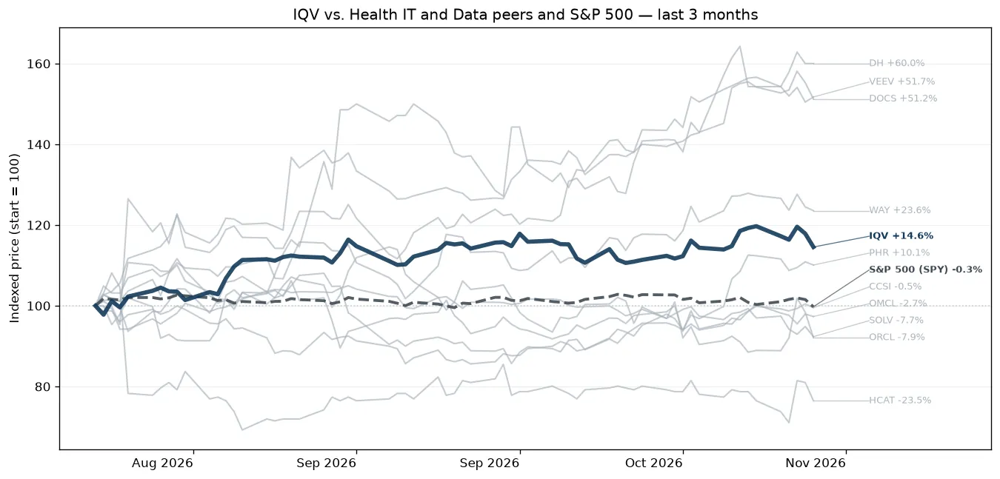

#### Reported Results

Q3 2026: EPS $3.34 vs. $3.28 est. (+1.96%); revenue $4.43B vs. $4.37B est. (+1.44%)

#### Earnings Call Summary

IQVIA delivered strong Q3 2026 results, with total revenue rising 8% year-over-year (8.6% at constant currency) to $4.428B, beating the guidance high end. Adjusted EBITDA grew 8.7% to $1.032B with a 20 basis point margin expansion, while adjusted diluted EPS grew 11.3% year-over-year to $3.34.

#### At a Glance

- **IQVIA Beats Revenue and Adjusted EPS:** IQVIA reported Q3 2026 revenue of $4,428 million, beating estimates of $4,365 million, while reported GAAP EPS was $2.10 and adjusted EPS reached $3.34, outperforming market expectations.
- **Strong R&amp;D Solutions Bookings Growth:** R&amp;D Solutions recorded net new bookings of $3.2 billion, up 15% year-over-year, which outpaced previous trends and highlights strong demand in clinical testing pipelines.
- **Full-Year Guidance Shifted Higher:** Management raised its full-year 2026 guidance, expecting revenue between $17.35 billion and $17.50 billion and adjusted diluted EPS between $12.90 and $13.00.
- **AI Implementation Drives Efficiency:** The company expects future margin expansion to be supported by the deployment of internal AI agents tasked with automating administrative and software development activities.
- **Market Records Muted Price Reaction:** Despite surpassing top and bottom-line estimates and lifting full-year outlooks, IQVIA&#x27;s stock responded with a modest slide during early post-announcement trading.

#### Key Moments from the Call

- **4m 59s — Record Clinical Bookings and Pipeline Visibility:** Net new clinical bookings reached a four-year high of $3.2 billion, up 15% year-over-year, pushing the trailing 12-month net bookings to $11.7 billion. This extended momentum indicates highly durable, predictable revenue visibility and reinforces the strength of outsourcing demand from both biotech and global pharma sponsors.
- **15m 36s — Backlog Cleaned via $2.1 Billion Adjustment:** Management removed $2.1 billion of staled, inactive clinical trials from its contracted backlog. This structural optimization ensures stronger pipeline transparency, and because it does not affect short-term revenue visibility, current 2026 growth expectations, or net new bookings metrics, it represents a step forward in financial operational hygiene.
- **16m 39s — Full-Year 2026 Guidance Raised:** IQVIA raised its full-year 2026 guidance across revenue, adjusted EBITDA, and adjusted EPS based on strong operation execution and higher operational win rates. This upward revision highlights the company's accelerating organic growth trends and strong momentum across its core business segments as it heads into the final quarter.
- **27m 43s — Operational Efficiencies Dynamic Margin Growth:** Despite a 70 basis point margin headwind caused by pass-through mixes in full-service solutions, IQVIA delivered a 20 basis point expansion in its adjusted EBITDA margin. This expansion was driven by 80 basis points of core operational improvements, highlighting successful internal productivity measures and digital tool integration.

<h3 id="earnings-cnc">Centene (CNC) +10.0% Last 3m</h3>

Centene is a managed care organization that focuses on government-sponsored healthcare plans, including Medicaid, Medicare, and the individual exchanges. Centene served 20 million medical members as of December 2025, mostly in Medicaid (about 64% of membership), the individual exchanges (about 28%), and Medicare (about 5%). The company also provides Medicare Part D pharmaceutical plans.

**Reported:** October 27, 2026 · [Google Finance earnings page](https://www.google.com/finance/quote/CNC:NYSE?tab=earnings&hl=en)

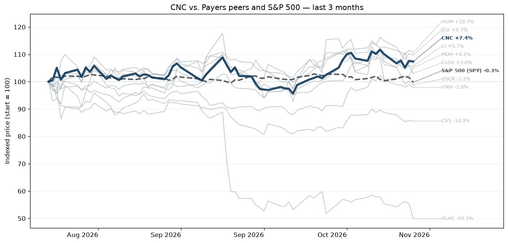

#### Reported Results

Q3 2026: EPS $0.58 vs. $0.10 est. (+496.65%); revenue $45.44B vs. $46.95B est. (-3.22%)

#### Earnings Call Summary

Centene reported Q3 2026 adjusted diluted EPS of $0.58, beating expectations due to strong performance in the Medicare segment and stable Medicaid and commercial results. Consequently, full-year 2026 adjusted EPS guidance was raised to greater than $5.20, up from the prior outlook of greater than $4.80.

#### At a Glance

- **Centene Misses Estimates on Top and Bottom Lines:** For Q3 2026, Centene Corporation reported a negative adjusted EPS of -$0.14, significantly missing the estimated positive adjusted EPS of $0.097. The company&#x27;s reported revenue of $45.44 billion also fell short of the projected $46.95 billion.
- **Health Benefits Ratio Meets Industry Expectations:** Centene maintained a consolidated Health Benefits Ratio (HBR) of 92.7% during the quarter, which was unchanged from the prior year&#x27;s period and came in better than internal management forecasts despite ongoing segment adjustments.
- **Full-Year Adjusted EPS Guidance Lifted:** Management raised its full-year 2026 adjusted diluted EPS guidance floor by $0.40 to greater than $5.20 per share, citing operational strength in its Medicare and Marketplace portfolios.
- **Medicare Advantage Recovery Runs Ahead of Schedule:** The company&#x27;s Medicare Advantage segment is now on track to reach a breakeven financial performance in 2026, achieving this key operational turnaround milestone an entire year earlier than originally projected.
- **Medicaid Rolls Contracting Amid Ongoing Eligibility Cuts:** Total company membership fell to 25.7 million as full-year Medicaid enrollment is projected to decrease by 8% to 9% due to continuous state-level eligibility redeterminations.

#### Key Moments from the Call

- **6m 44s — Accelerated Medicare Advantage Break-Even:** Medicare Advantage is now forecasted to achieve financial break-even in 2026, a year ahead of Centene's multi-year plan, driven by favorable medical cost experience and disciplined trend management.
- **14m 44s — Raised Full-Year Guidance:** Centene raised its full-year 2026 adjusted diluted EPS guidance to greater than $5.20 from greater than $4.80, reflecting Medicare strength, upgraded Marketplace margins, and reduced interest expenses.
- **20m 54s — 2027 Earnings Growth Baseline:** Management established a 2026 adjusted EPS jump-off baseline of $4.70, factoring out non-recurring items. The company projects adjusted EPS growth in 2027 relative to both the jump-off baseline and the revised $5.20 guidance.
- **25m 4s — Proactive Medicaid Rate Alignment:** Unlike the prior redeterminations period, states are actively and prospectively building explicit provisions into 2027 Medicaid rates to account for acuity shifts resulting from upcoming work requirements.

<h3 id="earnings-ilmn">Illumina (ILMN) +15.1% Last 3m</h3>

Illumina provides tools and services to analyze genetic material with life science and clinical lab applications. The company generates over 90% of its revenue from sequencing instruments, consumables, and services. Illumina&#x27;s high-throughput technology enables whole genome sequencing in humans and other large organisms. Its lower throughput tools enable applications that require smaller data outputs, such as viral and cancer tumor screening. Illumina also sells microarrays that enable lower-cost, focused genetic screening with primarily consumer and agricultural applications.

**Reported:** October 29, 2026 · [Google Finance earnings page](https://www.google.com/finance/quote/ILMN:NASDAQ?tab=earnings&hl=en)

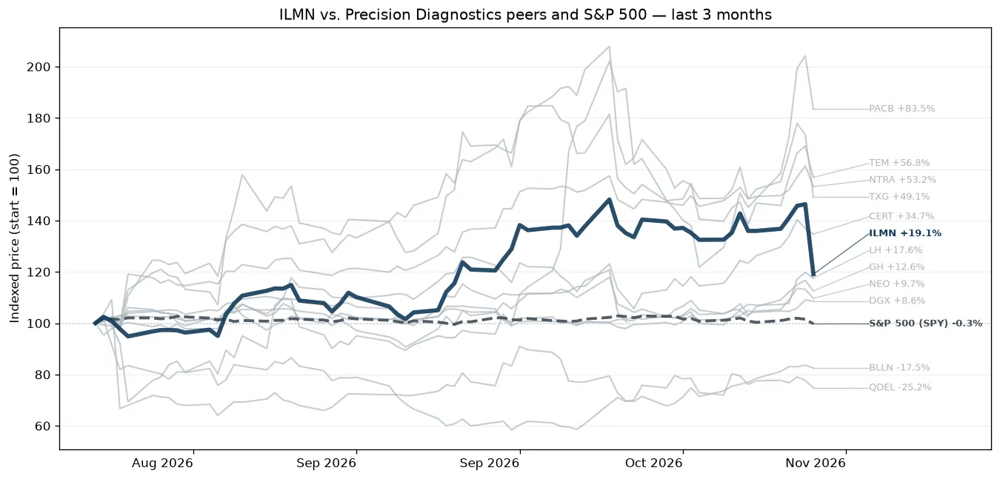

#### Reported Results

Q3 2026: EPS $1.44 vs. $1.36 est. (+6.08%); revenue $1.13B vs. $1.15B est. (-2.06%)

#### Earnings Call Summary

Illumina reported strong Q3 2026 results that beat its guidance range, driven by strong clinical sequencing demand and elevated NovaSeq X instrument placements. Diluted EPS grew 7% year-over-year to $1.44, non-GAAP operating margin reached 25%, and cash flow from operations was $419 million with $378 million in free cash flow.

#### At a Glance

- **EPS Beats but Revenue Misses Estimates:** Illumina reported Q3 2026 adjusted EPS of $1.43, beating the analyst estimate of $1.357, while its reported revenue of $1,129,000,000 slightly missed the expected $1,152,784,110.
- **Strong Placements Boost Core Platforms:** The company saw elevated clinical sequencing demand alongside robust placements of over 80 NovaSeq X instruments, driving a 6% growth in sequencing consumables to $792 million.
- **Full-Year 2026 Guidance Raised Higher:** Illumina raised its full-year 2026 outlook, increasing its adjusted EPS guidance to a range of $5.40 to $5.45 and upgrading full-year revenue expectations to between $4.64 billion and $4.66 billion.
- **Operating Margins Expand Significantly:** The non-GAAP operating margin, excluding tariff refunds, improved to 25.0% for the quarter, outperforming previous company guidance by 100 basis points due to operational efficiencies.
- **Shares Decline Post-Earnings Announcement:** Despite lifting full-year profit and sales forecasts, Illumina&#x27;s stock experienced a post-earnings drop of roughly 16% as investors reacted to the core revenue miss and valuation concerns.

#### Key Moments from the Call

- **4m 1s — AI and Multi-Omic Commercial Progress:** The company reported growing commercial traction and revenue generation from its Billion Cell Atlas and BioInsight ecosystems. GSK joined as the newest consortium partner, validating Illumina's strategy to monetize standardized multi-omic datasets for AI drug discovery.
- **11m 57s — Diminishing NovaSeq X Pricing Headwinds:** With high-throughput volume conversion hitting 84% overall, management noted the transition is largely finished for research markets. This minimizes near-term headwinds and ensures pricing pressures will drop significantly in 2027.
- **16m 43s — Full-Year 2026 Guidance Increase:** Illumina raised full-year 2026 revenue guidance to $4.64B–$4.66B and EPS guidance to $5.40–$5.45. This positive revision reflects strong Q3 execution and enhanced expectations for Q4 sequencing consumables revenue from an expanding NovaSeq X installed base.
- **45m 31s — Greater China Returns to Growth:** Despite ongoing macroeconomic and geopolitical uncertainties regarding trade restrictions and the Unreliable Entity List, Illumina successfully returned to positive year-over-year growth in Greater China during the third quarter.

<h3 id="earnings-lh">Labcorp Holdings (LH) +16.9% Last 3m</h3>

Labcorp is one of the nation&#x27;s two largest independent clinical laboratories, with roughly 20% of the independent lab market. The company operates approximately 2,000 patient-service centers, offering a broad range of 5,000 clinical lab tests, ranging from uncomplicated routine blood and urine screens to complex oncology and genomic testing.

**Reported:** October 28, 2026 · [Google Finance earnings page](https://www.google.com/finance/quote/LH:NYSE?tab=earnings&hl=en)

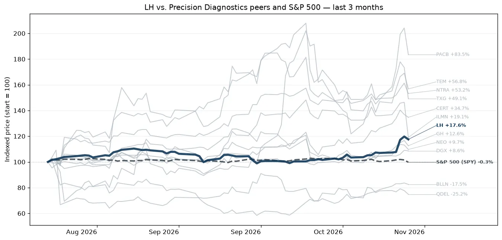

#### Reported Results

Q3 2026: EPS $4.78 vs. $4.64 est. (+2.94%); revenue $3.81B vs. $3.76B est. (+1.35%)

#### Earnings Call Summary

Labcorp reported strong Q3 2026 financial results with revenue growing 7% year-over-year to $3.8B, driven by healthy volume growth. Enterprise adjusted operating income (AOI) margin expanded 60 basis points to 15%, and adjusted EPS increased 14.5% to $4.78. Free cash flow for the quarter reached $412M.

#### At a Glance

- **Labcorp Beats Financial Estimates Comfortably:** Labcorp reported a quarterly revenue of $3.81 billion, beating expectations of $3.76 billion, while its reported adjusted EPS reached $4.78, ahead of the $4.64 consensus estimate.
- **Segments Achieve Margin and Volume Expansion:** The Diagnostics segment revenue grew 6.5% to $2.9 billion with 4.4% organic growth, while Biopharma Laboratory Services rose 8.5% to $867 million, achieving 180 basis points of adjusted operating margin expansion.
- **Full-Year Guidance Shifted Upward Significantly:** Management raised its full-year 2026 adjusted EPS guidance to a range of $18.30 to $18.70, up $0.18 at the midpoint, reflecting strong business momentum despite currency headwinds.
- **Aggressive M&amp;A Integration Strategy Advanced:** The company announced or finalized four key strategic acquisitions, including assets from BioReference Health and Myriad Genetics, which are expected to be accretive to adjusted EPS within the first year.
- **Productivity Initiative Offsets Regulatory Pressures:** Labcorp confirmed its Launchpad initiative is tracking to deliver $125 million in full-year savings, serving as a vital lever to counter upcoming PAMA reimbursement headwinds expected in 2027.
- **Stock Rises Near Yearly Highs:** Following the earnings beat and boosted guidance, Labcorp stock rose over 9% in premarket trading, moving close to its 52-week high.

#### Key Moments from the Call

- **10m 44s — Subsequent Strategic Acquisitions Announced:** Management highlighted four strategic acquisitions—MLM Medical Labs, BioReference Health assets, Myriad Genetics' prenatal business, and Millennium Health. Investors will appreciate that each transaction meets Labcorp's criteria of being accretive to adjusted EPS in year one and returning the cost of capital by year three.
- **22m 18s — Full-Year 2026 Outlook Increased:** Labcorp raised its full-year 2026 guidance due to robust organic performance in both core segments. The adjusted EPS midpoint was increased by $0.18 to a range of $18.30–$18.70, pleasing investors with an implied 12.5% year-over-year growth rate despite facing $10M in foreign currency headwinds.
- **28m 40s — PAMA Reimbursement Headwinds Defended:** Analysts heavily focused on the proposed PAMA fee schedule cuts, which present a projected $125M headwind in 2027. Management reassured investors by reaffirming its long-term 2026–2029 outlook, citing sustainable offsets through its LaunchPad cost-savings initiatives, volume growth, and business development synergies.
- **49m 27s — Biopharma Services Bookings Acceleration:** The Biopharma segment delivered a strong net book-to-bill ratio of 1.13 in Q3, fueled by robust global pharmaceutical demand in oncology and an emerging expansion into cardiometabolic clinical trials, ensuring strong long-term visibility into multi-year revenue conversion.

<h3 id="earnings-thc">Tenet Health (THC) +7.2% Last 3m</h3>

Tenet Healthcare is a Dallas-based healthcare services organization. It operates acute and specialty hospitals (50 as of December 2025) and hundreds of ambulatory surgery centers and other outpatient facilities across the US, primarily in the South. Through its Conifer segment, Tenet also provides revenue cycle management solutions.

**Reported:** October 29, 2026 · [Google Finance earnings page](https://www.google.com/finance/quote/THC:NYSE?tab=earnings&hl=en)

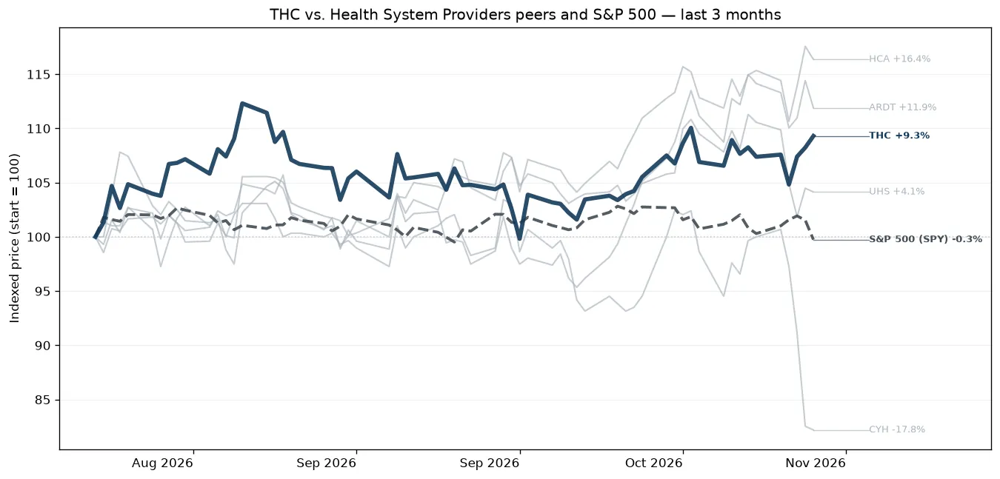

#### Reported Results

Q3 2026: EPS $6.64 vs. $4.68 est. (+42.01%); revenue $5.63B vs. $5.51B est. (+2.19%)

#### Earnings Call Summary

Tenet Healthcare reported Q3 2026 net operating revenues of $5.6 billion and consolidated adjusted EBITDA of $1.355 billion. Adjusted diluted EPS increased 80% year-over-year to $6.64, driven by a strong core business growth trajectory, which delivered an adjusted EBITDA margin of 21.8% and 10% growth in adjusted EBITDA over Q3 2025.

#### At a Glance

- **Tenet Beats Q3 Earnings Estimates:** Tenet Healthcare reported Q3 2026 reported revenue of $5,631,000,000, beating estimates of $5,510,471,140, while reported adjusted EPS came in at $12.41, vastly outperforming the estimated $4.676.
- **USPI Drives Segment Growth KPIs:** United Surgical Partners International (USPI) experienced a 9.1% year-over-year increase in adjusted EBITDA and a 6.1% increase in revenue per case, supported by a 12.8% surge in total joint replacements.
- **Full Year Guidance Raised Significantly:** Tenet raised its full-year 2026 adjusted EBITDA outlook to a range of $5.05 billion to $5.20 billion, an upward adjustment driven mostly by strong core operating performance and non-recurring contract items.
- **Conifer Contract Shifting Benefits EBITDA:** The company recognized a temporary $147 million adjusted EBITDA tailwind during the quarter due to the accelerated expense reductions and shifting timing of its Conifer contract transitions.
- **Aggressive Share Buybacks and Refinancing:** Tenet utilized strong free cash flow to repurchase $255 million in shares during the quarter and successfully refinanced $2 billion in debt, extending major maturities out to 2028.

#### Key Moments from the Call

- **5m 22s — Initial 2027 Outlook Confidence:** Despite facing a $450 million headwind from non-recurring Conifer contract transitions, management expressed confidence that the enterprise will deliver positive core adjusted EBITDA growth in 2027. This reassurance is supported by steady Hospital volume demand, strict cost efficiencies, and continued asset expansion within USPI.
- **9m 41s — Conifer Transition Financial Impact:** Tenet recorded a $147 million net benefit in Q3 2026 from Conifer transition activities, including a $97 million revenue recognition timing shift from Q4 and $50 million in accelerated EBITDA from early expense reductions. Total 2026 Conifer transition contributions are expected to reach $450 million and will not recur in 2027.
- **10m 28s — Robust Free Cash Flow and Buybacks:** Tenet generated $1.1 billion in adjusted free cash flow during Q3 2026, bringing the year-to-date total to $2.5 billion. The company has aggressively deployed capital for shareholder benefit, repurchasing 8 million shares year-to-date for $1.615 billion, while maintaining a strong leverage ratio of 2.11x EBITDA.
- **12m 6s — Full-Year 2026 Guidance Raised:** Management increased full-year 2026 adjusted EBITDA guidance by $195 million at the midpoint to a range of $5.05 billion–$5.20 billion. Revenue guidance was also raised by $50 million at the midpoint, reflecting supplemental Medicaid revenues and transition outperformance, pleasing investors with continued guidance momentum.

<h3 id="earnings-ehc">Encompass Health (EHC) +22.4% Last 3m</h3>

Encompass Health Corp provides post-acute healthcare services in the United States through a network of inpatient rehabilitation hospitals, which is the company&#x27;s sole segment. Inpatient rehabilitation contributes the majority of the firm&#x27;s revenue and provides specialized rehabilitative treatment through a network of inpatient hospitals. The company&#x27;s inpatient rehabilitation hospitals provide a higher level of rehabilitative care to patients who are recovering from conditions such as stroke and other neurological disorders, cardiac and pulmonary conditions, brain and spinal cord injuries, complex orthopedic conditions, and amputations.

**Reported:** October 29, 2026 · [Google Finance earnings page](https://www.google.com/finance/quote/EHC:NYSE?tab=earnings&hl=en)

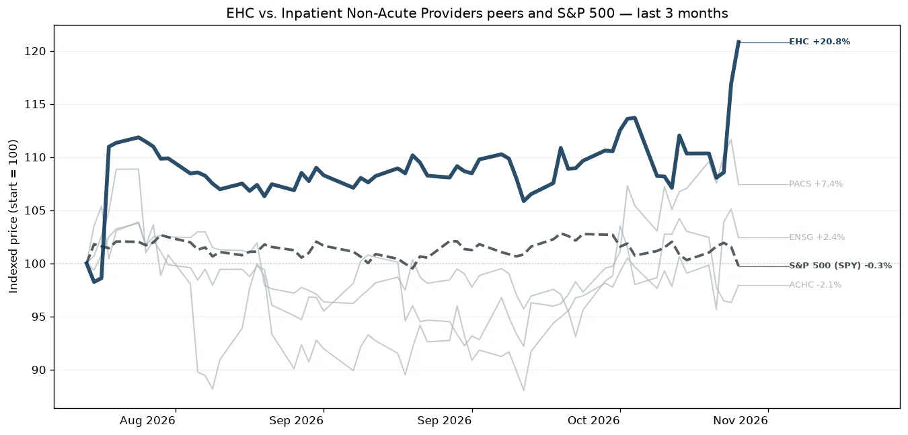

#### Reported Results

Q3 2026: EPS $1.52 vs. $1.36 est. (+11.92%); revenue $1.61B vs. $1.60B est. (+0.49%)

#### Earnings Call Summary

Encompass Health reported strong Q3 2026 results, with revenue growing 8.9% to $1.61 billion, adjusted EBITDA increasing 15.5% to $346.6 million, and adjusted EPS up 23.6% to $1.52. High clinical quality was maintained, achieving an 84.7% discharge-to-community rate.

#### At a Glance

- **Encompass Health Beats Top and Bottom Lines:** Encompass Health reported a strong third quarter with reported adjusted EPS of $1.50 beating the estimated $1.358, and reported revenue of $1,609.50 million outpacing the estimated $1,601.66 million.
- **Discharge Metrics Drive Operational Success:** The company&#x27;s performance was supported by a 5.7% increase in total discharges and a 4% increase in net revenue per discharge, driven primarily by higher patient acuity metrics.
- **Management Increases Full-Year Guidance Outlook:** On the back of strong operational momentum, Encompass Health raised its full-year 2026 adjusted EPS guidance to a range of $6.23 to $6.37, up from the previous outlook of $6.02 to $6.25.
- **Hospital Capacity Expansion Strategy Continues:** The firm expanded its long-term development pipeline, which now features 15 announced new hospital projects with 654 beds planned for openings beyond 2026.
- **Market Welcomes Robust Financial Performance:** Investors reacted positively to the earnings beat and boosted guidance, sending Encompass Health shares up 5.67% to approach its 52-week high.
- **Billing System Triggers Temporary Bad Debt:** Bad debt expense elevated to 2.7% of revenue during the third quarter due to a temporary billing disruption from an Oracle patient billing system conversion.

#### Key Moments from the Call

- **15m 12.590000000000032s — Full-Year 2026 Guidance Increase:** Encompass Health raised its 2026 guidance following strong third-quarter operational efficiencies and discharge volume momentum, signaling continued robust market demand and solid financial execution to investors.
- **19m 18.730000000000018s — Medicare Advantage Admit and Appeal Success:** A pilot strategy tackling Medicare Advantage denials yielded an 87% overturn rate in the company's favor. The initiative generated 36% MA discharge growth in pilot markets and is expanding system-wide for stroke diagnoses.
- **29m 42.75s — Review Choice Demonstration Expansion:** Management addressed concerns regarding the expansion of CMS's Review Choice Demonstration to 75 more hospitals in 2027. While noting high compliance confidence, they highlighted potential administrative burdens for the reviewer, Palmetto.
- **32m 2s — System Conversion Disruption Impacts Bad Debt:** A legacy patient billing system migration to Oracle caused a one-off operational disruption, temporarily pushing Q3 bad debt expense to 2.7%. Management reassured investors that collections will normalize by year-end.

<h3 id="earnings-btsg">BrightSpring Health Services (BTSG) +12.0% Last 3m</h3>

BrightSpring Health Services Inc is a home and community-based healthcare services platform, focused on delivering complementary pharmacy and provider services to complex patients. Its platform delivers clinical services and pharmacy solutions across Medicare, Medicaid, and commercially insured populations. Its segments include Pharmacy Solutions, Provider Services, and others. It generates the majority of its revenue from the Pharmacy Solutions segment.

**Reported:** October 30, 2026 · [Google Finance earnings page](https://www.google.com/finance/quote/BTSG:NASDAQ?tab=earnings&hl=en)

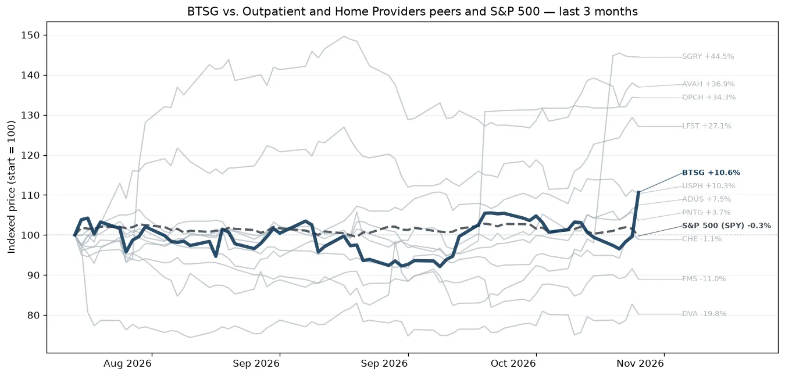

#### Reported Results

Q3 2026: EPS $0.54 vs. $0.47 est. (+14.67%); revenue $4.21B vs. $3.87B est. (+8.75%)

#### Earnings Call Summary

BrightSpring Health Services reported strong Q3 2026 results, with total revenue increasing 26% year-over-year to $4.2 billion and adjusted EBITDA growing 42% to $228 million. EPS surged 80% to $0.54 compared to the prior year, while cash flow from operations surpassed $200 million, bringing net leverage down to 1.79x.

#### At a Glance

- **BrightSpring Beats Revenue and Misses EPS:** BrightSpring reported Q3 2026 revenue of $4.21 billion, exceeding the estimated $3.87 billion, while reported adjusted EPS came in at $0.45, falling slightly short of the estimated $0.47.
- **Strong Double-Digit KPI Segment Growth:** The Pharmacy Solutions segment revenue expanded 26% to $3.7 billion and Provider Services grew 31% to $481 million, showing strong momentum over historical trends.
- **Management Ups Full-Year 2026 Guidance:** BrightSpring raised its full-year 2026 adjusted EBITDA outlook to a range of $850 million to $860 million and increased its revenue expectations to between $15.9 billion and $16.125 billion.
- **Acquisitions and Volume Drive Pharmacy Results:** Growth within Pharmacy Solutions was driven by 29% script volume growth and 19 branded LDD launches, while the provider segment benefited from integration of Amedisys and LHC assets.
- **Significant Deleveraging and Improved Margins:** The company reduced its net leverage ratio down to 1.7x from 2.15x sequentially while expanding its adjusted EBITDA margin by 60 basis points to 5.4%.
- **Positive Stock Reaction on Strong Results:** BrightSpring shares jumped 11.08% during regular trading hours to close at $66.89 as the market reacted favorably to strong volume performance and raised guidance.

#### Key Moments from the Call

- **15m 7s — Reiterated Upwardly Leveraged 2027 Organic Growth Outlook:** The company reiterated its Analyst Day framework targeting 15%-20% organic adjusted EBITDA growth for 2027. Crucially, executives highlighted that this growth rate will now apply to a significantly higher 2026 EBITDA baseline, signaling sustained operational momentum that should boost long-term investor confidence.
- **15m 27s — Specialty Script Growth Beats Operational Targets:** Specialty pharmacy recorded an impressive 29% script growth rate driven by a strong pipeline of 19 year-to-date branded LDD launches. Annualized revenue contribution from 2026 launches is outperforming 2025 metrics, reassuring analysts regarding the segment's competitive moat and future growth upside.
- **22m 10s — Raised Full-Year 2026 Financial Guidance:** Management increased its full-year adjusted EBITDA outlook to $850M-$860M and total revenue to $15.9B-$16.125B. This beat expectations and reflects strong execution across segments, pleasing investors with robust double-digit top- and bottom-line growth over 2025 metrics.
- **45m 10s — Expansion Into Medicare Risk-Free LEAD ACO Program:** BrightSpring announced its selection into the new Medicare LEAD ACO program starting January 1. This strategic primary care push provides material, low-risk shared savings upside with zero downside risk, while positioning the company for meaningful economic contributions by 2028.

<h3 id="earnings-dva">Davita (DVA) -21.9% Last 3m</h3>

DaVita is one of the largest providers of dialysis services in the United States, boasting a market share of about 35%. The firm operates over 3,200 facilities worldwide, mostly in the US, and treats about 300,000 patients annually. Government payers dominate US dialysis reimbursement. DaVita receives about two-thirds of US sales at government (primarily Medicare) reimbursement rates, with the remainder coming from commercial insurers. While commercial insurers represent only about 10% of US patients treated, they represent nearly all of the profits generated by DaVita in the US dialysis business.

**Reported:** October 29, 2026 · [Google Finance earnings page](https://www.google.com/finance/quote/DVA:NYSE?tab=earnings&hl=en)

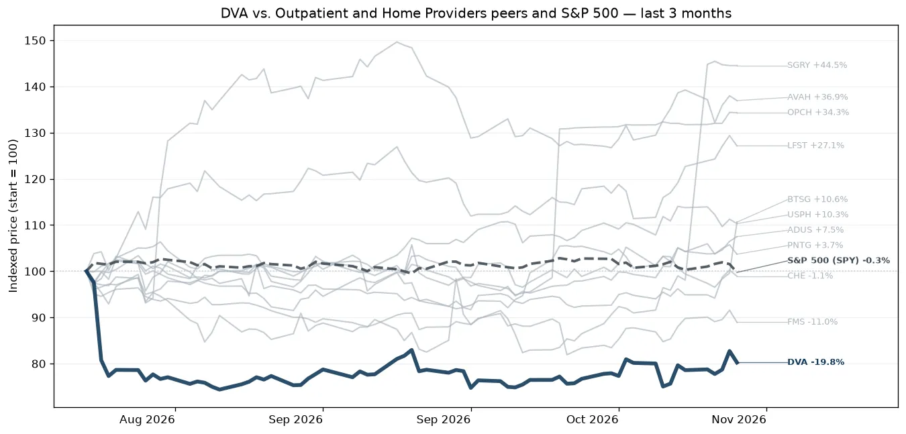

#### Reported Results

Q3 2026: EPS $3.82 vs. $3.57 est. (+6.86%); revenue $3.58B vs. $3.51B est. (+2.01%)

#### Earnings Call Summary

CEO Javier Rodriguez highlighted fluid management advancements as key mortality improvement drivers, noting specialized clinical protocols and digital tools led to a 10% improvement in achieving optimal fluid removal, a 5% improvement in inter-treatment weight gain management, and a nearly 5-pound reduction in average patient weight.

#### At a Glance

- **DaVita Beats Revenue and EPS Estimates:** DaVita reported Q3 2026 revenue of $3.58 billion, beating the estimated $3.51 billion, while its reported adjusted EPS of $3.40 fell short of the estimated $3.58.
- **Treatment Volumes See Positive Rebound:** U.S. dialysis treatment volumes increased by 1.2% year-over-year, showing a strong recovery compared to a 1.5% decline in the same quarter last year.
- **Full Year Guidance Narrowed and Lifted:** Management narrowed its full-year 2026 adjusted EPS guidance to a range of $14.30 to $15.20, effectively raising the lower limit from its previous forecast.
- **Integrated Kidney Care Delivers Outperformance:** The Integrated Kidney Care segment significantly beat expectations, leading the company to raise its full-year outlook for the unit by $25 million to at least $65 million.
- **China Impairment and Tech Costs Drag:** Earnings were heavily pressured by a $62 million non-cash impairment charge in its China business alongside elevated IT modernization expenditures.
- **Stock Declines Despite Financial Beats:** Shares of DaVita dropped roughly 3% following the release as investors focused on compressed margins from rising patient care and technology costs.

#### Key Moments from the Call

- **9m 12s — IKC Guidance Increase:** Investors will be pleased by the $25 million increase in 2026 IKC adjusted operating income guidance to at least $65 million. The expansion demonstrates the business's scalable clinical and actuarial capabilities, growing maturity, and strong value-based performance, validated by a new upstream chronic kidney disease partnership with Humana.
- **10m 17s — Narrowed 2026 Outlook:** The narrowing of full-year 2026 adjusted operating income and EPS guidance represents a balanced update. While IKC is outperforming expectations, the gains are being counterbalanced by heavier-than-expected investments in modernizing U.S. dialysis technology infrastructure, which acts as a near-term drag on earnings but is expected to decelerate going forward.
- **19m 47s — CMS ESRD Final Rule Impact:** Analysts heavily focused on the newly finalized CMS ESRD rule, which sets a headline 3.5% rate increase for large dialysis organizations. Management estimates a positive full-year 2027 net impact of 1.5% to 2%, but cautioned that post-TDAPA adjustments for DEFENCATH will cause the rate to decline significantly after the first quarter.
- **30m 17s — Initial 2027 Outlook Elements:** Management shared preliminary puts and takes for 2027, anticipating higher volume growth than 2026 and lower pharmaceutical binder costs. However, these tailwinds will face ongoing pressure from commercial ACA exchange mix declines, while heavily scrutinized IT spending growth will decelerate rather than outright decline.

<h3 id="earnings-ensg">The Ensign Group (ENSG) +1.9% Last 3m</h3>

Ensign Group Inc provides post-acute healthcare services in the United States. Its regional subsidiaries oversee skilled nursing, assisted living, home health and hospice, mobile ancillary, and urgent care operations. Medicare and Medicaid programs contribute majority of revenue received for Ensign&#x27;s services. The firm operates through two segments, Skilled services, and Standard Bearer. The skilled services segment includes the operation of skilled nursing facilities and rehabilitation therapy services. The Standard Bearer segment comprises of properties owned by the company through its captive REIT and leased to skilled nursing and assisted living operations. The majority of the revenue is generated from the skilled services segment.

**Reported:** October 28, 2026 · [Google Finance earnings page](https://www.google.com/finance/quote/ENSG:NASDAQ?tab=earnings&hl=en)

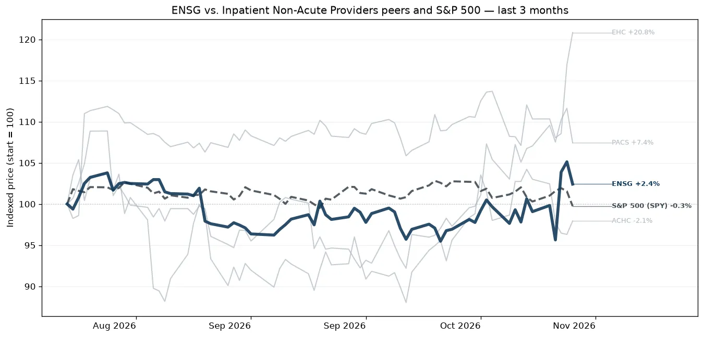

#### Reported Results

Q3 2026: EPS $2.03 vs. $1.97 est. (+3.09%); revenue $1.48B vs. $1.51B est. (-1.45%)

#### Earnings Call Summary

The Ensign Group reported strong operational metrics for Q3 2026, with same-store and transitioning occupancy reaching 84.1% and 86.1%, respectively. Driven by outcomes, same-store skilled mix revenue grew 10.7% and skilled days increased 7.2% year-over-year. Payer categories grew across the board, with Medicare revenue up 11.1% and managed care revenue up 9.1%.

#### At a Glance

- **Ensign Misses EPS and Revenue Estimates:** The Ensign Group reported a quarterly Adjusted EPS of $1.76, falling short of the estimated $1.969, while its reported revenue of $1,484,002,000 also missed the consensus expectation of $1,505,905,920.
- **Occupancy Rates See Solid Improvement:** The company&#x27;s operational performance improved from past quarters, with same-store occupancy reaching 84.1% and transitioning occupancy hitting 86.1%, driven by solid demographic demand and clinical results.
- **Full-Year Earnings Guidance Is Raised:** Management boosted its full-year 2026 adjusted earnings guidance to a range of $7.94 to $8.02 per diluted share and raised the lower end of its revenue guidance to $5.89 billion, signaling strong confidence in core operations.
- **Aggressive Expansion Through Key Acquisitions:** Ensign added 22 new operations during and since the third quarter, extending its strategic reach into new operational territories including a notable entry into the Florida market.
- **Turnaround Timelines for Florida Assets:** Management cautioned that the newly acquired facilities in Florida are currently turnaround assets, which could take a year or more to ramp up occupancy and contribute materially to overall corporate earnings.
- **Stock Surges on Positive Outlook:** Despite the top- and bottom-line misses against initial estimates, the stock jumped nearly 10% following the release as investors prioritized the full-year guidance raise and underlying core business strengths.

#### Key Moments from the Call

- **12m 15s — Full-Year 2026 Guidance Upgraded:** The Ensign Group raised its full-year 2026 EPS guidance to $7.94–$8.02 and tightened revenue guidance to $5.89B–$5.92B. This increase reflects strong momentum in core occupancy and skilled mix, boosting investor confidence by showcasing a projected 21.5% earnings growth over 2025.
- **15m 18s — Strategic Entry into Florida Market:** Ensign announced its entry into Florida with nine challenging turnaround operations. Investors will appreciate this expansion into one of the nation's largest healthcare markets under experienced internal leadership, though executives noted the properties will take time to become financially accretive.
- **28m 11s — Robust Balance Sheet and Dry Powder:** The company reported over $1 billion in available liquidity, including $337.6 million in cash and $730 million under its credit line, while maintaining low leverage at 2x net debt-to-EBITDA. This financial strength pleases investors by ensuring sustained capacity for aggressive M&A.
- **38m 34s — Turnaround Nature of Recent M&A:** Management addressed analyst models by clarifying that recent Texas and Florida acquisitions are underperforming turnaround properties that are currently non-accretive. This manages investor expectations, affirming that core business strength drives near-term guidance while acquisitions provide long-term upside.

<h3 id="earnings-uhs">Universal Health Services (UHS) +4.5% Last 3m</h3>

Universal Health Services primarily offers healthcare services through its behavioral health centers, acute care hospitals, and related outpatient facilities. As of late 2025, the company operated 346 inpatient behavioral health centers, 29 acute care hospitals, and many supportive outpatient facilities. Its operations are concentrated in the US, particularly in Nevada (21% of 2025 operating profits), Texas (19%), and California (13%), although it does have some exposure to the UK behavioral health market (6% of 2025 sales) too. While its acute care services account for over 55% of revenue, the behavioral health centers sport higher margins and account for over 55% of pretax profits.

**Reported:** October 28, 2026 · [Google Finance earnings page](https://www.google.com/finance/quote/UHS:NYSE?tab=earnings&hl=en)

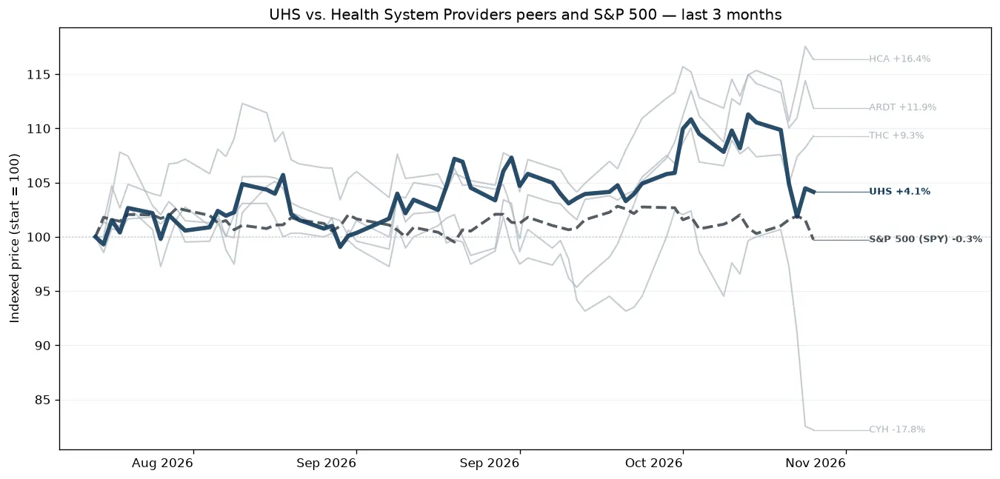

#### Reported Results

Q3 2026: EPS $5.22 vs. $5.15 est. (+1.26%); revenue $4.73B vs. $4.71B est. (+0.51%)

#### Earnings Call Summary

Universal Health Services reported Q3 2026 adjusted EPS of $5.22, an 8% decline year-over-year. Adjusted EBITDA less NCI fell to $625 million from $671 million in Q3 2025. Results included $47 million in supplemental Medicaid benefits, partially offset by $26 million in litigation reserves and $8.5 million in Talkspace transaction costs.

#### At a Glance

- **UHS Beats Revenue and EPS Estimates:** Universal Health Services reported an adjusted EPS of $5.22, beating the estimated $5.155, while its quarterly revenue reached $4,733,352,000, slightly outperforming the predicted $4,709,515,580.
- **Same-Store Sales Show Volume Acceleration:** The company&#x27;s same-store sales rose 4.7% year-over-year, which represents a noticeable acceleration from the 2% same-store sales growth recorded in the prior year&#x27;s third quarter.
- **Guidance Iterated Toward Lower End:** Management reiterated its full-year 2026 financial and operating forecast ranges but expects final results to land toward the lower end of those guidance ranges due to near-term headwinds.
- **De Novo Facility Openings Drag:** Operational results were negatively impacted by a slower-than-anticipated maturation and ramp-up of new de novo hospitals in Washington, D.C. and Florida.
- **Future Regulatory Pressures Cloud 2027:** Looking ahead, the company anticipates a potential $175 million to $200 million headwind in fiscal year 2027 resulting from reductions in Medicaid supplemental payments.
- **Surgical Volumes Soften From Shifting Mix:** Acute care pricing experienced pressure due to a negative mix shift from surgical to medical admissions as procedures migrate to ambulatory surgery centers.

#### Key Moments from the Call

- **7m 30s — Lower-End Guidance and De Novo Headwinds:** Management expects 2026 results to hit the lower end of guidance, disappointing investors. Slower volume ramp-ups at Palm Beach Gardens and Cedar Hill de novo hospitals are delaying margin improvements, while Cedar Hill's operational break-even has been pushed out from Q4 2026 to the first half of 2027.
- **9m 44s — Surgical Volume Shift Acceleration:** A 0.7% decrease in same-facility surgeries pressured acute care pricing, revealing an accelerated shift of elective procedures (like GI and orthopedics) out of hospitals into alternative settings. This negative medical-to-surgical mix shift creates a structural pricing drag that may concern investors looking for high-margin revenue.
- **19m 46s — Substantial 2027 Medicaid Supplemental Headwinds:** Management disclosed a significant projected 2027 regulatory headwind of $175 million to $200 million from reductions to Medicaid supplemental funding and non-repeating prior year DPP benefits. This clarity on upcoming financial pressures provides a realistic, though challenging, headwind for investors modeling next year's earnings potential.
- **32m 50s — Talkspace Revenue Synergy Potential:** The integration of Talkspace, closed in August, is progressing with a focus on capturing revenue synergies over the next 12 to 24 months. Investors will be pleased by the strategy to build a unique behavioral continuum of care, driving higher-margin commercial and Medicare outpatient volumes to mitigate Medicaid cuts.

<h3 id="earnings-tem">Tempus AI (TEM) +64.6% Last 3m</h3>

Tempus AI Inc is a technology company. It has built the Tempus Platform, which comprises both a technology platform to free healthcare data from silos and an operating system to make the resulting data useful. Its Intelligent Diagnostics use AI, including generative AI, to make laboratory tests more accurate, tailored, and personal.

**Reported:** November 2, 2026 · [Google Finance earnings page](https://www.google.com/finance/quote/TEM:NASDAQ?tab=earnings&hl=en)

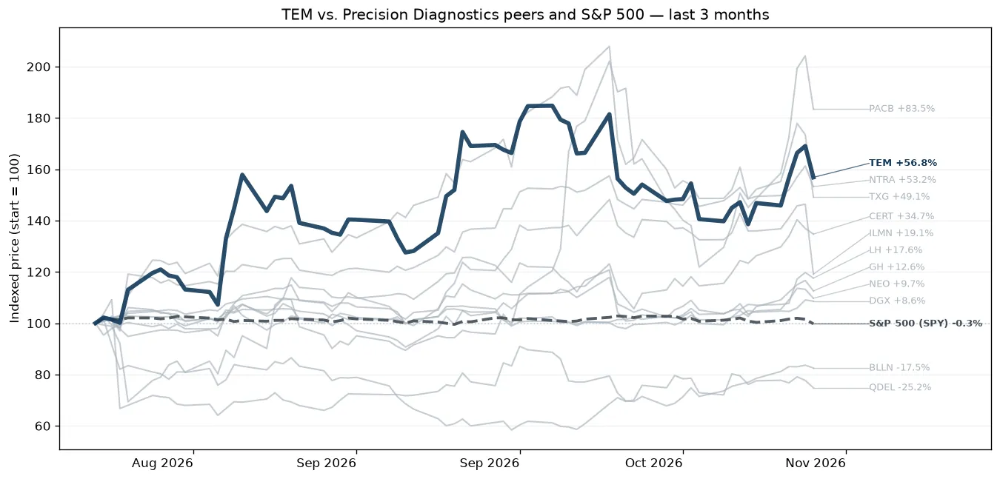

#### Reported Results

Q3 2026: EPS $0.07 vs. -$0.08 est. (+191.53%); revenue $411.54M vs. $409.30M est. (+0.55%)

#### Earnings Call Summary

Tempus AI reported strong Q3 2026 results, with total revenue rising 23% year-over-year to $411.5 million, beating the estimated $409.3 million. EPS of $0.07 beat expectations of a $0.076 loss. Growth was driven by a 32% increase in oncology unit volume and a 33% revenue increase in the data and applications business.

#### At a Glance

- **Tempus AI Outperforms Earnings Estimates:** Tempus AI reported a Reported Adjusted EPS of $0.00, beating the Estimated Adjusted EPS of -$0.076, while Reported Revenue reached $411.537 million, surpassing expectations of $409.295 million.
- **Oncology and Data Segments Expand:** The company&#x27;s Oncology business saw unit volume growth accelerate to 32%, while the Data &amp; Applications segment achieved robust revenue growth of 33% year-over-year.
- **Full-Year Revenue Forecast Raised Higher:** Management boosted its full-year 2026 revenue guidance to a range of $1.60 billion to $1.605 billion, while reaffirming its full-year Adjusted EBITDA expectation of approximately $65 million.
- **First Positive Adjusted EBITDA Quarter:** Tempus AI hit a key financial milestone by generating $25.6 million in positive Adjusted EBITDA, marking its first profitable quarter on an adjusted basis as gross profit outpaced historical tech investments.
- **Strategic Collaborations Drive Diversification Moat:** The company secured multi-year data licensing partnerships with Merck, Moderna, and Bristol Myers Squibb, expanding its data-driven offerings beyond oncology into neurological disease areas like Alzheimer&#x27;s disease.
- **Stock Surges on Strong Performance:** Shares of Tempus AI climbed as much as 11% in Monday trading following the market reaction to the top- and bottom-line beats and raised annual revenue target.

#### Key Moments from the Call

- **5m 26s — Positive EBITDA Inflection:** Tempus generated $25.6 million in Adjusted EBITDA this quarter, successfully turning the corner toward sustained profitability. Investors will be pleased that expanding gross margins are outpacing investments, showcasing strong financial leverage despite absorbing near-term operational losses from the upcoming Personalis acquisition.
- **8m 34s — Hereditary Segment Recovery Dynamics:** The hereditary cancer testing segment experienced growth stabilization as it lapped tough year-over-year comparables from a 2025 volume surge. September and October unit growth rebounded to low double digits, reassuring investors of stable performance within a highly under-penetrated market.
- **10m 17s — Oncology Average Selling Price Headwinds and Tailwinds:** Management announced an expansion of FDA approval for the xT test to include tumor-only pricing, kicking in on January 1, 2027. This shift provides an estimated $80 million uplift to oncology average selling prices (ASPs) in 2027, alleviating investor concerns regarding macro lab fee headwinds.
- **22m 29s — Transition to High-Margin AI Modeling Subscriptions:** The data business is successfully migrating biopharma customers from episodic data licensing to sticky, multi-year subscriptions. By connecting its Lens software platform to private GPU clusters, Tempus locks clients into its environment for advanced AI modeling, enhancing multi-year revenue visibility through 2029.

<h3 id="earnings-che">Chemed (Vitas) (CHE) +0.5% Last 3m</h3>

Chemed Corp purchases, operates, and divests subsidiaries engaged in diverse business activities to maximize shareholder value. The company operates in the following segments: VITAS and Roto-Rooter. The VITAS segment generates the majority of the firm&#x27;s revenue and provides hospice and palliative care services to patients with terminal illnesses through a network of physicians, registered nurses, home health aides, social workers, and volunteers. The Roto-Rooter segment provides plumbing, drain cleaning, water restoration, and related services to residential and commercial customers.

**Reported:** October 28, 2026 · [Google Finance earnings page](https://www.google.com/finance/quote/CHE:NYSE?tab=earnings&hl=en)

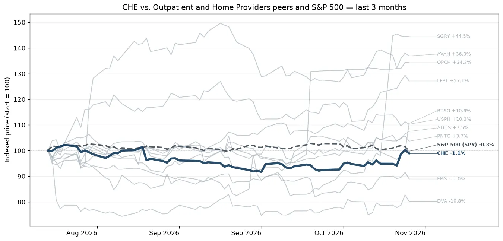

#### Reported Results

Q3 2026: EPS $6.75 vs. $6.44 est. (+4.89%); revenue $690.94M vs. $685.81M est. (+0.75%)

#### Earnings Call Summary

Chemed Corporation reported strong Q3 2026 results, with consolidated revenue increasing 10.6% year-over-year and adjusted diluted EPS rising 28.1% to $6.75, beating estimates. Performance was anchored by significant revenue and income growth at its VITAS Healthcare subsidiary, driven by average daily census growth and centralized cost containment.

#### At a Glance

- **Chemed Tops Revenue Consensus Expectations:** Chemed Corporation reported third-quarter 2026 revenue of $690.94 million, beating the estimated $685.81 million, though its reported GAAP diluted EPS of $5.45 missed the estimated adjusted EPS of 6.44.
- **VITAS Operations Drive Census Growth:** The VITAS segment saw an increase in Average Daily Census of 9.4% and an increase in admissions of 7.2%, driving a 12.2% growth in net patient revenue to $457.4 million.
- **Full-Year Guidance Set at Top Range:** Management anticipates full-year 2026 adjusted EPS to finish at or slightly above the high end of its previously issued guidance range, driven by outperformance at VITAS.
- **Roto-Rooter Faces Fuel and Marketing Pressures:** While Roto-Rooter revenue rose 7.5% to $233.5 million, its adjusted EBITDA declined 2.5% due to a $1.4 million fuel expense headwind and a $4.3 million increase in digital marketing costs.
- **Aggressive Franchise Re-acquisitions in California:** Chemed spent $62.5 million to re-acquire several Roto-Rooter franchise territories in California, expanding its direct population coverage by over 12 million people.

#### Key Moments from the Call

- **5m 20s — Google Lead Shift Incurs Elevated Marketing Spend:** Roto-Rooter faced distinct margin pressure as free internet leads declined 11.8%, forcing a transition toward paid Google leads, which comprised 60% of total volume. This conversion, paired with higher per-lead bidding costs, increased quarterly marketing outlays by $4.3 million, highlighting a persistent structural customer acquisition headwind.
- **11m 29s — Franchise Acquisitions to Mute Roto-Rooter Margins:** Chemed spent $96 million in 2026 reacquiring Roto-Rooter franchises in California and Texas. While generating immediate top-line additions, these locations operate at lower single-digit EBITDA margins. Implementing Chemed's full operating model takes 12 to 18 months, which will temporarily compress Roto-Rooter's near-term blended margins.
- **13m 32s — Full-Year 2026 EPS Guidance Top-End View:** Management announced they expect full-year 2026 adjusted EPS to land at or slightly above the high end of their previous guidance range, driven by a $0.30 beat in Q3 2026 performance. This signaling reassures investors of continued stability through Q4, offsetting minor segment mix adjustments.
- **39m 32s — Increased Regulatory Audits Drive Contractual Allowances:** VITAS experienced a sequential increase in regulatory write-offs due to heightened state and federal file compliance reviews across the industry. Although accounting provisions rose to approximately $8 million per quarter, management noted an outstanding historical track record of reversing these claims upon completed due process review.

<h3 id="earnings-omcl">Omnicell (OMCL) +3.6% Last 3m</h3>

Omnicell Inc provides automation and business analytics software for healthcare providers. The company is engaged in transforming the pharmacy and nursing care delivery model. The company helps its customers define and deliver cost-effective medication management designed to equip and empower pharmacists and nurses to focus on patient care rather than administrative tasks and drive improved clinical, operational, and financial outcomes across all care settings. The company derives the majority of its revenue from the United States.

**Reported:** October 29, 2026 · [Google Finance earnings page](https://www.google.com/finance/quote/OMCL:NASDAQ?tab=earnings&hl=en)

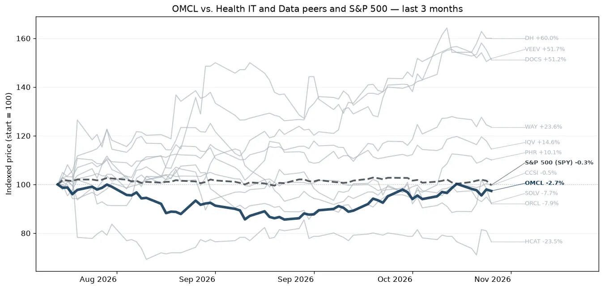

#### Reported Results

Q3 2026: EPS $0.58 vs. $0.42 est. (+38.92%); revenue $307.85M vs. $304.48M est. (+1.11%)

#### Earnings Call Summary

Omnicell delivered a strong third quarter 2026, generating $308 million in total revenue and non-GAAP EBITDA of $45 million, with both figures exceeding the high end of previously provided guidance ranges. The company achieved a non-GAAP EPS of $0.58 for the quarter, reflecting solid operational execution and cost efficiencies built throughout the year.

#### At a Glance

- **Omnicell Beats Revenue and Estimates:** Omnicell reported Q3 2026 revenue of $307.85 million, beating the estimated $304.48 million, while its non-GAAP diluted EPS reached $0.58 compared to initial consensus estimates.
- **Strong EBITDA Growth Beats Guidance:** The company delivered non-GAAP EBITDA of $45 million, exceeding its guidance range of $32 million to $37 million, driven by cost efficiencies and favorable customer mix compared to prior periods.
- **Profit Guidance Raised; Q4 Muted:** Omnicell raised its full-year 2026 non-GAAP EPS outlook to $2.48-$2.56, though its Q4 revenue guidance came in below analyst consensus estimates.
- **Titan XT Hardware Shipments Commence:** Management announced that initial hardware shipments for its next-generation Titan XT automated dispensing platform are officially underway.
- **OmniSphere Platform Launch On Track:** The company remains on track for the general availability of its cloud-native OmniSphere platform in the first half of 2027, utilizing a subscription-based pricing model.
- **Leasing Expansion Driving Growth Pipeline:** Omnicell is actively expanding its leasing programs to bypass financial barriers in competitive deals, resulting in a growing sales pipeline.

#### Key Moments from the Call

- **16m 8s — Q3 Financial Results Outperform Guidance:** Omnicell reported Q3 2026 total revenue of $308 million and non-GAAP EBITDA of $45 million, beating the high end of its guidance. This outperformance will please investors as it highlights positive gross margins, disciplined spending, and growing bottom-line operating leverage despite modest near-term top-line growth.
- **21m 38s — Full-Year 2026 Profit Guidance Raised:** The company raised its full-year non-GAAP EBITDA and non-GAAP EPS guidance while narrowing total revenue ranges. This guidance upgrade signals strong cost efficiency and favorable product mix executing into the final quarter, reinforcing investor confidence in profitability targets.
- **23m 14s — Titan XT Ships as OmniSphere Targets 2027:** Management announced that the first Titan XT hardware units ship within days, while the OmniSphere cloud platform targets general availability in H1 2027. This milestone validates product development timelines for their core multi-year upgrade cycle, though near-term pacing considerations keep full-year bookings ranges wide.
- **34m 37s — Lease Structures and Gross Margin Impact:** Omnicell noted that roughly 30% of the active market is involved in leasing, which it uses to stay competitive. Because these are structured as sales-type leases, revenue is recognized upfront with slight initial gross margin erosion, followed by higher-margin interest income recognized over the lease life.

<h3 id="earnings-tdoc">Teladoc (TDOC) +26.8% Last 3m</h3>

Teladoc Health Inc is engaged in the provision of virtual healthcare services, connecting patients, providers, and healthcare systems through technology-enabled platforms. The company has two reportable segments: Integrated Care and BetterHelp. The Integrated Care segment provides virtual healthcare solutions, including primary care, mental health, chronic care management, and telehealth enablement services for employers, insurers, and healthcare systems, mainly on a business-to-business basis, while the BetterHelp segment offers direct-to-consumer online mental health services, including counseling and therapy delivered through digital platforms. It generates the majority of its revenue from the Integrated Care segment.

**Reported:** October 28, 2026 · [Google Finance earnings page](https://www.google.com/finance/quote/TDOC:NYSE?tab=earnings&hl=en)

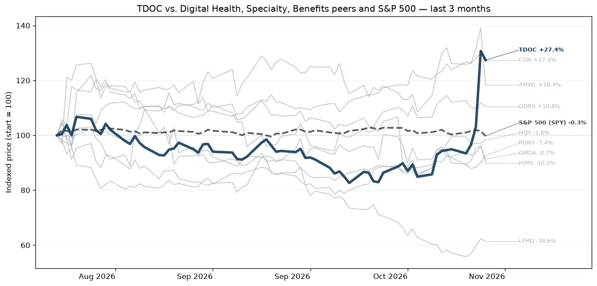

#### Reported Results

Q3 2026: EPS -$0.12 vs. -$0.19 est. (+36.47%); revenue $605.10M vs. $590.71M est. (+2.44%)

#### Earnings Call Summary

Teladoc Health reported Q3 2026 consolidated revenue of $605 million, down 3.4% year-over-year, beating the estimated $590.7 million. Consolidated adjusted EBITDA grew 13.5% year-over-year to $79 million, outperforming expectations, while consolidated adjusted EBITDA margins expanded by approximately 200 basis points to 13.1%. GAAP net loss per share improved to $0.15 compared to a $0.28 loss last year.

#### At a Glance

- **Teladoc Tops Q3 Revenue and EPS Expectations:** Teladoc Health reported a Q3 2026 Adjusted EPS of -$0.15, beating the estimated -$0.187, and reported revenue of $605.10 million, which surpassed the expected $590.71 million despite a 3.4% year-over-year decline.
- **BetterHelp Pivot Offsets Core Cash-Pay Weakness:** The BetterHelp segment saw a 13% revenue decline due to weakness in its traditional direct-to-consumer cash-pay market, but was cushioned by rapid expansion in its in-network insurance revenue which reached $32 million.
- **Management Raises Full-Year 2026 Guidance:** Teladoc raised its full-year 2026 outlook, bumping the midpoint of revenue expectations to a range of $2.39 billion to $2.44 billion and increasing projected adjusted EBITDA to $277 million to $303 million.
- **Integrated Care Segment Drives Margin Gains:** The Integrated Care business segment expanded its adjusted EBITDA margin by approximately 180 basis points to 18.8%, helping lift total consolidated adjusted EBITDA by 14% to $79.4 million.
- **Free Cash Flow Surges on Operational Efficiencies:** Driven by operational excellence initiatives and AI-enabled self-service utilization, the company generated a strong $76 million in free cash flow for the quarter, improving its net debt leverage ratio.
- **Strong Market Performance Following Results Release:** Investors reacted favorably to the smaller net loss and robust cash flow numbers, causing Teladoc&#x27;s stock price to surge by over 11% shortly after the announcement.

#### Key Moments from the Call

- **9m 8s — BetterHelp Insurance Scaled to $140M Run Rate:** BetterHelp's weekly insurance sessions reached 27,000, boosting its annualized revenue run rate to $140 million from $110 million in Q2. Furthermore, 36% of newly acquired U.S. users came via insurance channels. This rapid milestone indicates successful execution in pivoting away from volatile, high-churn cash pay users.
- **17m 26s — Integrated Care Outperformance Funds Strategic Reinvestments:** Integrated Care delivered segment adjusted EBITDA margins well above guidance at 18.8%, expanding 180 basis points year-over-year. Management intends to leverage this financial outperformance to step up incremental investments into strategic initiatives like Teladoc One and hybrid care in Q4 2026, aiming to solidify 2027 booking momentum.
- **19m 55s — Guidance Increase on BetterHelp Pivot Traction:** Teladoc raised its full-year 2026 revenue and adjusted EBITDA midpoints by $13 million and $3 million, respectively. This revision will please investors as it highlights faster-than-expected commercial traction in BetterHelp's insurance business, mitigating structural headwinds seen in the cash pay direct-to-consumer segment.
- **26m 59s — Proactive $1 Billion Debt Maturity Refinancing Plan:** Management outlined a clear two-phase strategy to address its $1 billion convertible notes maturing in June 2027. Phase one includes repurchasing a substantial portion prior to year-end 2026 via cash and traditional debt, followed by cash repayment at maturity. This proactive capital management reduces dilution risks and structural overhang concerns.

<h3 id="earnings-alhc">Alignment Health (ALHC) -51.0% Last 3m</h3>

Alignment Healthcare Inc is a next-generation, consumer-centric platform that is revolutionizing the healthcare experience for seniors through Medicare Advantage plans. These plans are marketed and sold direct-to-consumer, allowing seniors to select the manner in which customers receive healthcare coverage and services on an annual basis. The company combines a technology platform and clinical model for more effective health outcomes.

**Reported:** October 29, 2026 · [Google Finance earnings page](https://www.google.com/finance/quote/ALHC:NASDAQ?tab=earnings&hl=en)

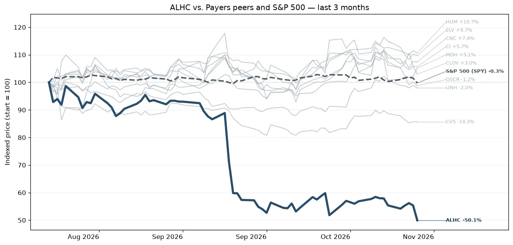

#### Reported Results

Q3 2026: EPS $0.05 vs. $0.04 est. (+5.91%); revenue $1.36B vs. $1.32B est. (+2.88%)

#### Earnings Call Summary

Alignment Healthcare reported Q3 2026 health plan membership of 301,200 (up 31% YoY) and revenue of approximately $1.4 billion (up 37% YoY). Adjusted gross profit was $142 million, representing an adjusted MBR of 89.5% (up 240 bps YoY). Adjusted SG&A was $120 million (8.9% of revenue), and adjusted EBITDA was $22 million.

#### At a Glance

- **Revenue Beats, Reported EPS Misses:** Alignment Healthcare reported Q3 2026 revenue of $1.36 billion, beating the estimated $1.32 billion, while reported adjusted EPS came in at -$0.04, missing the estimated 0.043.
- **Membership Surges Amid Margin Crunch:** Health plan membership grew 31.2% year-over-year to 301,200 members, but the medical benefit ratio climbed 240 basis points to 89.5% due to rising provider disputes and elevated catastrophic care costs.
- **Profitability Outlook Lowered for 2026:** Management cut its full-year 2026 adjusted EBITDA guidance to at least $100 million, signaling that elevated medical cost trends are expected to persist through the fourth quarter.
- **Claims Migration Drives Costs Higher:** Operational cost volatility was heavily impacted by a claims system migration to the Facets platform, which peaked in July before stabilizing later in the quarter.
- **Shares Plunge on Profitability Concerns:** Despite the robust top-line revenue growth, the company&#x27;s stock fell over 10% after hours as investors reacted negatively to the return to a net loss position and the trimmed outlook.

#### Key Moments from the Call

- **4m 29s — Full-Year Guidance Cut:** Management lowered full-year 2026 adjusted EBITDA guidance to no less than $100 million and adjusted gross profit to no less than $575 million. This will disappoint investors as third-quarter cost trends and provider appeal volatility are expected to continue weighing on results through the fourth quarter.
- **6m 28s — California HMO Star Rating Shortfall:** Alignment's core California HMO contract dropped to a 3.5 Star Rating for payment year 2028, missing expectations due to shortfalls in triple-weighted HOS and Part D metrics. While disappointing, management noted early 2027 AEP broker feedback and sales remain strong, backed by trusted long-term relationships.
- **15m 59s — Claims Migration Volatility Unpacked:** The transition to the industry-leading Facets claims adjudication system triggered provider-led appeals and disputes that peaked in July. Though medical cost trends began stabilizing across August, September, and October, management's Q4 guidance prudently models these expenses lingering at peak levels without assuming near-term operational benefits.
- **49m 56s — Strategic Provider De-delegation Progress:** Alignment has completed roughly 80% of its initiative to de-delegate acute inpatient utilization management from California IPAs to its internal care model. This strategic pivot shifts reliance away from rigid global capitation models, granting the company greater operational control to combat margin pressures outside California.

<h3 id="earnings-cyh">Community Health Systems (CYH) -14.0% Last 3m</h3>

Community Health Systems Inc is a publicly owned hospital operator in the United States. The company also owns four home health agencies and provides management and consulting services to independent hospitals. The firm derives revenue through a broad range of general and specialized hospital healthcare services and outpatient services.

**Reported:** October 29, 2026 · [Google Finance earnings page](https://www.google.com/finance/quote/CYH:NYSE?tab=earnings&hl=en)

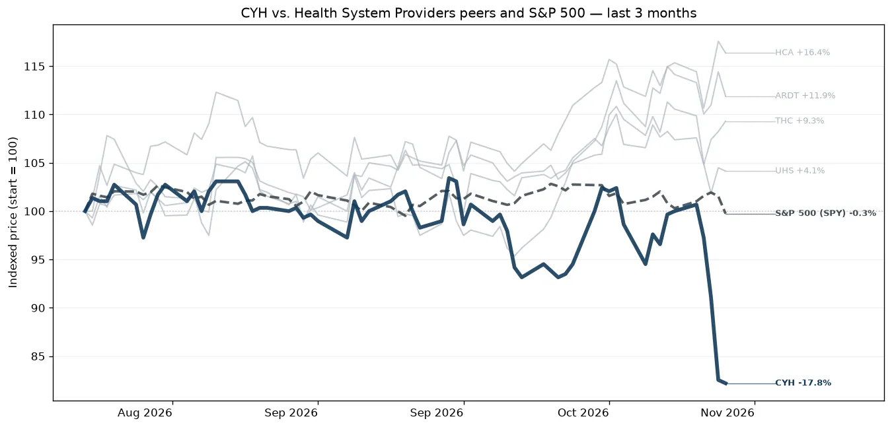

#### Reported Results

Q3 2026: EPS -$0.48 vs. -$0.32 est. (-48.03%); revenue $2.76B vs. $2.80B est. (-1.58%)

#### Earnings Call Summary

CEO Kevin Hammons highlighted strong clinical improvements, outperforming national benchmarks for severe sepsis, septic shock mortality, and hospital-acquired infections. CHS reduced physician turnover by over 40% and bedside RN turnover by 10% year-over-year, leading to a 2.5% increase in its employee provider base to expand procedural capacity.

#### At a Glance

- **Earnings and Revenue Miss Estimates:** Community Health Systems Inc missed analyst expectations for the third quarter of 2026, reporting an Adjusted EPS of -$0.63 compared to the estimated -$0.324, and total revenue of $2.757 billion against the estimated $2.801 billion.
- **Admissions Rise Faced with Unfavorable Mix:** Same-store adjusted admissions grew 3.6% and same-store surgeries increased 2%, but over half of the admissions growth came from lower-reimbursement uninsured patients, leading same-store net revenue per adjusted admission to increase only 0.2%.
- **Guidance Cut On Uncompensated Care Trends:** Management lowered its full-year 2026 guidance, decreasing net operating revenues to a range of $11.3 billion to $11.5 billion and lowering adjusted EBITDA to between $1.225 billion and $1.275 billion.
- **Cost Programs Address Sector Headwinds:** The company targeted $100 million in annual savings through corporate expense management and advanced electronic technologies to mitigate rising medical specialist fees, which jumped 13% year-over-year.
- **Macro Pressures Cause Sharp Market Drop:** Following the return to a quarterly loss and reduced annual forecasts, the company&#x27;s shares dropped 9.4% in a single trading day to settle at $2.41.

#### Key Moments from the Call

- **12m 47s — Unfavorable Payer and Service Mix:** Almost half of the 3.6% growth in same-store adjusted admissions came from uninsured patients. This surge in lower-reimbursement care, combined with deferred high-acuity surgeries, limited same-store net revenue per adjusted admission growth to a muted 0.2%, negatively surprising investors.
- **14m 46s — Full Year 2026 Guidance Revision:** CHS lowered its full-year adjusted EBITDA midpoint by 6.5% to a range of $1.225 billion-$1.275 billion. This disappointing cut is driven by elevated trends in uncompensated care following health exchange coverage losses and ongoing softness in high-margin commercial elective procedures.
- **34m 59s — Pausing Medium-Term Financial Targets:** Management confirmed they are reassessing and removing their slide on medium-term targets. This change signals deep macro uncertainties and a potential multi-year earnings reset due to persistent industry headwinds, including shifting consumer behaviors driven by high out-of-pocket costs.
- **38m 58s — Structural Cost Actions to Defend Margins:** To mitigate margin pressure from deferred care, CHS initiated corporate structural changes projected to yield over $100 million in annual savings. These actions focus on department restructurings, enhanced ERP software vendor compliance, and scaled supply chain contracts.

## Upcoming Earnings

### Payers

<table class="sortable"><thead><tr><th class="sortable-heading" data-column="0" data-type="text">Company</th><th class="sortable-heading" data-column="1" data-type="text">Ticker</th><th class="sortable-heading" data-column="2" data-type="text">Date</th><th class="sortable-heading" data-column="3" data-type="number">Market cap</th><th class="sortable-heading" data-column="4" data-type="number">3m Return</th><th class="sortable-heading" data-column="5" data-type="number">12m Return</th></tr></thead><tbody><tr><td class="text" data-sort="cvs health" style="">CVS Health</td><td class="text text" data-sort="cvs" style=""><a href="https://www.google.com/finance/quote/CVS:NYSE?hl=en" target="_blank" rel="noopener">CVS</a></td><td class="text" data-sort="2026-11-04" style="">November 4, 2026</td><td class="" data-sort="118125703280.84" style="">$118.1B</td><td class="" data-sort="-0.13578473618691955" style="background:#c0302f;color:#ffffff;">-13.6%</td><td class="" data-sort="0.15483045425463837" style="background:#a9d9a4;color:#111820;">+15.5%</td></tr><tr><td class="text" data-sort="cigna" style="">Cigna</td><td class="text text" data-sort="ci" style=""><a href="https://www.google.com/finance/quote/CI:NYSE?hl=en" target="_blank" rel="noopener">CI</a></td><td class="text" data-sort="2026-11-05" style="">November 5, 2026</td><td class="" data-sort="78804440139.78" style="">$78.8B</td><td class="" data-sort="0.06873320193513699" style="background:#7cc077;color:#111820;">+6.9%</td><td class="" data-sort="0.2202037559837977" style="background:#a9d9a4;color:#111820;">+22.0%</td></tr><tr><td class="text" data-sort="humana" style="">Humana</td><td class="text text" data-sort="hum" style=""><a href="https://www.google.com/finance/quote/HUM:NYSE?hl=en" target="_blank" rel="noopener">HUM</a></td><td class="text" data-sort="2026-11-06" style="">November 6, 2026</td><td class="" data-sort="49773287666.0" style="">$49.8B</td><td class="" data-sort="0.13917440773924028" style="background:#1a7a3c;color:#ffffff;">+13.9%</td><td class="" data-sort="0.4899888565368993" style="background:#2f9e44;color:#111820;">+49.0%</td></tr><tr><td class="text" data-sort="oscar health" style="">Oscar Health</td><td class="text text" data-sort="oscr" style=""><a href="https://www.google.com/finance/quote/OSCR:NYSE?hl=en" target="_blank" rel="noopener">OSCR</a></td><td class="text" data-sort="2026-11-05" style="">November 5, 2026</td><td class="" data-sort="9373548650.0" style="">$9.4B</td><td class="" data-sort="-0.027226137091607927" style="background:#fbd5d4;color:#111820;">-2.7%</td><td class="" data-sort="0.6872222222222222" style="background:#1a7a3c;color:#ffffff;">+68.7%</td></tr><tr><td class="text" data-sort="clover health" style="">Clover Health</td><td class="text text" data-sort="clov" style=""><a href="https://www.google.com/finance/quote/CLOV:NASDAQ?hl=en" target="_blank" rel="noopener">CLOV</a></td><td class="text" data-sort="2026-11-04" style="">November 4, 2026</td><td class="" data-sort="2368956932.98" style="">$2.4B</td><td class="" data-sort="0.0695443645083933" style="background:#7cc077;color:#111820;">+7.0%</td><td class="" data-sort="0.2634560906515582" style="background:#a9d9a4;color:#111820;">+26.3%</td></tr></tbody></table>

### Health System Providers

<table class="sortable"><thead><tr><th class="sortable-heading" data-column="0" data-type="text">Company</th><th class="sortable-heading" data-column="1" data-type="text">Ticker</th><th class="sortable-heading" data-column="2" data-type="text">Date</th><th class="sortable-heading" data-column="3" data-type="number">Market cap</th><th class="sortable-heading" data-column="4" data-type="number">3m Return</th><th class="sortable-heading" data-column="5" data-type="number">12m Return</th></tr></thead><tbody><tr><td class="text" data-sort="ardent health partners" style="">Ardent Health Partners</td><td class="text text" data-sort="ardt" style=""><a href="https://www.google.com/finance/quote/ARDT:NYSE?hl=en" target="_blank" rel="noopener">ARDT</a></td><td class="text" data-sort="2026-11-05" style="">November 5, 2026</td><td class="" data-sort="1541012833.25" style="">$1.5B</td><td class="" data-sort="0.12746016869728205" style="background:#1a7a3c;color:#ffffff;">+12.7%</td><td class="" data-sort="-0.1737637362637363" style="background:#c0302f;color:#ffffff;">-17.4%</td></tr></tbody></table>

### Inpatient Non-Acute Providers

<table class="sortable"><thead><tr><th class="sortable-heading" data-column="0" data-type="text">Company</th><th class="sortable-heading" data-column="1" data-type="text">Ticker</th><th class="sortable-heading" data-column="2" data-type="text">Date</th><th class="sortable-heading" data-column="3" data-type="number">Market cap</th><th class="sortable-heading" data-column="4" data-type="number">3m Return</th><th class="sortable-heading" data-column="5" data-type="number">12m Return</th></tr></thead><tbody><tr><td class="text" data-sort="pacs group" style="">PACS Group</td><td class="text text" data-sort="pacs" style=""><a href="https://www.google.com/finance/quote/PACS:NYSE?hl=en" target="_blank" rel="noopener">PACS</a></td><td class="text" data-sort="2026-11-04" style="">November 4, 2026</td><td class="" data-sort="7570025609.72" style="">$7.6B</td><td class="" data-sort="0.039121930015214135" style="background:#1a7a3c;color:#ffffff;">+3.9%</td><td class="" data-sort="2.9577814569536427" style="background:#1a7a3c;color:#ffffff;">+295.8%</td></tr><tr><td class="text" data-sort="acadia healthcare" style="">Acadia Healthcare</td><td class="text text" data-sort="achc" style=""><a href="https://www.google.com/finance/quote/ACHC:NASDAQ?hl=en" target="_blank" rel="noopener">ACHC</a></td><td class="text" data-sort="2026-11-05" style="">November 5, 2026</td><td class="" data-sort="2789284239.0" style="">$2.8B</td><td class="" data-sort="0.011478730587440866" style="background:#a9d9a4;color:#111820;">+1.1%</td><td class="" data-sort="0.39348837209302334" style="background:#d6ecd4;color:#111820;">+39.3%</td></tr></tbody></table>

### Value-Based Care

<table class="sortable"><thead><tr><th class="sortable-heading" data-column="0" data-type="text">Company</th><th class="sortable-heading" data-column="1" data-type="text">Ticker</th><th class="sortable-heading" data-column="2" data-type="text">Date</th><th class="sortable-heading" data-column="3" data-type="number">Market cap</th><th class="sortable-heading" data-column="4" data-type="number">3m Return</th><th class="sortable-heading" data-column="5" data-type="number">12m Return</th></tr></thead><tbody><tr><td class="text" data-sort="privia health group" style="">Privia Health Group</td><td class="text text" data-sort="prva" style=""><a href="https://www.google.com/finance/quote/PRVA:NASDAQ?hl=en" target="_blank" rel="noopener">PRVA</a></td><td class="text" data-sort="2026-11-05" style="">November 5, 2026</td><td class="" data-sort="2743730766.36" style="">$2.7B</td><td class="" data-sort="-0.09252217997465151" style="background:#fbd5d4;color:#111820;">-9.3%</td><td class="" data-sort="-0.11604938271604937" style="background:#fbd5d4;color:#111820;">-11.6%</td></tr><tr><td class="text" data-sort="astrana health" style="">Astrana Health</td><td class="text text" data-sort="asth" style=""><a href="https://www.google.com/finance/quote/ASTH:NASDAQ?hl=en" target="_blank" rel="noopener">ASTH</a></td><td class="text" data-sort="2026-11-05" style="">November 5, 2026</td><td class="" data-sort="1812047489.98" style="">$1.8B</td><td class="" data-sort="0.02727784026996627" style="background:#d6ecd4;color:#111820;">+2.7%</td><td class="" data-sort="0.1704581864786927" style="background:#d6ecd4;color:#111820;">+17.0%</td></tr><tr><td class="text" data-sort="agilon health" style="">Agilon Health</td><td class="text text" data-sort="agl" style=""><a href="https://www.google.com/finance/quote/AGL:NYSE?hl=en" target="_blank" rel="noopener">AGL</a></td><td class="text" data-sort="2026-11-04" style="">November 4, 2026</td><td class="" data-sort="1429267795.2" style="">$1.4B</td><td class="" data-sort="-0.07324527889968335" style="background:#fbd5d4;color:#111820;">-7.3%</td><td class="" data-sort="3.263653483992467" style="background:#1a7a3c;color:#ffffff;">+326.4%</td></tr><tr><td class="text" data-sort="evolent health" style="">Evolent Health</td><td class="text text" data-sort="evh" style=""><a href="https://www.google.com/finance/quote/EVH:NYSE?hl=en" target="_blank" rel="noopener">EVH</a></td><td class="text" data-sort="2026-11-05" style="">November 5, 2026</td><td class="" data-sort="486155140.5" style="">$486.2M</td><td class="" data-sort="0.39158576051779925" style="background:#2f9e44;color:#111820;">+39.2%</td><td class="" data-sort="-0.3553223388305847" style="background:#fbd5d4;color:#111820;">-35.5%</td></tr><tr><td class="text" data-sort="p3 health" style="">P3 Health</td><td class="text text" data-sort="piii" style=""><a href="https://www.google.com/finance/quote/PIII:NASDAQ?hl=en" target="_blank" rel="noopener">PIII</a></td><td class="text" data-sort="2026-11-09" style="">November 9, 2026</td><td class="" data-sort="15765206.860000001" style="">$15.8M</td><td class="" data-sort="-0.590030518819939" style="background:#c0302f;color:#ffffff;">-59.0%</td><td class="" data-sort="-0.5394285714285714" style="background:#fbd5d4;color:#111820;">-53.9%</td></tr></tbody></table>

### Outpatient and Home Providers

<table class="sortable"><thead><tr><th class="sortable-heading" data-column="0" data-type="text">Company</th><th class="sortable-heading" data-column="1" data-type="text">Ticker</th><th class="sortable-heading" data-column="2" data-type="text">Date</th><th class="sortable-heading" data-column="3" data-type="number">Market cap</th><th class="sortable-heading" data-column="4" data-type="number">3m Return</th><th class="sortable-heading" data-column="5" data-type="number">12m Return</th></tr></thead><tbody><tr><td class="text" data-sort="fresenius" style="">Fresenius</td><td class="text text" data-sort="fms" style=""><a href="https://www.google.com/finance/quote/FMS:NYSE?hl=en" target="_blank" rel="noopener">FMS</a></td><td class="text" data-sort="2026-11-03" style="">November 3, 2026</td><td class="" data-sort="11958969243.9" style="">$12.0B</td><td class="" data-sort="-0.12431800467653942" style="background:#f5aead;color:#111820;">-12.4%</td><td class="" data-sort="-0.16281669150521616" style="background:#fbd5d4;color:#111820;">-16.3%</td></tr><tr><td class="text" data-sort="lifestance health" style="">Lifestance Health</td><td class="text text" data-sort="lfst" style=""><a href="https://www.google.com/finance/quote/LFST:NASDAQ?hl=en" target="_blank" rel="noopener">LFST</a></td><td class="text" data-sort="2026-11-05" style="">November 5, 2026</td><td class="" data-sort="5094065569.8" style="">$5.1B</td><td class="" data-sort="0.27862595419847325" style="background:#7cc077;color:#111820;">+27.9%</td><td class="" data-sort="1.7346938775510203" style="background:#1a7a3c;color:#ffffff;">+173.5%</td></tr><tr><td class="text" data-sort="option care health" style="">Option Care Health</td><td class="text text" data-sort="opch" style=""><a href="https://www.google.com/finance/quote/OPCH:NASDAQ?hl=en" target="_blank" rel="noopener">OPCH</a></td><td class="text" data-sort="2026-11-04" style="">November 4, 2026</td><td class="" data-sort="4767926118.2699995" style="">$4.8B</td><td class="" data-sort="0.38211029092488036" style="background:#2f9e44;color:#111820;">+38.2%</td><td class="" data-sort="0.2228198232808296" style="background:#d6ecd4;color:#111820;">+22.3%</td></tr><tr><td class="text" data-sort="surgery partners" style="">Surgery Partners</td><td class="text text" data-sort="sgry" style=""><a href="https://www.google.com/finance/quote/SGRY:NASDAQ?hl=en" target="_blank" rel="noopener">SGRY</a></td><td class="text" data-sort="2026-11-09" style="">November 9, 2026</td><td class="" data-sort="2991184015.1600003" style="">$3.0B</td><td class="" data-sort="0.5071428571428571" style="background:#1a7a3c;color:#ffffff;">+50.7%</td><td class="" data-sort="0.05836753305973552" style="background:#d6ecd4;color:#111820;">+5.8%</td></tr><tr><td class="text" data-sort="addus homecare" style="">Addus HomeCare</td><td class="text text" data-sort="adus" style=""><a href="https://www.google.com/finance/quote/ADUS:NASDAQ?hl=en" target="_blank" rel="noopener">ADUS</a></td><td class="text" data-sort="2026-11-04" style="">November 4, 2026</td><td class="" data-sort="2121438440.1599998" style="">$2.1B</td><td class="" data-sort="0.08711465188777279" style="background:#d6ecd4;color:#111820;">+8.7%</td><td class="" data-sort="0.07400119770724611" style="background:#d6ecd4;color:#111820;">+7.4%</td></tr><tr><td class="text" data-sort="us physical therapy" style="">US Physical Therapy</td><td class="text text" data-sort="usph" style=""><a href="https://www.google.com/finance/quote/USPH:NYSE?hl=en" target="_blank" rel="noopener">USPH</a></td><td class="text" data-sort="2026-11-05" style="">November 5, 2026</td><td class="" data-sort="1154497333.54" style="">$1.2B</td><td class="" data-sort="0.08563116620288391" style="background:#d6ecd4;color:#111820;">+8.6%</td><td class="" data-sort="-0.005100266604845194" style="background:#fbd5d4;color:#111820;">-0.5%</td></tr></tbody></table>

### Digital Health, Specialty, Benefits

<table class="sortable"><thead><tr><th class="sortable-heading" data-column="0" data-type="text">Company</th><th class="sortable-heading" data-column="1" data-type="text">Ticker</th><th class="sortable-heading" data-column="2" data-type="text">Date</th><th class="sortable-heading" data-column="3" data-type="number">Market cap</th><th class="sortable-heading" data-column="4" data-type="number">3m Return</th><th class="sortable-heading" data-column="5" data-type="number">12m Return</th></tr></thead><tbody><tr><td class="text" data-sort="hims &amp; hers" style="">Hims &amp; Hers</td><td class="text text" data-sort="hims" style=""><a href="https://www.google.com/finance/quote/HIMS:NYSE?hl=en" target="_blank" rel="noopener">HIMS</a></td><td class="text" data-sort="2026-11-09" style="">November 9, 2026</td><td class="" data-sort="6458115271.84" style="">$6.5B</td><td class="" data-sort="-0.0032409074540871163" style="background:#fbd5d4;color:#111820;">-0.3%</td><td class="" data-sort="-0.39111306643202814" style="background:#f5aead;color:#111820;">-39.1%</td></tr><tr><td class="text" data-sort="concentra group" style="">Concentra Group</td><td class="text text" data-sort="con" style=""><a href="https://www.google.com/finance/quote/CON:NYSE?hl=en" target="_blank" rel="noopener">CON</a></td><td class="text" data-sort="2026-11-06" style="">November 6, 2026</td><td class="" data-sort="3982170593.6" style="">$4.0B</td><td class="" data-sort="0.275829383886256" style="background:#2f9e44;color:#111820;">+27.6%</td><td class="" data-sort="1.0271084337349397" style="background:#2f9e44;color:#111820;">+102.7%</td></tr><tr><td class="text" data-sort="progyny" style="">Progyny</td><td class="text text" data-sort="pgny" style=""><a href="https://www.google.com/finance/quote/PGNY:NASDAQ?hl=en" target="_blank" rel="noopener">PGNY</a></td><td class="text" data-sort="2026-11-04" style="">November 4, 2026</td><td class="" data-sort="2465903007.6" style="">$2.5B</td><td class="" data-sort="-0.06231930613556047" style="background:#fbd5d4;color:#111820;">-6.2%</td><td class="" data-sort="0.5601282736504543" style="background:#a9d9a4;color:#111820;">+56.0%</td></tr><tr><td class="text" data-sort="omada health" style="">Omada Health</td><td class="text text" data-sort="omda" style=""><a href="https://www.google.com/finance/quote/OMDA:NASDAQ?hl=en" target="_blank" rel="noopener">OMDA</a></td><td class="text" data-sort="2026-11-05" style="">November 5, 2026</td><td class="" data-sort="1146588847.19" style="">$1.1B</td><td class="" data-sort="-0.055947580645161255" style="background:#fbd5d4;color:#111820;">-5.6%</td><td class="" data-sort="-0.23768823768823766" style="background:#fbd5d4;color:#111820;">-23.8%</td></tr><tr><td class="text" data-sort="amwell" style="">Amwell</td><td class="text text" data-sort="amwl" style=""><a href="https://www.google.com/finance/quote/AMWL:NYSE?hl=en" target="_blank" rel="noopener">AMWL</a></td><td class="text" data-sort="2026-11-03" style="">November 3, 2026</td><td class="" data-sort="216521489.34" style="">$216.5M</td><td class="" data-sort="0.18418604651162784" style="background:#7cc077;color:#111820;">+18.4%</td><td class="" data-sort="1.4386973180076632" style="background:#1a7a3c;color:#ffffff;">+143.9%</td></tr><tr><td class="text" data-sort="lifemd" style="">LifeMD</td><td class="text text" data-sort="lfmd" style=""><a href="https://www.google.com/finance/quote/LFMD:NASDAQ?hl=en" target="_blank" rel="noopener">LFMD</a></td><td class="text" data-sort="2026-11-09" style="">November 9, 2026</td><td class="" data-sort="110505866.73" style="">$110.5M</td><td class="" data-sort="-0.34571428571428575" style="background:#c0302f;color:#ffffff;">-34.6%</td><td class="" data-sort="-0.6125211505922166" style="background:#ee8483;color:#111820;">-61.3%</td></tr></tbody></table>

### Health IT and Data

<table class="sortable"><thead><tr><th class="sortable-heading" data-column="0" data-type="text">Company</th><th class="sortable-heading" data-column="1" data-type="text">Ticker</th><th class="sortable-heading" data-column="2" data-type="text">Date</th><th class="sortable-heading" data-column="3" data-type="number">Market cap</th><th class="sortable-heading" data-column="4" data-type="number">3m Return</th><th class="sortable-heading" data-column="5" data-type="number">12m Return</th></tr></thead><tbody><tr><td class="text" data-sort="solventum" style="">Solventum</td><td class="text text" data-sort="solv" style=""><a href="https://www.google.com/finance/quote/SOLV:NYSE?hl=en" target="_blank" rel="noopener">SOLV</a></td><td class="text" data-sort="2026-11-05" style="">November 5, 2026</td><td class="" data-sort="14606898185.49" style="">$14.6B</td><td class="" data-sort="-0.048103932584269704" style="background:#fbd5d4;color:#111820;">-4.8%</td><td class="" data-sort="0.17801274623406704" style="background:#a9d9a4;color:#111820;">+17.8%</td></tr><tr><td class="text" data-sort="doximity" style="">Doximity</td><td class="text text" data-sort="docs" style=""><a href="https://www.google.com/finance/quote/DOCS:NYSE?hl=en" target="_blank" rel="noopener">DOCS</a></td><td class="text" data-sort="2026-11-05" style="">November 5, 2026</td><td class="" data-sort="5839338304.799999" style="">$5.8B</td><td class="" data-sort="0.5667144906743184" style="background:#1a7a3c;color:#ffffff;">+56.7%</td><td class="" data-sort="-0.5036363636363637" style="background:#c0302f;color:#ffffff;">-50.4%</td></tr><tr><td class="text" data-sort="waystar" style="">Waystar</td><td class="text text" data-sort="way" style=""><a href="https://www.google.com/finance/quote/WAY:NASDAQ?hl=en" target="_blank" rel="noopener">WAY</a></td><td class="text" data-sort="2026-11-02" style="">November 2, 2026</td><td class="" data-sort="5368955648.0" style="">$5.4B</td><td class="" data-sort="0.32638559924206545" style="background:#7cc077;color:#111820;">+32.6%</td><td class="" data-sort="-0.21896792189679226" style="background:#ee8483;color:#111820;">-21.9%</td></tr><tr><td class="text" data-sort="consensus cloud solutions" style="">Consensus Cloud Solutions</td><td class="text text" data-sort="ccsi" style=""><a href="https://www.google.com/finance/quote/CCSI:NASDAQ?hl=en" target="_blank" rel="noopener">CCSI</a></td><td class="text" data-sort="2026-11-05" style="">November 5, 2026</td><td class="" data-sort="684252587.48" style="">$684.3M</td><td class="" data-sort="0.025824175824175954" style="background:#d6ecd4;color:#111820;">+2.6%</td><td class="" data-sort="0.2735334242837655" style="background:#7cc077;color:#111820;">+27.4%</td></tr><tr><td class="text" data-sort="health catalyst" style="">Health Catalyst</td><td class="text text" data-sort="hcat" style=""><a href="https://www.google.com/finance/quote/HCAT:NASDAQ?hl=en" target="_blank" rel="noopener">HCAT</a></td><td class="text" data-sort="2026-11-05" style="">November 5, 2026</td><td class="" data-sort="127183283.89" style="">$127.2M</td><td class="" data-sort="-0.19138755980861244" style="background:#f5aead;color:#111820;">-19.1%</td><td class="" data-sort="-0.476780185758514" style="background:#c0302f;color:#ffffff;">-47.7%</td></tr></tbody></table>

### Pharma Distribution

<table class="sortable"><thead><tr><th class="sortable-heading" data-column="0" data-type="text">Company</th><th class="sortable-heading" data-column="1" data-type="text">Ticker</th><th class="sortable-heading" data-column="2" data-type="text">Date</th><th class="sortable-heading" data-column="3" data-type="number">Market cap</th><th class="sortable-heading" data-column="4" data-type="number">3m Return</th><th class="sortable-heading" data-column="5" data-type="number">12m Return</th></tr></thead><tbody><tr><td class="text" data-sort="mckesson" style="">McKesson</td><td class="text text" data-sort="mck" style=""><a href="https://www.google.com/finance/quote/MCK:NYSE?hl=en" target="_blank" rel="noopener">MCK</a></td><td class="text" data-sort="2026-11-04" style="">November 4, 2026</td><td class="" data-sort="97224871780.34999" style="">$97.2B</td><td class="" data-sort="0.16163468389025804" style="background:#a9d9a4;color:#111820;">+16.2%</td><td class="" data-sort="0.22584859614957975" style="background:#2f9e44;color:#111820;">+22.6%</td></tr><tr><td class="text" data-sort="cencora" style="">Cencora</td><td class="text text" data-sort="cor" style=""><a href="https://www.google.com/finance/quote/COR:NYSE?hl=en" target="_blank" rel="noopener">COR</a></td><td class="text" data-sort="2026-11-04" style="">November 4, 2026</td><td class="" data-sort="59590161456.799995" style="">$59.6B</td><td class="" data-sort="0.06263249180959729" style="background:#d6ecd4;color:#111820;">+6.3%</td><td class="" data-sort="-0.020632900150972522" style="background:#fbd5d4;color:#111820;">-2.1%</td></tr><tr><td class="text" data-sort="cardinal health" style="">Cardinal Health</td><td class="text text" data-sort="cah" style=""><a href="https://www.google.com/finance/quote/CAH:NYSE?hl=en" target="_blank" rel="noopener">CAH</a></td><td class="text" data-sort="2026-11-05" style="">November 5, 2026</td><td class="" data-sort="54698777435.25" style="">$54.7B</td><td class="" data-sort="0.08890144763726471" style="background:#d6ecd4;color:#111820;">+8.9%</td><td class="" data-sort="0.3129947056665092" style="background:#1a7a3c;color:#ffffff;">+31.3%</td></tr><tr><td class="text" data-sort="henry schein" style="">Henry Schein</td><td class="text text" data-sort="hsic" style=""><a href="https://www.google.com/finance/quote/HSIC:NASDAQ?hl=en" target="_blank" rel="noopener">HSIC</a></td><td class="text" data-sort="2026-11-03" style="">November 3, 2026</td><td class="" data-sort="10151122216.27" style="">$10.2B</td><td class="" data-sort="-0.010145772594752245" style="background:#fbd5d4;color:#111820;">-1.0%</td><td class="" data-sort="0.34303797468354413" style="background:#1a7a3c;color:#ffffff;">+34.3%</td></tr><tr><td class="text" data-sort="accendra health" style="">Accendra Health</td><td class="text text" data-sort="ahco" style=""><a href="https://www.google.com/finance/quote/AHCO:NASDAQ?hl=en" target="_blank" rel="noopener">AHCO</a></td><td class="text" data-sort="2026-11-03" style="">November 3, 2026</td><td class="" data-sort="912923359.92" style="">$912.9M</td><td class="" data-sort="-0.46203703703703713" style="background:#c0302f;color:#ffffff;">-46.2%</td><td class="" data-sort="-0.3537263626251391" style="background:#c0302f;color:#ffffff;">-35.4%</td></tr></tbody></table>

### Precision Diagnostics

<table class="sortable"><thead><tr><th class="sortable-heading" data-column="0" data-type="text">Company</th><th class="sortable-heading" data-column="1" data-type="text">Ticker</th><th class="sortable-heading" data-column="2" data-type="text">Date</th><th class="sortable-heading" data-column="3" data-type="number">Market cap</th><th class="sortable-heading" data-column="4" data-type="number">3m Return</th><th class="sortable-heading" data-column="5" data-type="number">12m Return</th></tr></thead><tbody><tr><td class="text" data-sort="natera" style="">Natera</td><td class="text text" data-sort="ntra" style=""><a href="https://www.google.com/finance/quote/NTRA:NASDAQ?hl=en" target="_blank" rel="noopener">NTRA</a></td><td class="text" data-sort="2026-11-05" style="">November 5, 2026</td><td class="" data-sort="39411440972.58" style="">$39.4B</td><td class="" data-sort="0.5472811472960861" style="background:#2f9e44;color:#111820;">+54.7%</td><td class="" data-sort="1.0826421354245213" style="background:#a9d9a4;color:#111820;">+108.3%</td></tr><tr><td class="text" data-sort="guardant health" style="">Guardant Health</td><td class="text text" data-sort="gh" style=""><a href="https://www.google.com/finance/quote/GH:NASDAQ?hl=en" target="_blank" rel="noopener">GH</a></td><td class="text" data-sort="2026-11-05" style="">November 5, 2026</td><td class="" data-sort="21443206004.3" style="">$21.4B</td><td class="" data-sort="0.10377183776776344" style="background:#d6ecd4;color:#111820;">+10.4%</td><td class="" data-sort="0.9221672758546551" style="background:#a9d9a4;color:#111820;">+92.2%</td></tr><tr><td class="text" data-sort="billiontoone" style="">BillionToOne</td><td class="text text" data-sort="blln" style=""><a href="https://www.google.com/finance/quote/BLLN:NASDAQ?hl=en" target="_blank" rel="noopener">BLLN</a></td><td class="text" data-sort="2026-11-04" style="">November 4, 2026</td><td class="" data-sort="6542857599.0" style="">$6.5B</td><td class="" data-sort="-0.18239538239538244" style="background:#f5aead;color:#111820;">-18.2%</td><td class="" data-sort="0.0402056177712502" style="background:#d6ecd4;color:#111820;">+4.0%</td></tr><tr><td class="text" data-sort="10x genomics" style="">10x Genomics</td><td class="text text" data-sort="txg" style=""><a href="https://www.google.com/finance/quote/TXG:NASDAQ?hl=en" target="_blank" rel="noopener">TXG</a></td><td class="text" data-sort="2026-11-05" style="">November 5, 2026</td><td class="" data-sort="6076123205.54" style="">$6.1B</td><td class="" data-sort="0.48318172202242415" style="background:#7cc077;color:#111820;">+48.3%</td><td class="" data-sort="4.140029325513196" style="background:#1a7a3c;color:#ffffff;">+414.0%</td></tr><tr><td class="text" data-sort="quidelortho" style="">QuidelOrtho</td><td class="text text" data-sort="qdel" style=""><a href="https://www.google.com/finance/quote/QDEL:NASDAQ?hl=en" target="_blank" rel="noopener">QDEL</a></td><td class="text" data-sort="2026-11-03" style="">November 3, 2026</td><td class="" data-sort="1198797586.62" style="">$1.2B</td><td class="" data-sort="-0.20989862850327967" style="background:#f5aead;color:#111820;">-21.0%</td><td class="" data-sort="-0.5090774360874397" style="background:#fbd5d4;color:#111820;">-50.9%</td></tr><tr><td class="text" data-sort="certara" style="">Certara</td><td class="text text" data-sort="cert" style=""><a href="https://www.google.com/finance/quote/CERT:NASDAQ?hl=en" target="_blank" rel="noopener">CERT</a></td><td class="text" data-sort="2026-11-05" style="">November 5, 2026</td><td class="" data-sort="1189802484.0" style="">$1.2B</td><td class="" data-sort="0.36049382716049383" style="background:#7cc077;color:#111820;">+36.0%</td><td class="" data-sort="-0.0524505588993982" style="background:#fbd5d4;color:#111820;">-5.2%</td></tr><tr><td class="text" data-sort="pacbio" style="">PacBio</td><td class="text text" data-sort="pacb" style=""><a href="https://www.google.com/finance/quote/PACB:NASDAQ?hl=en" target="_blank" rel="noopener">PACB</a></td><td class="text" data-sort="2026-11-04" style="">November 4, 2026</td><td class="" data-sort="447266430.71999997" style="">$447.3M</td><td class="" data-sort="0.8607142857142858" style="background:#1a7a3c;color:#ffffff;">+86.1%</td><td class="" data-sort="0.11324786324786329" style="background:#d6ecd4;color:#111820;">+11.3%</td></tr></tbody></table>

## Notable Changes

Comparison with the previous monthly report, dated October 5, 2026 (market data through October 2, 2026). Ranks order the tracked companies or subcategories by trailing 12-month return (1 = best).

### Sectors

#### Top 3 by 12m return: last month vs. now

<table class="sortable"><thead><tr><th class="sortable-heading" data-column="0" data-type="text">Entity</th><th class="sortable-heading" data-column="1" data-type="number">Last Month&#x27;s 12m Rank</th><th class="sortable-heading" data-column="2" data-type="number">Current 12m Rank</th><th class="sortable-heading" data-column="3" data-type="number">Change</th><th class="sortable-heading" data-column="4" data-type="number">Current 12m Return</th></tr></thead><tbody><tr><td class="text" data-sort="precision diagnostics" style=""><a href="#category-precision-diagnostics">Precision Diagnostics</a></td><td class="" data-sort="1" style="">#1</td><td class="" data-sort="1" style="">#1</td><td class="" data-sort="0" style="">— 0</td><td class="" data-sort="0.8120381018525574" style="background:#1a7a3c;color:#ffffff;">+81.2%</td></tr><tr><td class="text" data-sort="inpatient non-acute providers" style=""><a href="#category-inpatient-non-acute-providers">Inpatient Non-Acute Providers</a></td><td class="" data-sort="3" style="">#3</td><td class="" data-sort="2" style="">#2</td><td class="rank-change-up" data-sort="-1" style="">↑ 1</td><td class="" data-sort="0.7624643814751219" style="background:#1a7a3c;color:#ffffff;">+76.2%</td></tr><tr><td class="text" data-sort="value-based care" style=""><a href="#category-value-based-care">Value-Based Care</a></td><td class="" data-sort="2" style="">#2</td><td class="" data-sort="3" style="">#3</td><td class="rank-change-down" data-sort="1" style="">↓ 1</td><td class="" data-sort="0.6896688878687205" style="background:#1a7a3c;color:#ffffff;">+69.0%</td></tr></tbody></table>

#### Largest rank changes: change in 12m return rank since October 5, 2026

<table class="sortable"><thead><tr><th class="sortable-heading" data-column="0" data-type="text">Entity</th><th class="sortable-heading" data-column="1" data-type="number">Last Month&#x27;s 12m Rank</th><th class="sortable-heading" data-column="2" data-type="number">Current 12m Rank</th><th class="sortable-heading" data-column="3" data-type="number">Change</th><th class="sortable-heading" data-column="4" data-type="number">Current 12m Return</th></tr></thead><tbody><tr><td class="text" data-sort="payers" style=""><a href="#category-payers">Payers</a></td><td class="" data-sort="7" style="">#7</td><td class="" data-sort="5" style="">#5</td><td class="rank-change-up" data-sort="-2" style="">↑ 2</td><td class="" data-sort="0.26466939104481046" style="background:#1a7a3c;color:#ffffff;">+26.5%</td></tr><tr><td class="text" data-sort="digital health, specialty, benefits" style=""><a href="#category-digital-health-specialty-benefits">Digital Health, Specialty, Benefits</a></td><td class="" data-sort="9" style="">#9</td><td class="" data-sort="7" style="">#7</td><td class="rank-change-up" data-sort="-2" style="">↑ 2</td><td class="" data-sort="0.14170079827010046" style="background:#7cc077;color:#111820;">+14.2%</td></tr></tbody></table>

### Stocks

#### Top 3 by 12m return: last month vs. now

<table class="sortable"><thead><tr><th class="sortable-heading" data-column="0" data-type="text">Entity</th><th class="sortable-heading" data-column="1" data-type="number">Last Month&#x27;s 12m Rank</th><th class="sortable-heading" data-column="2" data-type="number">Current 12m Rank</th><th class="sortable-heading" data-column="3" data-type="number">Change</th><th class="sortable-heading" data-column="4" data-type="number">Current 12m Return</th></tr></thead><tbody><tr><td class="text" data-sort="10x genomics" style="">10x Genomics (<a href="https://www.google.com/finance/quote/TXG:NASDAQ?hl=en" target="_blank" rel="noopener">TXG</a>)</td><td class="" data-sort="1" style="">#1</td><td class="" data-sort="1" style="">#1</td><td class="" data-sort="0" style="">— 0</td><td class="" data-sort="4.140029325513196" style="background:#1a7a3c;color:#ffffff;">+414.0%</td></tr><tr><td class="text" data-sort="agilon health" style="">Agilon Health (<a href="https://www.google.com/finance/quote/AGL:NYSE?hl=en" target="_blank" rel="noopener">AGL</a>)</td><td class="" data-sort="3" style="">#3</td><td class="" data-sort="2" style="">#2</td><td class="rank-change-up" data-sort="-1" style="">↑ 1</td><td class="" data-sort="3.263653483992467" style="background:#2f9e44;color:#111820;">+326.4%</td></tr><tr><td class="text" data-sort="pacs group" style="">PACS Group (<a href="https://www.google.com/finance/quote/PACS:NYSE?hl=en" target="_blank" rel="noopener">PACS</a>)</td><td class="" data-sort="2" style="">#2</td><td class="" data-sort="3" style="">#3</td><td class="rank-change-down" data-sort="1" style="">↓ 1</td><td class="" data-sort="2.9577814569536427" style="background:#2f9e44;color:#111820;">+295.8%</td></tr></tbody></table>

#### Largest rank changes: change in 12m return rank since October 5, 2026

<table class="sortable"><thead><tr><th class="sortable-heading" data-column="0" data-type="text">Entity</th><th class="sortable-heading" data-column="1" data-type="number">Last Month&#x27;s 12m Rank</th><th class="sortable-heading" data-column="2" data-type="number">Current 12m Rank</th><th class="sortable-heading" data-column="3" data-type="number">Change</th><th class="sortable-heading" data-column="4" data-type="number">Current 12m Return</th></tr></thead><tbody><tr><td class="text" data-sort="molina healthcare" style="">Molina Healthcare (<a href="https://www.google.com/finance/quote/MOH:NYSE?hl=en" target="_blank" rel="noopener">MOH</a>)</td><td class="" data-sort="50" style="">#50</td><td class="" data-sort="23" style="">#23</td><td class="rank-change-up" data-sort="-27" style="">↑ 27</td><td class="" data-sort="0.33790670325362604" style="background:#1a7a3c;color:#ffffff;">+33.8%</td></tr><tr><td class="text" data-sort="option care health" style="">Option Care Health (<a href="https://www.google.com/finance/quote/OPCH:NASDAQ?hl=en" target="_blank" rel="noopener">OPCH</a>)</td><td class="" data-sort="60" style="">#60</td><td class="" data-sort="32" style="">#32</td><td class="rank-change-up" data-sort="-28" style="">↑ 28</td><td class="" data-sort="0.2228198232808296" style="background:#2f9e44;color:#111820;">+22.3%</td></tr><tr><td class="text" data-sort="pacbio" style="">PacBio (<a href="https://www.google.com/finance/quote/PACB:NASDAQ?hl=en" target="_blank" rel="noopener">PACB</a>)</td><td class="" data-sort="12" style="">#12</td><td class="" data-sort="39" style="">#39</td><td class="rank-change-down" data-sort="27" style="">↓ 27</td><td class="" data-sort="0.11324786324786329" style="background:#a9d9a4;color:#111820;">+11.3%</td></tr></tbody></table>

### Subcategory price moves since October 5, 2026

<table class="sortable"><thead><tr><th class="sortable-heading" data-column="0" data-type="text">Subcategory</th><th class="sortable-heading" data-column="1" data-type="number">Price Move Since Last Month</th><th class="sortable-heading" data-column="2" data-type="number">Last Month&#x27;s 12m Return</th><th class="sortable-heading" data-column="3" data-type="number">Current 12m Return</th></tr></thead><tbody><tr><td class="text" data-sort="outpatient and home providers" style=""><a href="#category-outpatient-and-home-providers">Outpatient and Home Providers</a></td><td class="" data-sort="0.12361933060734925" style="background:#1a7a3c;color:#ffffff;">+12.4%</td><td class="" data-sort="0.354692639756" style="background:#a9d9a4;color:#111820;">+35.5%</td><td class="" data-sort="0.4991711768266922" style="background:#2f9e44;color:#111820;">+49.9%</td></tr><tr><td class="text" data-sort="digital health, specialty, benefits" style=""><a href="#category-digital-health-specialty-benefits">Digital Health, Specialty, Benefits</a></td><td class="" data-sort="0.1021307018627107" style="background:#1a7a3c;color:#ffffff;">+10.2%</td><td class="" data-sort="-0.00364719872684" style="background:#fbd5d4;color:#111820;">-0.4%</td><td class="" data-sort="0.14170079827010046" style="background:#d6ecd4;color:#111820;">+14.2%</td></tr><tr><td class="text" data-sort="inpatient non-acute providers" style=""><a href="#category-inpatient-non-acute-providers">Inpatient Non-Acute Providers</a></td><td class="" data-sort="0.10087643087653621" style="background:#1a7a3c;color:#ffffff;">+10.1%</td><td class="" data-sort="0.479735815269" style="background:#a9d9a4;color:#111820;">+48.0%</td><td class="" data-sort="0.7624643814751219" style="background:#1a7a3c;color:#ffffff;">+76.2%</td></tr><tr><td class="text" data-sort="health system providers" style=""><a href="#category-health-system-providers">Health System Providers</a></td><td class="" data-sort="0.09196410228487263" style="background:#2f9e44;color:#111820;">+9.2%</td><td class="" data-sort="0.0253158444562" style="background:#d6ecd4;color:#111820;">+2.5%</td><td class="" data-sort="0.05680415452456627" style="background:#d6ecd4;color:#111820;">+5.7%</td></tr><tr><td class="text" data-sort="pharma distribution" style=""><a href="#category-pharma-distribution">Pharma Distribution</a></td><td class="" data-sort="0.08759011403332698" style="background:#2f9e44;color:#111820;">+8.8%</td><td class="" data-sort="0.230806355431" style="background:#d6ecd4;color:#111820;">+23.1%</td><td class="" data-sort="0.1842425240870949" style="background:#a9d9a4;color:#111820;">+18.4%</td></tr><tr><td class="text" data-sort="payers" style=""><a href="#category-payers">Payers</a></td><td class="" data-sort="0.0820738387792" style="background:#2f9e44;color:#111820;">+8.2%</td><td class="" data-sort="0.0850471512045" style="background:#d6ecd4;color:#111820;">+8.5%</td><td class="" data-sort="0.26466939104481046" style="background:#a9d9a4;color:#111820;">+26.5%</td></tr><tr><td class="text" data-sort="value-based care" style=""><a href="#category-value-based-care">Value-Based Care</a></td><td class="" data-sort="0.04894047004056345" style="background:#a9d9a4;color:#111820;">+4.9%</td><td class="" data-sort="0.536181106878" style="background:#7cc077;color:#111820;">+53.6%</td><td class="" data-sort="0.6896688878687205" style="background:#1a7a3c;color:#ffffff;">+69.0%</td></tr><tr><td class="text" data-sort="precision diagnostics" style=""><a href="#category-precision-diagnostics">Precision Diagnostics</a></td><td class="" data-sort="0.009147816659189791" style="background:#d6ecd4;color:#111820;">+0.9%</td><td class="" data-sort="1.2146947604" style="background:#1a7a3c;color:#ffffff;">+121.5%</td><td class="" data-sort="0.8120381018525574" style="background:#1a7a3c;color:#ffffff;">+81.2%</td></tr><tr><td class="text" data-sort="health it and data" style=""><a href="#category-health-it-and-data">Health IT and Data</a></td><td class="" data-sort="-0.04319910143905489" style="background:#f5aead;color:#111820;">-4.3%</td><td class="" data-sort="-0.387617444112" style="background:#f5aead;color:#111820;">-38.8%</td><td class="" data-sort="-0.35867297048998026" style="background:#ee8483;color:#111820;">-35.9%</td></tr></tbody></table>

### Largest company moves: price change since October 5, 2026

<table class="sortable"><thead><tr><th class="sortable-heading" data-column="0" data-type="text">Direction</th><th class="sortable-heading" data-column="1" data-type="text">Company</th><th class="sortable-heading" data-column="2" data-type="text">Ticker</th><th class="sortable-heading" data-column="3" data-type="number">Price Move Since Last Month</th></tr></thead><tbody><tr><td class="text" data-sort="0" style="">Gain</td><td class="text" data-sort="surgery partners" style="">Surgery Partners</td><td class="text text" data-sort="sgry" style=""><a href="https://www.google.com/finance/quote/SGRY:NASDAQ?hl=en" target="_blank" rel="noopener">SGRY</a></td><td class="" data-sort="0.7424924924924925" style="background:#1a7a3c;color:#ffffff;">+74.2%</td></tr><tr><td class="text" data-sort="0" style="">Gain</td><td class="text" data-sort="teladoc" style=""><a href="#earnings-tdoc">Teladoc</a></td><td class="text text" data-sort="tdoc" style=""><a href="https://www.google.com/finance/quote/TDOC:NYSE?hl=en" target="_blank" rel="noopener">TDOC</a></td><td class="" data-sort="0.5416666666666667" style="background:#2f9e44;color:#111820;">+54.2%</td></tr><tr><td class="text" data-sort="0" style="">Gain</td><td class="text" data-sort="option care health" style="">Option Care Health</td><td class="text text" data-sort="opch" style=""><a href="https://www.google.com/finance/quote/OPCH:NASDAQ?hl=en" target="_blank" rel="noopener">OPCH</a></td><td class="" data-sort="0.40591872791519434" style="background:#7cc077;color:#111820;">+40.6%</td></tr><tr><td class="text" data-sort="1" style="">Decline</td><td class="text" data-sort="p3 health" style="">P3 Health</td><td class="text text" data-sort="piii" style=""><a href="https://www.google.com/finance/quote/PIII:NASDAQ?hl=en" target="_blank" rel="noopener">PIII</a></td><td class="" data-sort="-0.3663522012578616" style="background:#ee8483;color:#111820;">-36.6%</td></tr><tr><td class="text" data-sort="1" style="">Decline</td><td class="text" data-sort="10x genomics" style="">10x Genomics</td><td class="text text" data-sort="txg" style=""><a href="https://www.google.com/finance/quote/TXG:NASDAQ?hl=en" target="_blank" rel="noopener">TXG</a></td><td class="" data-sort="-0.2501604278074866" style="background:#f5aead;color:#111820;">-25.0%</td></tr><tr><td class="text" data-sort="1" style="">Decline</td><td class="text" data-sort="lifemd" style="">LifeMD</td><td class="text text" data-sort="lfmd" style=""><a href="https://www.google.com/finance/quote/LFMD:NASDAQ?hl=en" target="_blank" rel="noopener">LFMD</a></td><td class="" data-sort="-0.16423357664233584" style="background:#f5aead;color:#111820;">-16.4%</td></tr></tbody></table>

## Subcategory Performance

<table class="sortable"><thead><tr><th class="sortable-heading" data-column="0" data-type="text">Subcategory</th><th class="sortable-heading" data-column="1" data-type="number">Companies</th><th class="sortable-heading" data-column="2" data-type="number">Market cap</th><th class="sortable-heading" data-column="3" data-type="number">3m Return</th><th class="sortable-heading" data-column="4" data-type="number">12m Return</th><th class="sortable-heading" data-column="5" data-type="number">24m Return</th></tr></thead><tbody><tr><td class="text" data-sort="payers" style=""><a href="#category-payers">Payers</a></td><td class="" data-sort="10" style="">10</td><td class="" data-sort="755925064575.49" style="">$755.9B</td><td class="" data-sort="0.00474813898363044" style="background:#d6ecd4;color:#111820;">+0.5%</td><td class="" data-sort="0.26466939104481046" style="background:#a9d9a4;color:#111820;">+26.5%</td><td class="" data-sort="0.0026190133737481053" style="background:#d6ecd4;color:#111820;">+0.3%</td></tr><tr><td class="text" data-sort="health system providers" style=""><a href="#category-health-system-providers">Health System Providers</a></td><td class="" data-sort="5" style="">5</td><td class="" data-sort="132927437070.72" style="">$132.9B</td><td class="" data-sort="0.14682786806061474" style="background:#7cc077;color:#111820;">+14.7%</td><td class="" data-sort="0.05680415452456627" style="background:#d6ecd4;color:#111820;">+5.7%</td><td class="" data-sort="0.34805091844519465" style="background:#d6ecd4;color:#111820;">+34.8%</td></tr><tr><td class="text" data-sort="inpatient non-acute providers" style=""><a href="#category-inpatient-non-acute-providers">Inpatient Non-Acute Providers</a></td><td class="" data-sort="4" style="">4</td><td class="" data-sort="34308277541.04" style="">$34.3B</td><td class="" data-sort="0.10243379347004956" style="background:#7cc077;color:#111820;">+10.2%</td><td class="" data-sort="0.7624643814751219" style="background:#1a7a3c;color:#ffffff;">+76.2%</td><td class="" data-sort="0.20169184296782883" style="background:#d6ecd4;color:#111820;">+20.2%</td></tr><tr><td class="text" data-sort="value-based care" style=""><a href="#category-value-based-care">Value-Based Care</a></td><td class="" data-sort="5" style="">5</td><td class="" data-sort="6486966398.900001" style="">$6.5B</td><td class="" data-sort="-0.019738787430428537" style="background:#fbd5d4;color:#111820;">-2.0%</td><td class="" data-sort="0.6896688878687205" style="background:#1a7a3c;color:#ffffff;">+69.0%</td><td class="" data-sort="-0.04305693471554043" style="background:#fbd5d4;color:#111820;">-4.3%</td></tr><tr><td class="text" data-sort="outpatient and home providers" style=""><a href="#category-outpatient-and-home-providers">Outpatient and Home Providers</a></td><td class="" data-sort="11" style="">11</td><td class="" data-sort="62736452555.17" style="">$62.7B</td><td class="" data-sort="0.0535720676605822" style="background:#a9d9a4;color:#111820;">+5.4%</td><td class="" data-sort="0.4991711768266922" style="background:#2f9e44;color:#111820;">+49.9%</td><td class="" data-sort="0.818665947389025" style="background:#7cc077;color:#111820;">+81.9%</td></tr><tr><td class="text" data-sort="digital health, specialty, benefits" style=""><a href="#category-digital-health-specialty-benefits">Digital Health, Specialty, Benefits</a></td><td class="" data-sort="9" style="">9</td><td class="" data-sort="25897440074.96" style="">$25.9B</td><td class="" data-sort="0.06188244783940886" style="background:#a9d9a4;color:#111820;">+6.2%</td><td class="" data-sort="0.14170079827010046" style="background:#d6ecd4;color:#111820;">+14.2%</td><td class="" data-sort="0.39278167676021714" style="background:#a9d9a4;color:#111820;">+39.3%</td></tr><tr><td class="text" data-sort="health it and data" style=""><a href="#category-health-it-and-data">Health IT and Data</a></td><td class="" data-sort="11" style="">11</td><td class="" data-sort="520048309571.19995" style="">$520.0B</td><td class="" data-sort="0.07739664086231145" style="background:#a9d9a4;color:#111820;">+7.7%</td><td class="" data-sort="-0.35867297048998026" style="background:#ee8483;color:#111820;">-35.9%</td><td class="" data-sort="-0.1070378279149578" style="background:#fbd5d4;color:#111820;">-10.7%</td></tr><tr><td class="text" data-sort="pharma distribution" style=""><a href="#category-pharma-distribution">Pharma Distribution</a></td><td class="" data-sort="5" style="">5</td><td class="" data-sort="222577856248.59" style="">$222.6B</td><td class="" data-sort="0.1068623682197458" style="background:#7cc077;color:#111820;">+10.7%</td><td class="" data-sort="0.1842425240870949" style="background:#a9d9a4;color:#111820;">+18.4%</td><td class="" data-sort="0.7908367872150426" style="background:#7cc077;color:#111820;">+79.1%</td></tr><tr><td class="text" data-sort="precision diagnostics" style=""><a href="#category-precision-diagnostics">Precision Diagnostics</a></td><td class="" data-sort="12" style="">12</td><td class="" data-sort="168611092169.36" style="">$168.6B</td><td class="" data-sort="0.2540499174083374" style="background:#1a7a3c;color:#ffffff;">+25.4%</td><td class="" data-sort="0.8120381018525574" style="background:#1a7a3c;color:#ffffff;">+81.2%</td><td class="" data-sort="1.9167499095276763" style="background:#1a7a3c;color:#ffffff;">+191.7%</td></tr></tbody></table>

Subcategory returns use the most recently saved market capitalizations as weights.

## Stock Performance vs. SPY

The same selected stocks appear in every chart. Each line is labeled at the right with its ticker and return for the displayed window.
### Last 6 months

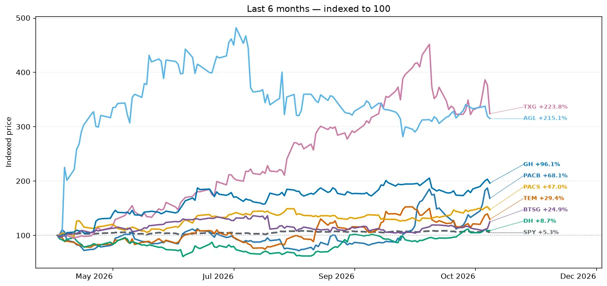

### Last 12 months

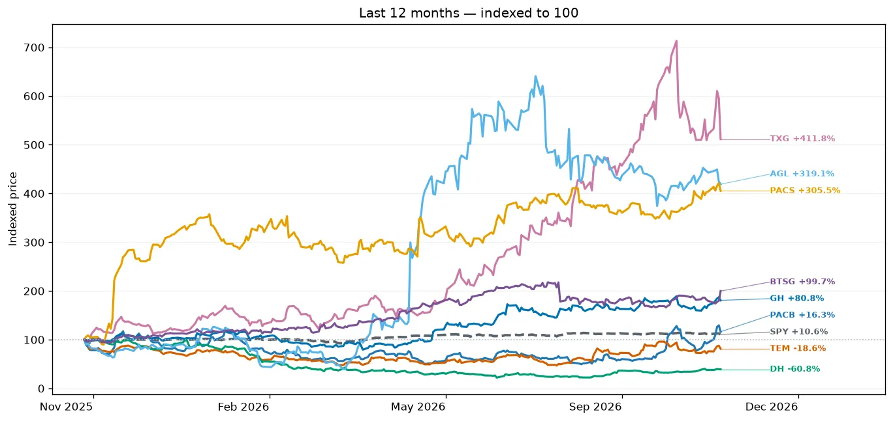

### Last 24 months

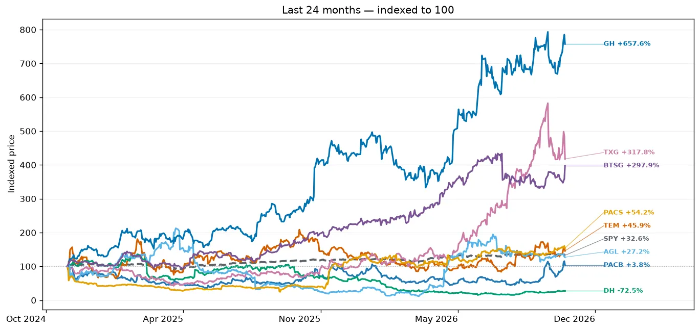

## Current Top Stocks

### Last 3 months

<table class="sortable"><thead><tr><th class="sortable-heading" data-column="0" data-type="number">Rank</th><th class="sortable-heading" data-column="1" data-type="text">Company</th><th class="sortable-heading" data-column="2" data-type="text">Ticker</th><th class="sortable-heading" data-column="3" data-type="number">Market cap</th><th class="sortable-heading" data-column="4" data-type="number">3m Return</th></tr></thead><tbody><tr><td class="" data-sort="1" style="">1</td><td class="text" data-sort="pacbio" style="">PacBio</td><td class="text text" data-sort="pacb" style=""><a href="https://www.google.com/finance/quote/PACB:NASDAQ?hl=en" target="_blank" rel="noopener">PACB</a></td><td class="" data-sort="447266430.71999997" style="">$447.3M</td><td class="" data-sort="0.8607142857142858" style="background:#1a7a3c;color:#ffffff;">+86.1%</td></tr><tr><td class="" data-sort="2" style="">2</td><td class="text" data-sort="tempus ai" style=""><a href="#earnings-tem">Tempus AI</a></td><td class="text text" data-sort="tem" style=""><a href="https://www.google.com/finance/quote/TEM:NASDAQ?hl=en" target="_blank" rel="noopener">TEM</a></td><td class="" data-sort="8489455269.799999" style="">$8.5B</td><td class="" data-sort="0.6462274903122864" style="background:#2f9e44;color:#111820;">+64.6%</td></tr><tr><td class="" data-sort="3" style="">3</td><td class="text" data-sort="definitive healthcare" style="">Definitive Healthcare</td><td class="text text" data-sort="dh" style=""><a href="https://www.google.com/finance/quote/DH:NASDAQ?hl=en" target="_blank" rel="noopener">DH</a></td><td class="" data-sort="106744713.0" style="">$106.7M</td><td class="" data-sort="0.6415066686208415" style="background:#2f9e44;color:#111820;">+64.2%</td></tr><tr><td class="" data-sort="4" style="">4</td><td class="text" data-sort="doximity" style="">Doximity</td><td class="text text" data-sort="docs" style=""><a href="https://www.google.com/finance/quote/DOCS:NYSE?hl=en" target="_blank" rel="noopener">DOCS</a></td><td class="" data-sort="5839338304.799999" style="">$5.8B</td><td class="" data-sort="0.5667144906743184" style="background:#2f9e44;color:#111820;">+56.7%</td></tr><tr><td class="" data-sort="5" style="">5</td><td class="text" data-sort="natera" style="">Natera</td><td class="text text" data-sort="ntra" style=""><a href="https://www.google.com/finance/quote/NTRA:NASDAQ?hl=en" target="_blank" rel="noopener">NTRA</a></td><td class="" data-sort="39411440972.58" style="">$39.4B</td><td class="" data-sort="0.5472811472960861" style="background:#2f9e44;color:#111820;">+54.7%</td></tr></tbody></table>

### Last 12 months

<table class="sortable"><thead><tr><th class="sortable-heading" data-column="0" data-type="number">Rank</th><th class="sortable-heading" data-column="1" data-type="text">Company</th><th class="sortable-heading" data-column="2" data-type="text">Ticker</th><th class="sortable-heading" data-column="3" data-type="number">Market cap</th><th class="sortable-heading" data-column="4" data-type="number">12m Return</th></tr></thead><tbody><tr><td class="" data-sort="1" style="">1</td><td class="text" data-sort="10x genomics" style="">10x Genomics</td><td class="text text" data-sort="txg" style=""><a href="https://www.google.com/finance/quote/TXG:NASDAQ?hl=en" target="_blank" rel="noopener">TXG</a></td><td class="" data-sort="6076123205.54" style="">$6.1B</td><td class="" data-sort="4.140029325513196" style="background:#1a7a3c;color:#ffffff;">+414.0%</td></tr><tr><td class="" data-sort="2" style="">2</td><td class="text" data-sort="agilon health" style="">Agilon Health</td><td class="text text" data-sort="agl" style=""><a href="https://www.google.com/finance/quote/AGL:NYSE?hl=en" target="_blank" rel="noopener">AGL</a></td><td class="" data-sort="1429267795.2" style="">$1.4B</td><td class="" data-sort="3.263653483992467" style="background:#2f9e44;color:#111820;">+326.4%</td></tr><tr><td class="" data-sort="3" style="">3</td><td class="text" data-sort="pacs group" style="">PACS Group</td><td class="text text" data-sort="pacs" style=""><a href="https://www.google.com/finance/quote/PACS:NYSE?hl=en" target="_blank" rel="noopener">PACS</a></td><td class="" data-sort="7570025609.72" style="">$7.6B</td><td class="" data-sort="2.9577814569536427" style="background:#2f9e44;color:#111820;">+295.8%</td></tr><tr><td class="" data-sort="4" style="">4</td><td class="text" data-sort="lifestance health" style="">Lifestance Health</td><td class="text text" data-sort="lfst" style=""><a href="https://www.google.com/finance/quote/LFST:NASDAQ?hl=en" target="_blank" rel="noopener">LFST</a></td><td class="" data-sort="5094065569.8" style="">$5.1B</td><td class="" data-sort="1.7346938775510203" style="background:#7cc077;color:#111820;">+173.5%</td></tr><tr><td class="" data-sort="5" style="">5</td><td class="text" data-sort="amwell" style="">Amwell</td><td class="text text" data-sort="amwl" style=""><a href="https://www.google.com/finance/quote/AMWL:NYSE?hl=en" target="_blank" rel="noopener">AMWL</a></td><td class="" data-sort="216521489.34" style="">$216.5M</td><td class="" data-sort="1.4386973180076632" style="background:#a9d9a4;color:#111820;">+143.9%</td></tr></tbody></table>

### Last 24 months

<table class="sortable"><thead><tr><th class="sortable-heading" data-column="0" data-type="number">Rank</th><th class="sortable-heading" data-column="1" data-type="text">Company</th><th class="sortable-heading" data-column="2" data-type="text">Ticker</th><th class="sortable-heading" data-column="3" data-type="number">Market cap</th><th class="sortable-heading" data-column="4" data-type="number">24m Return</th></tr></thead><tbody><tr><td class="" data-sort="1" style="">1</td><td class="text" data-sort="guardant health" style="">Guardant Health</td><td class="text text" data-sort="gh" style=""><a href="https://www.google.com/finance/quote/GH:NASDAQ?hl=en" target="_blank" rel="noopener">GH</a></td><td class="" data-sort="21443206004.3" style="">$21.4B</td><td class="" data-sort="6.773913043478261" style="background:#1a7a3c;color:#ffffff;">+677.4%</td></tr><tr><td class="" data-sort="2" style="">2</td><td class="text" data-sort="10x genomics" style="">10x Genomics</td><td class="text text" data-sort="txg" style=""><a href="https://www.google.com/finance/quote/TXG:NASDAQ?hl=en" target="_blank" rel="noopener">TXG</a></td><td class="" data-sort="6076123205.54" style="">$6.1B</td><td class="" data-sort="3.293325168401715" style="background:#7cc077;color:#111820;">+329.3%</td></tr><tr><td class="" data-sort="3" style="">3</td><td class="text" data-sort="brightspring health services" style=""><a href="#earnings-btsg">BrightSpring Health Services</a></td><td class="text text" data-sort="btsg" style=""><a href="https://www.google.com/finance/quote/BTSG:NASDAQ?hl=en" target="_blank" rel="noopener">BTSG</a></td><td class="" data-sort="12419938407.57" style="">$12.4B</td><td class="" data-sort="2.87768115942029" style="background:#7cc077;color:#111820;">+287.8%</td></tr><tr><td class="" data-sort="4" style="">4</td><td class="text" data-sort="natera" style="">Natera</td><td class="text text" data-sort="ntra" style=""><a href="https://www.google.com/finance/quote/NTRA:NASDAQ?hl=en" target="_blank" rel="noopener">NTRA</a></td><td class="" data-sort="39411440972.58" style="">$39.4B</td><td class="" data-sort="2.3368234536082477" style="background:#a9d9a4;color:#111820;">+233.7%</td></tr><tr><td class="" data-sort="5" style="">5</td><td class="text" data-sort="aveanna healthcare" style="">Aveanna Healthcare</td><td class="text text" data-sort="avah" style=""><a href="https://www.google.com/finance/quote/AVAH:NASDAQ?hl=en" target="_blank" rel="noopener">AVAH</a></td><td class="" data-sort="2038188700.08" style="">$2.0B</td><td class="" data-sort="1.8671023965141615" style="background:#a9d9a4;color:#111820;">+186.7%</td></tr></tbody></table>

## Companies by Subcategory

<h3 id="category-payers"><a href="#subcategory-performance">Payers</a>Last 3m: +0.5%</h3>

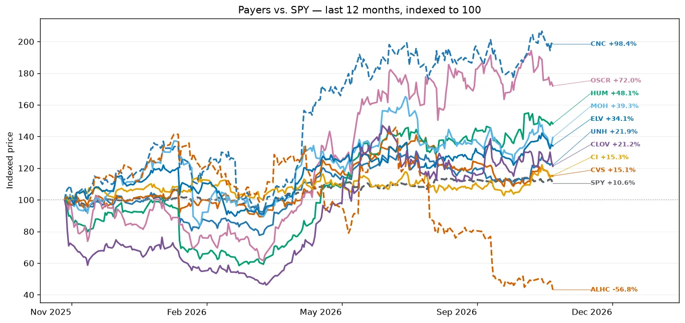

<table class="sortable"><thead><tr><th class="sortable-heading" data-column="0" data-type="text">Company</th><th class="sortable-heading" data-column="1" data-type="text">Ticker</th><th class="sortable-heading" data-column="2" data-type="number">Market cap</th><th class="sortable-heading" data-column="3" data-type="number">3m Return</th><th class="sortable-heading" data-column="4" data-type="number">12m Return</th><th class="sortable-heading" data-column="5" data-type="number">24m Return</th></tr></thead><tbody><tr><td class="text" data-sort="unitedhealth" style="">UnitedHealth</td><td class="text text" data-sort="unh" style=""><a href="https://www.google.com/finance/quote/UNH:NYSE?hl=en" target="_blank" rel="noopener">UNH</a></td><td class="" data-sort="360321499431.21" style="">$360.3B</td><td class="" data-sort="-0.017929536679536562" style="background:#fbd5d4;color:#111820;">-1.8%</td><td class="" data-sort="0.19150368895655245" style="background:#a9d9a4;color:#111820;">+19.2%</td><td class="" data-sort="-0.28294805835506365" style="background:#f5aead;color:#111820;">-28.3%</td></tr><tr><td class="text" data-sort="cvs health" style="">CVS Health</td><td class="text text" data-sort="cvs" style=""><a href="https://www.google.com/finance/quote/CVS:NYSE?hl=en" target="_blank" rel="noopener">CVS</a></td><td class="" data-sort="118125703280.84" style="">$118.1B</td><td class="" data-sort="-0.13578473618691955" style="background:#f5aead;color:#111820;">-13.6%</td><td class="" data-sort="0.15483045425463837" style="background:#d6ecd4;color:#111820;">+15.5%</td><td class="" data-sort="0.6170937108045154" style="background:#1a7a3c;color:#ffffff;">+61.7%</td></tr><tr><td class="text" data-sort="humana" style="">Humana</td><td class="text text" data-sort="hum" style=""><a href="https://www.google.com/finance/quote/HUM:NYSE?hl=en" target="_blank" rel="noopener">HUM</a></td><td class="" data-sort="49773287666.0" style="">$49.8B</td><td class="" data-sort="0.13917440773924028" style="background:#a9d9a4;color:#111820;">+13.9%</td><td class="" data-sort="0.4899888565368993" style="background:#7cc077;color:#111820;">+49.0%</td><td class="" data-sort="0.5898891488627211" style="background:#1a7a3c;color:#ffffff;">+59.0%</td></tr><tr><td class="text" data-sort="oscar health" style="">Oscar Health</td><td class="text text" data-sort="oscr" style=""><a href="https://www.google.com/finance/quote/OSCR:NYSE?hl=en" target="_blank" rel="noopener">OSCR</a></td><td class="" data-sort="9373548650.0" style="">$9.4B</td><td class="" data-sort="-0.027226137091607927" style="background:#fbd5d4;color:#111820;">-2.7%</td><td class="" data-sort="0.6872222222222222" style="background:#2f9e44;color:#111820;">+68.7%</td><td class="" data-sort="0.7206798866855526" style="background:#1a7a3c;color:#ffffff;">+72.1%</td></tr><tr><td class="text" data-sort="molina healthcare" style="">Molina Healthcare</td><td class="text text" data-sort="moh" style=""><a href="https://www.google.com/finance/quote/MOH:NYSE?hl=en" target="_blank" rel="noopener">MOH</a></td><td class="" data-sort="10648560000.0" style="">$10.6B</td><td class="" data-sort="0.04682547796748793" style="background:#d6ecd4;color:#111820;">+4.7%</td><td class="" data-sort="0.33790670325362604" style="background:#a9d9a4;color:#111820;">+33.8%</td><td class="" data-sort="-0.37328232593726085" style="background:#ee8483;color:#111820;">-37.3%</td></tr><tr><td class="text" data-sort="cigna" style="">Cigna</td><td class="text text" data-sort="ci" style=""><a href="https://www.google.com/finance/quote/CI:NYSE?hl=en" target="_blank" rel="noopener">CI</a></td><td class="" data-sort="78804440139.78" style="">$78.8B</td><td class="" data-sort="0.06873320193513699" style="background:#d6ecd4;color:#111820;">+6.9%</td><td class="" data-sort="0.2202037559837977" style="background:#a9d9a4;color:#111820;">+22.0%</td><td class="" data-sort="-0.057695345824512634" style="background:#fbd5d4;color:#111820;">-5.8%</td></tr><tr><td class="text" data-sort="elevance" style="">Elevance</td><td class="text text" data-sort="elv" style=""><a href="https://www.google.com/finance/quote/ELV:NYSE?hl=en" target="_blank" rel="noopener">ELV</a></td><td class="" data-sort="91100282650.3" style="">$91.1B</td><td class="" data-sort="0.11768305661983836" style="background:#a9d9a4;color:#111820;">+11.8%</td><td class="" data-sort="0.32430643127364434" style="background:#a9d9a4;color:#111820;">+32.4%</td><td class="" data-sort="0.014637327600782513" style="background:#d6ecd4;color:#111820;">+1.5%</td></tr><tr><td class="text" data-sort="clover health" style="">Clover Health</td><td class="text text" data-sort="clov" style=""><a href="https://www.google.com/finance/quote/CLOV:NASDAQ?hl=en" target="_blank" rel="noopener">CLOV</a></td><td class="" data-sort="2368956932.98" style="">$2.4B</td><td class="" data-sort="0.0695443645083933" style="background:#d6ecd4;color:#111820;">+7.0%</td><td class="" data-sort="0.2634560906515582" style="background:#a9d9a4;color:#111820;">+26.3%</td><td class="" data-sort="0.06190476190476191" style="background:#d6ecd4;color:#111820;">+6.2%</td></tr><tr><td class="text" data-sort="centene" style=""><a href="#earnings-cnc">Centene</a></td><td class="text text" data-sort="cnc" style=""><a href="https://www.google.com/finance/quote/CNC:NYSE?hl=en" target="_blank" rel="noopener">CNC</a></td><td class="" data-sort="33887404600.0" style="">$33.9B</td><td class="" data-sort="0.10012857602057212" style="background:#d6ecd4;color:#111820;">+10.0%</td><td class="" data-sort="0.9352558665535766" style="background:#1a7a3c;color:#ffffff;">+93.5%</td><td class="" data-sort="0.07761335012594461" style="background:#d6ecd4;color:#111820;">+7.8%</td></tr><tr><td class="text" data-sort="alignment health" style=""><a href="#earnings-alhc">Alignment Health</a></td><td class="text text" data-sort="alhc" style=""><a href="https://www.google.com/finance/quote/ALHC:NASDAQ?hl=en" target="_blank" rel="noopener">ALHC</a></td><td class="" data-sort="1521381224.3799999" style="">$1.5B</td><td class="" data-sort="-0.5104377104377105" style="background:#c0302f;color:#ffffff;">-51.0%</td><td class="" data-sort="-0.5688018979833926" style="background:#e34948;color:#111820;">-56.9%</td><td class="" data-sort="-0.43861003861003867" style="background:#e34948;color:#111820;">-43.9%</td></tr></tbody></table>

<h3 id="category-health-system-providers"><a href="#subcategory-performance">Health System Providers</a>Last 3m: +14.7%</h3>

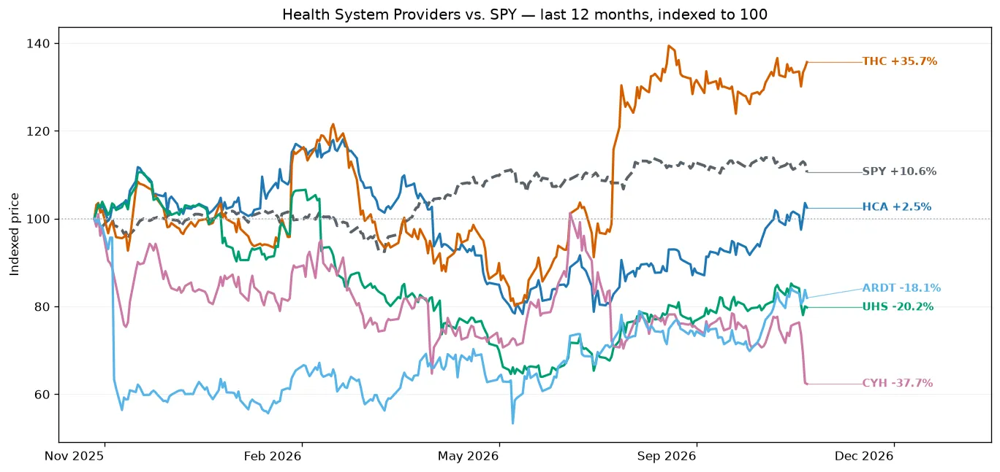

<table class="sortable"><thead><tr><th class="sortable-heading" data-column="0" data-type="text">Company</th><th class="sortable-heading" data-column="1" data-type="text">Ticker</th><th class="sortable-heading" data-column="2" data-type="number">Market cap</th><th class="sortable-heading" data-column="3" data-type="number">3m Return</th><th class="sortable-heading" data-column="4" data-type="number">12m Return</th><th class="sortable-heading" data-column="5" data-type="number">24m Return</th></tr></thead><tbody><tr><td class="text" data-sort="hca healthcare" style=""><a href="#earnings-hca">HCA Healthcare</a></td><td class="text text" data-sort="hca" style=""><a href="https://www.google.com/finance/quote/HCA:NYSE?hl=en" target="_blank" rel="noopener">HCA</a></td><td class="" data-sort="98845842075.0" style="">$98.8B</td><td class="" data-sort="0.17536451476688453" style="background:#1a7a3c;color:#ffffff;">+17.5%</td><td class="" data-sort="0.029390010442046588" style="background:#d6ecd4;color:#111820;">+2.9%</td><td class="" data-sort="0.32475713205856827" style="background:#7cc077;color:#111820;">+32.5%</td></tr><tr><td class="text" data-sort="tenet health" style=""><a href="#earnings-thc">Tenet Health</a></td><td class="text text" data-sort="thc" style=""><a href="https://www.google.com/finance/quote/THC:NYSE?hl=en" target="_blank" rel="noopener">THC</a></td><td class="" data-sort="21747421000.0" style="">$21.7B</td><td class="" data-sort="0.07249391631996227" style="background:#7cc077;color:#111820;">+7.2%</td><td class="" data-sort="0.3233086348007166" style="background:#1a7a3c;color:#ffffff;">+32.3%</td><td class="" data-sort="0.7501441106769999" style="background:#1a7a3c;color:#ffffff;">+75.0%</td></tr><tr><td class="text" data-sort="universal health services" style=""><a href="#earnings-uhs">Universal Health Services</a></td><td class="text text" data-sort="uhs" style=""><a href="https://www.google.com/finance/quote/UHS:NYSE?hl=en" target="_blank" rel="noopener">UHS</a></td><td class="" data-sort="10375773465.75" style="">$10.4B</td><td class="" data-sort="0.04517929232961304" style="background:#a9d9a4;color:#111820;">+4.5%</td><td class="" data-sort="-0.18874706234735716" style="background:#ee8483;color:#111820;">-18.9%</td><td class="" data-sort="-0.14230731754847503" style="background:#fbd5d4;color:#111820;">-14.2%</td></tr><tr><td class="text" data-sort="community health systems" style=""><a href="#earnings-cyh">Community Health Systems</a></td><td class="text text" data-sort="cyh" style=""><a href="https://www.google.com/finance/quote/CYH:NYSE?hl=en" target="_blank" rel="noopener">CYH</a></td><td class="" data-sort="417387696.71999997" style="">$417.4M</td><td class="" data-sort="-0.13978494623655924" style="background:#e34948;color:#111820;">-14.0%</td><td class="" data-sort="-0.38144329896907214" style="background:#c0302f;color:#ffffff;">-38.1%</td><td class="" data-sort="-0.4285714285714286" style="background:#ee8483;color:#111820;">-42.9%</td></tr><tr><td class="text" data-sort="ardent health partners" style="">Ardent Health Partners</td><td class="text text" data-sort="ardt" style=""><a href="https://www.google.com/finance/quote/ARDT:NYSE?hl=en" target="_blank" rel="noopener">ARDT</a></td><td class="" data-sort="1541012833.25" style="">$1.5B</td><td class="" data-sort="0.12746016869728205" style="background:#2f9e44;color:#111820;">+12.7%</td><td class="" data-sort="-0.1737637362637363" style="background:#ee8483;color:#111820;">-17.4%</td><td class="" data-sort="-0.3203389830508475" style="background:#ee8483;color:#111820;">-32.0%</td></tr></tbody></table>

<h3 id="category-inpatient-non-acute-providers"><a href="#subcategory-performance">Inpatient Non-Acute Providers</a>Last 3m: +10.2%</h3>

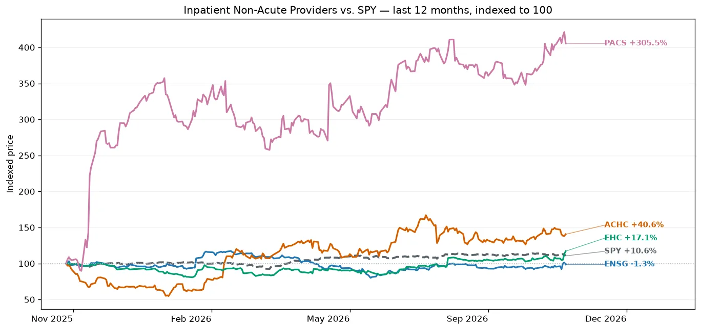

<table class="sortable"><thead><tr><th class="sortable-heading" data-column="0" data-type="text">Company</th><th class="sortable-heading" data-column="1" data-type="text">Ticker</th><th class="sortable-heading" data-column="2" data-type="number">Market cap</th><th class="sortable-heading" data-column="3" data-type="number">3m Return</th><th class="sortable-heading" data-column="4" data-type="number">12m Return</th><th class="sortable-heading" data-column="5" data-type="number">24m Return</th></tr></thead><tbody><tr><td class="text" data-sort="the ensign group" style=""><a href="#earnings-ensg">The Ensign Group</a></td><td class="text text" data-sort="ensg" style=""><a href="https://www.google.com/finance/quote/ENSG:NASDAQ?hl=en" target="_blank" rel="noopener">ENSG</a></td><td class="" data-sort="10589997692.32" style="">$10.6B</td><td class="" data-sort="0.018859452177817815" style="background:#d6ecd4;color:#111820;">+1.9%</td><td class="" data-sort="0.007884508606329943" style="background:#d6ecd4;color:#111820;">+0.8%</td><td class="" data-sort="0.1761809110347956" style="background:#7cc077;color:#111820;">+17.6%</td></tr><tr><td class="text" data-sort="acadia healthcare" style="">Acadia Healthcare</td><td class="text text" data-sort="achc" style=""><a href="https://www.google.com/finance/quote/ACHC:NASDAQ?hl=en" target="_blank" rel="noopener">ACHC</a></td><td class="" data-sort="2789284239.0" style="">$2.8B</td><td class="" data-sort="0.011478730587440866" style="background:#d6ecd4;color:#111820;">+1.1%</td><td class="" data-sort="0.39348837209302334" style="background:#d6ecd4;color:#111820;">+39.3%</td><td class="" data-sort="-0.2870061875297478" style="background:#e34948;color:#111820;">-28.7%</td></tr><tr><td class="text" data-sort="encompass health" style=""><a href="#earnings-ehc">Encompass Health</a></td><td class="text text" data-sort="ehc" style=""><a href="https://www.google.com/finance/quote/EHC:NYSE?hl=en" target="_blank" rel="noopener">EHC</a></td><td class="" data-sort="13358970000.0" style="">$13.4B</td><td class="" data-sort="0.22355271450436676" style="background:#1a7a3c;color:#ffffff;">+22.4%</td><td class="" data-sort="0.19367588932806346" style="background:#d6ecd4;color:#111820;">+19.4%</td><td class="" data-sort="0.3739763421292084" style="background:#1a7a3c;color:#ffffff;">+37.4%</td></tr><tr><td class="text" data-sort="pacs group" style="">PACS Group</td><td class="text text" data-sort="pacs" style=""><a href="https://www.google.com/finance/quote/PACS:NYSE?hl=en" target="_blank" rel="noopener">PACS</a></td><td class="" data-sort="7570025609.72" style="">$7.6B</td><td class="" data-sort="0.039121930015214135" style="background:#d6ecd4;color:#111820;">+3.9%</td><td class="" data-sort="2.9577814569536427" style="background:#1a7a3c;color:#ffffff;">+295.8%</td><td class="" data-sort="0.11341406613879834" style="background:#a9d9a4;color:#111820;">+11.3%</td></tr></tbody></table>

<h3 id="category-value-based-care"><a href="#subcategory-performance">Value-Based Care</a>Last 3m: -2.0%</h3>

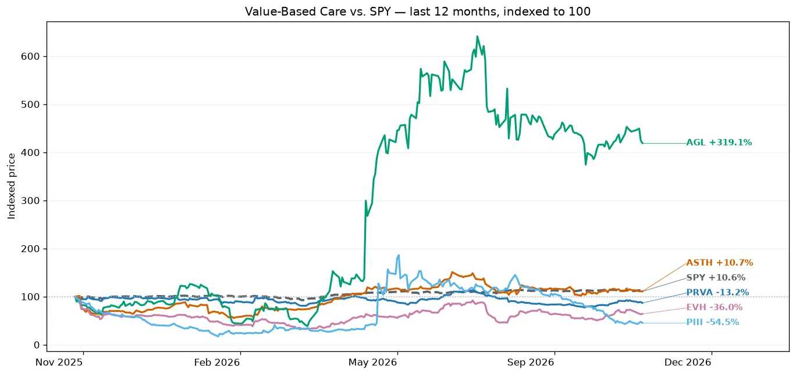

<table class="sortable"><thead><tr><th class="sortable-heading" data-column="0" data-type="text">Company</th><th class="sortable-heading" data-column="1" data-type="text">Ticker</th><th class="sortable-heading" data-column="2" data-type="number">Market cap</th><th class="sortable-heading" data-column="3" data-type="number">3m Return</th><th class="sortable-heading" data-column="4" data-type="number">12m Return</th><th class="sortable-heading" data-column="5" data-type="number">24m Return</th></tr></thead><tbody><tr><td class="text" data-sort="privia health group" style="">Privia Health Group</td><td class="text text" data-sort="prva" style=""><a href="https://www.google.com/finance/quote/PRVA:NASDAQ?hl=en" target="_blank" rel="noopener">PRVA</a></td><td class="" data-sort="2743730766.36" style="">$2.7B</td><td class="" data-sort="-0.09252217997465151" style="background:#fbd5d4;color:#111820;">-9.3%</td><td class="" data-sort="-0.11604938271604937" style="background:#fbd5d4;color:#111820;">-11.6%</td><td class="" data-sort="0.1311216429699844" style="background:#d6ecd4;color:#111820;">+13.1%</td></tr><tr><td class="text" data-sort="astrana health" style="">Astrana Health</td><td class="text text" data-sort="asth" style=""><a href="https://www.google.com/finance/quote/ASTH:NASDAQ?hl=en" target="_blank" rel="noopener">ASTH</a></td><td class="" data-sort="1812047489.98" style="">$1.8B</td><td class="" data-sort="0.02727784026996627" style="background:#d6ecd4;color:#111820;">+2.7%</td><td class="" data-sort="0.1704581864786927" style="background:#d6ecd4;color:#111820;">+17.0%</td><td class="" data-sort="-0.3300935264991748" style="background:#ee8483;color:#111820;">-33.0%</td></tr><tr><td class="text" data-sort="agilon health" style="">Agilon Health</td><td class="text text" data-sort="agl" style=""><a href="https://www.google.com/finance/quote/AGL:NYSE?hl=en" target="_blank" rel="noopener">AGL</a></td><td class="" data-sort="1429267795.2" style="">$1.4B</td><td class="" data-sort="-0.07324527889968335" style="background:#fbd5d4;color:#111820;">-7.3%</td><td class="" data-sort="3.263653483992467" style="background:#1a7a3c;color:#ffffff;">+326.4%</td><td class="" data-sort="0.2577777777777779" style="background:#a9d9a4;color:#111820;">+25.8%</td></tr><tr><td class="text" data-sort="evolent health" style="">Evolent Health</td><td class="text text" data-sort="evh" style=""><a href="https://www.google.com/finance/quote/EVH:NYSE?hl=en" target="_blank" rel="noopener">EVH</a></td><td class="" data-sort="486155140.5" style="">$486.2M</td><td class="" data-sort="0.39158576051779925" style="background:#2f9e44;color:#111820;">+39.2%</td><td class="" data-sort="-0.3553223388305847" style="background:#fbd5d4;color:#111820;">-35.5%</td><td class="" data-sort="-0.8167092924126172" style="background:#c0302f;color:#ffffff;">-81.7%</td></tr><tr><td class="text" data-sort="p3 health" style="">P3 Health</td><td class="text text" data-sort="piii" style=""><a href="https://www.google.com/finance/quote/PIII:NASDAQ?hl=en" target="_blank" rel="noopener">PIII</a></td><td class="" data-sort="15765206.860000001" style="">$15.8M</td><td class="" data-sort="-0.590030518819939" style="background:#c0302f;color:#ffffff;">-59.0%</td><td class="" data-sort="-0.5394285714285714" style="background:#fbd5d4;color:#111820;">-53.9%</td><td class="" data-sort="-0.7809782608695652" style="background:#c0302f;color:#ffffff;">-78.1%</td></tr></tbody></table>

<h3 id="category-outpatient-and-home-providers"><a href="#subcategory-performance">Outpatient and Home Providers</a>Last 3m: +5.4%</h3>

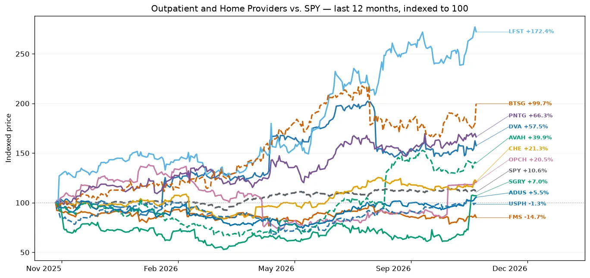

<table class="sortable"><thead><tr><th class="sortable-heading" data-column="0" data-type="text">Company</th><th class="sortable-heading" data-column="1" data-type="text">Ticker</th><th class="sortable-heading" data-column="2" data-type="number">Market cap</th><th class="sortable-heading" data-column="3" data-type="number">3m Return</th><th class="sortable-heading" data-column="4" data-type="number">12m Return</th><th class="sortable-heading" data-column="5" data-type="number">24m Return</th></tr></thead><tbody><tr><td class="text" data-sort="davita" style=""><a href="#earnings-dva">Davita</a></td><td class="text text" data-sort="dva" style=""><a href="https://www.google.com/finance/quote/DVA:NYSE?hl=en" target="_blank" rel="noopener">DVA</a></td><td class="" data-sort="11793750000.0" style="">$11.8B</td><td class="" data-sort="-0.2190428589279021" style="background:#ee8483;color:#111820;">-21.9%</td><td class="" data-sort="0.5753654847924718" style="background:#a9d9a4;color:#111820;">+57.5%</td><td class="" data-sort="0.3242460625750405" style="background:#d6ecd4;color:#111820;">+32.4%</td></tr><tr><td class="text" data-sort="fresenius" style="">Fresenius</td><td class="text text" data-sort="fms" style=""><a href="https://www.google.com/finance/quote/FMS:NYSE?hl=en" target="_blank" rel="noopener">FMS</a></td><td class="" data-sort="11958969243.9" style="">$12.0B</td><td class="" data-sort="-0.12431800467653942" style="background:#f5aead;color:#111820;">-12.4%</td><td class="" data-sort="-0.16281669150521616" style="background:#fbd5d4;color:#111820;">-16.3%</td><td class="" data-sort="0.13714574898785403" style="background:#d6ecd4;color:#111820;">+13.7%</td></tr><tr><td class="text" data-sort="surgery partners" style="">Surgery Partners</td><td class="text text" data-sort="sgry" style=""><a href="https://www.google.com/finance/quote/SGRY:NASDAQ?hl=en" target="_blank" rel="noopener">SGRY</a></td><td class="" data-sort="2991184015.1600003" style="">$3.0B</td><td class="" data-sort="0.5071428571428571" style="background:#1a7a3c;color:#ffffff;">+50.7%</td><td class="" data-sort="0.05836753305973552" style="background:#d6ecd4;color:#111820;">+5.8%</td><td class="" data-sort="-0.19269565217391305" style="background:#fbd5d4;color:#111820;">-19.3%</td></tr><tr><td class="text" data-sort="option care health" style="">Option Care Health</td><td class="text text" data-sort="opch" style=""><a href="https://www.google.com/finance/quote/OPCH:NASDAQ?hl=en" target="_blank" rel="noopener">OPCH</a></td><td class="" data-sort="4767926118.2699995" style="">$4.8B</td><td class="" data-sort="0.38211029092488036" style="background:#2f9e44;color:#111820;">+38.2%</td><td class="" data-sort="0.2228198232808296" style="background:#d6ecd4;color:#111820;">+22.3%</td><td class="" data-sort="0.3201990875155536" style="background:#d6ecd4;color:#111820;">+32.0%</td></tr><tr><td class="text" data-sort="lifestance health" style="">Lifestance Health</td><td class="text text" data-sort="lfst" style=""><a href="https://www.google.com/finance/quote/LFST:NASDAQ?hl=en" target="_blank" rel="noopener">LFST</a></td><td class="" data-sort="5094065569.8" style="">$5.1B</td><td class="" data-sort="0.27862595419847325" style="background:#7cc077;color:#111820;">+27.9%</td><td class="" data-sort="1.7346938775510203" style="background:#1a7a3c;color:#ffffff;">+173.5%</td><td class="" data-sort="0.9676945668135097" style="background:#a9d9a4;color:#111820;">+96.8%</td></tr><tr><td class="text" data-sort="chemed (vitas)" style=""><a href="#earnings-che">Chemed (Vitas)</a></td><td class="text text" data-sort="che" style=""><a href="https://www.google.com/finance/quote/CHE:NYSE?hl=en" target="_blank" rel="noopener">CHE</a></td><td class="" data-sort="7054119350.92" style="">$7.1B</td><td class="" data-sort="0.004640676373884434" style="background:#d6ecd4;color:#111820;">+0.5%</td><td class="" data-sort="0.23978669139809883" style="background:#d6ecd4;color:#111820;">+24.0%</td><td class="" data-sort="0.0057177249473368" style="background:#d6ecd4;color:#111820;">+0.6%</td></tr><tr><td class="text" data-sort="addus homecare" style="">Addus HomeCare</td><td class="text text" data-sort="adus" style=""><a href="https://www.google.com/finance/quote/ADUS:NASDAQ?hl=en" target="_blank" rel="noopener">ADUS</a></td><td class="" data-sort="2121438440.1599998" style="">$2.1B</td><td class="" data-sort="0.08711465188777279" style="background:#d6ecd4;color:#111820;">+8.7%</td><td class="" data-sort="0.07400119770724611" style="background:#d6ecd4;color:#111820;">+7.4%</td><td class="" data-sort="-0.0057812623742772296" style="background:#fbd5d4;color:#111820;">-0.6%</td></tr><tr><td class="text" data-sort="pennant group" style="">Pennant Group</td><td class="text text" data-sort="pntg" style=""><a href="https://www.google.com/finance/quote/PNTG:NASDAQ?hl=en" target="_blank" rel="noopener">PNTG</a></td><td class="" data-sort="1342375375.77" style="">$1.3B</td><td class="" data-sort="0.03323412698412698" style="background:#d6ecd4;color:#111820;">+3.3%</td><td class="" data-sort="0.6845936109987867" style="background:#a9d9a4;color:#111820;">+68.5%</td><td class="" data-sort="0.28224068944290526" style="background:#d6ecd4;color:#111820;">+28.2%</td></tr><tr><td class="text" data-sort="us physical therapy" style="">US Physical Therapy</td><td class="text text" data-sort="usph" style=""><a href="https://www.google.com/finance/quote/USPH:NYSE?hl=en" target="_blank" rel="noopener">USPH</a></td><td class="" data-sort="1154497333.54" style="">$1.2B</td><td class="" data-sort="0.08563116620288391" style="background:#d6ecd4;color:#111820;">+8.6%</td><td class="" data-sort="-0.005100266604845194" style="background:#fbd5d4;color:#111820;">-0.5%</td><td class="" data-sort="0.054681739985254385" style="background:#d6ecd4;color:#111820;">+5.5%</td></tr><tr><td class="text" data-sort="brightspring health services" style=""><a href="#earnings-btsg">BrightSpring Health Services</a></td><td class="text text" data-sort="btsg" style=""><a href="https://www.google.com/finance/quote/BTSG:NASDAQ?hl=en" target="_blank" rel="noopener">BTSG</a></td><td class="" data-sort="12419938407.57" style="">$12.4B</td><td class="" data-sort="0.12024786467928328" style="background:#a9d9a4;color:#111820;">+12.0%</td><td class="" data-sort="1.0239031770045388" style="background:#7cc077;color:#111820;">+102.4%</td><td class="" data-sort="2.87768115942029" style="background:#1a7a3c;color:#ffffff;">+287.8%</td></tr><tr><td class="text" data-sort="aveanna healthcare" style="">Aveanna Healthcare</td><td class="text text" data-sort="avah" style=""><a href="https://www.google.com/finance/quote/AVAH:NASDAQ?hl=en" target="_blank" rel="noopener">AVAH</a></td><td class="" data-sort="2038188700.08" style="">$2.0B</td><td class="" data-sort="0.40149094781682626" style="background:#2f9e44;color:#111820;">+40.1%</td><td class="" data-sort="0.45414364640883975" style="background:#a9d9a4;color:#111820;">+45.4%</td><td class="" data-sort="1.8671023965141615" style="background:#2f9e44;color:#111820;">+186.7%</td></tr></tbody></table>

<h3 id="category-digital-health-specialty-benefits"><a href="#subcategory-performance">Digital Health, Specialty, Benefits</a>Last 3m: +6.2%</h3>

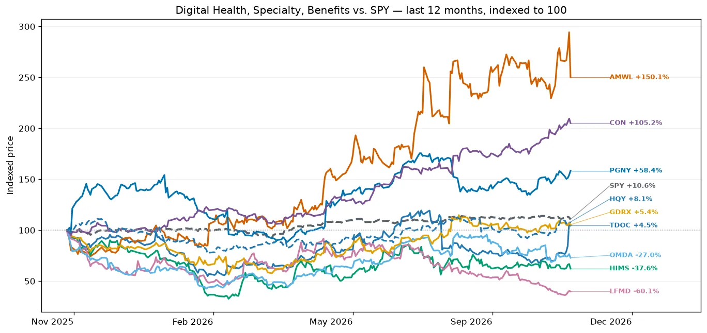

<table class="sortable"><thead><tr><th class="sortable-heading" data-column="0" data-type="text">Company</th><th class="sortable-heading" data-column="1" data-type="text">Ticker</th><th class="sortable-heading" data-column="2" data-type="number">Market cap</th><th class="sortable-heading" data-column="3" data-type="number">3m Return</th><th class="sortable-heading" data-column="4" data-type="number">12m Return</th><th class="sortable-heading" data-column="5" data-type="number">24m Return</th></tr></thead><tbody><tr><td class="text" data-sort="teladoc" style=""><a href="#earnings-tdoc">Teladoc</a></td><td class="text text" data-sort="tdoc" style=""><a href="https://www.google.com/finance/quote/TDOC:NYSE?hl=en" target="_blank" rel="noopener">TDOC</a></td><td class="" data-sort="1551319174.25" style="">$1.6B</td><td class="" data-sort="0.2682563338301043" style="background:#2f9e44;color:#111820;">+26.8%</td><td class="" data-sort="-0.013904982618771822" style="background:#fbd5d4;color:#111820;">-1.4%</td><td class="" data-sort="-0.07600434310532045" style="background:#fbd5d4;color:#111820;">-7.6%</td></tr><tr><td class="text" data-sort="amwell" style="">Amwell</td><td class="text text" data-sort="amwl" style=""><a href="https://www.google.com/finance/quote/AMWL:NYSE?hl=en" target="_blank" rel="noopener">AMWL</a></td><td class="" data-sort="216521489.34" style="">$216.5M</td><td class="" data-sort="0.18418604651162784" style="background:#7cc077;color:#111820;">+18.4%</td><td class="" data-sort="1.4386973180076632" style="background:#1a7a3c;color:#ffffff;">+143.9%</td><td class="" data-sort="0.4144444444444444" style="background:#7cc077;color:#111820;">+41.4%</td></tr><tr><td class="text" data-sort="hims &amp; hers" style="">Hims &amp; Hers</td><td class="text text" data-sort="hims" style=""><a href="https://www.google.com/finance/quote/HIMS:NYSE?hl=en" target="_blank" rel="noopener">HIMS</a></td><td class="" data-sort="6458115271.84" style="">$6.5B</td><td class="" data-sort="-0.0032409074540871163" style="background:#fbd5d4;color:#111820;">-0.3%</td><td class="" data-sort="-0.39111306643202814" style="background:#f5aead;color:#111820;">-39.1%</td><td class="" data-sort="0.3595284872298625" style="background:#a9d9a4;color:#111820;">+36.0%</td></tr><tr><td class="text" data-sort="lifemd" style="">LifeMD</td><td class="text text" data-sort="lfmd" style=""><a href="https://www.google.com/finance/quote/LFMD:NASDAQ?hl=en" target="_blank" rel="noopener">LFMD</a></td><td class="" data-sort="110505866.73" style="">$110.5M</td><td class="" data-sort="-0.34571428571428575" style="background:#c0302f;color:#ffffff;">-34.6%</td><td class="" data-sort="-0.6125211505922166" style="background:#ee8483;color:#111820;">-61.3%</td><td class="" data-sort="-0.46990740740740744" style="background:#ee8483;color:#111820;">-47.0%</td></tr><tr><td class="text" data-sort="omada health" style="">Omada Health</td><td class="text text" data-sort="omda" style=""><a href="https://www.google.com/finance/quote/OMDA:NASDAQ?hl=en" target="_blank" rel="noopener">OMDA</a></td><td class="" data-sort="1146588847.19" style="">$1.1B</td><td class="" data-sort="-0.055947580645161255" style="background:#fbd5d4;color:#111820;">-5.6%</td><td class="" data-sort="-0.23768823768823766" style="background:#fbd5d4;color:#111820;">-23.8%</td><td class="missing" data-sort="—" style="background:#f0efec;color:#111820;">—</td></tr><tr><td class="text" data-sort="goodrx" style="">GoodRx</td><td class="text text" data-sort="gdrx" style=""><a href="https://www.google.com/finance/quote/GDRX:NASDAQ?hl=en" target="_blank" rel="noopener">GDRX</a></td><td class="" data-sort="1190597404.1200001" style="">$1.2B</td><td class="" data-sort="0.1368078175895766" style="background:#a9d9a4;color:#111820;">+13.7%</td><td class="" data-sort="0.035608308605341366" style="background:#d6ecd4;color:#111820;">+3.6%</td><td class="" data-sort="-0.4361873990306947" style="background:#ee8483;color:#111820;">-43.6%</td></tr><tr><td class="text" data-sort="progyny" style="">Progyny</td><td class="text text" data-sort="pgny" style=""><a href="https://www.google.com/finance/quote/PGNY:NASDAQ?hl=en" target="_blank" rel="noopener">PGNY</a></td><td class="" data-sort="2465903007.6" style="">$2.5B</td><td class="" data-sort="-0.06231930613556047" style="background:#fbd5d4;color:#111820;">-6.2%</td><td class="" data-sort="0.5601282736504543" style="background:#a9d9a4;color:#111820;">+56.0%</td><td class="" data-sort="0.9460000000000002" style="background:#1a7a3c;color:#ffffff;">+94.6%</td></tr><tr><td class="text" data-sort="concentra group" style="">Concentra Group</td><td class="text text" data-sort="con" style=""><a href="https://www.google.com/finance/quote/CON:NYSE?hl=en" target="_blank" rel="noopener">CON</a></td><td class="" data-sort="3982170593.6" style="">$4.0B</td><td class="" data-sort="0.275829383886256" style="background:#2f9e44;color:#111820;">+27.6%</td><td class="" data-sort="1.0271084337349397" style="background:#2f9e44;color:#111820;">+102.7%</td><td class="" data-sort="1.010956175298805" style="background:#1a7a3c;color:#ffffff;">+101.1%</td></tr><tr><td class="text" data-sort="healthequity" style="">HealthEquity</td><td class="text text" data-sort="hqy" style=""><a href="https://www.google.com/finance/quote/HQY:NASDAQ?hl=en" target="_blank" rel="noopener">HQY</a></td><td class="" data-sort="8775718420.289999" style="">$8.8B</td><td class="" data-sort="0.018487227909750548" style="background:#d6ecd4;color:#111820;">+1.8%</td><td class="" data-sort="0.08342144216536274" style="background:#d6ecd4;color:#111820;">+8.3%</td><td class="" data-sort="0.1869570253677748" style="background:#d6ecd4;color:#111820;">+18.7%</td></tr></tbody></table>

<h3 id="category-health-it-and-data"><a href="#subcategory-performance">Health IT and Data</a>Last 3m: +7.7%</h3>

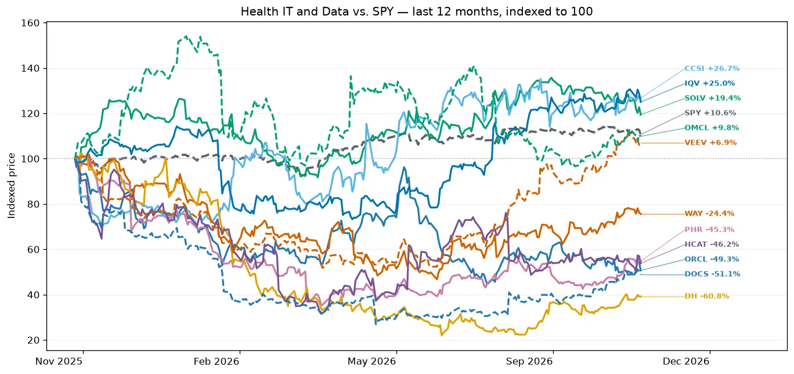

<table class="sortable"><thead><tr><th class="sortable-heading" data-column="0" data-type="text">Company</th><th class="sortable-heading" data-column="1" data-type="text">Ticker</th><th class="sortable-heading" data-column="2" data-type="number">Market cap</th><th class="sortable-heading" data-column="3" data-type="number">3m Return</th><th class="sortable-heading" data-column="4" data-type="number">12m Return</th><th class="sortable-heading" data-column="5" data-type="number">24m Return</th></tr></thead><tbody><tr><td class="text" data-sort="oracle-cerner" style="">Oracle-Cerner</td><td class="text text" data-sort="orcl" style=""><a href="https://www.google.com/finance/quote/ORCL:NYSE?hl=en" target="_blank" rel="noopener">ORCL</a></td><td class="" data-sort="396126255139.82996" style="">$396.1B</td><td class="" data-sort="0.006160006160006004" style="background:#d6ecd4;color:#111820;">+0.6%</td><td class="" data-sort="-0.5024180343475115" style="background:#c0302f;color:#ffffff;">-50.2%</td><td class="" data-sort="-0.23144335960475249" style="background:#f5aead;color:#111820;">-23.1%</td></tr><tr><td class="text" data-sort="waystar" style="">Waystar</td><td class="text text" data-sort="way" style=""><a href="https://www.google.com/finance/quote/WAY:NASDAQ?hl=en" target="_blank" rel="noopener">WAY</a></td><td class="" data-sort="5368955648.0" style="">$5.4B</td><td class="" data-sort="0.32638559924206545" style="background:#7cc077;color:#111820;">+32.6%</td><td class="" data-sort="-0.21896792189679226" style="background:#f5aead;color:#111820;">-21.9%</td><td class="" data-sort="-0.02676399026763987" style="background:#fbd5d4;color:#111820;">-2.7%</td></tr><tr><td class="text" data-sort="solventum" style="">Solventum</td><td class="text text" data-sort="solv" style=""><a href="https://www.google.com/finance/quote/SOLV:NYSE?hl=en" target="_blank" rel="noopener">SOLV</a></td><td class="" data-sort="14606898185.49" style="">$14.6B</td><td class="" data-sort="-0.048103932584269704" style="background:#fbd5d4;color:#111820;">-4.8%</td><td class="" data-sort="0.17801274623406704" style="background:#a9d9a4;color:#111820;">+17.8%</td><td class="" data-sort="0.12241236544300316" style="background:#d6ecd4;color:#111820;">+12.2%</td></tr><tr><td class="text" data-sort="phreesia" style="">Phreesia</td><td class="text text" data-sort="phr" style=""><a href="https://www.google.com/finance/quote/PHR:NYSE?hl=en" target="_blank" rel="noopener">PHR</a></td><td class="" data-sort="772162543.36" style="">$772.2M</td><td class="" data-sort="0.1593662628145387" style="background:#a9d9a4;color:#111820;">+15.9%</td><td class="" data-sort="-0.450530035335689" style="background:#e34948;color:#111820;">-45.1%</td><td class="" data-sort="-0.32647536545749867" style="background:#ee8483;color:#111820;">-32.6%</td></tr><tr><td class="text" data-sort="consensus cloud solutions" style="">Consensus Cloud Solutions</td><td class="text text" data-sort="ccsi" style=""><a href="https://www.google.com/finance/quote/CCSI:NASDAQ?hl=en" target="_blank" rel="noopener">CCSI</a></td><td class="" data-sort="684252587.48" style="">$684.3M</td><td class="" data-sort="0.025824175824175954" style="background:#d6ecd4;color:#111820;">+2.6%</td><td class="" data-sort="0.2735334242837655" style="background:#7cc077;color:#111820;">+27.4%</td><td class="" data-sort="0.6305676855895199" style="background:#1a7a3c;color:#ffffff;">+63.1%</td></tr><tr><td class="text" data-sort="definitive healthcare" style="">Definitive Healthcare</td><td class="text text" data-sort="dh" style=""><a href="https://www.google.com/finance/quote/DH:NASDAQ?hl=en" target="_blank" rel="noopener">DH</a></td><td class="" data-sort="106744713.0" style="">$106.7M</td><td class="" data-sort="0.6415066686208415" style="background:#1a7a3c;color:#ffffff;">+64.2%</td><td class="" data-sort="-0.5956678700361011" style="background:#c0302f;color:#ffffff;">-59.6%</td><td class="" data-sort="-0.7320574162679425" style="background:#c0302f;color:#ffffff;">-73.2%</td></tr><tr><td class="text" data-sort="iqvia" style=""><a href="#earnings-iqv">Iqvia</a></td><td class="text text" data-sort="iqv" style=""><a href="https://www.google.com/finance/quote/IQV:NYSE?hl=en" target="_blank" rel="noopener">IQV</a></td><td class="" data-sort="44055984000.0" style="">$44.1B</td><td class="" data-sort="0.13747766147561902" style="background:#a9d9a4;color:#111820;">+13.7%</td><td class="" data-sort="0.23500877760325212" style="background:#a9d9a4;color:#111820;">+23.5%</td><td class="" data-sort="0.2781124497991967" style="background:#a9d9a4;color:#111820;">+27.8%</td></tr><tr><td class="text" data-sort="health catalyst" style="">Health Catalyst</td><td class="text text" data-sort="hcat" style=""><a href="https://www.google.com/finance/quote/HCAT:NASDAQ?hl=en" target="_blank" rel="noopener">HCAT</a></td><td class="" data-sort="127183283.89" style="">$127.2M</td><td class="" data-sort="-0.19138755980861244" style="background:#f5aead;color:#111820;">-19.1%</td><td class="" data-sort="-0.476780185758514" style="background:#c0302f;color:#ffffff;">-47.7%</td><td class="" data-sort="-0.7805194805194805" style="background:#c0302f;color:#ffffff;">-78.1%</td></tr><tr><td class="text" data-sort="doximity" style="">Doximity</td><td class="text text" data-sort="docs" style=""><a href="https://www.google.com/finance/quote/DOCS:NYSE?hl=en" target="_blank" rel="noopener">DOCS</a></td><td class="" data-sort="5839338304.799999" style="">$5.8B</td><td class="" data-sort="0.5667144906743184" style="background:#1a7a3c;color:#ffffff;">+56.7%</td><td class="" data-sort="-0.5036363636363637" style="background:#c0302f;color:#ffffff;">-50.4%</td><td class="" data-sort="-0.22644628099173558" style="background:#f5aead;color:#111820;">-22.6%</td></tr><tr><td class="text" data-sort="veeva systems" style="">Veeva Systems</td><td class="text text" data-sort="veev" style=""><a href="https://www.google.com/finance/quote/VEEV:NYSE?hl=en" target="_blank" rel="noopener">VEEV</a></td><td class="" data-sort="50670993696.0" style="">$50.7B</td><td class="" data-sort="0.5357738737854547" style="background:#1a7a3c;color:#ffffff;">+53.6%</td><td class="" data-sort="0.07472527472527468" style="background:#d6ecd4;color:#111820;">+7.5%</td><td class="" data-sort="0.47081492621486976" style="background:#2f9e44;color:#111820;">+47.1%</td></tr><tr><td class="text" data-sort="omnicell" style=""><a href="#earnings-omcl">Omnicell</a></td><td class="text text" data-sort="omcl" style=""><a href="https://www.google.com/finance/quote/OMCL:NASDAQ?hl=en" target="_blank" rel="noopener">OMCL</a></td><td class="" data-sort="1689541469.35" style="">$1.7B</td><td class="" data-sort="0.036188860616341634" style="background:#d6ecd4;color:#111820;">+3.6%</td><td class="" data-sort="0.09174858504617212" style="background:#d6ecd4;color:#111820;">+9.2%</td><td class="" data-sort="-0.24696938565851656" style="background:#f5aead;color:#111820;">-24.7%</td></tr></tbody></table>

<h3 id="category-pharma-distribution"><a href="#subcategory-performance">Pharma Distribution</a>Last 3m: +10.7%</h3>

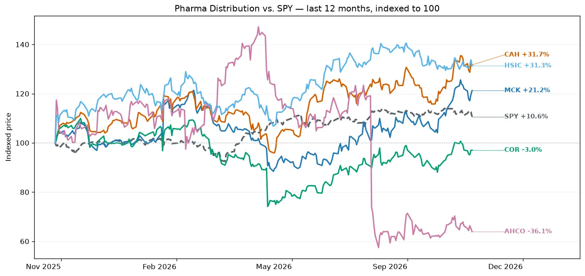

<table class="sortable"><thead><tr><th class="sortable-heading" data-column="0" data-type="text">Company</th><th class="sortable-heading" data-column="1" data-type="text">Ticker</th><th class="sortable-heading" data-column="2" data-type="number">Market cap</th><th class="sortable-heading" data-column="3" data-type="number">3m Return</th><th class="sortable-heading" data-column="4" data-type="number">12m Return</th><th class="sortable-heading" data-column="5" data-type="number">24m Return</th></tr></thead><tbody><tr><td class="text" data-sort="mckesson" style="">McKesson</td><td class="text text" data-sort="mck" style=""><a href="https://www.google.com/finance/quote/MCK:NYSE?hl=en" target="_blank" rel="noopener">MCK</a></td><td class="" data-sort="97224871780.34999" style="">$97.2B</td><td class="" data-sort="0.16163468389025804" style="background:#a9d9a4;color:#111820;">+16.2%</td><td class="" data-sort="0.22584859614957975" style="background:#2f9e44;color:#111820;">+22.6%</td><td class="" data-sort="0.8896150777064256" style="background:#2f9e44;color:#111820;">+89.0%</td></tr><tr><td class="text" data-sort="cardinal health" style="">Cardinal Health</td><td class="text text" data-sort="cah" style=""><a href="https://www.google.com/finance/quote/CAH:NYSE?hl=en" target="_blank" rel="noopener">CAH</a></td><td class="" data-sort="54698777435.25" style="">$54.7B</td><td class="" data-sort="0.08890144763726471" style="background:#d6ecd4;color:#111820;">+8.9%</td><td class="" data-sort="0.3129947056665092" style="background:#1a7a3c;color:#ffffff;">+31.3%</td><td class="" data-sort="1.156893137001636" style="background:#1a7a3c;color:#ffffff;">+115.7%</td></tr><tr><td class="text" data-sort="cencora" style="">Cencora</td><td class="text text" data-sort="cor" style=""><a href="https://www.google.com/finance/quote/COR:NYSE?hl=en" target="_blank" rel="noopener">COR</a></td><td class="" data-sort="59590161456.799995" style="">$59.6B</td><td class="" data-sort="0.06263249180959729" style="background:#d6ecd4;color:#111820;">+6.3%</td><td class="" data-sort="-0.020632900150972522" style="background:#fbd5d4;color:#111820;">-2.1%</td><td class="" data-sort="0.4122166730695349" style="background:#a9d9a4;color:#111820;">+41.2%</td></tr><tr><td class="text" data-sort="accendra health" style="">Accendra Health</td><td class="text text" data-sort="ahco" style=""><a href="https://www.google.com/finance/quote/AHCO:NASDAQ?hl=en" target="_blank" rel="noopener">AHCO</a></td><td class="" data-sort="912923359.92" style="">$912.9M</td><td class="" data-sort="-0.46203703703703713" style="background:#c0302f;color:#ffffff;">-46.2%</td><td class="" data-sort="-0.3537263626251391" style="background:#c0302f;color:#ffffff;">-35.4%</td><td class="" data-sort="-0.44666666666666666" style="background:#f5aead;color:#111820;">-44.7%</td></tr><tr><td class="text" data-sort="henry schein" style="">Henry Schein</td><td class="text text" data-sort="hsic" style=""><a href="https://www.google.com/finance/quote/HSIC:NASDAQ?hl=en" target="_blank" rel="noopener">HSIC</a></td><td class="" data-sort="10151122216.27" style="">$10.2B</td><td class="" data-sort="-0.010145772594752245" style="background:#fbd5d4;color:#111820;">-1.0%</td><td class="" data-sort="0.34303797468354413" style="background:#1a7a3c;color:#ffffff;">+34.3%</td><td class="" data-sort="0.20619582208327403" style="background:#d6ecd4;color:#111820;">+20.6%</td></tr></tbody></table>

<h3 id="category-precision-diagnostics"><a href="#subcategory-performance">Precision Diagnostics</a>Last 3m: +25.4%</h3>

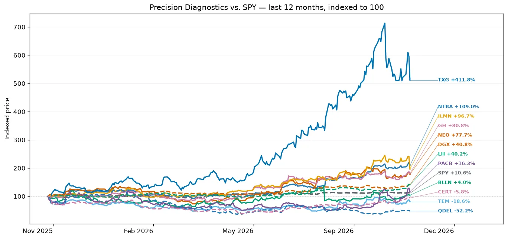

<table class="sortable"><thead><tr><th class="sortable-heading" data-column="0" data-type="text">Company</th><th class="sortable-heading" data-column="1" data-type="text">Ticker</th><th class="sortable-heading" data-column="2" data-type="number">Market cap</th><th class="sortable-heading" data-column="3" data-type="number">3m Return</th><th class="sortable-heading" data-column="4" data-type="number">12m Return</th><th class="sortable-heading" data-column="5" data-type="number">24m Return</th></tr></thead><tbody><tr><td class="text" data-sort="natera" style="">Natera</td><td class="text text" data-sort="ntra" style=""><a href="https://www.google.com/finance/quote/NTRA:NASDAQ?hl=en" target="_blank" rel="noopener">NTRA</a></td><td class="" data-sort="39411440972.58" style="">$39.4B</td><td class="" data-sort="0.5472811472960861" style="background:#2f9e44;color:#111820;">+54.7%</td><td class="" data-sort="1.0826421354245213" style="background:#a9d9a4;color:#111820;">+108.3%</td><td class="" data-sort="2.3368234536082477" style="background:#a9d9a4;color:#111820;">+233.7%</td></tr><tr><td class="text" data-sort="neogenomics" style="">NeoGenomics</td><td class="text text" data-sort="neo" style=""><a href="https://www.google.com/finance/quote/NEO:NASDAQ?hl=en" target="_blank" rel="noopener">NEO</a></td><td class="" data-sort="2092864917.6" style="">$2.1B</td><td class="" data-sort="0.13669064748201443" style="background:#d6ecd4;color:#111820;">+13.7%</td><td class="" data-sort="0.7789150460593655" style="background:#d6ecd4;color:#111820;">+77.9%</td><td class="" data-sort="0.24142857142857133" style="background:#d6ecd4;color:#111820;">+24.1%</td></tr><tr><td class="text" data-sort="billiontoone" style="">BillionToOne</td><td class="text text" data-sort="blln" style=""><a href="https://www.google.com/finance/quote/BLLN:NASDAQ?hl=en" target="_blank" rel="noopener">BLLN</a></td><td class="" data-sort="6542857599.0" style="">$6.5B</td><td class="" data-sort="-0.18239538239538244" style="background:#f5aead;color:#111820;">-18.2%</td><td class="" data-sort="0.0402056177712502" style="background:#d6ecd4;color:#111820;">+4.0%</td><td class="missing" data-sort="—" style="background:#f0efec;color:#111820;">—</td></tr><tr><td class="text" data-sort="guardant health" style="">Guardant Health</td><td class="text text" data-sort="gh" style=""><a href="https://www.google.com/finance/quote/GH:NASDAQ?hl=en" target="_blank" rel="noopener">GH</a></td><td class="" data-sort="21443206004.3" style="">$21.4B</td><td class="" data-sort="0.10377183776776344" style="background:#d6ecd4;color:#111820;">+10.4%</td><td class="" data-sort="0.9221672758546551" style="background:#a9d9a4;color:#111820;">+92.2%</td><td class="" data-sort="6.773913043478261" style="background:#1a7a3c;color:#ffffff;">+677.4%</td></tr><tr><td class="text" data-sort="tempus ai" style=""><a href="#earnings-tem">Tempus AI</a></td><td class="text text" data-sort="tem" style=""><a href="https://www.google.com/finance/quote/TEM:NASDAQ?hl=en" target="_blank" rel="noopener">TEM</a></td><td class="" data-sort="8489455269.799999" style="">$8.5B</td><td class="" data-sort="0.6462274903122864" style="background:#2f9e44;color:#111820;">+64.6%</td><td class="" data-sort="-0.19621591541457983" style="background:#fbd5d4;color:#111820;">-19.6%</td><td class="" data-sort="0.5679548415110725" style="background:#d6ecd4;color:#111820;">+56.8%</td></tr><tr><td class="text" data-sort="illumina" style=""><a href="#earnings-ilmn">Illumina</a></td><td class="text text" data-sort="ilmn" style=""><a href="https://www.google.com/finance/quote/ILMN:NASDAQ?hl=en" target="_blank" rel="noopener">ILMN</a></td><td class="" data-sort="30654510000.0" style="">$30.7B</td><td class="" data-sort="0.15060945880058507" style="background:#d6ecd4;color:#111820;">+15.1%</td><td class="" data-sort="0.9102315039663267" style="background:#a9d9a4;color:#111820;">+91.0%</td><td class="" data-sort="0.5757879273504276" style="background:#d6ecd4;color:#111820;">+57.6%</td></tr><tr><td class="text" data-sort="10x genomics" style="">10x Genomics</td><td class="text text" data-sort="txg" style=""><a href="https://www.google.com/finance/quote/TXG:NASDAQ?hl=en" target="_blank" rel="noopener">TXG</a></td><td class="" data-sort="6076123205.54" style="">$6.1B</td><td class="" data-sort="0.48318172202242415" style="background:#7cc077;color:#111820;">+48.3%</td><td class="" data-sort="4.140029325513196" style="background:#1a7a3c;color:#ffffff;">+414.0%</td><td class="" data-sort="3.293325168401715" style="background:#7cc077;color:#111820;">+329.3%</td></tr><tr><td class="text" data-sort="pacbio" style="">PacBio</td><td class="text text" data-sort="pacb" style=""><a href="https://www.google.com/finance/quote/PACB:NASDAQ?hl=en" target="_blank" rel="noopener">PACB</a></td><td class="" data-sort="447266430.71999997" style="">$447.3M</td><td class="" data-sort="0.8607142857142858" style="background:#1a7a3c;color:#ffffff;">+86.1%</td><td class="" data-sort="0.11324786324786329" style="background:#d6ecd4;color:#111820;">+11.3%</td><td class="" data-sort="0.06762295081967218" style="background:#d6ecd4;color:#111820;">+6.8%</td></tr><tr><td class="text" data-sort="quidelortho" style="">QuidelOrtho</td><td class="text text" data-sort="qdel" style=""><a href="https://www.google.com/finance/quote/QDEL:NASDAQ?hl=en" target="_blank" rel="noopener">QDEL</a></td><td class="" data-sort="1198797586.62" style="">$1.2B</td><td class="" data-sort="-0.20989862850327967" style="background:#f5aead;color:#111820;">-21.0%</td><td class="" data-sort="-0.5090774360874397" style="background:#fbd5d4;color:#111820;">-50.9%</td><td class="" data-sort="-0.6611253196930946" style="background:#fbd5d4;color:#111820;">-66.1%</td></tr><tr><td class="text" data-sort="quest diagnostics" style="">Quest Diagnostics</td><td class="text text" data-sort="dgx" style=""><a href="https://www.google.com/finance/quote/DGX:NYSE?hl=en" target="_blank" rel="noopener">DGX</a></td><td class="" data-sort="25796461699.2" style="">$25.8B</td><td class="" data-sort="0.08072614909231368" style="background:#d6ecd4;color:#111820;">+8.1%</td><td class="" data-sort="0.4312020460358057" style="background:#d6ecd4;color:#111820;">+43.1%</td><td class="" data-sort="0.621611179084294" style="background:#d6ecd4;color:#111820;">+62.2%</td></tr><tr><td class="text" data-sort="labcorp holdings" style=""><a href="#earnings-lh">Labcorp Holdings</a></td><td class="text text" data-sort="lh" style=""><a href="https://www.google.com/finance/quote/LH:NYSE?hl=en" target="_blank" rel="noopener">LH</a></td><td class="" data-sort="25268305999.999996" style="">$25.3B</td><td class="" data-sort="0.16879042690815016" style="background:#d6ecd4;color:#111820;">+16.9%</td><td class="" data-sort="0.42301937312962656" style="background:#d6ecd4;color:#111820;">+42.3%</td><td class="" data-sort="0.5913254073095553" style="background:#d6ecd4;color:#111820;">+59.1%</td></tr><tr><td class="text" data-sort="certara" style="">Certara</td><td class="text text" data-sort="cert" style=""><a href="https://www.google.com/finance/quote/CERT:NASDAQ?hl=en" target="_blank" rel="noopener">CERT</a></td><td class="" data-sort="1189802484.0" style="">$1.2B</td><td class="" data-sort="0.36049382716049383" style="background:#7cc077;color:#111820;">+36.0%</td><td class="" data-sort="-0.0524505588993982" style="background:#fbd5d4;color:#111820;">-5.2%</td><td class="" data-sort="0.07512195121951226" style="background:#d6ecd4;color:#111820;">+7.5%</td></tr></tbody></table>

