# Healthcare Digest

<strong>Week of November 9, 2026</strong>Market data through: November 6, 2026Narrative created: November 9, 2026

Weekly review of healthcare services, technology, distribution, and diagnostic company performance, changes, earnings activity, and strategy narrative.

## In the News

<nav class="strategy-narrative-links" aria-label="Strategy narrative sections">
<ul>
<li><a href="#strategy-executive-summary-1-cms-redistributes-outpatient-margin-away-from-340b-drugs-and-legacy-off-campus-sites">1. CMS redistributes outpatient margin away from 340B drugs and legacy off-campus sites</a></li>
<li><a href="#strategy-executive-summary-2-physician-fee-cuts-coexist-with-richer-aco-payment-and-a-two-year-remote-monitoring-reprieve">2. Physician fee cuts coexist with richer ACO payment and a two-year remote-monitoring reprieve</a></li>
<li><a href="#strategy-executive-summary-3-cvs-preserves-payer-pbm-care-integration-while-separating-the-consumer-front-door">3. CVS preserves payer-PBM-care integration while separating the consumer front door</a></li>
<li><a href="#strategy-executive-summary-4-cms-gives-home-health-a-2-4-increase-while-widening-retroactive-payment-recovery">4. CMS gives home health a 2.4% increase while widening retroactive payment recovery</a></li>
<li><a href="#strategy-executive-summary-5-oscar-shows-exchange-underwriting-can-improve-while-hospitals-absorb-coverage-loss">5. Oscar shows Exchange underwriting can improve while hospitals absorb coverage loss</a></li>
</ul>
</nav>

<h3 id="executive-summary">Executive Summary</h3>
- CMS shifted 2027 outpatient economics away from 340B drug margin and legacy off-campus departments while expanding outpatient surgical eligibility, creating substantial redistribution across hospital service lines beginning January 1. ([CMS, *CY 2027 OPPS and ASC Final Rule*, November 4, 2026](https://www.cms.gov/newsroom/fact-sheets/calendar-year-2027-hospital-outpatient-prospective-payment-system-opps-ambulatory-surgical-center-0))
- Physician conversion factors will decline 1.83%-2.31%, but ACO participants gain a 32% E/M modifier and remote-monitoring companies retain contracted clinical-staff models through 2028. ([CMS, *CY 2027 Medicare Physician Fee Schedule Final Rule*, November 4, 2026](https://www.cms.gov/newsroom/fact-sheets/calendar-year-cy-2027-medicare-physician-fee-schedule-final-rule))
- CVS will separate retail pharmacy, MinuteClinic and Health100 from Aetna, Caremark, specialty pharmacy and value-based care, preserving the core payer-PBM-care platform while detaching its consumer storefront. ([CVS Health, *CVS Health Announces Intent to Create Two Distinct Leaders in Healthcare*, November 4, 2026](https://investors.cvshealth.com/news/news-details/2026/CVS-Health-Announces-Intent-to-Create-Two-Distinct-Leaders-in-Healthcare/default.aspx))
- Payer execution improved: Oscar lowered its third-quarter MLR to 84.0%, while Humana reported a 93.7% benefit ratio and medical and pharmacy trends in line to better than its high-single-digit expectation. ([Oscar Health, *Third Quarter 2026 Results*, November 5, 2026](https://ir.oscarhealth.com/sec-filings/all-sec-filings/content/0001568651-26-000082/oscarhealththirdquarter202.htm); [Humana, *Third Quarter 2026 Prepared Management Remarks*, November 6, 2026](https://humana.gcs-web.com/static-files/87a928cc-8abf-4636-9e85-370745b2ac58))
- Overall environment: improved for payers and ACO-oriented primary care, deteriorated for physician fee-for-service and 340B-heavy providers, and mixed for health technology because remote-monitoring demand gained time while CVS’s separation creates new integration and contracting risk.

<h3 id="strategy-executive-summary-1-cms-redistributes-outpatient-margin-away-from-340b-drugs-and-legacy-off-campus-sites">1. CMS redistributes outpatient margin away from 340B drugs and legacy off-campus sites</h3>

**What happened**

CMS finalized a 2.3% OPPS and ASC rate update for 2027, but will pay for 340B-acquired drugs at average sales price minus 28%. CMS estimates the drug policy will reduce Original Medicare payments by $4.35 billion and beneficiary payments by $1.1 billion, with Medicare savings redistributed to non-drug OPPS services through budget neutrality. Hospitals enrolled before 2018 also face a separate 2% conversion-factor reduction through 2031 to recover prior 340B remedy payments. CMS additionally applied physician-office-equivalent rates to noncontrast imaging at excepted off-campus departments and removed 637 procedures from the inpatient-only list. ([CMS, *CY 2027 OPPS and ASC Final Rule*, November 4, 2026](https://www.cms.gov/newsroom/fact-sheets/calendar-year-2027-hospital-outpatient-prospective-payment-system-opps-ambulatory-surgical-center-0))

**Implication**

The 2.3% headline conceals a large service-line redistribution. Systems generating disproportionate margin from 340B-infused drugs or legacy off-campus imaging will lose relative to procedure-heavy hospitals and ASCs receiving higher non-drug payments and broader surgical eligibility. Contracting, site-of-care management and service-line profitability tools become more valuable as providers reassess infusion, imaging and surgical footprints.

**Watch next**

Hospital legal challenges, 2027 drug-administration strategies and whether payers accelerate migration of newly eligible procedures to ASCs.

---

<h3 id="strategy-executive-summary-2-physician-fee-cuts-coexist-with-richer-aco-payment-and-a-two-year-remote-monitoring-reprieve">2. Physician fee cuts coexist with richer ACO payment and a two-year remote-monitoring reprieve</h3>

**What happened**

CMS finalized 2027 conversion factors of $32.95 for qualifying APM participants and $32.63 for other clinicians, decreases of 1.83% and 2.31%, respectively. The rule converts G2211 into a modifier that increases associated E/M payment by 16% and creates a separate 32% modifier for practitioners participating in the Medicare Shared Savings Program or the LEAD Model. CMS also delayed until January 1, 2029, its requirement that remote physiologic and therapeutic monitoring services use clinical staff employed by the billing practice rather than contractors. ([CMS, *CY 2027 Medicare Physician Fee Schedule Final Rule*, November 4, 2026](https://www.cms.gov/newsroom/fact-sheets/calendar-year-cy-2027-medicare-physician-fee-schedule-final-rule))

**Implication**

Independent and employed physician groups face renewed base-rate pressure, strengthening demand for coding accuracy, denial prevention and productivity automation. The ACO modifier creates a material differential for primary-care organizations operating inside accountable-care structures, although the additional payments enter assignment, benchmark and performance-year spending calculations.

The contractor delay preserves current RPM and RTM vendor models through 2028. Practices avoid an immediate insourcing requirement, and vendors gain two years to redesign staffing, contracting or software-only offerings.

**Watch next**

Specialty-level payment impacts, congressional action on the conversion-factor decline and whether CMS revisits remote-monitoring bundling before 2029.

---

<h3 id="strategy-executive-summary-3-cvs-preserves-payer-pbm-care-integration-while-separating-the-consumer-front-door">3. CVS preserves payer-PBM-care integration while separating the consumer front door</h3>

**What happened**

CVS plans to create two publicly traded companies through a tax-free separation expected in the first half of 2028. CVS Health will retain Aetna, Caremark, CVS Specialty, Oak Street Health and Signify Health. CVS Pharmacy will hold approximately 9,000 retail pharmacies, mail pharmacy, MinuteClinic, virtual care and the Health100 technology business. Both companies are expected to maintain investment-grade ratings. ([CVS Health, *CVS Health Announces Intent to Create Two Distinct Leaders in Healthcare*, November 4, 2026](https://investors.cvshealth.com/news/news-details/2026/CVS-Health-Announces-Intent-to-Create-Two-Distinct-Leaders-in-Healthcare/default.aspx))

**Implication**

The transaction narrows CVS’s vertical-integration thesis rather than dismantling it. Aetna will remain connected to Caremark, specialty pharmacy, primary care and home assessments, preserving the assets most directly tied to medical-cost management and pharmacy economics.

Retail pharmacy and MinuteClinic become a payer-agnostic contracting platform with greater incentive to serve competing plans and PBMs. The split also creates new data, identity, referral and pharmacy-network interfaces where internal coordination previously sufficed. Vendors serving member engagement, interoperability and care navigation may gain opportunity, while CVS must prevent separation-related friction from degrading medication adherence or Aetna care coordination.

**Watch next**

The Form 10 allocation of shared technology, data rights, debt and corporate costs, particularly ownership and commercial terms for Health100.

---

<h3 id="strategy-executive-summary-4-cms-gives-home-health-a-2-4-increase-while-widening-retroactive-payment-recovery">4. CMS gives home health a 2.4% increase while widening retroactive payment recovery</h3>

**What happened**

CMS estimates aggregate Medicare home-health payments will increase 2.4%, or $415 million, in 2027, while retaining a temporary 3% reduction to the base rate under its PDGM reconciliation. The rule also makes Medicare enrollment revocations retroactive to the date noncompliance began across provider and supplier types, expands grounds for denial or revocation, and requires reenrollment after certain ownership changes involving home-health, hospice and DMEPOS providers. CMS estimates the integrity provisions will save approximately $82 million annually. ([CMS, *CY 2027 Home Health Prospective Payment System Final Rule*, November 4, 2026](https://www.cms.gov/newsroom/fact-sheets/calendar-year-cy-2027-home-health-prospective-payment-system-final-rule-cms-1844-f); [CMS, *CMS Finalizes Broad Medicare Integrity Changes in Home Health Final Rule*, November 4, 2026](https://www.cms.gov/newsroom/press-releases/cms-finalizes-broad-medicare-integrity-changes-home-health-final-rule-expected-save-taxpayers-tens))

**Implication**

The payment update improves near-term reimbursement visibility for scaled home-health operators, but it does not end PDGM recoupment risk. Case-mix recalibration and the temporary adjustment will continue to create agency-level variance.

Retroactive revocation has broader consequences. A compliance failure can now convert previously paid claims into recoverable overpayments, increasing exposure during audits, acquisitions and ownership transitions. Enrollment monitoring, credentialing and transaction diligence therefore become payment-integrity controls rather than administrative formalities.

**Watch next**

Sub-regulatory instructions defining recovery periods and how Medicare contractors apply the new ownership and managing-employee standards.

---

<h3 id="strategy-executive-summary-5-oscar-shows-exchange-underwriting-can-improve-while-hospitals-absorb-coverage-loss">5. Oscar shows Exchange underwriting can improve while hospitals absorb coverage loss</h3>

**What happened**

Oscar’s third-quarter revenue increased to $5.14 billion from $2.99 billion, its MLR declined to 84.0% from 88.5%, and operating income improved to $178 million from a $129 million loss. Membership reached 2.69 million, and updated risk-adjustment estimates contributed $250 million to revenue. Oscar raised full-year operating-income guidance to $850 million-$950 million from $600 million-$800 million. ([Oscar Health, *Third Quarter 2026 Results*, November 5, 2026](https://ir.oscarhealth.com/sec-filings/all-sec-filings/content/0001568651-26-000082/oscarhealththirdquarter202.htm))

**Implication**

The result does not refute last week’s finding that Exchange attrition is increasing hospital uncompensated care. It localizes the economics: disciplined rate increases and favorable risk adjustment can improve carrier profitability on retained enrollment while providers bear losses when other consumers exit coverage.

The split raises the value of enrollment retention, premium-payment monitoring and eligibility intervention for both sides. Plans need accurate risk-adjustment and lapse management; hospitals need earlier identification of coverage loss before services convert to self-pay. Oscar’s $250 million adjustment also shows that risk-score performance remains a major earnings variable despite improved underlying underwriting.

**Watch next**

Final 2027 enrollment, payment-effectuation rates and whether Oscar’s risk-adjustment advantage persists after market-wide data reconcile.

<h3 id="what-to-watch-for">What to Watch For</h3>

- December 7, 2026: Medicare open enrollment ends, providing the first firm read on Humana’s membership-growth expectations and plan switching after the 2027 Stars release. ([CMS, *Medicare Advantage and Medicare Prescription Drug Programs Expected to Remain Stable in 2027*, October 2026](https://www.cms.gov/newsroom/press-releases/medicare-advantage-medicare-prescription-drug-programs-expected-remain-stable-2027))
- December 15, 2026: Comments close on CMS’s proposed MA provider-directory and Part D PBM accountability rule. ([Federal Register, *CMS-4214-P*, October 20, 2026](https://public-inspection.federalregister.gov/2026-21420.pdf))
- December 28, 2026: Most HTI-5 health-IT certification changes take effect. ([Federal Register, *HTI-5 Final Rule*, October 28, 2026](https://www.federalregister.gov/documents/2026/10/28/2026-21943/health-data-technology-and-interoperability-onc-deregulatory-actions-to-unleash-prosperity))
- January 1, 2027: The 2027 OPPS, physician-fee and home-health payment policies take effect. ([CMS, *CY 2027 OPPS and ASC Final Rule*, November 4, 2026](https://www.cms.gov/newsroom/fact-sheets/calendar-year-2027-hospital-outpatient-prospective-payment-system-opps-ambulatory-surgical-center-0); [CMS, *CY 2027 Medicare Physician Fee Schedule Final Rule*, November 4, 2026](https://www.cms.gov/newsroom/fact-sheets/calendar-year-cy-2027-medicare-physician-fee-schedule-final-rule); [CMS, *CY 2027 Home Health PPS Final Rule*, November 4, 2026](https://www.cms.gov/newsroom/fact-sheets/calendar-year-cy-2027-home-health-prospective-payment-system-final-rule-cms-1844-f))
- January 15, 2027: HealthCare.gov open enrollment for 2027 coverage closes. ([CMS, *Plan Year 2027 Marketplace Plans and Prices*, October 30, 2026](https://beta.cms.gov/newsroom/fact-sheets/plan-year-2027-marketplace-plans-prices-fact-sheet-0))

<h3 id="bottom-line">Bottom Line</h3>

CMS’s outpatient rule is the week’s largest economic change because it reallocates billions of dollars across 340B drugs, non-drug services and care sites beginning January 1. Hospital service-line exposure, especially infusion, off-campus imaging and outpatient surgery, needs the closest attention. Medicare open enrollment ending December 7 is the next event most likely to change the payer view.

## Recent Earnings Highlights

Companies covered in this section:
<ul class="section-jump-list">
<li><a href="#earnings-mck">McKesson (MCK)</a></li>
<li><a href="#earnings-cvs">CVS Health (CVS)</a></li>
<li><a href="#earnings-ci">Cigna (CI)</a></li>
<li><a href="#earnings-cor">Cencora (COR)</a></li>
<li><a href="#earnings-cah">Cardinal Health (CAH)</a></li>
<li><a href="#earnings-hum">Humana (HUM)</a></li>
<li><a href="#earnings-ntra">Natera (NTRA)</a></li>
<li><a href="#earnings-gh">Guardant Health (GH)</a></li>
<li><a href="#earnings-solv">Solventum (SOLV)</a></li>
<li><a href="#earnings-tem">Tempus AI (TEM)</a></li>
<li><a href="#earnings-fms">Fresenius (FMS)</a></li>
<li><a href="#earnings-hsic">Henry Schein (HSIC)</a></li>
<li><a href="#earnings-oscr">Oscar Health (OSCR)</a></li>
<li><a href="#earnings-txg">10x Genomics (TXG)</a></li>
<li><a href="#earnings-pacs">PACS Group (PACS)</a></li>
<li><a href="#earnings-docs">Doximity (DOCS)</a></li>
<li><a href="#earnings-blln">BillionToOne (BLLN)</a></li>
<li><a href="#earnings-way">Waystar (WAY)</a></li>
<li><a href="#earnings-con">Concentra Group (CON)</a></li>
<li><a href="#earnings-lfst">Lifestance Health (LFST)</a></li>
<li><a href="#earnings-opch">Option Care Health (OPCH)</a></li>
<li><a href="#earnings-achc">Acadia Healthcare (ACHC)</a></li>
<li><a href="#earnings-prva">Privia Health Group (PRVA)</a></li>
<li><a href="#earnings-pgny">Progyny (PGNY)</a></li>
<li><a href="#earnings-ardt">Ardent Health Partners (ARDT)</a></li>
<li><a href="#earnings-clov">Clover Health (CLOV)</a></li>
<li><a href="#earnings-adus">Addus HomeCare (ADUS)</a></li>
<li><a href="#earnings-cert">Certara (CERT)</a></li>
<li><a href="#earnings-usph">US Physical Therapy (USPH)</a></li>
<li><a href="#earnings-agl">Agilon Health (AGL)</a></li>
<li><a href="#earnings-pntg">Pennant Group (PNTG)</a></li>
<li><a href="#earnings-omda">Omada Health (OMDA)</a></li>
<li><a href="#earnings-qdel">QuidelOrtho (QDEL)</a></li>
<li><a href="#earnings-pacb">PacBio (PACB)</a></li>
<li><a href="#earnings-ccsi">Consensus Cloud Solutions (CCSI)</a></li>
<li><a href="#earnings-evh">Evolent Health (EVH)</a></li>
<li><a href="#earnings-amwl">Amwell (AMWL)</a></li>
<li><a href="#earnings-hcat">Health Catalyst (HCAT)</a></li>
<li><a href="#earnings-dh">Definitive Healthcare (DH)</a></li>
</ul>
<h3 id="earnings-mck">McKesson (MCK) +22.0% Last 3m</h3>

McKesson is one of three leading pharmaceutical wholesalers in the US engaged in sourcing and distributing branded, generic, and specialty pharmaceutical products to pharmacies (retail chains, independent, and mail order), hospitals networks, and healthcare providers. Along with Cencora and Cardinal Health, the three account for over 90% of the US pharmaceutical wholesale industry. Outside the US market, McKesson engages in pharmaceutical wholesale and distribution in Canada. Additionally, the company supplies medical-surgical products and equipment to healthcare facilities and provides a variety of technology solutions for pharmacies.

**Reported:** November 4, 2026 · [Google Finance earnings page](https://www.google.com/finance/quote/MCK:NYSE?tab=earnings&hl=en)

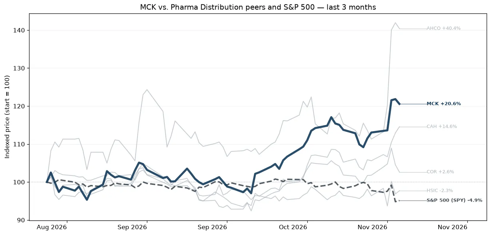

#### Reported Results

Q2 2027: EPS $11.68 vs. $10.75 est. (+8.62%); revenue $110.96B vs. $109.95B est. (+0.91%)

#### Earnings Call Summary

McKesson reported strong Q2 fiscal 2027 results with an 8% revenue increase to $111 billion and an 18% adjusted EPS growth to $11.68, beating estimates. Driven by this broad-based momentum and a strong first half, management raised full-year fiscal 2027 adjusted EPS guidance to $45.60-$46.40 from $44.20-$45.00.

#### At a Glance

- **McKesson Misses EPS, Beats Revenue Estimates:** McKesson reported Q2 2027 adjusted EPS of $10.44, missing the estimated $10.753, while its reported revenue of $110.96 billion surpassed the estimated $109.95 billion.
- **Strong Pharmaceutical and GLP-1 Volume Growth:** North American Pharmaceutical segment revenue increased 6% year-over-year to $91.4 billion, heavily supported by sustained demand for specialty products and a 26% growth in GLP-1 medication distribution.
- **Full-Year Adjusted EPS Outlook Upgraded:** McKesson raised its fiscal 2027 full-year adjusted EPS guidance range to $45.60 to $46.40, marking an increase from the previous projection of $44.20 to $45.00.
- **Major Strategic Acquisitions and Investments Closed:** The company completed its $2.25 billion acquisition of Precision Medicine Group to boost oncology capabilities and announced a $1.4 billion investment for a 49% minority interest in Option Care Health.
- **CVS Health Distribution Partnership Extended:** McKesson signed a long-term agreement extending its pharmaceutical distribution partnership with CVS Health through June 2032, ensuring substantial operational revenue visibility.
- **Medical-Surgical Segment Margin Pressures Persist:** Despite overall consolidated growth, Medical-Surgical Solutions segment operating profit declined 10% due to an unfavorable product mix within the ambulatory care channel.

#### Key Moments from the Call

- **1m 45s — Strong Earnings Beat and Guidance Raise:** McKesson posted Q2 fiscal 2027 adjusted EPS of $11.68, significantly beating the estimated $10.753. Backed by powerful operating leverage and a robust first half, the company increased its full-year fiscal 2027 adjusted EPS outlook well above its long-term target, which will please investors looking for sustainable bottom-line momentum.
- **12m 36s — Strategic Expansion in High-Margin Verticals:** Management detailed the $2.25 billion acquisition of Precision Medicine Group and a pending $1.4 billion investment for a 49% stake in Option Care Health. Investors will appreciate these additions to the Oncology & Multispecialty and corporate segments, as they expand footprint into higher-margin clinical research and lower-cost alternate site infusion care.
- **18m 11s — Robust Specialty and GLP-1 Growth:** North American Pharmaceutical operating profit surged 22%, driven by health systems and specialty distribution. GLP-1 distribution revenue reached $16 billion, expanding 26% year-over-year. This clear outperformance over long-term targets reassures investors of McKesson's vital role in capturing high-demand, complex therapeutic volumes.
- **42m 27s — CVS Health Relationship Extension:** McKesson highlighted the formal extension of its long-term pharmaceutical distribution relationship with CVS Health through June 2032. Securing this major partnership anchors long-term volume predictability and provides clear visibility for the North American Pharmaceutical segment's future baseline growth, mitigating competitive renewal risks.

<h3 id="earnings-cvs">CVS Health (CVS) -12.4% Last 3m</h3>

CVS Health offers a diverse set of healthcare services. Its roots are in its retail pharmacy operations, where it operates around 9,000 stores primarily in the US. CVS is also a large pharmacy benefit manager (acquired through Caremark), processing about 2 billion adjusted claims annually. It operates a top-tier health insurer (acquired through Aetna) through which it serves about 26 million medical members. The acquisition of Oak Street Health added primary care services to the mix, which could have significant synergies with all existing business lines.

**Reported:** November 4, 2026 · [Google Finance earnings page](https://www.google.com/finance/quote/CVS:NYSE?tab=earnings&hl=en)

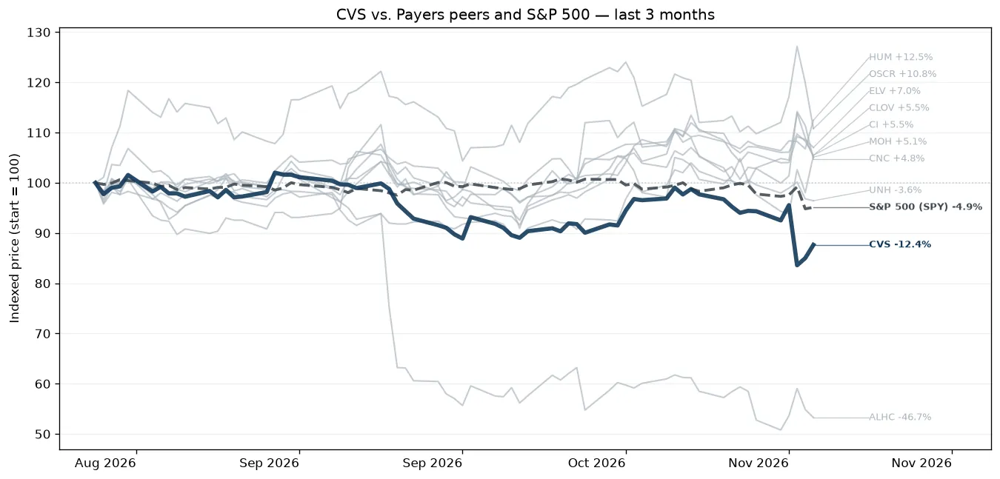

#### Reported Results

Q3 2026: EPS $2.09 vs. $1.65 est. (+26.60%); revenue $107.75B vs. $104.69B est. (+2.92%)

#### Earnings Call Summary

CVS Health announced plans to separate into two independent, publicly traded companies: CVS Health (a healthcare solutions provider retaining Aetna, Caremark, and specialty care) and CVS Pharmacy (a national retail pharmacy and community healthcare company). The tax-free transaction is expected to be completed in the first half of 2028.

#### At a Glance

- **CVS Beats EPS and Revenue Estimates:** CVS Health reported Q3 2026 Adjusted EPS of $1.68 and total revenues of $108.399 billion, both outperforming the estimated Adjusted EPS of $1.651 and estimated revenue of $104.695 billion.
- **Segment Performance and Operating Metrics Improve:** The Health Care Benefits segment experienced a notable recovery with its medical benefit ratio improving by 150 basis points, driven primarily by strong performance in Medicare.
- **Full-Year Guidance Significantly Raised:** Management increased its full-year 2026 Adjusted EPS guidance to at least $8.20, up from the prior forecast range of $7.90 to $8.10, reflecting sustained financial momentum.
- **Major Strategic Corporate Separation Announced:** CVS Health announced plans to split into two independent, publicly traded companies by the first half of 2028, separating its retail pharmacy operations from its insurance and pharmacy services segments.
- **Share Repurchases Planned to Resume:** Having achieved its leverage reduction targets ahead of schedule, the company generated $15.3 billion in year-to-date operating cash flow and intends to resume share buybacks in the fourth quarter.

#### Key Moments from the Call

- **2m 3s — Strategic Corporate Breakup Plan:** CVS Health's decision to split into two independent public companies will please investors by unlocking trapped value, streamlining corporate structure, and enabling distinct capital allocation strategies tailored to a healthcare solutions business versus a pure-play retail pharmacy operator.
- **2m 56s — Strong Guidance Boost and Share Buybacks:** Raising full-year 2026 adjusted EPS guidance to at least $8.20 and announcing the resumption of share repurchases in Q4 2026 will satisfy investors, showing robust underlying earnings power, rapid balance sheet deleveraging, and proactive shareholder capital return.
- **13m 33s — Upward Revision of 2027 EPS Floor:** Providing a 2027 adjusted EPS floor of at least $8.65—up from a previous $8.44 projection—alongside a target to reach the upper end of its mid-teens long-term CAGR through 2028 will bolster investor confidence regarding multi-year operational execution.
- **26m 51s — Sizing the Health Services Segment Floor:** Setting a clear 2027 trough earnings floor of at least $7 billion for Health Services mitigates market anxiety over transitory 340B regulatory contract changes and health plan client membership attrition by clearly framing it as a near-term dip before returning to segment growth.

<h3 id="earnings-ci">Cigna (CI) +3.9% Last 3m</h3>

Cigna primarily provides pharmacy benefit management and health insurance services. Its PBM and specialty pharmacy services, which were greatly expanded by its 2018 merger with Express Scripts, are mostly sold to health insurance plans and employers. Its largest PBM contract is with the Department of Defense, and it recently won a multiyear deal with top-tier insurer Centene. In health insurance and other benefits, Cigna primarily serves employers through self-funding arrangements, and the company operates mostly in the US with 16 million US and 2 million international medical members covered as of December 2025.

**Reported:** November 5, 2026 · [Google Finance earnings page](https://www.google.com/finance/quote/CI:NYSE?tab=earnings&hl=en)

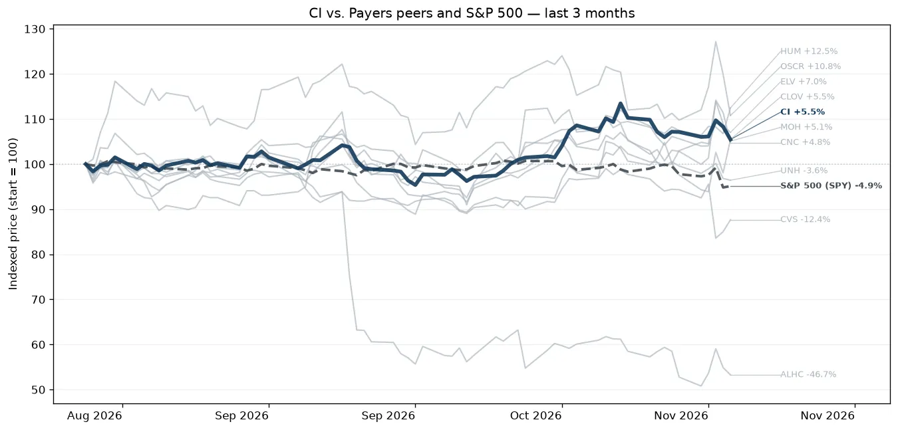

#### Reported Results

Q3 2026: EPS $7.98 vs. $7.51 est. (+6.30%); revenue $73.68B vs. $72.45B est. (+1.70%)

#### Earnings Call Summary

The Cigna Group reported strong Q3 2026 results with adjusted revenue of $73.8B and adjusted EPS of $7.98, beating estimates. Backed by solid execution over the first nine months, management raised its full-year 2026 adjusted EPS outlook to at least $30.60.

#### At a Glance

- **Cigna Beats EPS and Revenue Estimates:** The Cigna Group reported a reported adjusted EPS of 5.47 and reported revenue of $73,683,000,000, which surpassed the estimated adjusted EPS of 7.507 and estimated revenue of $72,449,250,090.
- **Medical Care Ratio remains disciplined:** Cigna Healthcare achieved a Medical Care Ratio (MCR) of 85.0%, backed by disciplined pricing and stable medical cost trends that met the company&#x27;s internal expectations.
- **Full-Year 2026 Profit Outlook Upgraded:** Management raised its full-year 2026 adjusted EPS guidance to at least $30.60 per share, moving up from its previous outlook of at least $30.45 per share.
- **Evernorth Segment Shows Mixed Results:** Evernorth Health Services revenue grew 6% year-over-year to $63.8 billion, though its pharmacy benefit services profit fell 22% due to a structural transition to the fee-based Signature model.
- **Management Outlines Distinct 2027 Headwinds:** For fiscal 2027, the company flags potential compression in pharmacy benefit rebate pools, lower commercial GLP-1 weight-loss drug coverage, and a financial impact from its planned exit from the ACA Exchange market.
- **Productivity Initiative Unveiled to Streamline:** Cigna announced its multi-year &#x27;Accelerate to One&#x27; modernization and productivity push, which aims to generate $3 billion in gross run-rate savings by 2030.

#### Key Moments from the Call

- **3m 33s — Full-Year 2026 Outlook Raised:** The Cigna Group raised its full-year 2026 adjusted EPS guidance to at least $30.60, up from previous expectations, reflecting strong performance across its business segments during the first nine months of the year.
- **12m 20s — 2027 Headwinds and Guidance Initial Look:** Management projected 2027 adjusted EPS growth of at least 10% off an updated 2026 run rate of ~$30. This baseline accounts for a $200 million headwind from exiting the ACA exchange market alongside PBM gross rebate compression.
- **28m 36s — Signature PBM Transition Status:** Cigna is moving its fully insured book to its new fee-based, transparent Signature PBM model on January 1, 2027. Broader client adoption is scheduled to ramp up through 2028, positioning the company for regulatory alignment.
- **47m 31s — Strong 2027 PBM Selling Season:** Despite near-term transitional pressures in Pharmacy Benefit Services, the company secured strong momentum for the 2027 sales season, tracking to add at least 2 million new customers alongside high client retention rates in the upper 90s.

<h3 id="earnings-cor">Cencora (COR) +4.1% Last 3m</h3>

Cencora is one of three leading domestic pharmaceutical wholesalers. It sources and distributes branded, generic, and specialty pharmaceutical products to pharmacies (retail chains, independent, and mail order), hospital networks, and healthcare providers. It and McKesson and Cardinal Health hold over 90% share of the US pharmaceutical wholesale industry. Cencora also provides commercialization services for manufacturers of pharmaceuticals and medical devices and global specialty drug logistics (World Courier). Cencora expanded its international presence in 2021 by purchasing Alliance Healthcare, one of the leading drug wholesalers in Europe.

**Reported:** November 4, 2026 · [Google Finance earnings page](https://www.google.com/finance/quote/COR:NYSE?tab=earnings&hl=en)

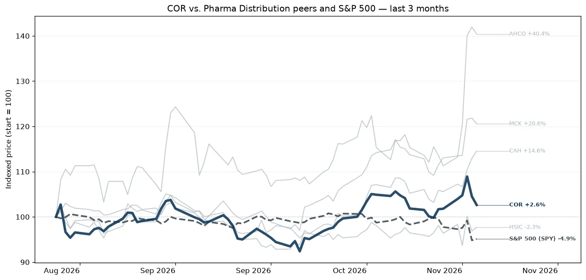

#### Reported Results

Q4 2026: EPS $4.66 vs. $4.57 est. (+1.88%); revenue $88.35B vs. $87.91B est. (+0.50%)

#### Earnings Call Summary

Cencora announced portfolio optimization through agreements or completed divestitures for all businesses in its "Other" category, including a merger of MWI Animal Health and an agreement to sell its equity stake in Profarma. This structural simplification allows resources and capital deployment to focus directly on its core pharmaceutical-centric strategy.

#### At a Glance

- **Cencora Outperforms Q4 Topline Metrics:** Cencora reported an adjusted EPS of $2.71, missing the estimated adjusted EPS of 4.574, but recorded revenue of $88.35 billion which beat the estimated $87.91 billion.
- **Specialty Pharmaceuticals Accelerate Growth:** U.S. Healthcare Solutions revenue rose 5.4% to $78.3 billion, driven by robust volumes in specialty products and expanding demand for GLP-1 weight-loss therapies.
- **Strong Fiscal 2027 Guidance Released:** The company introduced fiscal 2027 adjusted diluted EPS guidance of $19.40 to $19.75, projecting steady year-over-year operational growth of 8% to 10%.
- **Segment Realignment to Refocus Operations:** Cencora introduced a new reportable segment model divided into Specialty Pharmaceutical &amp; Provider Services and Pharmaceutical Distribution &amp; Services to enhance long-term visibility.
- **Strategic M&amp;A Expands MSO Platform:** Acquisitions including OneOncology and Retina Consultants of America contributed higher-margin revenue, driving a 23% increase in adjusted gross profit during the quarter.
- **Robust Shareholder Returns and Dividend:** Management approved a 10% increase in the quarterly dividend to $0.66 per share and announced plans for $1.25 billion in share repurchases for fiscal 2027.

#### Key Moments from the Call

- **11m 36s — New Operational Reporting Segments:** Cencora introduced two new segments, providing long-term guidance of mid-teens operating income growth for Specialty Pharmaceutical and Provider Services, and mid-single digits for Pharmaceutical Distribution and Services. This change enhances structural visibility and aligns execution with the expanding high-margin specialty drug pipeline.
- **22m 41s — Fiscal 2027 Financial Guidance Outlined:** Management projected fiscal 2027 adjusted EPS of $19.40-$19.75, representing headline growth of 8%-10%. Growth is tempered by a 5 percentage point headwind in the "Other" category due to divestitures and a mid-year MWI Animal Health merger, though underlying core operating growth remains strong at 8.5%-11%.
- **23m 53s — Elevated Capital Expenditure Target:** Cencora expects fiscal 2027 capital expenditures to reach approximately $1 billion, an elevated amount compared to recent years. The spend will fund significant ongoing infrastructure projects across the U.S. supply chain, digital IT transformations, SAP implementations, and MSO platform support to capture fast-paced market growth.
- **36m 25s — Specialty Segment Margin and Organic Drivers:** Analysts probed the long-term mid-teens growth target for the new Specialty segment. Management clarified that the 18%-21% growth expected in fiscal 2027 includes a four-month wraparound from the OneOncology transaction, with core underlying segment growth matching the mid-teens long-term expectation driven by fast market volumes and tuck-in physician acquisitions.

<h3 id="earnings-cah">Cardinal Health (CAH) +14.9% Last 3m</h3>

Cardinal Health is one of three leading pharmaceutical wholesalers in the US, engaged in sourcing and distributing of branded, generic, and specialty pharmaceutical products to pharmacies (retail chains, independent, and mail order), hospital networks, and healthcare providers. Cardinal, Cencora, and McKesson hold well over 90% of the US pharmaceutical wholesale industry. Cardinal Health also supplies medical-surgical products and equipment to healthcare facilities in North America, Europe, and Asia.

**Reported:** November 5, 2026 · [Google Finance earnings page](https://www.google.com/finance/quote/CAH:NYSE?tab=earnings&hl=en)

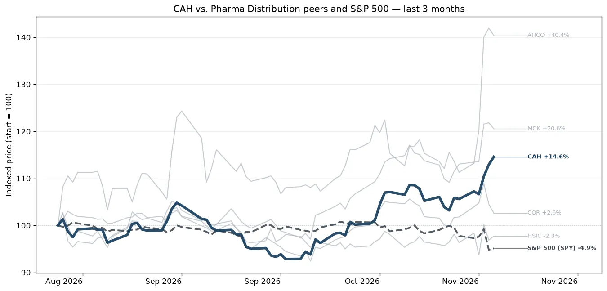

#### Reported Results

Q1 2027: EPS $3.26 vs. $2.94 est. (+10.91%); revenue $67.51B vs. $66.47B est. (+1.56%)

#### Earnings Call Summary

Cardinal Health started fiscal 2027 strongly, reporting Q1 revenue of $67.5 billion, up 5% year-over-year. Consolidated gross profit rose 12% to $2.6 billion, and operating income increased 17% to $1 billion, showcasing robust operational leverage as gross profit growth outpaced SG&A expenses. Non-GAAP diluted EPS surged 28% to $3.26.

#### At a Glance

- **Cardinal Health Outperforms Initial Estimates:** Cardinal Health reported an adjusted EPS of $2.38 for Q1 2027, missing the expected $2.939, while revenue reached $67.513 billion, beating the forecasted $66.475 billion.
- **Pharmaceutical Segment Drives Performance Gains:** The Pharmaceutical and Specialty Solutions segment drove performance with revenue rising 6% to $62.6 billion and profit climbing 17% to $783 million, bolstered by strong specialty and generic volumes.
- **Management Upgrades Full-Year Guidance Range:** Following strong broad-based momentum, Cardinal Health raised its fiscal 2027 non-GAAP diluted EPS guidance to a range of $12.80 to $13.00, up from the prior forecast of $12.40 to $12.60.
- **CVS Contract Extension Enhances Stability:** Cardinal Health executed a binding letter of intent to extend its pharmaceutical distribution agreement with its largest customer, CVS Health, through June 2032, ensuring long-term revenue visibility.
- **Global Medical Products Faces Profit Pressures:** The Global Medical Products and Distribution segment remained a soft spot, with profit decreasing 28% to $33 million due to distribution headwinds, inflation, and petroleum cost pressures.

#### Key Moments from the Call

- **2m 15s — CVS Health Contract Long-Term Renewal:** Cardinal Health secured a significant long-term contract renewal with its largest customer, CVS Health, extending through June 2032. This extension locks in structural stability, secures a massive portion of core revenue beyond CVS's planned 2028 retail pharmacy spin-off, and provides a durable foundation for capital reinvestment.
- **3m 42.24000000000001s — Full-Year Fiscal 2027 Guidance Upgraded:** Management increased non-GAAP diluted EPS guidance to $12.80-$13.00, driven by outperformance across the core distribution and specialty portfolios. Investors will be pleased by this clear signal of operating leverage and broad enterprise momentum, proving early capability investments are yielding higher profitability.
- **10m 31.690000000000055s — Macro Headwinds Diverge Across Segments:** While the Pharmaceutical division successfully absorbed IRA WAC regulatory changes using strong GLP-1 and specialty volume, the GMPD segment remains constrained. Elevated petroleum prices stemming from the Iran conflict are driving up transport costs, shifting full-year GMPD segment profit projections toward the lower end of guidance.
- **27m 10.769999999999982s — Specialty Integration and Ecosystem Synergy:** Executives detailed how strategic expansions, particularly in urology through the Solaris and Strive Medical acquisitions, are forming an interconnected provider ecosystem. This specialized multi-segment footprint accelerates growth via internal referrals, localized distribution efficiencies, and high-margin data capabilities like real-world research studies, enhancing overall margins.

<h3 id="earnings-hum">Humana (HUM) +12.7% Last 3m</h3>

Humana is one of the largest private health insurers in the US, and the firm has built a niche specializing in government-sponsored programs, with nearly all its medical membership stemming from Medicare, Medicaid, and the military&#x27;s Tricare program. Beyond medical insurance, the company provides other healthcare services, including primary-care services, at-home services, and pharmacy benefit management.

**Reported:** November 6, 2026 · [Google Finance earnings page](https://www.google.com/finance/quote/HUM:NYSE?tab=earnings&hl=en)

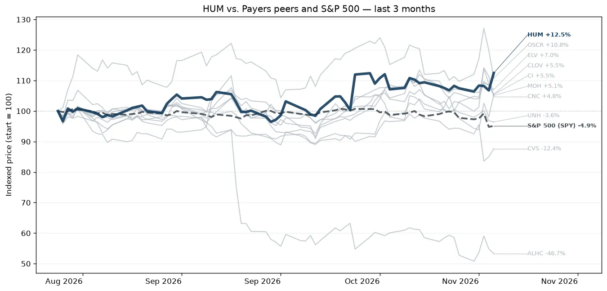

#### Reported Results

Q3 2026: EPS -$0.70 vs. -$1.00 est. (+30.33%); revenue $41.16B vs. $40.89B est. (+0.65%)

#### Earnings Call Summary

Medicare Advantage (MA) membership is performing in line to better than expected for 2026, with early 2027 Annual Election Period (AEP) sales trending ahead of plan. Management anticipates total membership will be up for 2027, supporting margin progression toward its 3%+ target by 2028.

#### At a Glance

- **Humana Beats Q3 Earnings Estimates:** Humana reported a top-line revenue of $41.16 billion, beating estimates of $40.89 billion, and posted an adjusted loss per share of $0.70, which outperformed the anticipated loss of $1.005.
- **Favorable Insurance Benefit Ratio Performance:** The company&#x27;s Insurance segment benefit ratio came in at 93.7 percent, improving upon management&#x27;s previous guidance of slightly above 94 percent despite rising medical costs from 91.1 percent in the prior year.
- **Full Year Earnings Guidance Raised:** Humana raised its full-year 2026 adjusted EPS guidance floor to at least $9.50, up from the prior estimate of at least $9.00, driven by favorable medical cost trends falling at the lower end of its projected range.
- **Strong Membership and Star Ratings:** Individual Medicare Advantage membership grew to 6.46 million, and the company achieved a high member-weighted Star rating of 4.17 for bonus year 2028, exceeding top-quartile performance metrics.
- **Strategic BlackRock Venture Formed:** Humana announced a new joint venture with BlackRock to optimize capital costs and balance sheet health, which is expected to trigger a 130 basis point reduction in its GAAP debt-to-capital ratio.

#### Key Moments from the Call

- **4m 17s — Stars Ratings Tailwind for 2028:** The company delivered exceptionally strong Bonus Year 2028 Stars results, achieving a 4.17 member-weighted rating. This will generate a significant financial tailwind in 2028, a portion of which will be directly passed through to boost earnings and shareholder returns.
- **10m 11s — Full-Year EPS Guidance Raised:** Humana raised its full-year 2026 adjusted EPS guidance to at least $9.50, up from the previous outlook of at least $9.00. This increase reflects better-than-expected cost trends and strong internal performance, signaling a robust recovery trajectory that will please investors.
- **12m 18s — BlackRock Joint Venture Optimizes Capital:** Humana closed a new joint venture with BlackRock, replacing its Welsh Carson JVs. This structure cuts its cost of capital, eliminates a pending 2027 put option funding requirement, and reduces the Q4 2026 GAAP debt-to-cap ratio by 130 basis points.
- **16m 44s — 2027 Cost Trend Expectations Elevate:** Management projected 2027 total medical cost trend to increase to 8%-9% (up from 7%-8% in 2026), driven primarily by a robust health technology pipeline boosting Part D costs by 14%-15%. Though priced into bids, the higher trend introduces a potential point of market scrutiny.

<h3 id="earnings-ntra">Natera (NTRA) -3.5% Last 3m</h3>

Natera Inc is a diagnostic and research company with proprietary molecular and bioinformatics technology. The company&#x27;s key product offerings include its Panorama Non-Invasive Prenatal Test (NIPT) which screens for chromosomal abnormalities of a fetus as well as in twin pregnancies, typically with a blood draw from the mother, Horizon Carrier Screening (HCS) to determine carrier status for a large number of severe genetic diseases that could be passed on to the carrier&#x27;s children, Signatera molecular residual disease (MRD) test, which detects circulating tumor DNA in patients previously diagnosed with cancer to assess molecular residual disease and monitor for recurrence; and Prospera, to assess organ transplant rejection.

**Reported:** November 5, 2026 · [Google Finance earnings page](https://www.google.com/finance/quote/NTRA:NASDAQ?tab=earnings&hl=en)

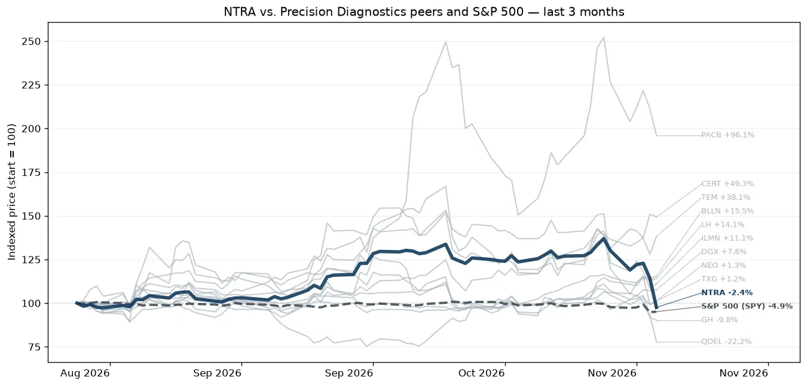

#### Reported Results

Q3 2026: EPS -$0.42 vs. -$0.28 est. (-49.16%); revenue $793.98M vs. $707.50M est. (+12.22%)

#### Earnings Call Summary

CEO Steve Chapman announced he is stepping down, handing leadership to Solomon Moshkevich, the former strategic driver for oncology. Chapman will remain engaged as a consultant and board advisor.

#### At a Glance

- **Natera Outperforms on Revenue Top-Line:** Natera reported Q3 2026 revenue of $793.98 million, beating the estimated $707.50 million, while reported adjusted EPS came in at $0, outperforming the estimated loss of $0.28 per share.
- **Testing Volumes Hit New Record:** The company processed approximately 1.09 million tests during the quarter, representing a 22.3% increase year-over-year, heavily supported by a 60.9% jump in oncology test volume to 339,500 units.
- **Full-Year Revenue Guidance Raised Significantly:** Natera raised its full-year 2026 revenue guidance by $140 million at the midpoint, establishing a new expected range of $3.005 billion to $3.035 billion.
- **Long-Term Growth Targets Established:** Management introduced an ambitious long-term strategic plan aiming to double annual revenue to $6 billion by fiscal year 2029.
- **Executive Leadership Transition Announced:** Steve Chapman is stepping down as Chief Executive Officer, with longtime company executive Solomon Moshkevich appointed to succeed him in the role.
- **Medicare Expands Coverage for Signatera:** The company secured expanded Medicare coverage for the serial use of its Signatera test in early-stage hepatocellular carcinoma surveillance.

#### Key Moments from the Call

- **2m 3s — CEO Succession Plan Announced:** Longtime CEO Steve Chapman is stepping down from his role, transitioning leadership to Solomon Moshkevich. This leadership shift comes from a position of commercial and financial strength, ensuring consistency in executing the company's long-term strategy.
- **7m 0s — Aggressive $6 Billion Revenue Target:** New CEO Solomon Moshkevich set a bold long-term financial target to double Natera's revenue to $6 billion by 2029. This growth assumes steady execution and an achievable ASP climb to $1,450 without relying on major screening milestones.
- **12m 15s — Signatera Medicare Coverage Expansion:** Medicare granted coverage for serial Signatera use in early-stage hepatocellular carcinoma (HCC). This expansion serves a market of roughly 40,000 new U.S. patients annually, providing a massive volume runway and validating Natera's real-world evidence framework.
- **29m 21s — Raised 2026 Guidance with Step-Up in OPEX:** Natera raised its full-year 2026 revenue guidance midpoint by $140 million to clear the $3 billion milestone. However, management bumped its OPEX spending limits due to elevated legal costs and immediate capacity expansions required to service booming biopharma demands.

<h3 id="earnings-gh">Guardant Health (GH) -10.5% Last 3m</h3>

Guardant Health, based in Redwood City, California, is a leader in liquid-based cancer tests for clinical and research use. The company&#x27;s main franchises are Guardant360 for genomic profiling of tumors, Reveal for molecular residual disease testing, and Shield for colorectal cancer screening. Additionally, Guardant offers research development services such as regulatory approval consultancy and clinical trial referrals.

**Reported:** November 5, 2026 · [Google Finance earnings page](https://www.google.com/finance/quote/GH:NASDAQ?tab=earnings&hl=en)

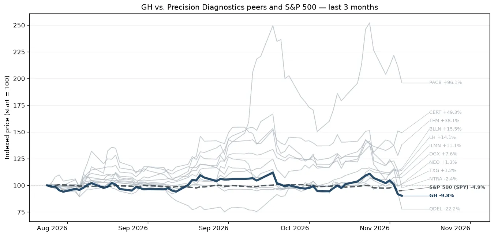

#### Reported Results

Q3 2026: EPS -$0.29 vs. -$0.31 est. (+7.77%); revenue $360.98M vs. $350.71M est. (+2.93%)

#### Earnings Call Summary

Guardant Health reported Q3 2026 revenue of $361 million, down slightly from expectations but up 36% year-over-year from $265 million. Non-GAAP gross margin improved to 67%. Oncology revenue grew 25% to $231 million, driven by a 58% increase in oncology test volumes to 117,000, led by Reveal volume growth over 100%.

#### At a Glance

- **Guardant Health Beats Revenue Estimates:** Guardant Health reported a total revenue of $360.98 million for Q3 2026, surpassing the estimated $350.71 million, while reported adjusted EPS came in at $0 compared to an estimated loss of $0.31.
- **Strong Volume Drives Core KPIs:** Oncology test volume surged 58% year-over-year to 117,000 tests, while Shield screening test volume grew 246% to 83,000, continuing a trend of strong clinical adoption across core product segments.
- **Full-Year Revenue Guidance Lifted:** Management raised its full-year 2026 revenue guidance to a range of $1.36 billion to $1.37 billion, up from its previous outlook of $1.34 billion to $1.36 billion.
- **Shield Screening Gains Significant Revenue:** Screening revenue skyrocketed 180% year-over-year to $68 million, fueled by expanded commercial coverage from payers like UnitedHealth Group.
- **Medicare Delays Impact Cash Burn:** The company raised its projected 2026 free cash flow burn due to a temporary CMS billing code and Medicare claims processing delay that shifts $10 million to $15 million in payments into 2027.

#### Key Moments from the Call

- **20m 52s — Shield Cost Reduction Beats Target Early:** Guardant fully implemented its lower-cost Shield workflow in August, driving cost per test down to $330 in Q3. This outpaced the company's year-end target of $350 a full quarter early, reinforcing their trajectory toward a $200 cost per test by 2028.
- **23m 3s — Full-Year 2026 Revenue Guidance Raised:** Strong volume across oncology and screening businesses prompted management to raise full-year revenue guidance to a range of $1.36 billion to $1.37 billion, representing 38% to 40% year-over-year growth.
- **25m 11s — CMS Delay Briefly Heightens Cash Burn:** Management increased the full-year free cash flow burn outlook to $205 million–$220 million. This revision stems entirely from a temporary CMS administrative delay in processing claims for the newly coded Guardant360 Liquid CDx, shifting $10 million–$15 million in cash collections from late 2026 into early 2027.
- **33m 33s — Massive Shield Coverage Expansion Achieved:** Favorable policy wins from UnitedHealthcare, Carelon, eviCore, and regional payers added roughly 30 million covered lives in Q3. This pushes total covered lives to an estimated 100 million entering 2027, representing over 80% of the eligible U.S. screening population.

<h3 id="earnings-solv">Solventum (SOLV) +8.9% Last 3m</h3>

In spring 2024, 3M spun out its legacy healthcare segment as a stand-alone firm, Solventum. At that time, the firm comprised four segments. The smallest one—purification and filtration—has since been sold. Now, medsurg is the largest business, contributing roughly 64% of consolidated revenue, and includes advanced wound care and wound prevention. Dental solutions (restorative composites and orthodontia) and health information systems (mainly revenue cycle management) each contribute 18% of total revenue.

**Reported:** November 5, 2026 · [Google Finance earnings page](https://www.google.com/finance/quote/SOLV:NYSE?tab=earnings&hl=en)

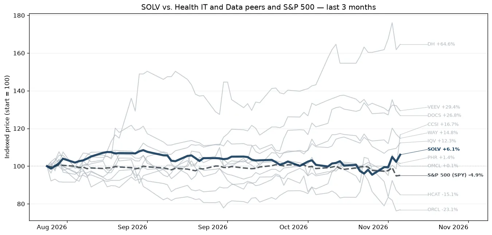

#### Reported Results

Q3 2026: EPS $1.45 vs. $1.34 est. (+7.87%); revenue $1.95B vs. $1.93B est. (+0.83%)

#### Earnings Call Summary

Solventum executed its largest and final ERP cutover in Q3 2026, pushing separation from 3M past 90% completion. This milestone significantly mitigates execution risk and is expected to strengthen free cash flow starting in Q4 2026 as associated separation costs begin to roll off.

#### At a Glance

- **Solventum Tops Q3 Financial Estimates:** Solventum reported Q3 2026 revenue of $1.949 billion, beating the estimated $1.933 billion, and reported an adjusted EPS of $1.45, which significantly outperformed the estimated $1.344.
- **ERP Reversal Headwind Weighs on KPIs:** Organic sales for the quarter declined by 2.8%, which was heavily impacted by an expected 630 basis point headwind from the reversal of advanced orders placed ahead of its ERP system cutover.
- **Full-Year Adjusted EPS Outlook Raised:** Management increased its full-year 2026 adjusted EPS guidance range to $7.20–$7.30 from its previous range of $7.10–$7.20 while anticipating organic sales growth toward the high end of its targets.
- **Separation From 3M Nears Completion:** The company successfully completed its largest and most complex ERP system cutover, pushing its overall structural separation from former parent company 3M past the 90% completion mark.
- **Strategic Review for Health Information Systems:** Solventum is actively evaluating strategic alternatives, including a potential sale or spin-off, for its Health Information Systems business segment to accelerate debt reduction.

#### Key Moments from the Call

- **4m 17s — Supply Contract Reset Erases Margin Headwind:** The renegotiated raw material supply agreement with 3M eliminates an anticipated 100 basis point step-up in product costs previously modeled for mid-2027, significantly increasing investor visibility and confidence in long-term margin improvement paths.
- **24m 44s — Organic Outlook Driven to High End:** Management pushed its full-year organic growth outlook to the high end of the 2.5% to 3% range, translating to roughly 4% growth excluding SKU exits, highlighting strong underlying commercial execution across main markets.
- **27m 30s — Full-Year EPS Guidance Upgraded:** Driven by robust year-to-date performance and stronger operating efficiency, Solventum raised its 2026 EPS expectations to $7.20–$7.30, validating the execution of its "Transform for the Future" cost savings program.
- **31m 42s — HIS Separation Strategy Underlines Dilution:** Analysts zeroed in on the financial profile of the impending HIS separation, with management confirming a mathematical reset of approximately 400 basis points in net operating margin dilution before downstream cost actions or capital deployment benefits.

<h3 id="earnings-tem">Tempus AI (TEM) +46.1% Last 3m</h3>

Tempus AI Inc is a technology company. It has built the Tempus Platform, which comprises both a technology platform to free healthcare data from silos and an operating system to make the resulting data useful. Its Intelligent Diagnostics use AI, including generative AI, to make laboratory tests more accurate, tailored, and personal.

**Reported:** November 2, 2026 · [Google Finance earnings page](https://www.google.com/finance/quote/TEM:NASDAQ?tab=earnings&hl=en)

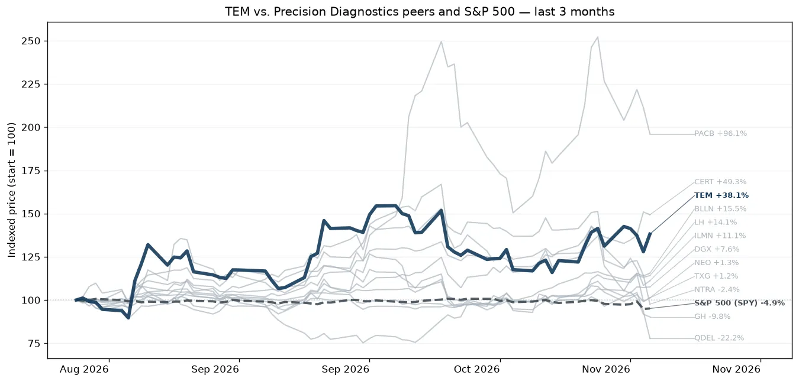

#### Reported Results

Q3 2026: EPS $0.07 vs. -$0.08 est. (+191.53%); revenue $411.54M vs. $409.30M est. (+0.55%)

#### Earnings Call Summary

Tempus AI reported strong Q3 2026 results, with total revenue rising 23% year-over-year to $411.5 million, beating the estimated $409.3 million. EPS of $0.07 beat expectations of a $0.076 loss. Growth was driven by a 32% increase in oncology unit volume and a 33% revenue increase in the data and applications business.

#### At a Glance

- **Tempus AI Outperforms Earnings Estimates:** Tempus AI reported a Reported Adjusted EPS of $0.00, beating the Estimated Adjusted EPS of -$0.076, while Reported Revenue reached $411.537 million, surpassing expectations of $409.295 million.
- **Oncology and Data Segments Expand:** The company&#x27;s Oncology business saw unit volume growth accelerate to 32%, while the Data &amp; Applications segment achieved robust revenue growth of 33% year-over-year.
- **Full-Year Revenue Forecast Raised Higher:** Management boosted its full-year 2026 revenue guidance to a range of $1.60 billion to $1.605 billion, while reaffirming its full-year Adjusted EBITDA expectation of approximately $65 million.
- **First Positive Adjusted EBITDA Quarter:** Tempus AI hit a key financial milestone by generating $25.6 million in positive Adjusted EBITDA, marking its first profitable quarter on an adjusted basis as gross profit outpaced historical tech investments.
- **Strategic Collaborations Drive Diversification Moat:** The company secured multi-year data licensing partnerships with Merck, Moderna, and Bristol Myers Squibb, expanding its data-driven offerings beyond oncology into neurological disease areas like Alzheimer&#x27;s disease.
- **Stock Surges on Strong Performance:** Shares of Tempus AI climbed as much as 11% in Monday trading following the market reaction to the top- and bottom-line beats and raised annual revenue target.

#### Key Moments from the Call

- **5m 26s — Positive EBITDA Inflection:** Tempus generated $25.6 million in Adjusted EBITDA this quarter, successfully turning the corner toward sustained profitability. Investors will be pleased that expanding gross margins are outpacing investments, showcasing strong financial leverage despite absorbing near-term operational losses from the upcoming Personalis acquisition.
- **8m 34s — Hereditary Segment Recovery Dynamics:** The hereditary cancer testing segment experienced growth stabilization as it lapped tough year-over-year comparables from a 2025 volume surge. September and October unit growth rebounded to low double digits, reassuring investors of stable performance within a highly under-penetrated market.
- **10m 17s — Oncology Average Selling Price Headwinds and Tailwinds:** Management announced an expansion of FDA approval for the xT test to include tumor-only pricing, kicking in on January 1, 2027. This shift provides an estimated $80 million uplift to oncology average selling prices (ASPs) in 2027, alleviating investor concerns regarding macro lab fee headwinds.
- **22m 29s — Transition to High-Margin AI Modeling Subscriptions:** The data business is successfully migrating biopharma customers from episodic data licensing to sticky, multi-year subscriptions. By connecting its Lens software platform to private GPU clusters, Tempus locks clients into its environment for advanced AI modeling, enhancing multi-year revenue visibility through 2029.

<h3 id="earnings-fms">Fresenius (FMS) -3.6% Last 3m</h3>

Fresenius Medical Care is the largest dialysis company in the world, treating nearly 300,000 patients from about 3,600 clinics worldwide as of December 2025. In addition to providing dialysis services, the firm is a leading supplier of dialysis products, including machines, dialyzers, and concentrates. Fresenius accounts for about 35% of the global dialysis products market, creating the world&#x27;s only fully integrated dialysis business. Services account for about three-fourths of sales, while the balance is generated from medical technology products that enable dialysis treatments.

**Reported:** November 3, 2026 · [Google Finance earnings page](https://www.google.com/finance/quote/FMS:NYSE?tab=earnings&hl=en)

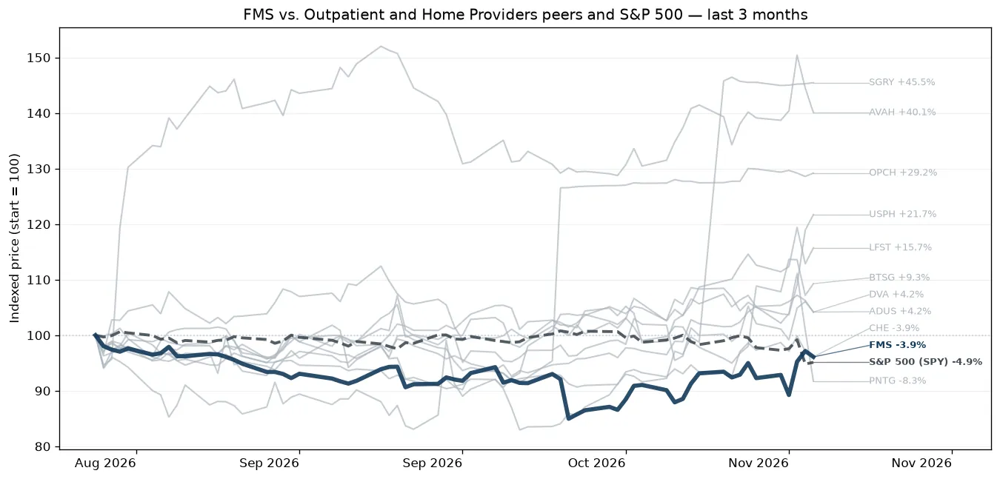

#### Reported Results

Q3 2026: EPS $0.56 vs. $0.53 est. (+4.91%); revenue $4.94B vs. $4.91B est. (+0.50%)

#### Earnings Call Summary

Fresenius Medical Care reported broadly stable revenue and earnings for Q3 2026 despite headwinds. Group revenue remained steady, supported by organic care delivery growth but offset by a decline in Value-Based Care revenue. Operating income excluding special items declined 6% at constant currency due to anticipated TDAPA reimbursement pressures, maintaining an 11% operating margin.

#### At a Glance

- **Fresenius Medical Care Beats Financial Estimates:** For Q3 2026, Fresenius Medical Care reported an adjusted EPS of $0.61, beating the estimated $0.529, while quarterly revenue reached $4,936,742,000, topping the consensus expectation of $4,911,967,800.
- **Segment Growth Offsets Strategic Refinements:** Organic revenue development remained stable driven by growth in Care Delivery and Care Enablement, which helped mitigate a planned top-line decline in the profit-neutral Value-Based Care segment.
- **Full Year Operating Income Outlook Narrowed:** Management narrowed its full-year 2026 operating income outlook to between flat and a negative mid-single-digit percentage growth rate due to ongoing regulatory and inflation headwinds.
- **China Transformation Triggers One-Time Charges:** Reported operating income fell 19% primarily due to one-time costs associated with refining the commercial strategy in China, including exiting the peritoneal dialysis business and discontinuing legacy 4008A manufacturing.
- **U.S. CAREsystem Rollout Reaches Milestones:** The deployment of the 5008X CAREsystem progressed steadily, expanding to 348 U.S. clinics and successfully delivering 1.3 million treatments by the end of the quarter.
- **Rising Macroeconomic Headwinds Limit Margins:** The company faced intensifying inflationary pressures in raw materials and logistics, which are now expected to surpass the previously anticipated top end of the €300 million headwind guidance range.

#### Key Moments from the Call

- **16m 33s — Inflation to Exceed Guidance Cap:** Management announced that cumulative group inflation headwinds will exceed the previously assumed EUR 300 million top-end cap for the year. This budget breach is being driven by higher labor costs within Care Delivery alongside elevated raw material, oil, gas, and transportation costs hitting the Care Enablement production lines.
- **18m 12s — 2026 Operating Income Guidance Lowered:** Management narrowed its 2026 full-year operating income guidance to the lower half of its prior range. The company now expects constant currency operating income growth to be between flat and a negative mid-single-digit percentage compared to the prior year, driven by intensifying second-half TDAPA headwinds and inflationary pressures.
- **25m 54s — Massive 2027 TDAPA Headwind Revealed:** Management projected a major 2027 operating income headwind of EUR 300 million to EUR 350 million resulting from the expiration of TDAPA drug reimbursements. This outlook reflects anticipated price and volume competition as well as spillover pressures on the company's pre-existing pharmacy-based operations as add-on payments sunset.
- **31m 40s — U.S. Patient Inflow Stabilizes:** Despite a 1.1% decline in U.S. same-market treatment volumes during Q3, management reported that patient inflows have finally stabilized to prior-year levels. Local clinic execution plans and improved referral management are successfully countering historical census shortfalls, though it will take multiple quarters to turn the aggregate volume metrics positive.

<h3 id="earnings-hsic">Henry Schein (HSIC) -2.4% Last 3m</h3>

Henry Schein Inc is a solutions company for healthcare professionals. It offers healthcare equipment, products, and services to office-based dental and medical practitioners, as well as alternative sites of care. The company&#x27;s reportable segments are: Global Distribution and Value-Added Services, Global Specialty Products, and Global Technology. It generates maximum revenue from the Global Distribution and Value-Added Services segment, which includes distribution to the dental and medical markets of national brand and corporate brand merchandise, as well as equipment and related technical services. This segment also includes value-added services such as financial services, continuing education services, consulting, and other practice services.

**Reported:** November 3, 2026 · [Google Finance earnings page](https://www.google.com/finance/quote/HSIC:NASDAQ?tab=earnings&hl=en)

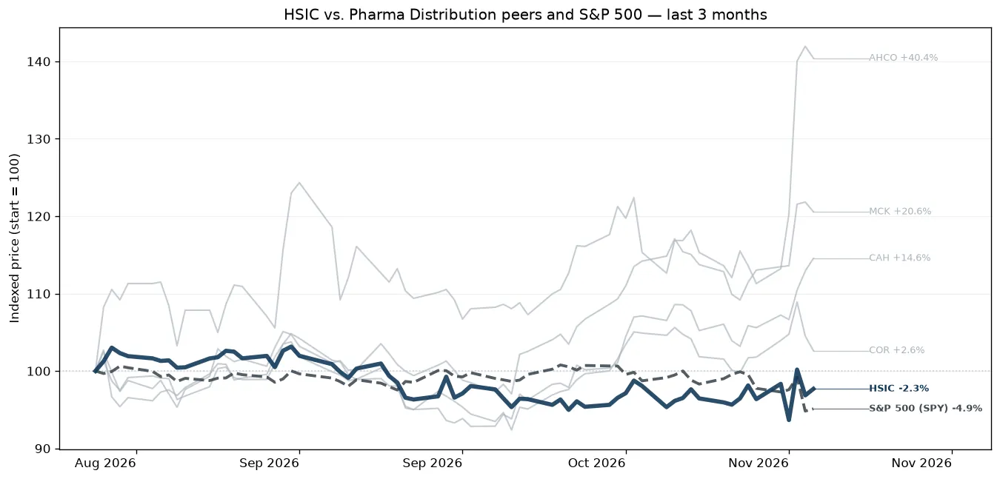

#### Reported Results

Q3 2026: EPS $1.37 vs. $1.36 est. (+0.91%); revenue $3.47B vs. $3.48B est. (-0.15%)

#### Earnings Call Summary

Henry Schein reported third-quarter 2026 global sales of $3.5 billion, up 4.0% year-over-year. Adjusted non-GAAP diluted EPS increased 19.1% to $1.37, excluding tariff refunds and prior year remeasurements. Non-GAAP operating margin expanded by 20 basis points to 8.03%, while GAAP operating margin rose 69 basis points to 5.57%.

#### At a Glance

- **Mixed Top and Bottom Line Results:** Henry Schein reported a reported adjusted EPS of 1.06, which missed the estimated adjusted EPS of 1.358, while its reported revenue of 3,471,000,000 narrowly missed the estimated 3,476,144,880.
- **Dental Merchandise Drives Key Growth:** The company&#x27;s core U.S. dental merchandise segment expanded by 8.6%, showcasing strong volume-driven market share gains relative to past performance.
- **Full-Year Earnings Outlook Upgraded:** Management raised its full-year 2026 non-GAAP diluted EPS guidance to a range of $5.50 to $5.56, highlighting benefits from net tariff refunds and enhanced business performance.
- **Tariff Refunds Boost Profitability Metrics:** The bottom-line performance was significantly aided by net tariff refunds, which contributed a $0.19 per diluted share benefit during the quarter.
- **Stock Declines Post Premarket Open:** Despite achieving margin expansions and an upgraded profit outlook, the stock slid over 5% in premarket trading as investors reacted to the slight revenue miss.
- **CFO Transition Strategy Implemented:** Henry Schein announced a leadership transition, with Emmanuel Caprais succeeding Ron South as Chief Financial Officer effective November 4, 2026.

#### Key Moments from the Call

- **27m 12s — Guidance Raised Following Tariff Refund Boost:** Management raised full-year 2026 non-GAAP EPS guidance to $5.50–$5.56, up from $5.29–$5.39. The upward revision accounts for a $0.19 per share net benefit from a $28 million tariff refund alongside improved underlying business performance, pleasing investors despite fourth-quarter incremental growth investments.
- **29m 37s — U.S. Dental Merchandise Beats on Volume Gains:** U.S. dental merchandise delivered a robust 8.6% total sales growth (7% internal local currency growth). Crucially, growth shifted from price to volume, signaling authentic market share gains within private practices and emerging DSOs, which will reassure investors tracking the health of dental markets.
- **31m 34s — Double-Digit Growth Commitment for 2027:** Analysts repeatedly probed whether the company's double-digit EPS growth target for 2027 relies on the one-time $0.19 tariff benefit. Management strongly defended its target, clarifying that underlying operational improvements and $125 million in year-end value creation run rates sustain the double-digit trajectory.
- **51m 48s — Cloud Software Platform Acceleration Adds Customers:** Global technology grew 5.2%, spearheaded by cloud practice management solutions Dentrix Ascend and Dentally. The tech stack is expanding by roughly 200 net new customer installs per month, reinforcing an integrated model that strengthens client lock-in and cross-selling capabilities for core consumables.

<h3 id="earnings-oscr">Oscar Health (OSCR) +9.9% Last 3m</h3>

Oscar Health Inc is a healthcare technology company built around a full stack technology platform and a relentless focus on serving its members. It offers Individual &amp; Family plans and health technology solutions that power the healthcare industry. Oscar operates as one segment to sell insurance to individuals, families and employees through the federal and state-run healthcare exchanges formed in conjunction with the Patient Protection and Affordable Care Act (ACA) and leverages its technology platform to provide services via its Oscar offering.

**Reported:** November 5, 2026 · [Google Finance earnings page](https://www.google.com/finance/quote/OSCR:NYSE?tab=earnings&hl=en)

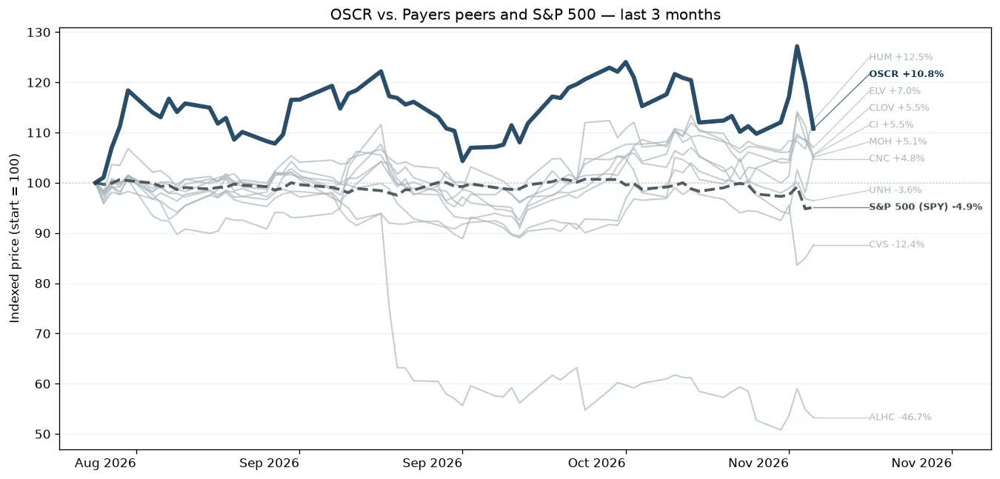

#### Reported Results

Q3 2026: EPS $0.49 vs. -$0.17 est. (+382.60%); revenue $5.14B vs. $4.72B est. (+8.93%)

#### Earnings Call Summary

Oscar Health delivered its strongest historical performance in the first nine months of 2026, reporting $1.3B in earnings from operations and $1.2B in net income. Third-quarter revenue surged roughly 70% year-over-year to $5.1B, driven by premium rate increases and membership growth, enabling management to hit several Investor Day targets early.

#### At a Glance

- **Oscar Health Beats Financial Targets:** Oscar Health delivered a significant earnings surprise with a reported adjusted EPS of $0.49 compared to an estimated loss of $0.173, alongside revenue of $5.14 billion that outperformed expectations of $4.72 billion.
- **Medical Loss Ratio Improves Substantially:** The company&#x27;s medical loss ratio fell to 84.0% for the quarter from 88.5% in the prior year, driven primarily by pricing discipline and improved medical cost performance.
- **Full-Year 2026 Guidance Boosted:** Management raised full-year 2026 operating earnings guidance to a range of $850 million to $950 million, up from the prior outlook, while increasing revenue forecasts to between $19 billion and $19.3 billion.
- **SG&amp;A Efficiency Hits Record Lows:** The company&#x27;s SG&amp;A expense ratio improved by 350 basis points year-over-year to a record low of 14.0%, bolstered by fixed cost leverage and AI-driven operational efficiencies.
- **Market Footprint Expanding for 2027:** Oscar Health announced plans to expand its total addressable market footprint by 24% for the 2027 open enrollment period, entering South Carolina and reaching 21 states.

#### Key Moments from the Call

- **9m 47s — Substantial Inherent Risk Adjustment Tailwinds Drive Revenue Boost:** Oscar reported a significant $250 million third-quarter revenue benefit driven by a favorable shift in its risk relative to the market and better-than-expected market morbidity. This data gave management the confidence to reduce full-year risk adjustment expectations to 17%-18% of premiums, boosting bottom-line expectations.
- **11m 1s — Record Efficient Administrative Performance and AI Leverage:** The third-quarter SG&A expense ratio reached an all-time company low of 14%, down 350 basis points year-over-year. This structural outperformance will reassure investors regarding Oscar's long-term margin target viability, demonstrating clear fixed-cost operating leverage and escalating efficiency gains from internal AI tools.
- **12m 8s — Triple Outlook Raise on Strong Financial Tailwinds:** Oscar Health raised its full-year 2026 earnings from operations guidance for a third time to $850M-$950M, a $200M bump at the midpoint over the prior outlook. This revision pleased investors as it underscores substantial outperformance in underlying risk adjustment and moderately favorable year-to-date medical utilization trends.
- **22m 27s — Disciplined 2027 Pricing Targets Margin Expansion Ahead:** Management revealed a weighted average rate increase of approximately 14% for the 2027 open enrollment period, incorporating high-single-digit cost trends, morbidity impacts from integrity initiatives, and built-in margin enhancement. Investors will look favorably on this strategy as it safeguards profitability and targets continued margin expansion.

<h3 id="earnings-txg">10x Genomics (TXG) +13.9% Last 3m</h3>

10x Genomics Inc is a life science technology company based in the United States. Its solutions include instruments, consumables, and software for analyzing biological systems. The company&#x27;s integrated solutions include instruments, consumables, and software for analyzing biological systems at a resolution and scale that matches the complexity of biology. Its product offerings include a Chromium platform comprising microfluidic chips and related consumables, Chromium X series, Visium and Xenium platforms, and others, which are predominantly used for the study of biological components. Geographically, the company derives operates from the United States and the rest from Americas (excluding the United States), Europe, Middle East and Africa, China, and Asia-Pacific (excluding China).

**Reported:** November 5, 2026 · [Google Finance earnings page](https://www.google.com/finance/quote/TXG:NASDAQ?tab=earnings&hl=en)

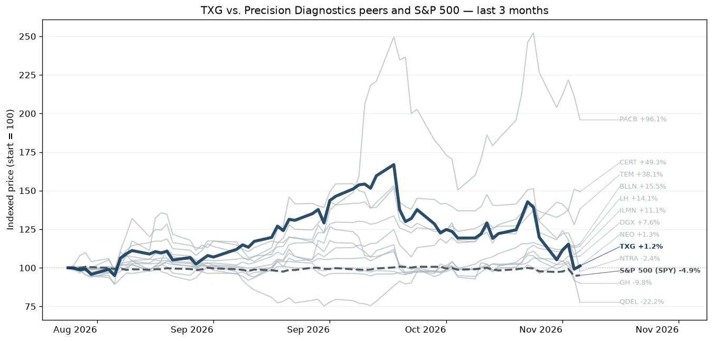

#### Reported Results

Q3 2026: EPS $0.03 vs. -$0.02 est. (+240.30%); revenue $150.67M vs. $148.16M est. (+1.69%)

#### Earnings Call Summary

10X Genomics reported Q3 2026 revenue of $150.7 million, a 1% year-over-year increase, driven by a 5% growth in total consumables revenue ($151 million total reported revenue). Total instruments revenue declined 43%, primarily due to customers moderating purchases of Visium and Xenium systems in anticipation of the new Atera platform.

#### At a Glance

- **10X Genomics Beats on Financials:** 10X Genomics reported an Adjusted EPS of $0.00, beating the estimated loss of $0.02, while quarterly revenue reached $150.67 million, outperforming the consensus estimate of $148.16 million.
- **Consumables Growth Defies Hardware Declines:** Spatial consumables revenue grew 16% year-over-year, which helped offset a sharp 43% decline in hardware instrument revenue driven by customers delaying purchases in anticipation of the new Atera platform.
- **Full-Year Revenue Guidance Elevated:** Management raised its full-year 2026 revenue guidance to a range of $625 million to $635 million, up from the previous range of $610 million to $630 million, primarily due to robust spatial consumables demand and an accelerated Atera shipment schedule.
- **Gross Margin Strong but Pressured:** Third-quarter gross margin expanded significantly to 75% from 67% in the prior year period due to a favorable product mix and lower inventory write-downs, though management anticipates a step-down to the low-to-mid 60% range in the fourth quarter as Atera instrument shipments ramp.
- **Atera Production Shipments Fast-Tracked:** Following the commencement of global commercial shipments for the Atera spatial biology platform, the company increased its 2026 shipment expectations to roughly 50 units by year-end, up from the previous target of 40.
- **AI-Driven Data Analytics Integration:** The company introduced Sentira, a new cloud analysis platform powered by NVIDIA accelerated computing and Anthropic&#x27;s Claude AI, designed to help customers process and interpret complex spatial and single-cell biological datasets.

#### Key Moments from the Call

- **14m 39s — Instrument Revenues Miss as Customers Wait:** Total instrument revenue plunged 43% year-over-year as customers paused Xenium and Visium purchases ahead of Atera. While predictable during a platform transition, the steep decline highlights the temporary headwinds facing the legacy hardware portfolio.
- **16m 1s — Full-Year 2026 Revenue Guidance Raised:** Management raised its full-year revenue outlook to $625M–$635M, signaling strong business momentum and higher-than-expected Atera shipments. This revision beat market assumptions and will please investors tracking the critical product launch.
- **17m 11s — Atera Shipping Forecast Boosted:** 10X Genomics increased its 2026 Atera shipping forecast to 50 units from 40, demonstrating efficient manufacturing execution. This surprise will reassure investors that supply chain and production capacity are scaling effectively to meet robust initial demand.
- **17m 11s — Near-Term Gross Margin Compression Expected:** Q4 gross margins are projected to drop to the low to mid-60s from Q3's 75% due to the initial instrument-heavy mix of Atera shipments. This near-term contraction may temporarily disappoint investors focused on immediate profitability.

<h3 id="earnings-pacs">PACS Group (PACS) +2.4% Last 3m</h3>

PACS Group Inc is a post-acute healthcare company mainly focused on delivering skilled nursing care through a portfolio of independently operated facilities. The post-acute care ecosystem serves individuals who need additional help recuperating from acute conditions, illnesses, or serious medical procedures after getting discharged from the hospital. It also provides senior care, assisted living, and independent living options in some of the communities. The company has one reportable segment.

**Reported:** November 4, 2026 · [Google Finance earnings page](https://www.google.com/finance/quote/PACS:NYSE?tab=earnings&hl=en)

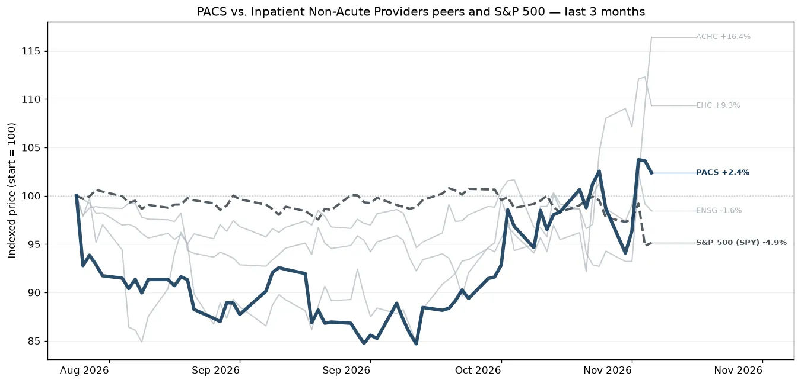

#### Reported Results

Q3 2026: EPS $0.63 vs. $0.58 est. (+8.09%); revenue $1.50B vs. $1.46B est. (+2.88%)

#### Earnings Call Summary

The 284 same-store skilled nursing facilities achieved 6.4% year-over-year revenue growth. Same-store occupancy improved by 200 basis points to 91.3%, while skilled mix by nursing patient days grew 120 basis points to 29.5%, reflecting strong organic momentum in established facilities.

#### At a Glance

- **PACS Top-Line Financial Results Mixed:** PACS Group reported Q3 2026 revenue of $1,498.58 million, beating estimates of $1,456.69 million, while its reported adjusted EPS of $0.37 missed the estimated $0.583.
- **Strong Same-Store KPI Progress:** The company delivered strong operational progress with same-store skilled nursing revenue growing 6.4% year-over-year and facility occupancy expanding by 200 basis points to 91.3%.
- **Full-Year 2026 Guidance Raised:** Management increased its full-year 2026 outlook, lifting expected revenue to a range of $5.95 billion to $6.05 billion and Adjusted EBITDA to between $685 million and $695 million.
- **Strategic Geographic Footprint Expansion:** PACS Group deployed $213 million in capital for strategic acquisitions during the quarter, including the acquisition of 31 Eduro facilities and its first large-scale expansion into Florida.
- **Market Welcomes Strong Profitability Metrics:** Despite the reported per-share earnings shortfall, shares jumped 10.63% in after-hours trading as investors chose to focus heavily on a 33.6% surge in Adjusted EBITDA and expanded margins.
- **Integration Costs and Investigations Remain:** Profitability faced headwinds from heavy near-term investments to onboard newly acquired assets, alongside elevated stock-based compensation and ongoing regulatory inquiries.

#### Key Moments from the Call

- **10m 6s — Significant Footprint Expansion Into Florida:** PACS Group entered Florida on October 1st by acquiring 32 skilled nursing operations adding 4,049 beds. This major entry into a high-occupancy state will encourage investors, signaling strong execution on their disciplined growth strategy and ability to replicate their decentralized operating model in new markets.
- **13m 18s — Strong Core Financial Beat:** Reported adjusted EPS of $0.63 beat estimates of $0.583, and revenue of $1.498 billion surpassed the $1.456 billion consensus. Investors will welcome this performance alongside a 190 basis point adjusted EBITDA margin expansion, underscoring strong platform operating leverage.
- **21m 29s — Substantial Full-Year Guidance Increase:** Management raised full-year 2026 revenue guidance by $200 million and adjusted EBITDA midpoint guidance by $40 million. This upward revision will please investors as it highlights robust organic trends and immediate operational absorption of major integration costs from large-scale acquisitions.
- **30m 57s — Improving Labor Environment Trend:** Management highlighted accelerating positive labor trends, noting falling agency staffing costs and sequential reductions in premium contract labor. This provides positive reassurance to investors regarding margin sustainability against industry-wide regulatory minimum staffing anxieties.

<h3 id="earnings-docs">Doximity (DOCS) +18.6% Last 3m</h3>

Doximity Inc provides an online platform, which enables physicians and other healthcare professionals to collaborate with colleagues, stay up to date with the latest medical news and research, manage their careers and on-call schedules, streamline documentation and administrative paperwork, and conduct virtual patient visits. The Company&#x27;s customers include pharmaceutical companies and health systems that connect with healthcare professionals through the Company&#x27;s digital Marketing, Hiring, and Workflow Solutions. Marketing Solutions provide customers with the ability to share tailored content on the network. Hiring Solutions enable customers to identify, connect with, and hire from the network of both active and passive potential medical professional candidates.

**Reported:** November 5, 2026 · [Google Finance earnings page](https://www.google.com/finance/quote/DOCS:NYSE?tab=earnings&hl=en)

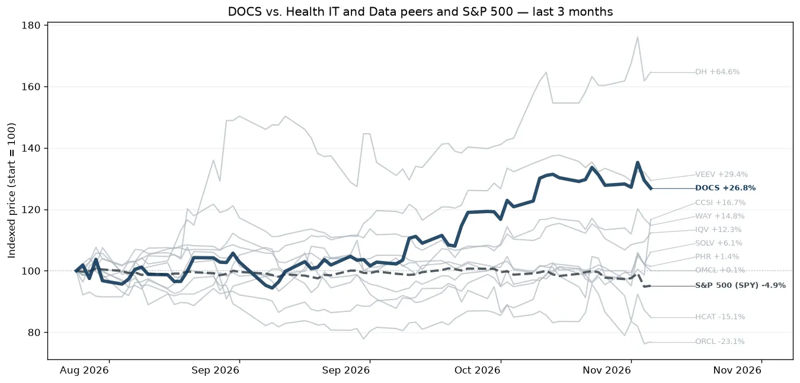

#### Reported Results

Q2 2027: EPS $0.36 vs. $0.35 est. (+2.80%); revenue $174.54M vs. $170.30M est. (+2.49%)

#### Earnings Call Summary

Doximity reported Q2 2027 revenue of $174.5 million, up 4% year-over-year and exceeding guidance. Adjusted EBITDA reached $89 million, up 9% above guidance, representing a 51% margin despite a six-fold year-over-year increase in AI investments, driven by strong core product performance and commercial AI Search traction.

#### At a Glance

- **Doximity Beats Q2 Revenue Estimates:** Doximity reported Q2 2027 revenue of $174.54 million, beating the estimated $170.30 million, while reported adjusted EPS came in at $0.18 compared to the estimated $0.35.
- **Record Prescriber Engagement Growth Achieved:** Quarterly active workflow prescribers surged by 34% year-over-year, representing nearly half of the 1.8 million U.S. medical prescribers on the platform.
- **Full Year Revenue Guidance Raised:** Driven by early commercial momentum, the company raised its full-year fiscal 2027 revenue guidance to a range of $678 million to $683 million.
- **AI Search Reaches Eight-Figure Bookings:** The new AI Search advertising product gained substantial commercial traction, securing purchases from 16 of the top 20 pharmaceutical companies.
- **Health System AI Footprint Expands:** The company expanded its health system AI suite client footprint to over 190 institutional clients, up from 165 in the previous quarter.
- **Heavy AI Investments Pressure Margins:** Non-GAAP gross margins fell to 88% from 92% in the prior quarter due to a sixfold increase in AI-related spending and computational costs.

#### Key Moments from the Call

- **12m 16s — AI Search Reaches Eight-Figure Bookings:** Doximity expanded its market opportunities by commercializing its new AI Search product, capturing eight-figure bookings from 16 of the top 20 pharmaceutical firms, enabling entry into the massive $14 billion pharma paid search industry.
- **12m 16s — Fiscal 2027 Revenue Guidance Raised:** Management raised full-year fiscal 2027 revenue guidance to $678 million-$683 million, indicating growing commercial visibility and a projected re-acceleration of year-over-year top-line growth in the second half of the year.
- **20m 23s — Significant AI Cost Efficiency Realized:** Doximity achieved meaningful operating leverage as Q2 cost of revenue grew at less than half the expansion rate of overall AI prompt volume, driven by pre-bought compute capacity and multi-model architectural optimization.
- **25m 17s — Record Workflow Engagement Growth:** Doximity's active workflow prescribers surged 34% year-over-year to historic highs, driven by continuous expansion across core telehealth, physician scheduling features, and newly integrated workflow AI features.

<h3 id="earnings-blln">BillionToOne (BLLN) +22.0% Last 3m</h3>

BillionToOne Inc is a molecular diagnostics company. It offers a portfolio of ultrasensitive tests covering prenatal genetic testing, cancer therapy selection, and response monitoring, which are based on its Quantitative Counting Templates (QCT) molecular counting platform. The company&#x27;s product portfolio comprises UNITY, a portfolio of prenatal testing products that can conduct fetal risk analysis without requiring a paternal sample; Northstar Select, a ultrasensitive liquid biopsy test that provides insights into appropriate therapies for stage III or IV cancer patients; and Northstar Response, a tissue-free, pan-cancer, liquid biopsy test that measures several genomic loci uniquely methylated in cancer to provide insight into dynamic changes in therapy response.

**Reported:** November 4, 2026 · [Google Finance earnings page](https://www.google.com/finance/quote/BLLN:NASDAQ?tab=earnings&hl=en)

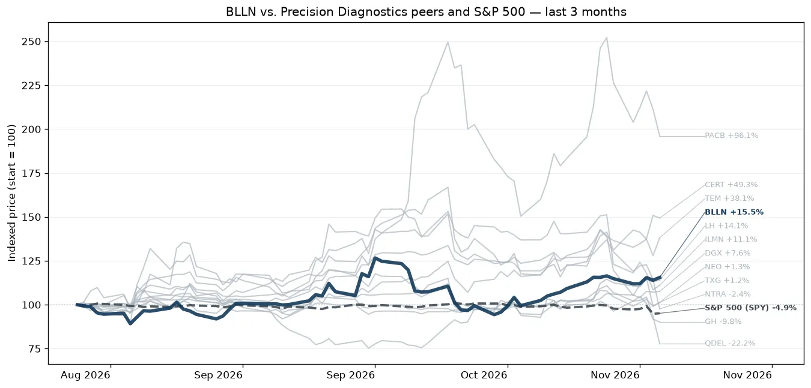

#### Reported Results

Q3 2026: EPS $0.48 vs. $0.30 est. (+58.90%); revenue $122.98M vs. $115.63M est. (+6.36%)

#### Earnings Call Summary

BillionToOne reported strong Q3 2026 results with total revenue growing 47% year-over-year to $123 million, driven by a 25% increase in total test volume to 206,000 tests and an 18% improvement in average selling price (ASP) to $589. Prenatal revenue grew 42% to $106 million, while oncology revenue surged 96% to $17 million.

#### At a Glance

- **BillionToOne Beats EPS and Revenue Estimates:** BillionToOne Inc reported a top-line revenue of $122.981 million and a reported adjusted EPS of $0, outperforming the estimated revenue of $115.62857 million.
- **Strong Key Product Volume Performance:** The company delivered approximately 206,000 tests during the quarter, representing an increase of 25% year-over-year compared to 165,000 tests delivered in Q3 2025.
- **Management Raises Full-Year Revenue Guidance:** BillionToOne raised its full-year 2026 total revenue guidance to a range of $460 million to $470 million, up from its prior projection of $450 million to $465 million.
- **Oncology Segment Records Massive Expansion:** Oncology clinical testing revenue nearly doubled by rising 96% year-over-year to $17.1 million, proving to be a high-growth segment alongside prenatal testing.
- **Upcoming Launch of Northstar Clear:** The company announced the commercial launch of Northstar Clear, a tissue-free molecular residual disease test scheduled for December 15, 2026, targeting a $30 billion market.

#### Key Moments from the Call

- **21m 43s — Full-Year 2026 Revenue Guidance Raised:** Investors will be pleased by management raising full-year 2026 revenue guidance to $460M–$470M, indicating strong operational momentum and clear market outperformance with 51%–54% projected year-over-year growth.
- **28m 8s — Northstar Clear Margin Advantage:** Management revealed that Northstar Clear is engineered with an exceptionally low-cost profile, allowing it to achieve positive gross margins without immediate Medicare reimbursement. This eliminates the need to restrict or throttle test volumes, positioning the company for unconstrained market penetration.
- **33m 41s — Health System Expansion Strategy:** The company clarified that near-term volume moderation in prenatal testing stems from high penetration in independent clinics. Growth efforts are shifting to health systems, which represent 60% of the market, backed by long sales cycles and strategic EMR integrations.
- **39m 26s — MolDX Reimbursement Timing Uncertain:** While a recent head-to-head study significantly de-risks ultimate Medicare coverage for Northstar Response, management noted that MolDX maintains a high review bar for tissue-free assays, making the exact year-end approval timeline uncertain.

<h3 id="earnings-way">Waystar (WAY) +17.0% Last 3m</h3>

Waystar Holding Corp is a provider of mission-critical cloud technology to healthcare organizations. Its enterprise-grade platform transforms the complex and disparate processes comprising healthcare payments received by healthcare providers from payers and patients, from pre-service engagement through post-service remittance and reconciliation. its platform enhances data integrity, eliminates manual tasks, and improves claim and billing accuracy, which results in transparency, reduced labor costs, and faster, more accurate reimbursement and cash flow. The market for solutions extends throughout the United States and includes Puerto Rico and other USA Territories.

**Reported:** November 2, 2026 · [Google Finance earnings page](https://www.google.com/finance/quote/WAY:NASDAQ?tab=earnings&hl=en)

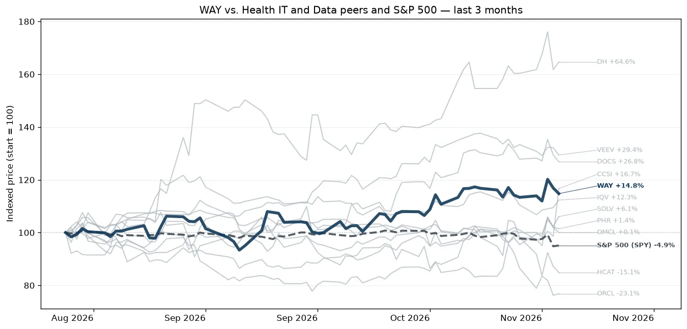

#### Reported Results

Q3 2026: EPS $0.44 vs. $0.41 est. (+7.96%); revenue $325.62M vs. $323.41M est. (+0.68%)

#### Earnings Call Summary

Waystar reported strong Q3 2026 results, with total revenue up 21% year-over-year to $326M and 10% organic growth. Adjusted EBITDA grew 24% to $139M with a 43% margin. Large clients (>$100k trailing revenue) grew 14% to 1,488, representing 75% of revenue, while net revenue retention remained steady at 108%. Unlevered free cash flow reached $115M.

#### At a Glance

- **Waystar Beats on Top Line:** Waystar reported Q3 2026 revenue of $325.62 million, beating the estimated $323.41 million, while reported adjusted EPS came in at $0.16 compared to the estimated $0.408.
- **Large Client Cohort Expands Steadily:** Waystar&#x27;s large client base generating over $100,000 in trailing 12-month revenue grew 14% year-over-year, contributing to approximately 75% of total revenue as providers continue to consolidate point solutions.
- **Revenue Guidance Points to Slowdown:** The company updated its full-year 2026 revenue guidance to a range of $1.277 billion to $1.287 billion, reflecting an implied fourth-quarter growth slowdown due to longer implementation times for major clients.
- **Autonomous AI Innovation Progresses:** Waystar launched an industry-first autonomous claim resubmission feature utilizing &#x27;Agentic&#x27; capabilities, with over 130 clients joining the early adopter program during the quarter.
- **Soft Guidance Damps Market Response:** Despite achieving a solid 21% year-over-year increase in top-line revenue, Waystar shares slid roughly 7% in after-hours trading following the announcement as investors focused on softer forward guidance.

#### Key Moments from the Call

- **21m 14s — Q4 Revenue Guidance Downside:** Management lowered its full-year revenue outlook, implying a deceleration to 6% growth in Q4. This disappointed investors and is driven by an accelerated transition from printed to digital patient statements, longer conversion timelines for complex platform implementations, and performance-based Iodine contracts.
- **22m 19s — Iodine Revenue Model Shift Delayed Recognition:** A strategic shift to price the new Prebill Anomaly Detection solution on an outcome or performance-based model rather than subscriptions has lengthened the timing between bookings and recognized revenue, creating a temporary headwind for full-year 2026 Iodine revenue.
- **23m 24s — Raised Full-Year Profitability Guidance:** Waystar raised its full-year 2026 adjusted EBITDA outlook to $543M-$549M, signaling strong operational efficiency, favorable mix shift away from lower-margin revenue, and disciplined cost control despite lowering its near-term top-line revenue outlook.
- **25m 46s — Record Backlog and Bookings Surge:** Year-to-date bookings surged 25% year-over-year, driven by the largest contract win in company history and a 50% increase in the implementation backlog for large clients. While pleasing long-term investors, this underscores an elongation of near-term revenue conversion timelines.

<h3 id="earnings-con">Concentra Group (CON) +24.0% Last 3m</h3>

Concentra Group Holdings Parent Inc is a provider of occupational health services in the USA. The business is organized into three operating segments: occupational health centers, onsite health clinics, and other businesses.

**Reported:** November 6, 2026 · [Google Finance earnings page](https://www.google.com/finance/quote/CON:NYSE?tab=earnings&hl=en)

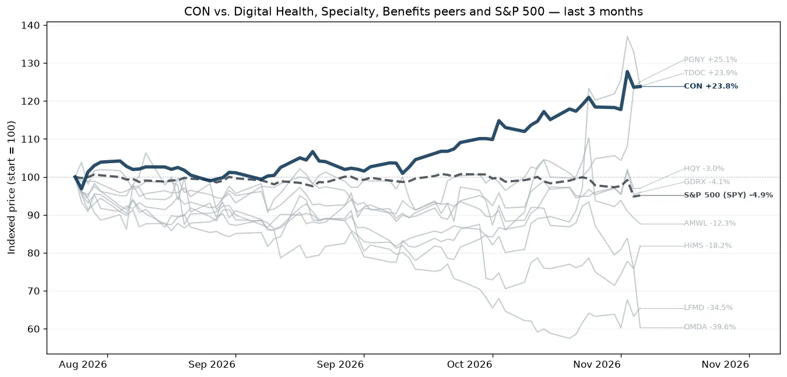

#### Reported Results

Q3 2026: EPS $0.52 vs. $0.44 est. (+18.41%); revenue $622.12M vs. $605.38M est. (+2.77%)

#### Earnings Call Summary

Concentra Group Holdings Parent Inc. reported total revenue of $622.1 million for Q3 2026, an 8.6% increase year-over-year. Net income grew 36% to $67.8 million, while Adjusted EBITDA reached $140.2 million, up 17.9% compared to the prior year period.

#### At a Glance

- **Concentra Beats Q3 Consensus Expectations:** Concentra Group Holdings reported Q3 2026 revenue of $622.12 million, outperforming the estimated $605.38 million, while its adjusted diluted EPS reached $0.52 compared to the expected $0.439.
- **Strong Growth in Patient Visits:** Daily patient visits at occupational health centers increased 4.9% year-over-year to over 58,000, while revenue per visit climbed 3.3% due to higher workers&#x27; compensation and employer services rates.
- **Full-Year Financial Guidance Raised:** Management raised its full-year 2026 revenue guidance to a range of $2.36 billion to $2.38 billion and adjusted EBITDA guidance to between $505 million and $510 million.
- **Board Approves Share Repurchase Authorization:** The company&#x27;s board of directors authorized a new $250 million share repurchase program with no expiration date, complementing its growth capital allocation priorities.
- **Footprint Expansion and De Novo Openings:** Concentra completed several center additions in Q3, positioning the company to add 15 new locations in 2026 through acquisitions and de novo developments, with plans for low double-digit openings in 2027.
- **Successful Executive Leadership Succession:** Effective November 1, 2026, Matt DiCanio officially stepped in as the new president and chief executive officer, succeeding Keith Newton who transitioned to executive chairman.

#### Key Moments from the Call

- **8m 42s — Margin Expansion Drivers and Sustainability:** Adjusted EBITDA margin expanded by 178 basis points year-over-year to 22.5%. Management indicated this progress stemmed from pricing power, volume growth, and center staffing efficiencies, reassuring analysts that current margin levels are sustainable heading into 2027.
- **12m 12s — Expanded Share Repurchase Authorization:** The board authorized a new $250 million share repurchase program with no expiration date. Having achieved its target net leverage ratio below 3x, management elevated share buybacks alongside debt paydown to maximize flexible shareholder returns.
- **13m 50s — Full-Year 2026 Guidance Increase:** Concentra raised the low and high ends of its full-year 2026 guidance for revenue and Adjusted EBITDA. This positive revision reflects sustained volume tailwinds, strong operational execution, and confidence in closing out the fiscal year ahead of previous market expectations.
- **30m 42s — Employer Services Visit Growth Surge:** Employer services daily visits surged 5.8% in Q3, outperforming historical trends. Analysts focused on this uptick as a leading economic indicator, which historically precedes subsequent workers' compensation case volume increases.

<h3 id="earnings-lfst">Lifestance Health (LFST) +27.0% Last 3m</h3>

LifeStance Health Group Inc is a mental healthcare company that operates as a provider of outpatient mental health services, spanning psychiatric evaluations and treatment, psychological and neuropsychological testing, and individual, family, and group therapy. It treats a broad range of mental health conditions, including anxiety, depression, bipolar disorder, eating disorders, psychotic disorders, and post-traumatic stress disorder, using evidence-based approaches to ensure effective treatment. The group has a single operating and reportable segment of mental health services.

**Reported:** November 5, 2026 · [Google Finance earnings page](https://www.google.com/finance/quote/LFST:NASDAQ?tab=earnings&hl=en)

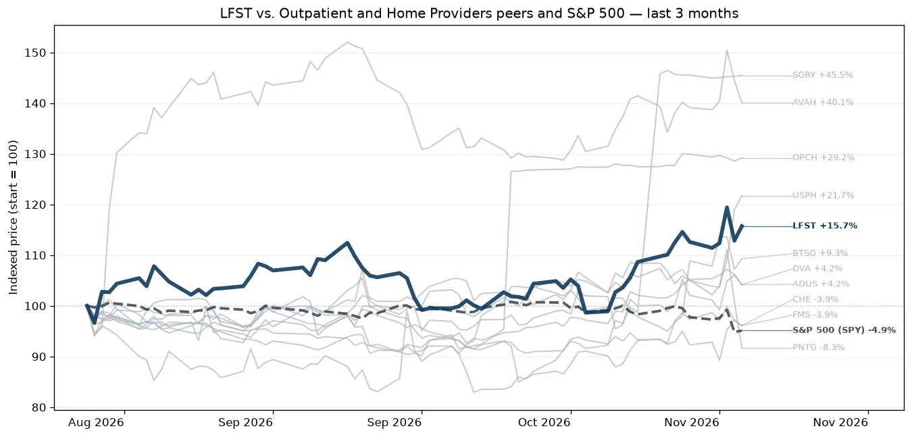

#### Reported Results

Q3 2026: EPS $0.11 vs. $0.08 est. (+26.73%); revenue $455.86M vs. $431.58M est. (+5.63%)

#### Earnings Call Summary

LifeStance Health delivered strong Q3 2026 performance, with revenue growing 25% year-over-year to $456 million, surpassing expectations due to a 17% increase in visit volumes (2.7 million) and a 7% rise in total revenue per visit ($170). The company also achieved positive net income of $22 million, an increase of $21 million year-over-year.

#### At a Glance

- **LifeStance Outperforms Q3 Numbers:** LifeStance Health Group Inc reported Q3 2026 revenue of $455.86 million, beating the estimated $431.58 million, while its reported adjusted EPS of $0.06 came in lower than the estimated $0.084.
- **Strong Growth Across KPIs:** The company&#x27;s performance was bolstered by a 25% year-over-year revenue increase, driven by a 17% expansion in patient visit volumes and a 7% lift in total revenue per visit.
- **Full-Year 2026 Guidance Lifted:** LifeStance raised its full-year 2026 outlook across all metrics, projecting full-year revenue between $1.741 billion and $1.761 billion and adjusted EBITDA of $242 million to $250 million.
- **Clinician Base Continues Expansion:** The firm expanded its clinician network by 11% year-over-year to 8,863, paired with a 5% increase in visits per clinician.
- **EHR Transition Winds Ahead:** Management noted that a planned implementation of a new electronic health record system could temporarily temper top-line revenue growth heading into fiscal year 2027.

#### Key Moments from the Call

- **2m 29s — Full-Year 2026 Guidance Raised on Momentum:** Management raised full-year guidance across all metrics due to consecutive quarters of 25% revenue growth and 15% Adjusted EBITDA margins. This update signals strong ongoing operational efficiency, outperforming internal expectations and strengthening market confidence.
- **13m 33s — EHR Implementation to Impact 2027 Growth:** LifeStance announced a temporary electronic health record (EHR) vendor transition throughout 2027, which is projected to create a 1-2 percentage point drag on 2027 revenue growth. This structural rollout will position revenue expansion at the lower end of their mid-teens long-term algorithm.
- **27m 50s — Payer Rate Increases Boost Unit Revenue:** Total revenue per visit grew 7% year-over-year to $170, exceeding historical low-to-mid single-digit targets. This performance was driven by favorable payer contracting renewals and incremental tailwinds from high-value clinical specialty services.
- **39m 33s — Strategic Second-Half Reinvestments Dynamic:** Management defended a sequential decline in Q4 Adjusted EBITDA guidance by detailing plans to reinvest outperformance upside into strategic initiatives, including AI solutions, center footprint refreshes, and business development assets, while still securing 300 basis points of full-year margin expansion.

<h3 id="earnings-opch">Option Care Health (OPCH) +33.0% Last 3m</h3>

Option Care Health Inc is the provider of home and alternate-site infusion services. It provides treatment for bleeding disorders, neurological disorders, heart failure, anti-infectives, and chronic inflammatory disorders, among others. The Company operates in one segment, infusion services.

**Reported:** November 4, 2026 · [Google Finance earnings page](https://www.google.com/finance/quote/OPCH:NASDAQ?tab=earnings&hl=en)

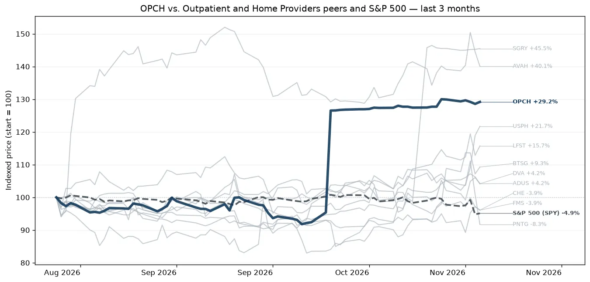

#### Reported Results

Q3 2026: EPS $0.49 vs. $0.49 est. (+0.59%); revenue $1.49B vs. $1.48B est. (+1.16%)

#### Earnings Call Summary

Option Care Health delivered Q2 2026 revenue of $1.44 billion, exceeding expectations and growing 2% year-over-year and 7% sequentially. The acute therapy portfolio posted high-single-digit organic growth, while the chronic platform stabilized following a Q1 reset, showing sequential growth led by the IG Neuro and rare and orphan portfolios.

#### At a Glance

- **Revenue Beats While EPS Misses Estimates:** Option Care Health reported Q3 2026 revenue of $1.49 billion, beating the estimated $1.48 billion, while reported adjusted EPS of $0.38 missed the estimated $0.49.
- **Adjusted EBITDA Grows Steadily Year-Over-Year:** The company&#x27;s adjusted EBITDA reached $124.6 million, marking a 4.3% increase compared to the prior-year period as operating performance remained steady.
- **Financial Guidance Withdrawn Amid Acquisition:** Option Care Health has withdrawn its previously disclosed financial guidance and cancelled its earnings call due to its pending acquisition by Clayton, Dubilier &amp; Rice and McKesson.
- **Solid Cash Flow Generated From Operations:** Cash provided by operating activities totaled $114.7 million for the third quarter, showcasing robust liquidity ahead of its major corporate transition.
- **Net Income Expands via Scale Advantages:** GAAP net income rose 10.8% year-over-year to $57.4 million, driven by a 4.1% top-line revenue expansion in alternate site health services.

#### Key Moments from the Call

- **15m 1s — Narrowed FY 2026 Guidance Ranges:** Option Care Health narrowed its full-year 2026 adjusted EBITDA guidance to $480 million–$495 million and adjusted EPS to $1.85–$1.92, while maintaining revenue guidance at $5.675 billion–$5.775 billion. This narrowing of guidance ranges reflects solid operational execution, strategic commercial investments, and progressive productivity improvements expected in the second half of the year.
- **16m 11s — Q3 2026 Sequential Growth Guidance:** Management provided explicit low-to-mid-single-digit sequential revenue growth expectations and mid-single-digit sequential EBITDA growth for Q3 2026 relative to Q2. This near-term outlook validates seasonal cadence expectations and gives investors specific modeling guardrails regarding revenue mix margins and back-half acceleration drivers.
- **21m 47s — Commercial Realignments and AI Investments:** To address past operational resets, management rebalanced commercial resource coverage across specialty accounts to stabilize CID patient census. Additionally, the company accelerated deployment of artificial intelligence tools targeting back-office registration, onboarding, and nursing route optimization, supporting sustainable margins and productivity gains stretching into 2027.
- **32m 3s — Limited Impact from CMS Proposals:** Addressing a July CMS proposal expanding Medicare coverage for certain home infusion pumps and drugs in 2027, management clarified that the changes target a narrow therapeutic scope. While not materially impactful near-term, it acts as a favorable policy precedent demonstrating the cost savings of home site-of-care models to regulators.

<h3 id="earnings-achc">Acadia Healthcare (ACHC) +17.3% Last 3m</h3>

Acadia Healthcare Co Inc acquires and develops behavioral healthcare facilities. Its facilities and services are classified into the following categories: acute inpatient psychiatric facilities; specialty treatment facilities; CTCs; and residential treatment centers. In which Acute inpatient psychiatric facilities contribute the majority of revenue in the United States. The Company has one reportable segment, behavioral healthcare services. The behavioral healthcare services segment provides inpatient and outpatient behavioral healthcare services.

**Reported:** November 5, 2026 · [Google Finance earnings page](https://www.google.com/finance/quote/ACHC:NASDAQ?tab=earnings&hl=en)

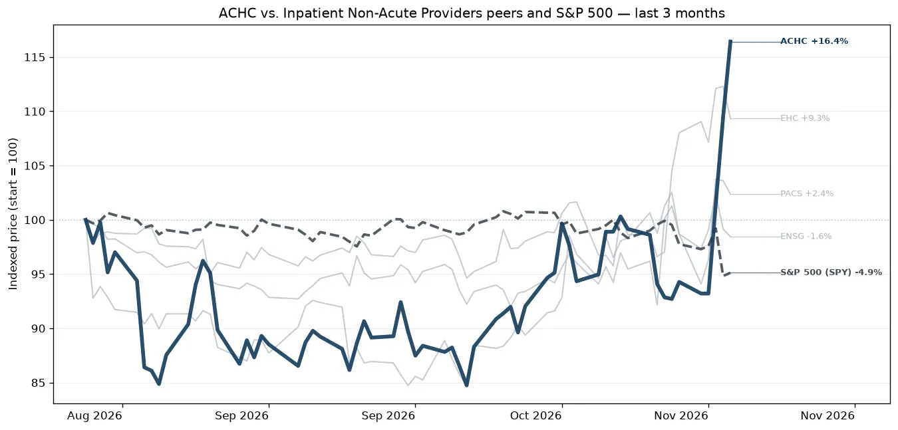

#### Reported Results

Q3 2026: EPS $0.60 vs. $0.46 est. (+29.20%); revenue $895.31M vs. $877.85M est. (+1.99%)

#### Earnings Call Summary

Acadia Healthcare delivered strong Q3 2026 financial results exceeding expectations. Revenue grew 5.1% year-over-year to $895 million, driven by solid volume gains and a 4.0% increase in revenue per patient day. Same-facility revenue growth reached 5.2%, hit at the top end of the company's projected range.

#### At a Glance

- **Acadia Misses EPS but Beats Revenue:** Acadia Healthcare reported a Q3 2026 adjusted EPS of $0.38, missing the estimated $0.464, while quarterly revenue reached $895.31 million, outperforming the estimated $877.85 million.
- **Strong Growth in Facility Performance:** Same-facility revenue expanded by 5.2% during the quarter, driven by a 1.1% increase in patient days and a 4.0% rise in revenue per patient day.
- **Full-Year Financial Guidance Raised Again:** Management raised its full-year 2026 guidance for the third consecutive quarter, forecasting full-year revenue of $3.44 billion to $3.46 billion and adjusted EPS of $1.70 to $1.80.
- **Acute Care Segment Leads Growth:** The acute inpatient psychiatric facilities led the company&#x27;s expansion with an 11% revenue jump to $525 million, supported by a 7.5% increase in patient volumes.
- **Strategic Expansion and Bed Capacity Increases:** The company added 220 licensed beds during the quarter, which included a new 144-bed de novo facility in Florida alongside 76 beds added to existing properties.
- **Regulatory Headwinds Affect Regional Performance:** Changes to New York&#x27;s Medicaid program negatively impacted Pennsylvania facility results, reducing overall same-facility revenue growth by approximately 1 percentage point.

#### Key Moments from the Call

- **5m 57s — Highly Visible $60M EBITDA Growth in 2027:** Management gave strong forward visibility by projecting $60 million in incremental adjusted EBITDA for 2027. This growth is highly credible as all 16 planned facilities are already open and progressing ahead of schedule on licensure and payer contracting.
- **14m 43s — Capital Expenditures Trimmed For Efficiency:** The company reduced its full-year 2026 capital expenditure guidance to $210M-$230M and expects further declines in 2027. Investors will welcome this disciplined capital allocation shift, moving focus from expensive de novo builds toward higher-return legacy facility expansions.
- **16m 36s — Full-Year 2026 Guidance Raised Again:** Acadia raised its full-year 2026 guidance for the third consecutive quarter, reflecting strong execution. Revenue is now targeted at $3.44B-$3.46B and adjusted EBITDA at $615M-$625M, which beats initial expectations and signals robust operational momentum to investors.
- **40m 14s — New York Medicaid Headwind Backfilled Successfully:** While policy changes in the New York Medicaid program reduced same-facility revenue growth by 1%, management pleased investors by successfully backfilling beds with new out-of-state and local Pennsylvania referrals, beating internal recovery expectations.

<h3 id="earnings-prva">Privia Health Group (PRVA) +8.8% Last 3m</h3>

Privia Health Group Inc is one of the physician enablement companies in the United States with a presence in around 24 states and the District of Columbia. The group builds scaled provider networks with primary-care centric medical groups, risk-bearing entities, a physician-led governance structure, and the Privia Platform comprising an extensive suite of technology and service solutions. It collaborates with medical groups, health plans, and health systems to optimize approximately 1,300+ physician practices, improve the patient experience for over 5.8+ million patients, and reward around 5,300+ physicians and practitioners for delivering high-value care.

**Reported:** November 5, 2026 · [Google Finance earnings page](https://www.google.com/finance/quote/PRVA:NASDAQ?tab=earnings&hl=en)

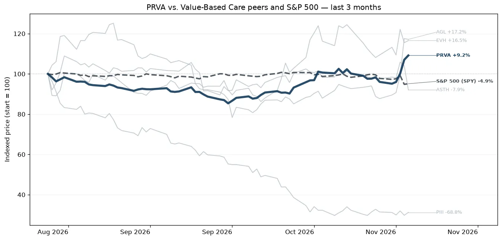

#### Reported Results

Q3 2026: EPS $0.21 vs. $0.24 est. (-11.76%); revenue $656.96M vs. $610.62M est. (+7.59%)

#### Earnings Call Summary

Privia Health reported strong Q3 2026 results with implemented providers up 12.2% year-over-year to 5,893 and value-based attributed lives up 19.2%. This performance drove a 12% increase in year-to-date practice collections and a 21.9% increase in adjusted EBITDA, with EBITDA margin expanding to 28.8% of care margin.

#### At a Glance

- **Privia Beats Revenue but Misses EPS:** Privia Health Group reported Q3 2026 revenue of $656.96 million, beating expectations of $610.62 million, but reported an adjusted EPS of $0.10, which missed the estimated $0.238.
- **Strong Growth in Care KPIs:** The company&#x27;s value-based care attributed lives increased by 19.2% year-over-year to 1.676 million, and total implemented providers grew 12.2% to 5,893 clinicians.
- **Full Year Financial Outlook Raised:** Management raised its full-year 2026 outlook across all financial metrics, with revenue now expected to fall between $2.50 billion and $2.55 billion, outperforming original high-end projections.
- **Value Based Footprint Strategic Expansion:** Privia announced a $36 million cash acquisition of American Choice Healthcare, adding over 36,000 Medicare Shared Savings Program attributed lives across ten existing and three new states starting in 2027.
- **Strategic Discontinuation of Montana Partnership:** The company decided to exit its partnership in Montana with Surgery Partners effective January 2027, which affects 69 providers and is expected to have no material impact on 2027 Adjusted EBITDA.
- **Robust Balance Sheet with Zero Debt:** Privia concluded the third quarter with $446.3 million in cash and cash equivalents and no debt, leaving an estimated $800 million to $900 million of M&amp;A liquidity capacity.

#### Key Moments from the Call

- **8m 57s — Full-Year 2026 Guidance Raised:** Privia Health increased its full-year 2026 financial guidance above the high end of its initial projections across all core metrics. Driven by strong ambulatory utilization and 12.2% growth in implemented providers, full-year adjusted EBITDA is now expected to grow 23.9% year-over-year at the updated midpoint.
- **11m 32s — American Choice Healthcare Acquisition:** Privia is expanding its value-based care footprint through the $36 million cash acquisition of Cano Health's American Choice Healthcare ACO. Entering 3 new states and adding over 36,000 Medicare Shared Savings Program lives starting January 2027, the deal highlights Privia's strategy to deploy capital opportunistically.
- **18m 9s — Strategic Exit from Montana Partnership:** Management announced the termination of its Montana joint venture with Surgery Partners, effective January 2027. Triggered by shifting partner priorities and small relative regional scale, the exit removes 69 providers and $23 million in practice collections but will not impact 2027 adjusted EBITDA.
- **36m 42s — Substantial Capital Allocation Optionality:** With a cash balance projected to exceed $520 million by year-end and zero debt, management highlighted a total debt-and-cash capacity of $800 million to $900 million. Executives indicated that while external tuck-in M&A remains the primary focus, the bar for share buybacks has lowered.

<h3 id="earnings-pgny">Progyny (PGNY) +24.0% Last 3m</h3>

Progyny Inc is a benefits management company specializing in fertility, family building, and women&#x27;s health benefits solutions. Its clients include employers across various industries. The fertility benefits solution consists of treatment services (Smart Cycles), access to the Progyny network of high-quality fertility specialists that perform the Smart Cycle treatments, and active management of the selective network of high-quality provider clinics.

**Reported:** November 4, 2026 · [Google Finance earnings page](https://www.google.com/finance/quote/PGNY:NASDAQ?tab=earnings&hl=en)

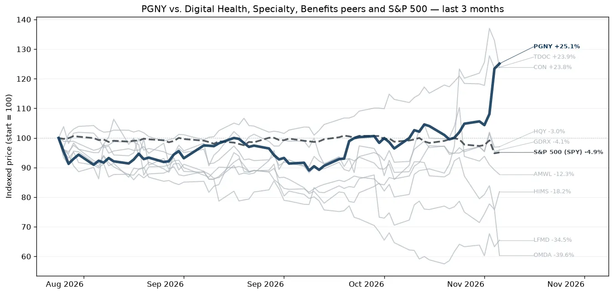

#### Reported Results

Q3 2026: EPS $0.52 vs. $0.51 est. (+2.17%); revenue $341.25M vs. $340.76M est. (+0.14%)

#### Earnings Call Summary

Progyny reported record third-quarter performance, driven by healthy member engagement and strong financial results. Given performance over the first nine months of 2026, management raised the midpoint of its full-year financial guidance.

#### At a Glance

- **Progyny Beats on Revenue and EPS:** Progyny reported Q3 2026 revenue of $341.25 million, narrowly beating estimates of $340,763,580, while its reported adjusted EPS of $0.32 was below the estimated adjusted EPS of 0.509.
- **Record Selling Season Boosts Lives:** The company achieved a record selling season by adding 1.3 million new covered lives and over 85 new clients while maintaining a near 100% customer retention rate.
- **Full Year Midpoint Guidance Raised:** Management raised the midpoint of its full-year 2026 guidance, now projecting revenue between $1.365 billion and $1.385 billion alongside adjusted EPS of $2.09 to $2.13.
- **Aggressive Share Repurchase Activity Continues:** Progyny repurchased nearly 3 million shares for $82.7 million in Q3, bringing its total share count reduction over the past year to nearly 15%.
- **Margin Expansion Drives Profitability Growth:** Third-quarter gross margin expanded by 130 basis points to 24.5%, enabling net income to nearly double year-over-year to $26.25 million.

#### Key Moments from the Call

- **2m 51s — Record Covered Lives and Client Expansion:** Progyny generated its strongest-ever sales momentum, securing over 85 new clients and 1.3 million new covered lives. This expansion brings expected 2027 totals to more than 660 clients and 8.3 million covered lives, signaling immense market share capture and pleasing investors focused on long-term scalability.
- **17m 4s — Raised Full-Year 2026 Financial Guidance:** Management raised the midpoints of its full-year guidance, projecting revenue of $1.365B–$1.385B and Adjusted EBITDA of $235M–$240M. This upward revision, driven by robust third-quarter results and stable member engagement, will reassure investors of the company's strong near-term execution and predictable revenue model.
- **20m 52s — CalPERS Contract Economics and Utilization:** Management clarified that the major public sector contract with CalPERS preserves typical margin profiles. While underwriting models project slightly lower utilization rates for this specific population compared to the broader book of business, the contract provides stable economics, alleviating investor concerns regarding large-client margin dilution.
- **22m 11s — Gross Margin Expansion and Tapering Investments:** Third-quarter gross margin expanded by 130 basis points year-over-year. Management highlighted long-term network cost efficiencies and reiterated that elevated investment cycles will taper off during 2027, reassuring investors that operating leverage will improve to support expanded future profitability.

<h3 id="earnings-ardt">Ardent Health Partners (ARDT) +49.8% Last 3m</h3>

Ardent Health Inc is a provider of healthcare in growing mid-sized urban communities across the U.S and operating in eight growing mid-sized urban markets across six states Texas, Oklahoma, New Mexico, New Jersey, Idaho, and Kansas. The main focus on people and investments in services and technologies.

**Reported:** November 5, 2026 · [Google Finance earnings page](https://www.google.com/finance/quote/ARDT:NYSE?tab=earnings&hl=en)

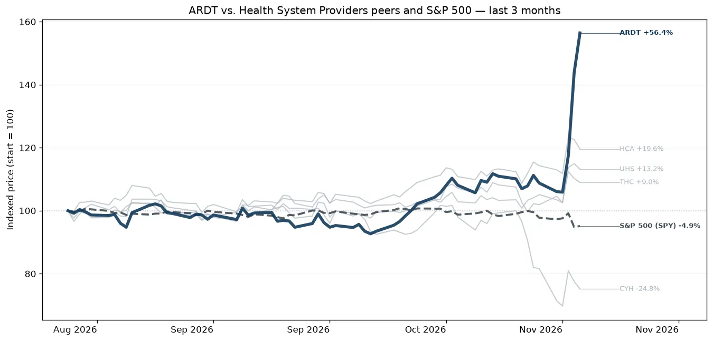

#### Reported Results

Q3 2026: EPS $0.38 vs. $0.25 est. (+55.02%); revenue $1.62B vs. $1.60B est. (+1.37%)

#### Earnings Call Summary

Ardent Health reported strong Q3 2026 financial results with revenue of $1.62B and adjusted EBITDA of $138M, driven by cost discipline and sequential volume improvements. Adjusted admissions grew 2.9% year-over-year, while emergency room visits rose 1.7%, representing solid progress across the enterprise's key demand funnel metrics.

#### At a Glance

- **Ardent Health Tops Earnings Estimates:** Ardent Health reported Q3 2026 Adjusted EPS of $0.31, beating the estimated $0.245, while revenue reached $1.62 billion, surpassing the estimated $1.60 billion.
- **Patient Admissions Volume Accelerates Strongly:** Adjusted admissions grew 2.9% year-over-year during the quarter, reflecting an acceleration from the 2.3% volume growth recorded in the first half of 2026.
- **EBITDA and Income Guidance Increased:** Management raised its full-year 2026 adjusted EBITDA outlook to a range of $500 million to $535 million and increased its net income expectations, while flagging a bias toward the lower end of its revenue range.
- **Cost Discipline Lowers Labor Expenses:** Salaries, wages, and benefits expenses decreased 4.3% year-over-year, dropping 300 basis points as a percentage of revenue due to a 44.8% reduction in contract labor.
- **Portfolio Optimization Through Asset Divestiture:** The company reached an agreement to sell its Kansas hospital joint-venture ownership for $58.4 million, a strategic move expected to enhance corporate margins by 40 basis points upon closing in Q4.
- **Strategic Savings Program Remains Ahead:** Ardent&#x27;s internal operational IMPACT program is fully on track to generate at least $70 million in savings this year, providing an expected $20 million to $25 million tailwind into 2027.

#### Key Moments from the Call

- **3m 42s — Accretive Portfolio Optimization in Kansas:** The company announced a definitive agreement to divest its Kansas hospital ownership to its joint venture partner at an accretive multiple of 11x EBITDA, an optimization move projected to boost enterprise margins by 40 basis points upon closing.
- **15m 53s — Raised Full-Year EBITDA Guidance Midpoint:** Ardent raised the lower end of its full-year adjusted EBITDA guidance to a range of $500M to $535M due to strong core execution, providing a definitive 1.5% midpoint increase that signals increased financial visibility and operational momentum to investors.
- **39m 21s — IMPACT Program Multi-Year Run Rate Visibility:** Management confirmed that its cost-saving IMPACT program is fully on track to achieve at least $70M in savings this year, projecting an additional annualized run-rate tailwind of $20M to $25M flowing directly into fiscal year 2027.
- **42m 56s — Ambient AI Technology Enhances Clinical Productivity:** Ardent deployed ambient AI documentation tools across 900 of its 2,000 providers, reaching 1.5 million patient encounters and yielding verified 8% productivity gains, underlining a scalable lever to offset industry-wide clinical labor constraints.

<h3 id="earnings-clov">Clover Health (CLOV) +1.3% Last 3m</h3>

Clover Health Investments Corp is a healthcare technology company. It focuses on empowering Medicare physicians to proactively manage chronic diseases through its proprietary software platform, Clover Assistant. This cloud-based solution provides personalized insights to physicians, enabling early detection and management of chronic conditions. It operates in one segment: Insurance, through which it offers PPO and HMO plans to Medicare Advantage members in several states.

**Reported:** November 4, 2026 · [Google Finance earnings page](https://www.google.com/finance/quote/CLOV:NASDAQ?tab=earnings&hl=en)

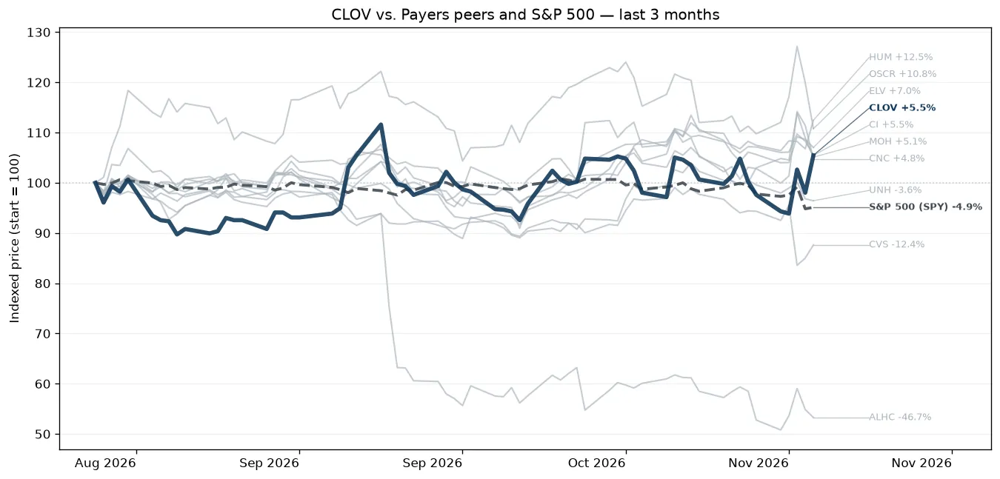

#### Reported Results

Q3 2026: EPS $0.03 vs. $0.01 est. (+177.00%); revenue $759.30M vs. $747.65M est. (+1.56%)

#### Earnings Call Summary

Clover Health expects to deliver its first full year of GAAP net income profitability in 2026. Through the first nine months, the company grew membership by nearly 50% year-over-year, increased consolidated gross profit by over $160 million, more than doubled Adjusted EBITDA to $97 million, and improved GAAP net income by nearly $100 million.

#### At a Glance

- **Clover Health Matches EPS Expectations:** Clover Health reported an adjusted EPS of $0.01, which matched analyst estimates, and a reported revenue of $759,304,000, beating the expected $755,578,000.
- **Medicare Advantage Membership Drives Growth:** Medicare Advantage membership grew 45% year-over-year to 158,907 members, while the Insurance Benefit Expense Ratio improved by 240 basis points to 91.1%.
- **Full-Year Profitability Outlook Raised:** Management raised the lower end of its full-year guidance and projected achieving its first full year of GAAP net income profitability in 2026, targeting $25 million to $35 million.
- **Clover Assistant Coverage Accelerates:** The adoption and coverage of the company&#x27;s AI-driven software platform, Clover Assistant, accelerated during the second half of 2026, tracking ahead of the previous year&#x27;s pace.
- **Flagship PPO Earns Top Rating:** Clover Health&#x27;s flagship PPO plan achieved a 5-Star rating for payment year 2028, establishing it as the largest 5-Star PPO contract in the nation.
- **Strong Liquidity and Debt-Free Status:** The company maintained a strong, debt-free balance sheet with $513 million in cash, cash equivalents, and investments at the end of the third quarter.

#### Key Moments from the Call

- **3m 10s — Five-Star Rating Achieved for 2028 Payment:** The company's flagship PPO contract secured a maximum five-Star rating for payment year 2028, positioning it as the largest five-Star PPO plan nationwide. This designation ensures long-term premium benefit stability and maximum financial retention for its rapidly growing and economically maturing member base.
- **12m 45s — First Full Year of GAAP Profitability Expected:** Clover Health raised its full-year 2026 guidance floor across all key metrics. Backed by $62 million in year-to-date GAAP net income and accelerating operational efficiencies, management confirmed the company is firmly on track to achieve its first-ever full year of GAAP net income profitability in 2026.
- **14m 6s — Favorable Competitive Dynamics in Core Markets:** Management noted that early Annual Enrollment Period (AEP) trends are playing out favorably as large national competitors retreat from $0-premium PPO plans and adjust benefits. Highlighting a major competitor exit in New Jersey, Clover expects to sustain strong membership growth across its core New Jersey and Georgia footprints.
- **15m 19s — Predictable Cohort Maturation Economics Drive Earnings:** CFO Clay Thornton detailed a clear pathway for 2027 and 2028 earnings expansion utilizing historical member maturation curves. Profitability spikes significantly as cohorts progress, yielding an extra $70 PMPM in year two and an additional $85 PMPM in year three, heavily supported by accelerating Clover Assistant AI coverage.

<h3 id="earnings-adus">Addus HomeCare (ADUS) +3.9% Last 3m</h3>

Addus HomeCare Corp is engaged in the provision of in-home care services. The Company has three reportable segments: Personal Care, Hospice, and Home Health. The Personal Care segment provides non-medical assistance with activities of daily living, mainly to the elderly, chronically ill, and disabled individuals. The Hospice segment provides physical, emotional, and spiritual care for terminally ill patients and their families. The Home Health segment provides medical services to individuals requiring care during illness or recovery. It generates the majority of its revenue from the Personal Care segment.

**Reported:** November 4, 2026 · [Google Finance earnings page](https://www.google.com/finance/quote/ADUS:NASDAQ?tab=earnings&hl=en)

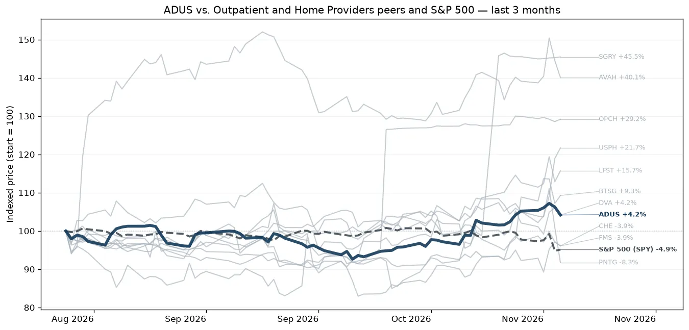

#### Reported Results

Q3 2026: EPS $1.83 vs. $1.79 est. (+2.11%); revenue $387.73M vs. $388.69M est. (-0.25%)

#### Earnings Call Summary

Addus HomeCare reported solid Q3 2026 financial performance, with net service revenues growing 7% year-over-year to $387.7 million. Bottom-line performance outpaced revenue gains due to cost discipline, resulting in a 13.5% increase in adjusted EBITDA to $51.2 million and a 17.3% rise in adjusted EPS to $1.83.

#### At a Glance

- **Addus Misses Estimates on Results:** Addus HomeCare reported a fiscal Q3 2026 adjusted EPS of $1.54, which missed the estimated adjusted EPS of $1.792, and reported revenue of $387,733,000, slightly below the expected $388,690,560.
- **Segment Performance and Same-Store Trends:** Personal care same-store revenue grew 6.9% year-over-year, driven by a 1.6% increase in same-store hours, while total organic sales volumes remained relatively flat compared to past performance.
- **Guidance Reflects Upcoming Synergies:** Management anticipates a full-year 2026 adjusted EBITDA margin in the 13% range and forecasts seasonal gross margin benefits of 50 to 60 basis points in Q4, despite expecting slight margin compression in 2027 from business mix shifts.
- **AccentCare Integration Progresses Well:** The pending acquisition of AccentCare&#x27;s personal care services is expected to close in Q1 2027, projecting to add $280 million in annualized revenue and scale the company&#x27;s private pay home care business.
- **Regulatory Developments Ease Outlook:** Management expressed optimism that the CMS &quot;80/20&quot; rule will be removed by the end of 2026, which reduces long-term regulatory compliance risks regarding Medicaid direct care spending.
- **Market Reaction and Share Stability:** Following the earnings release, the stock was little changed and remained near the top of its 52-week trading range as Wall Street digested steady organic segment growth.

#### Key Moments from the Call

- **9m 13s — Home Health and Clinical Inflection:** Home health generated 2.5% organic revenue growth and a 13.8% increase in admissions, reversing a multi-year down cycle. Leadership changes and enhanced managed care rate negotiations, including episodic structures, drove the turnaround, prompting management to seek larger clinical acquisitions.
- **15m 46s — AccentCare Personal Care Acquisition Detail:** The $275 million AccentCare transaction expands Addus' non-clinical platform, adding an average daily census of 13,700 clients across 10 states. It expands private pay mix to 7%-8% for those assets, providing insulation from Medicaid budget pressures while expanding market density.
- **30m 39s — Regulatory Outlook on 80/20 Rule:** Following the recent election, management expressed high confidence that CMS will eliminate the controversial 80/20 individual state spend mandate from the final rule by the end of 2026, while retaining other quality reporting provisions supported by the company.
- **41m 4s — Margin Guidance and Mix Shift Puts:** Full year 2026 adjusted EBITDA margins are projected at approximately 13%. However, management anticipates a slight margin contraction in 2027 due to the lower-margin profile of the newly acquired AccentCare personal care business, offset partly by clinical growth and G&A leverage.

<h3 id="earnings-cert">Certara (CERT) +47.0% Last 3m</h3>

Certara Inc accelerates medicines to patients using biosimulation software and technology to transform traditional drug discovery and development. It provides modeling and simulation, regulatory science, and assessment software and services to help clients reduce clinical trials, accelerate regulatory approval, and increase patient access to medicines. The company has its business presence in the Americas, which is also its key revenue-generating market, EMEA, and the Asia Pacific region.

**Reported:** November 5, 2026 · [Google Finance earnings page](https://www.google.com/finance/quote/CERT:NASDAQ?tab=earnings&hl=en)

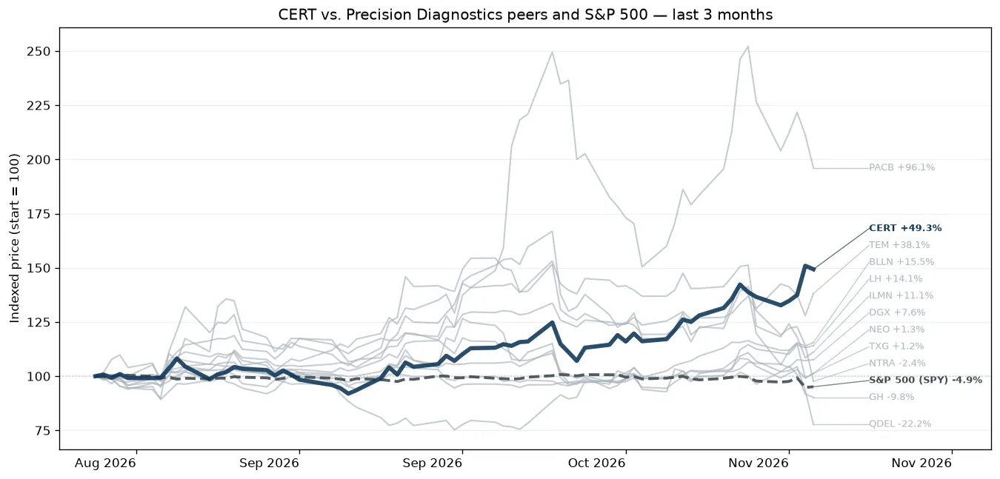

#### Reported Results

Q3 2026: EPS $0.09 vs. $0.09 est. (+4.17%); revenue $94.90M vs. $91.98M est. (+3.18%)

#### Earnings Call Summary

Certara reported Q3 2026 revenue of $94.9 million, up 4% year-over-year on a continuing operations basis, beating the estimated $92.0 million. Adjusted EBITDA rose 6% to $30.2 million with a 31.8% margin, reflecting initial benefits from operational actions and cost-saving measures implemented earlier in the year.

#### At a Glance

- **Certara Beats Q3 Top-Line Estimates:** Certara reported Q3 2026 revenue of $94,901,000, beating the estimated $91,975,110, while reported adjusted EPS came in at $0.04 compared to the estimated $0.086.
- **Software Overcomes Lagging Services Revenue:** Software revenue grew 11% year-over-year to $48.8 million, marking the first double-digit organic growth quarter in two years, which offset a 2% decline in services revenue.
- **Management Narrows Full-Year Guidance Range:** Certara narrowed its full-year 2026 revenue growth guidance to a range of 2% to 3% and updated its full-year adjusted EPS outlook to $0.31 to $0.34.
- **Margin Expansion Boosted by Efficiency:** The company&#x27;s Adjusted EBITDA margin improved to 31.8%, representing an increase of 370 basis points sequentially due to a favorable software mix and ongoing cost-saving measures.
- **Strategic Cloud and AI Shifts:** Certara reported that nearly 10% of its Phoenix Cloud accounts have successfully migrated, while the company continues to embed advanced AI capabilities to capture long-term growth.

#### Key Moments from the Call

- **4m 5s — Double-Digit Organic Software Growth Inflection:** Certara achieved 11% organic software revenue growth in Q3, its first double-digit growth quarter in two years. This acceleration reinforces strong underlying demand across major product portfolios like Pinnacle 21 and Simcyp, signaling a positive inflection that investors have been anticipating.
- **4m 5s — Phoenix Cloud Migration and Revenue Headwinds:** Management revealed that nearly 10% of all accounts have migrated to Phoenix Cloud, tracking slightly ahead of initial first-year expectations. While the transition from on-premise to a hosted ratable model creates a near-term revenue recognition headwind, it accelerates long-term bookings and opens paths for high-margin AI module add-ons.
- **10m 46s — Commercial Realignment Targeting Biotech and APAC:** Certara is restructuring its commercial strategy under a new CCO, shifting focus toward mid-sized pharma, biotech, and global CRO segments using targeted scientific content. Additionally, the company is aggressively expanding its commercial footprint in the APAC region—specifically Japan, Korea, and China—to capitalize on shifting global R&D spend in 2027.
- **15m 8s — EBITDA Margin Expansion via Cost Disciplines:** Adjusted EBITDA margin expanded sequentially by 370 basis points to 31.8%, driven by favorable software product mix and a major workforce reduction implemented in mid-2026. Run-rate cost savings have exceeded $12 million to $13 million, providing financial flexibility to invest in AI and cloud products.

<h3 id="earnings-usph">US Physical Therapy (USPH) +24.3% Last 3m</h3>

US Physical Therapy Inc through its subsidiaries operate outpatient physical therapy clinics that provide pre-and post-operative care and treatment for orthopedic-related disorders, sports-related injuries, preventative care, rehabilitation of injured workers, and neurological-related injuries. The principal payment sources for the clinics&#x27; services are managed care programs, commercial health insurance, Medicare/Medicaid, workers&#x27; compensation insurance, and proceeds from personal injury cases. Its operating segment includes Physical therapy operations and Industrial injury prevention services. The company generates maximum revenue from the Physical therapy operations segment.

**Reported:** November 5, 2026 · [Google Finance earnings page](https://www.google.com/finance/quote/USPH:NYSE?tab=earnings&hl=en)

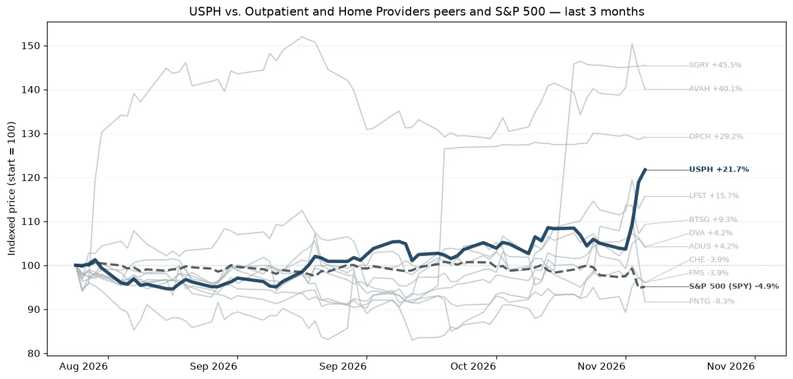

#### Reported Results

Q3 2026: EPS $0.80 vs. $0.73 est. (+10.34%); revenue $220.64M vs. $214.54M est. (+2.85%)

#### Earnings Call Summary

The company's new hospital affiliation partnerships, consisting of 72 total clinics across Metro N.Y. and Gulf Coast, generated over $25 million in revenue during Q3 2026. Hospital revenue expanded from under 5% of total revenue in Q2 to over 13% in Q3, significantly accelerating mature clinic revenue growth to more than 6%.

#### At a Glance

- **USPH Beats Earnings Estimates Comfortably:** U.S. Physical Therapy reported a reported revenue of $220,641,000, which beat the estimated revenue of $214,536,410, while its non-GAAP adjusted EPS came in strong at $0.80 per share.
- **Hospital Partnerships Lift Core KPIs:** The company extended its record monthly patient volume streak to 27 months, while physical therapy net revenue per patient visit grew by $5 year-over-year to $111, heavily supported by its successful hospital affiliations.
- **Management Reaffirms Full-Year Guidance Range:** Management fully reaffirmed its full-year 2026 adjusted EBITDA guidance of $102 million to $106 million, indicating a strong performance baseline despite encountering operational cost headwinds.
- **Elevated Employee Health Expenses Impede:** The company faced profit and margin pressures due to elevated self-insured employee health benefit costs, which partially offset the strong top-line gains from its clinical volume growth.
- **Industrial Injury Prevention Segment Expands:** The Industrial Injury Prevention division reported a 14% revenue increase to $33 million, driven by strong operational discipline that expanded the segment&#x27;s margin by 230 basis points to 22%.

#### Key Moments from the Call

- **3m 30s — Hospital Affiliation Ramps Profitability:** The rapid onboarding of 72 hospital-affiliated clinics drove an unprecedented $5 year-over-year net rate increase per visit. Investors will be pleased that hospital revenue jumped from under 5% to 13% sequentially, driving mature clinic revenue growth to its highest rate in some time and promising further rate progression into Q4.
- **5m 48s — Self-Insured Cost Headwinds Impede Margins:** High-cost, complex employee medical claims created a significant headwind, raising year-to-date insurance expenses by $7 million and dragging down Q3 physical therapy margins by 150 basis points. Management implemented targeted, surgical labor reductions and expense controls to help mitigate these volatile, un-forecasted costs heading into the fourth quarter.
- **24m 15s — Favorable Medicare Modifier Phase-Out Announced:** Management revealed that CMS finalized a rule to phase out the Indirect Practice Cost Index (IPCI) modifier over two years starting in 2027. This regulatory shift eliminates a historical penalty on efficient, lower-overhead providers like US Physical Therapy, establishing a significant, multi-year tailwind for reimbursement values.
- **31m 45s — Workers' Compensation Payer Mix Strength:** Workers' compensation penetration neared 11% in Q3, delivering an 8% revenue per visit increase over the prior year. Driven by a multi-year effort to expand PPO contracts that pay higher per-visit rates, this high-margin revenue line reached its highest percentage of total payer mix since 2020.

<h3 id="earnings-agl">Agilon Health (AGL) +18.7% Last 3m</h3>

Agilon Health Inc is a healthcare services company that partners with primary care physicians to support value-based care for senior patients. The company provides a platform that enables physician groups to manage healthcare outcomes and costs through a Medicare-centric, capitated care model and long-term partnerships with community-based physicians.

**Reported:** November 4, 2026 · [Google Finance earnings page](https://www.google.com/finance/quote/AGL:NYSE?tab=earnings&hl=en)

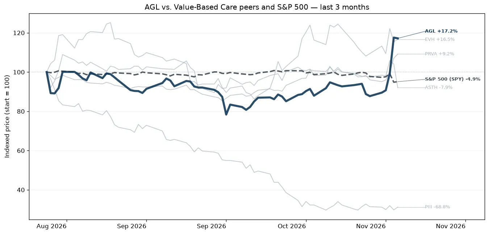

#### Reported Results

Q3 2026: EPS $2.08 vs. -$0.73 est. (+384.81%); revenue $1.52B vs. $1.47B est. (+3.62%)

#### Earnings Call Summary

CEO Tim O'Rourke announced that agilon health exceeded its Q3 2026 guidance across key financial metrics. Based on strong year-to-date performance and a solid outlook for the remainder of the year, the company increased its full-year 2026 financial guidance.

#### At a Glance

- **Agilon Health Exceeds Financial Expectations:** Agilon Health reported a substantial beat for Q3 2026, posting a Reported Adjusted EPS of $1.97 against an estimate of -$0.73, while revenue reached $1,519,486,000 compared to the projected $1,466,355,540.
- **Medical Cost Ratios Show Improvement:** The company&#x27;s medical services expense ratio improved significantly to 88.5% from 104.0% in the prior year, driven by favorable prior-period claims development and better contract economics.
- **Full-Year 2026 Guidance Upgraded:** Management raised its full-year 2026 Adjusted EBITDA guidance range to $145 million to $155 million, up from the previous forecast of $75 million to $95 million, alongside a slightly increased revenue midpoint of $5.88 billion.
- **Membership Contracted for Profitability Strategy:** Total membership on the agilon platform declined 8% year-over-year to 566,000 due to a deliberate operational shift prioritizing contract profitability over raw growth, including planned market exits.
- **Positive Shift in Cash Generation:** The company achieved positive operating cash flow for the nine-month period, generating $49.9 million in the third quarter alone and expanding cash reserves to $311.7 million.

#### Key Moments from the Call

- **16m 13s — Significant Metric Beat and EPS Turnaround:** The company reported Q3 2026 revenue of $1.52 billion and a GAAP EPS of 2.079, substantially beating consensus estimates. This dramatic bottom-line reversal from historical losses signals strong operational execution and successful cost-containment initiatives, driving investor confidence.
- **17m 7s — Medical Expense Ratio and Trend Optimization:** Introducing the Medical Services Expense Ratio (MSER) as a core metric, agilon reported a sequential drop to 88.5% for Q3, down from 104% last year. While underlying first-half trends moderated to the low-6% range, management retained a prudent 7% Q3 trend reserve.
- **19m 59s — Full-Year 2026 Guidance Increase:** agilon increased its full-year 2026 guidance, forecasting revenue of $5.88 billion and Adjusted EBITDA of $150 million. This upward revision will please investors as it reflects robust Q3 outperformance, higher estimated risk scores, and favorable first-half medical cost trends.
- **21m 58s — Strong ACO Membership Growth Outlook:** Management projected ACO membership to grow 40% to 50% in 2027, expanding from 110,000 to approximately 160,000 members. This significant growth path, driven by deeper penetration with existing partners, highlights highly scalable embedded revenue opportunities outside of Medicare Advantage.

<h3 id="earnings-pntg">Pennant Group (PNTG) -6.8% Last 3m</h3>

Pennant Group Inc is engaged in providing healthcare services to patients of all ages, including the growing senior population, in the United States. It operates in multiple lines of business including home health, hospice, and senior living which includes the company&#x27;s assisted living, independent living, and memory care communities across Arizona, California, Colorado, Idaho, Montana, Nevada, Oklahoma, Oregon, Texas, Utah, Washington, Wisconsin, and Wyoming. It operates in two segments; home health and hospice services and senior living services. The company generates majority of its revenue from home health and hospice services segment, which includes its home health, hospice and home care businesses.

**Reported:** November 5, 2026 · [Google Finance earnings page](https://www.google.com/finance/quote/PNTG:NASDAQ?tab=earnings&hl=en)

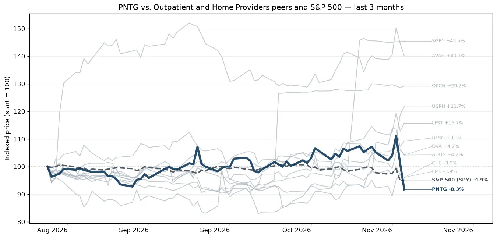

#### Reported Results

Q3 2026: EPS $0.35 vs. $0.35 est. (-1.21%); revenue $302.25M vs. $299.47M est. (+0.93%)

#### Earnings Call Summary

The Pennant Group reported strong Q3 2026 results, with revenue up 32% to $302.3 million and adjusted EPS up 16.7% to $0.35. Adjusted EBITDA rose 42.4% to $24.7 million. Year-over-year, the company served nearly 40% more home health patients, 35% more hospice patients, and 10% more senior living residents.

#### At a Glance

- **Pennant Group Outperforms Financial Estimates:** The Pennant Group reported an adjusted EPS of $0.25, missing the estimated $0.33, while reported revenue reached $297,984,000, beating expectations of $288,707,430.
- **Operational Volumes Drive Double-Digit Growth:** Total home health admissions jumped 62.3% and hospice average daily census grew 40.1% year-over-year, which reflects robust organic gains and strategic integration of acquired operations.
- **Management Raises Full-Year Guidance Outlook:** Fueled by strong operational momentum, the company raised its full-year 2026 outlook, now forecasting revenue between $1.17 billion and $1.19 billion and adjusted EPS of $1.34 to $1.41.
- **Home Health and Hospice Leads Expansion:** The Home Health and Hospice Services segment achieved a 43.2% increase in revenue to $237.8 million, showing major expansion over the prior year quarter.
- **Strategic Northeast Footprint Extension:** The company expanded its strategic regional presence through a key equity investment in Hartford HealthCare at Home, establishing a platform for long-term growth in the Northeast.

#### Key Moments from the Call

- **5m 17s — Full-Year Guidance Reaffirmed Despite Benefits Drag:** Management reaffirmed their full-year guidance despite an organization-wide increase in self-funded employee benefit costs that created a 50 basis point revenue headwind. The impact is expected to persist into Q4, but strong operational momentum across segments keeps full-year expectations intact.
- **12m 25s — Senior Living Margins Strained by Rapid Transitions:** Senior Living Adjusted EBITDA was roughly flat due to leadership capacity constraints in two key turnaround markets. A heavy influx of 16 community acquisitions since 2025 created localized operational lumpiness and occupancy declines, though management anticipates Q4 will show improvement.
- **15m 4s — Southeast EMR Integration Complete Ahead of Projections:** The complex EMR integration of 54 locations acquired from UnitedHealth and Amedisys in the Southeast was successfully completed on October 31. Despite temporary clinician and census disruptions common to large transitions, the operational rollouts performed ahead of internal management expectations.
- **33m 19s — Payer Opportunities Driven by Clinical Outperformance:** With a potentially preventable hospitalization rate of 9.9% versus the 10.8% industry average, Pennant expects to benefit from narrowing Managed Care networks. Management intends to leverage their strong quality metrics to negotiate improved reimbursement rates with payers scaling across regions.

<h3 id="earnings-omda">Omada Health (OMDA) -36.2% Last 3m</h3>

Omada Health Inc empowers individuals to make lasting health changes through personalized, virtual care between doctor&#x27;s visits. The integrated platform of the company supports members with cardiometabolic conditions like prediabetes, diabetes, hypertension, musculoskeletal issues, and behavioral health needs. The company&#x27;s specialized care tracks also assist members using GLP-1 medications. The company delivers measurable health outcomes and value for employers, health plans, health systems, and pharmacy benefit managers.

**Reported:** November 5, 2026 · [Google Finance earnings page](https://www.google.com/finance/quote/OMDA:NASDAQ?tab=earnings&hl=en)

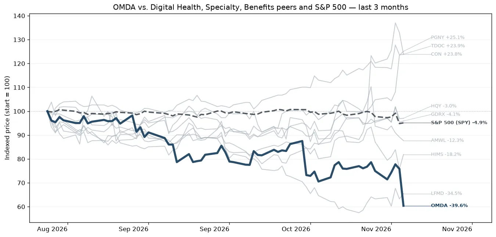

#### Reported Results

Q3 2026: EPS $0.21 vs. $0.10 est. (+114.27%); revenue $91.31M vs. $85.64M est. (+6.62%)

#### Earnings Call Summary

Omada Health reported record Q3 2026 results, with revenue growing 34% year-over-year to $91 million and gross margin expanding to 76% GAAP (78% non-GAAP) from 66% (68% non-GAAP) last year. Performance was driven by strong early-quarter enrollments and a mix shift toward higher-value chronic care programs, yielding record net income of nearly $7 million.

#### At a Glance

- **Omada Beats Q3 Financial Estimates:** Omada Health reported an adjusted EPS of $0.10 on revenue of $91,306,000, outperforming the estimated adjusted EPS of $0.098 and estimated revenue of $85,639,200.
- **Record Growth in Total Membership:** Total membership reached a record high of 1.134 million, reflecting a 36% year-over-year increase driven by strong enrollment in diabetes and hypertension programs.
- **Full-Year Financial Guidance Raised:** Management raised full-year 2026 revenue guidance to between $344 million and $346 million, while expecting a typical seasonal slowdown in fourth-quarter activity.
- **Substantial Expansion in Gross Margin:** GAAP gross margin expanded by 10 percentage points year-over-year to 76%, aided by care team efficiencies, supporting technology, and longer member tenures.
- **Upcoming CEO Leadership Transition Announced:** The company announced a formal leadership transition effective January 1, 2027, where Wei-Li Shao will become CEO and current CEO Sean Duffy will transition to Executive Chair.

#### Key Moments from the Call

- **15m 4s — Full-Year Outlook Raised Considerably:** Strong Q3 outperformance gave management the confidence to increase full-year 2026 revenue guidance to $344M–$346M and Adjusted EBITDA to $32M–$34M. This revised EBITDA outlook represents a massive 5.5x jump over 2025 performance, pleasing investors with proof of substantial operating leverage and strong bottom-line execution.
- **18m 31s — Flexible GLP-1 Product Strategy Hedging Risks:** With employers deliberating deeply on rising GLP-1 costs, Omada's strategy successfully spans both sides. If employers cut GLP-1 coverage, Omada's newly launched 'GLP-1 Flex Care' captures self-paying employee demand by providing critical clinical lifestyle oversight that limits weight regain, preserving their market ROI opportunity regardless of macro corporate decisions.
- **28m 52s — Onboarding Shift Directly Accelerated Revenue:** Management revealed that a tactical shift from weekly batch onboarding to real-time enrollment during Q3 shortened the timeframe from initial user sign-up to the first billing event. This operational optimization accelerated cash conversion cycles and directly contributed to the quarter's revenue beat.
- **38m 12s — AI Drives Care Team Headcount Efficiencies:** Despite rapid member growth, Omada achieved a net year-over-year reduction in clinical care team headcount by integrating advanced AI and automation into daily operations. This capacity expansion drives record-low costs to serve, positioning the firm to securely target its long-term gross margin goal of 80%.

<h3 id="earnings-qdel">QuidelOrtho (QDEL) -12.9% Last 3m</h3>

QuidelOrtho Corp is engaged in the development, manufacturing, and marketing of rapid diagnostic testing solutions. The company is engaged in immunoassay and molecular testing, clinical chemistry, and transfusion medicine, which helps clinicians and patients to make decisions across the globe. Geographically, the company has its presence in North America, EMEA, China, and Other countries. It generates the majority of its revenue from North America.

**Reported:** November 3, 2026 · [Google Finance earnings page](https://www.google.com/finance/quote/QDEL:NASDAQ?tab=earnings&hl=en)

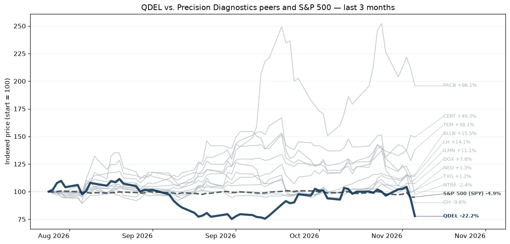

#### Reported Results

Q3 2026: EPS $0.31 vs. $0.18 est. (+73.77%); revenue $618.90M vs. $627.73M est. (-1.41%)

#### Earnings Call Summary

QuidelOrtho reported Q3 2026 total revenue of $619 million, down 12% year-over-year, impacted by China pricing guidelines and a softer respiratory environment. However, core Labs and immunohematology segments grew 3% excluding China, respiratory, and a donor screening wind-down, demonstrating underlying business resilience.

#### At a Glance

- **Mixed Results on Top and Bottom Lines:** QuidelOrtho reported a quarterly adjusted EPS of -$0.78, missing the estimated positive adjusted EPS of $0.178, while reported revenue of $618.9 million also fell short of the projected $627.73 million.
- **Respiratory and Regional Headwinds Impact KPIs:** Point-of-Care revenue declined 27% year-over-year due to a 39% drop in respiratory revenue, while total revenue from China plummeted 45% following severe distributor destocking and regulatory pricing shifts.
- **Full-Year Guidance Range Is Narrowed Downward:** Management lowered the upper bound of its full-year 2026 revenue guidance to a range of $2.52 billion to $2.54 billion and slashed the full-year adjusted EPS target to $0.65 to $0.70 to account for persistent market pressures.
- **Restructuring Plan Set to Lift Profitability:** The company introduced a new cost transformation and enterprise restructuring program designed to generate over $80 million in annual operational savings by 2027.
- **Core Segments Reflect Underlying Business Stability:** Excluding the impacts of China, respiratory testing, and donor screening wind-downs, underlying business revenue expanded 3% year-over-year, driven by low-to-mid single-digit growth in base Labs and Immunohematology markets.
- **Weak Revenue Growth Triggers Share Selloff:** QuidelOrtho&#x27;s weak top-line results and compressed guidance overshadowed an adjusted EBITDA beat, prompting an immediate 6.62% drop in after-hours trading following the announcement.

#### Key Moments from the Call

- **5m 43s — New Operational Restructuring Program:** Management will please investors by launching an enterprise restructuring program designed to generate over $80 million in incremental annual savings by 2027. Splitting operations into Core Diagnostics and Point of Care Diagnostics creates structural efficiencies and directly mitigates the financial headwinds from China.
- **14m 53s — Sequential Free Cash Flow Rebound:** Investors will be encouraged by free cash flow reaching break-even compared to a steep cash burn in the first half of the year. This turnaround reflects greater capital expenditure discipline and improved working capital execution, advancing management's top financial priority to deleverage the balance sheet.
- **15m 35s — Covenant Flexibility Secured:** The proactive amendment of QuidelOrtho's credit agreement to raise the maximum consolidated leverage ratio to 5.5x through mid-2028 provides critical operational breathing room. This financial flexibility reassures investors that the company can execute its costly transformation program without triggering covenant defaults.
- **15m 58s — Narrowed Guidance on China Headwinds:** Investors will be disappointed that QuidelOrtho trimmed the upper end of its full-year revenue and profit guidance. This reduction is primarily driven by accelerated customer destocking and pricing uncertainty in China following finalized nationwide IVD pricing guidelines, which will depress revenue mix significantly into 2027.

<h3 id="earnings-pacb">PacBio (PACB) +90.3% Last 3m</h3>

Pacific Biosciences of California Inc is a biotechnology company focused on designing, developing, and manufacturing sequencing solutions that enable scientists and clinical researchers to improve their understanding of the genome and ultimately, resolve genetically complex problems. It operates in, one reportable segment: the development, manufacturing, and marketing of an integrated platform for genetic analysis. The majority of the company&#x27;s revenue is derived from Americas, followed by Europe Middle East, and Africa and Asia-Pacific.

**Reported:** November 4, 2026 · [Google Finance earnings page](https://www.google.com/finance/quote/PACB:NASDAQ?tab=earnings&hl=en)

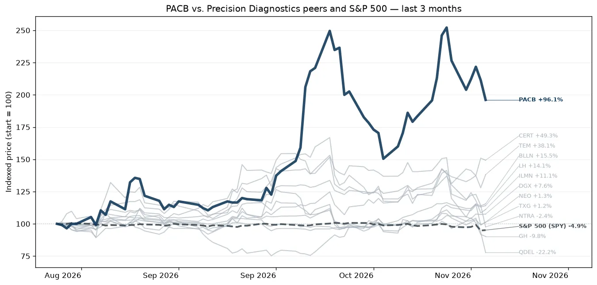

#### Reported Results

Q3 2026: EPS -$0.11 vs. -$0.13 est. (+16.09%); revenue $40.56M vs. $39.46M est. (+2.79%)

#### Earnings Call Summary

PacBio launched SPRQ-Nx chemistry, with over half of Revio consumable revenue derived from it. Two-thirds of the Revio install base upgraded their software, driving increased utilization. Multiple strategic clinical genomics and AI deals were finalized, supported by a $345 list price per 20x HiFi human genome.

#### At a Glance

- **PacBio Beats Q3 Earnings Estimates:** Pacific Biosciences reported a Q3 reported adjusted EPS of -$0.12, beating expectations by $0.01, and revenue of $40.56 million, ahead of estimated forecasts.
- **Strong Placements Offset Consumables Shift:** Instrument revenue rose 16% year-over-year to $13.2 million, driven by 35 Vega system shipments, though consumables revenue declined 2% due to customers transitioning to the new SPRQ-Nx chemistry.
- **Full-Year Outlook Narrowed Upwardly:** Management narrowed its full-year 2026 revenue guidance to between $155 million and $160 million while reinforcing its target to achieve cash flow breakeven by 2028.
- **Gross Margins Contract Under Cost Pressures:** Non-GAAP gross margin declined to 36% from 42% in the prior-year period, heavily impacted by elevated memory costs and manufacturing transition expenses for the Vega system.
- **Regional Funding Headwinds Restrict Growth:** Americas instrument revenue plummeted 24% year-over-year as ongoing NIH and academic funding constraints continued to limit domestic customer capital spending.
- **Leadership Shifts and AI Partnerships:** Chief Financial Officer Jim Gibson stepped down as the company initiated strategic bio-AI collaborations with players like Verily Health to support discovery sequencing.

#### Key Moments from the Call

- **18m 26s — Narrowed FY Guidance and Lowered OpEx Outlook:** Management narrowed full-year revenue guidance to $155M-$160M to reflect funding constraints. However, it lowered its 2026 non-GAAP operating expense outlook to $203M-$207M, demonstrating enhanced cost discipline from recent restructurings and visibility toward a lower 2027 expense base.
- **22m 59s — Clinical Growth Accelerates Beyond Projections:** Clinical consumables grew over 20% year-over-year, rising to exceed 20% of PacBio's total business. This strong performance, driven by international and domestic adoption of the SPRQ-Nx chemistry for clinical whole genome sequencing, establishes the clinical segment as a key revenue engine.
- **24m 13s — Debt Maturity Concerns Tempered by Management:** Executives reassured investors regarding $600M in convertible debt maturing in 2029 and 2030. They emphasized strong relationships with holders and noted that executing the product roadmap toward 2028 cash flow breakeven will maximize financial and strategic flexibility before addressing the debt.
- **28m 7s — High-Throughput Platform on Track for 2026 Launch:** Management confirmed that product development for its upcoming high-throughput box remains fully resourced and on track for a commercial launch by the end of 2027. The platform will target high-sample-volume projects and large-scale consortia, which are currently being priced in anticipation.

<h3 id="earnings-ccsi">Consensus Cloud Solutions (CCSI) +22.8% Last 3m</h3>

Consensus Cloud Solutions Inc is a provider of secure information delivery services with a scalable Software-as-a-Service SaaS platform. It is engaged in the fax cloud business. The company&#x27;s offerings include communication, data extraction, and digital signature solutions that enable users to securely access, exchange, and manage information across organizational and geographic boundaries. It serves multiple industry verticals, including healthcare, government, financial services, legal, and education. Geographically, the company operates in the United States, Canada, Ireland, and other countries. It derives the maximum revenue from the United States.

**Reported:** November 5, 2026 · [Google Finance earnings page](https://www.google.com/finance/quote/CCSI:NASDAQ?tab=earnings&hl=en)

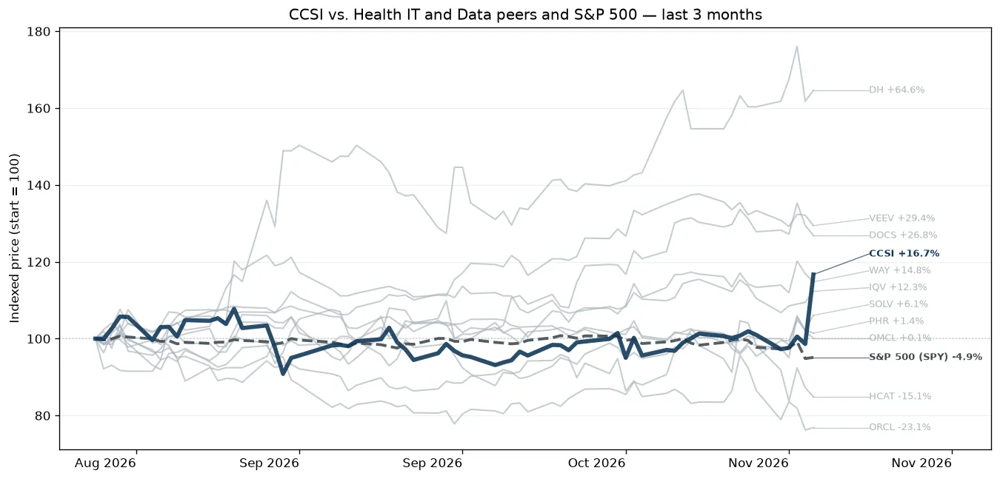

#### Reported Results

Q3 2026: EPS $1.50 vs. $1.41 est. (+6.63%); revenue $91.00M vs. $90.94M est. (+0.06%)

#### Earnings Call Summary

Consensus Cloud Solutions reported strong Q3 2026 consolidated revenue of $91.0M (+3.7% YoY) and adjusted non-GAAP EPS of $1.50 (+8.7% YoY), marking the fourth consecutive quarter of growth for both metrics. Total revenue growth was primarily driven by the corporate channel, which generated $61.4M, representing a 9.1% year-over-year increase.

#### At a Glance

- **Consensus Misses EPS, Beats Revenue Estimates:** Consensus Cloud Solutions reported Q3 2026 adjusted revenue of $91.003 million, slightly beating estimates of $90.944 million, while reported adjusted EPS came in at $1.15, missing the forecasted $1.407.
- **Corporate Performance Drives Key KPIs Growth:** The company achieved record corporate channel revenue of $61.4 million, representing 9.1% year-over-year growth, which pushed the net revenue retention rate to 104.5% compared to 101.9% in the prior year period.
- **Management Ups Full-Year EPS Guidance Range:** Consensus raised its full-year 2026 adjusted EPS guidance to $6.00–$6.10, while narrowing its full-year revenue outlook to $360–$364 million.
- **SoHo Segment Experiences Anticipated Declinces:** Small office and home office (SoHo) channel revenue fell 6% year-over-year to $29.6 million as the company intentionally prioritized cash optimization over subscriber volume.
- **Strong Cash Flows Facilitate Credit Restructuring:** Consensus generated $38.6 million in free cash flow, repurchased over $20 million in common stock, and amended its credit facility to support retiring its 6.5% senior notes in 2027.

#### Key Moments from the Call

- **11m 52s — Corporate Channel Metric Acceleration:** Corporate revenue beat expectations with its second straight quarter of 9%+ growth, climbing 9.1% YoY to $61.4M. This outperformance will please investors as corporate accounts scale to 69,000 and net revenue retention hit 104.5%, proving successful cross-selling and deepening customer reliance despite broader macroeconomic headwinds.
- **16m 43s — Credit Facility and Debt Restructuring:** The company extended its capital structure through 2031 via an amended $525M facility and authorized a new $348.2M debt repurchase program. Investors will favor the improved net leverage ratio of 2.35x and the planned retirement of 6.5% notes in late 2027, which will eventually lift operational cash restrictions.
- **20m 7s — Full-Year EPS Guidance Increase:** Management raised its full-year 2026 adjusted EPS guidance to $6.00–$6.10 while narrowing revenue and EBITDA ranges toward the top end. This upward revision will encourage investors, supported by solid core execution and an anticipated lower Q4 tax rate of 11%–13% driven by expiring tax reserves.
- **29m 28s — Disciplined Capital Allocation Strategy:** Management addressed post-2026 cash deployment, prioritizing stock buybacks given attractive free cash flow yields and targeting gross leverage under 2.5x. Large M&A deals were pushed to 2028 or beyond, reassuring investors focused on near-term balance sheet health and disciplined capital allocation over risky strategic shifts.

<h3 id="earnings-evh">Evolent Health (EVH) +15.9% Last 3m</h3>

Evolent Health Inc is engaged in healthcare delivery and payment. The company supports health systems and physician organizations in their migration toward value-based care and population health management. It provides specialty care management services in oncology, cardiology, musculoskeletal markets and holistic total cost of care management along with an integrated platform for health plan administration and value-based business infrastructure under one go to market package. The solutions provided by the company includes: Oncology, Cardiology, Musculoskeletal, Administrative Services, Advanced Illness, Genetic Testing, Physical Medicine, Radiology, and Surgical Management.

**Reported:** November 5, 2026 · [Google Finance earnings page](https://www.google.com/finance/quote/EVH:NYSE?tab=earnings&hl=en)

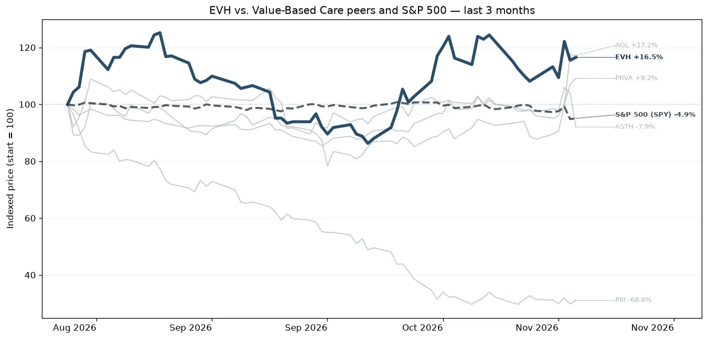

#### Reported Results

Q3 2026: EPS $0.06 vs. $0.06 est. (0.00%); revenue $725.37M vs. $727.05M est. (-0.23%)

#### Earnings Call Summary

Evolent reported Q3 2026 total revenue of $725 million, up 11% sequentially, and Adjusted EBITDA of $34 million, a 22% sequential increase. The medical expense ratio (MER) improved to 93% from 95% in Q2, driven by favorable in-year claims development and contractual adjustments.

#### At a Glance

- **Evolent Misses Revenue, EPS Meets Expectations:** Evolent Health reported a reported adjusted EPS of $0.00, missing the estimated adjusted EPS of $0.06, while reported revenue reached $725.37 million, falling slightly short of the estimated $727.05 million.
- **Performance Suite Expansion Drives Key Metrics:** Evolent&#x27;s key industry KPI, the Performance Suite segment, saw revenue expand 16% sequentially to $564.3 million and increased its platform lives to 7.2 million from 6.5 million in the prior year period.
- **Full-Year Adjusted EBITDA Guidance Raised:** Management reiterated its 2026 full-year revenue outlook of $2.6 billion to $2.7 billion and raised its full-year Adjusted EBITDA guidance range to $130.0 million to $135.0 million.
- **Medical Expense Ratio Historically Eases Sequentially:** The company&#x27;s medical expense ratio improved sequentially by 220 basis points to 93% compared to 95.3% in the prior quarter, aided by favorable in-year claims development.
- **AI Platform Strategic Automation Advances Broadly:** Evolent&#x27;s AuthIntelligence AI platform successfully advanced from its pilot stage to broad deployment, processing approximately 1 million cases annually and lifting authorization efficiency.
- **Largest Core Customer Agreement Renewed:** The company secured a major contract renewal for an additional four years with its largest Surgical Management customer, solidifying core multi-year platform relationships.

#### Key Moments from the Call

- **2m 46s — Adjusted EBITDA Guidance Raised:** Evolent raised the floor of its full-year 2026 Adjusted EBITDA guidance to $130 million-$135 million, demonstrating strong execution and sequential profitability growth, which will please investors looking for stable bottom-line progress.
- **10m 53s — AI AuthIntelligence Driving Efficiencies:** The scaling of AuthIntelligence to handle 1 million cases annually improves auto-authorization rates by up to 20 percentage points. This serves as a key margin expansion driver for 2027 through massive operational touch reductions.
- **14m 51s — Medical Expense Ratio Outperformance:** The sequential MER improvement from 95% to 93% in Q3 beat expectations due to earlier-than-expected favorable in-year claims development from new 2026 contracts, reassuring investors about risk management and contract execution pricing.
- **22m 5s — Strategic Balance Sheet Deleveraging:** Management announced plans to deploy up to $50 million by year-end to reduce outstanding debt. This proactive approach to refinancing and improving the leverage profile over the next 12-24 months addresses a key investor focus.

<h3 id="earnings-amwl">Amwell (AMWL) -11.9% Last 3m</h3>

American Well Corp is an enterprise platform and software company digitally enabling hybrid care by offering payers and health systems a technology-enabled care platform. The Amwell Platform, its cloud-based enablement platform, digitally enables a scalable healthcare experience across all care settings by enabling critical services like virtual primary care, urgent care, clinical partner programs, scheduling visits, etc. Additionally, the healthcare providers can use the platform to access familiar workflows for taking notes, prescribing, referencing clinical treatment guidelines, and other related activities. The firm also offers various paid services, including licensed clinical staffing, implementation support, workflow design, etc, to help clients execute their hybrid care strategies.

**Reported:** November 3, 2026 · [Google Finance earnings page](https://www.google.com/finance/quote/AMWL:NYSE?tab=earnings&hl=en)

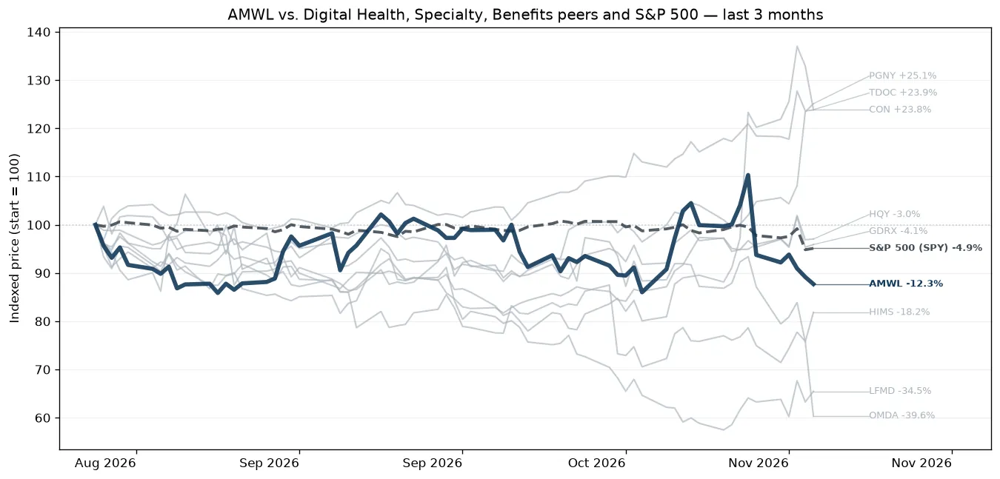

#### Reported Results

Q3 2026: EPS -$0.50 vs. -$0.66 est. (+24.11%); revenue $48.99M vs. $48.03M est. (+2.01%)

#### Earnings Call Summary

Amwell reported steady Q3 2026 progress, beating guidance on both revenue and adjusted EBITDA, marking nine consecutive quarters of meeting commitments. Management noted health plans and employers are facing severe cost pressures, shifting their purchasing focus from simple access to proven member engagement and clinical and financial outcomes.

#### At a Glance

- **Amwell Outperforms on Top-Line Forecasts:** American Well Corporation reported a Q3 2026 adjusted EPS of -$0.67, narrowly missing the estimated -$0.66, while generating $48.99 million in revenue to top projections of $48.03 million.
- **KPIs Boosted by Higher Visit Revenue:** Amwell Medical Group (AMG) visit revenue climbed 11.7% year-over-year to $23.7 million, helping mitigate a 22.5% decline in subscription software revenue driven by strategic portfolio shifts.
- **Full-Year Revenue Guidance Elevated Higher:** Management raised its full-year 2026 revenue guidance to a range of $204 million to $206 million, while expecting to achieve positive cash flow from operations in the fourth quarter.
- **Veterans Affairs Deal Signals Expansion:** The company received a non-binding letter of intent from the Department of Veterans Affairs for an enterprise-wide platform deployment, presenting a significant long-term growth opportunity.
- **Product Re-engineering Improves User Experience:** Amwell streamlined its core platform interface by reducing the user workflow from 12 screens down to just 3, contributing to a 41% surge in virtual primary care visits.

#### Key Moments from the Call

- **21m 14s — Guidance Raised and Path to Profitability:** Amwell raised its full-year 2026 revenue and adjusted EBITDA guidance based on strong Q3 performance and cost control. More importantly, management reaffirmed its clear visibility toward achieving positive operating cash flow and break-even to positive adjusted EBITDA in Q4 2026, signaling a major financial turning point that will reassure investors.
- **26m 18s — Department of Veterans Affairs Expansion:** The non-binding letter of intent from the Department of Veterans Affairs represents a massive expansion opportunity into a system serving 9 million veterans. Although the definitive agreement is still being negotiated, the validation of Amwell's cybersecurity and scalability strongly positions the company for high-margin, additive federal revenue starting in 2027.
- **38m 50s — Subscription Revenue Bottoming Out:** While subscription revenue declined 22.5% year-over-year due to legacy churn, management noted that health plan churn has stabilized. Investors will be pleased to hear that the massive subscription revenue swings experienced in 2024 and 2025 are not anticipated to continue, clearing a path toward normalized sequential growth.
- **45m 14s — Shift Toward Outcome-Based Revenue:** Management highlighted a strategic evolution where future revenue mix will shift increasingly toward high-utilization clinical services and outcome-based pricing rather than traditional SaaS fees. This allows Amwell to share risk and capture greater upside from insurance financial metrics as member engagement expands.

<h3 id="earnings-hcat">Health Catalyst (HCAT) -15.6% Last 3m</h3>

Health Catalyst Inc provides data and analytics technology and services to healthcare organizations. It has two operating segments. The Technology segment, the key revenue driver, includes data platform, analytics applications and support services and generates revenues mainly from contracts that are cloud-based subscription arrangements, time-based license arrangements, and maintenance and support fees; the Professional Services segment is generally the combination of analytics, implementation, strategic advisory, outsourcing, and improvement services to deliver expertise to its customers to more fully configure and utilize the benefits of the technology offerings.

**Reported:** November 5, 2026 · [Google Finance earnings page](https://www.google.com/finance/quote/HCAT:NASDAQ?tab=earnings&hl=en)

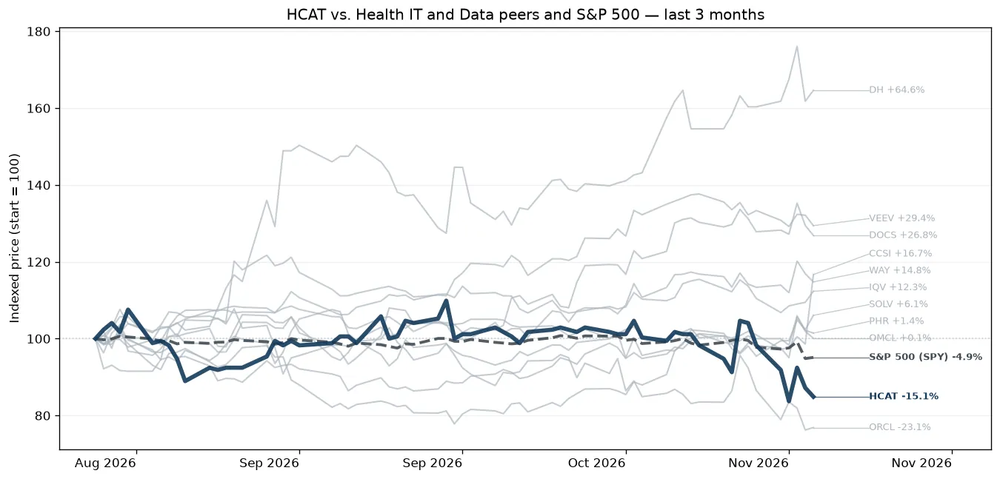

#### Reported Results

Q3 2026: EPS -$0.03 vs. -$0.05 est. (+36.84%); revenue $56.28M vs. $55.44M est. (+1.53%)

#### Earnings Call Summary

Health Catalyst reported Q3 2026 revenue of $56.3 million and adjusted EBITDA of $779,000, both exceeding the upper bound of guidance. Following year-to-date performance and on-track cost reductions via Project Nexus, management reaffirmed its full-year 2026 financial outlook.

#### At a Glance

- **Health Catalyst Outperforms Q3 Estimates:** Health Catalyst reported a top-line revenue of $56.28 million, beating the estimated $55.44 million, while its reported Adjusted EPS of $0.53 significantly outperformed the expected loss of $0.05 per share.
- **Bookings Outperform Despite Revenue Decline:** The company expects annual bookings to exceed the high end of its $22 million to $26 million target, though quarterly revenue declined 26.3% year-over-year due to migration-related client churn and a recent divestiture.
- **Full-Year 2026 Guidance Reaffirmed:** Management reaffirmed its full-year 2026 outlook, projecting total revenue between $246 million and $249 million and Adjusted EBITDA of $18 million to $18.5 million.
- **Strengthened Balance Sheet Following Divestiture:** Health Catalyst became completely debt-free with $79 million in cash at the end of the quarter following the completion of its Vitalware business divestiture and credit facility retirement.
- **Client Retention Becomes Urgent Focus:** Newly appointed CEO Simeon Kohl identified elevated client churn as the company&#x27;s most critical headwind, predicting that migration-related churn will persist through 2027.

#### Key Moments from the Call

- **3m 21s — Q3 2026 Financial Beat and Guidance Reaffirmation:** Health Catalyst reported Q3 2026 revenue of $56.3 million and adjusted EBITDA of $779,000, beating guidance. Reaffirming the full-year outlook pleases investors by validating near-term stability, while progress on Project Nexus cost reductions shows operational discipline amid a transitional phase.
- **5m 17s — Urgent Focus on Addressing Client Retention and Churn:** CEO Simeon Kohl prioritized addressing elevated client churn with urgency. While defining a clear turnaround path satisfies investors looking for operational accountability, the admission that migration-related churn headwinds will persist until the end of 2027 highlights an extended timeline for stabilizing the top line.
- **13m 12s — Gross Margin Contraction and Professional Services Pressures:** Adjusted gross margin fell sharply to 44.3% from 52.6% year-over-year, driven by professional services revenue declining faster than delivery costs and $1.6 million in unexpected medical claims. This margin pressure highlights structural inefficiencies that could disappoint investors looking for near-term profitability improvement.
- **16m 25s — Bookings Growth Offset by Strategic Churn Choices:** Management expects to exceed its $22 million to $26 million full-year bookings target, demonstrating underlying commercial demand. However, performance gains are being masked by migration churn and a deliberate decision to terminate an unprofitable health information exchange relationship at the end of 2026.

<h3 id="earnings-dh">Definitive Healthcare (DH) +61.2% Last 3m</h3>

Definitive Healthcare Corp is a provider of healthcare commercial intelligence. Its SaaS-based healthcare commercial intelligence platform is designed to provide comprehensive and accurate information on the healthcare ecosystem in the U.S. The platform uses deep analytics and data science to help customers develop data-driven strategic decisions, such as finding new markets to enter, building comprehensive go-to-market strategies, accessing tactical information to help target the right decision makers, and improving win rates with detailed contextual information. The company derives substantially all of its revenue from the sale of subscription fees for access to its platform and stand-ready support. Geographically, it derives a majority of its revenue from the United States.

**Reported:** November 5, 2026 · [Google Finance earnings page](https://www.google.com/finance/quote/DH:NASDAQ?tab=earnings&hl=en)

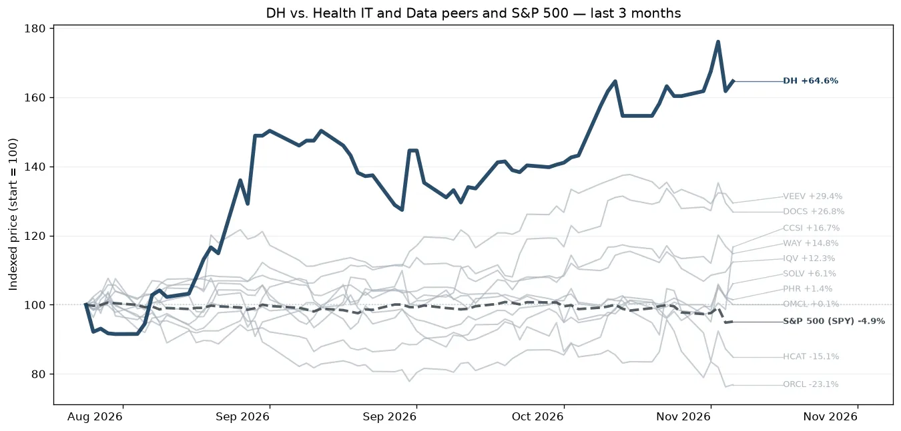

#### Reported Results

Q3 2026: EPS $0.06 vs. $0.04 est. (+41.74%); revenue $54.65M vs. $54.58M est. (+0.12%)

#### Earnings Call Summary

Definitive Healthcare reported Q2 2026 revenue of $55.2 million, a 9% year-over-year decline, which met its guided range. Non-GAAP EPS was $0.05, and adjusted EBITDA reached $14.6 million. The company's diversified and provider segments, representing over 60% of revenue, are leading the recovery, while the life sciences segment remains slower to return to growth.

#### At a Glance

- **Mixed Top and Bottom Line Results:** Definitive Healthcare reported a quarterly adjusted EPS of -$0.04, missing the estimated adjusted EPS of $0.042, while reported revenue slightly beat expectations at $54.65 million compared to the $54.58 million estimate.
- **Profitability Performance Outpaces Past Margins:** The company recorded an Adjusted EBITDA of $15.7 million, representing 29% of revenue, down from 32% in Q3 2025 but above the high end of internal management expectations.
- **Financial Guidance Suspended Pending Buyout:** Definitive Healthcare has withdrawn its full-year and fourth-quarter financial outlook and will not host an earnings call due to an ongoing non-binding acquisition proposal from Advent International.
- **Revenue Contraction Remains Core Risk:** Total quarterly revenue fell 9% year-over-year from $60.0 million in Q3 2025, driven primarily by customer churn, sales execution difficulties, and broader macroeconomic headwinds.
- **Narrowing GAAP Net Losses Reported:** The company&#x27;s GAAP net loss significantly improved and narrowed by 70% to $5.4 million from a net loss of $17.8 million in the prior-year period.
- **Persistent Top-Line Expansion Constraints:** Despite highlighting new-logo additions and expansion activity during the quarter, the persistent contraction in top-line revenue triggered a 2.65% drop in after-hours stock value following the release.

#### Key Moments from the Call

- **20m 27s — Full-Year 2026 Revenue Guidance Tightened Lower:** Definitive Healthcare tightened its full-year 2026 revenue guidance to $220M–$222M due to weaker-than-anticipated traditional analytics bookings in professional services. This will disappoint investors seeking top-line acceleration, though confidence is supported by an upward revision to full-year adjusted EBITDA and profit margins.
- **23m 58s — AI Platform Turbo Launched via Pilot:** The introduction of Turbo, an AI-powered intelligence platform, will please investors looking for modern product innovation. While it carries no material revenue impact for 2026, it is strategically timed to improve customer retention during the upcoming peak December and January renewal periods.
- **26m 13s — Biopharma New Logo Growth Signals Stabilization:** The biopharma sector delivered its strongest new business quarter in three years outside of a typical Q4 peak. This, alongside key win-backs of past customers, signals that investments in high data quality are beginning to effectively counter macroeconomic headwinds in the pressured life sciences segment.
- **28m 1s — Remaining Performance Obligations Lower via Single-Year Shifts:** Total RPO declined 18% and current RPO fell 12% year-over-year, heavily impacted by customers shifting from multi-year commitments to single-year agreements. Management noted this environment-driven trend is normalizing, meaning structural multi-year locking is no longer a near-term critical dependency for stabilization.

## Upcoming Earnings

### Value-Based Care

<table class="sortable"><thead><tr><th class="sortable-heading" data-column="0" data-type="text">Company</th><th class="sortable-heading" data-column="1" data-type="text">Ticker</th><th class="sortable-heading" data-column="2" data-type="text">Date</th><th class="sortable-heading" data-column="3" data-type="number">Market cap</th><th class="sortable-heading" data-column="4" data-type="number">3m Return</th><th class="sortable-heading" data-column="5" data-type="number">12m Return</th></tr></thead><tbody><tr><td class="text" data-sort="p3 health" style="">P3 Health</td><td class="text text" data-sort="piii" style=""><a href="https://www.google.com/finance/quote/PIII:NASDAQ?hl=en" target="_blank" rel="noopener">PIII</a></td><td class="text" data-sort="2026-11-09" style="">November 9, 2026</td><td class="" data-sort="15765206.860000001" style="">$15.8M</td><td class="" data-sort="-0.6545768566493955" style="background:#c0302f;color:#ffffff;">-65.5%</td><td class="" data-sort="-0.49411913494372073" style="background:#c0302f;color:#ffffff;">-49.4%</td></tr></tbody></table>

### Outpatient and Home Providers

<table class="sortable"><thead><tr><th class="sortable-heading" data-column="0" data-type="text">Company</th><th class="sortable-heading" data-column="1" data-type="text">Ticker</th><th class="sortable-heading" data-column="2" data-type="text">Date</th><th class="sortable-heading" data-column="3" data-type="number">Market cap</th><th class="sortable-heading" data-column="4" data-type="number">3m Return</th><th class="sortable-heading" data-column="5" data-type="number">12m Return</th></tr></thead><tbody><tr><td class="text" data-sort="surgery partners" style="">Surgery Partners</td><td class="text text" data-sort="sgry" style=""><a href="https://www.google.com/finance/quote/SGRY:NASDAQ?hl=en" target="_blank" rel="noopener">SGRY</a></td><td class="text" data-sort="2026-11-16" style="">November 16, 2026</td><td class="" data-sort="2991184015.1600003" style="">$3.0B</td><td class="" data-sort="0.49388280746941415" style="background:#1a7a3c;color:#ffffff;">+49.4%</td><td class="" data-sort="0.07906976744186034" style="background:#d6ecd4;color:#111820;">+7.9%</td></tr><tr><td class="text" data-sort="aveanna healthcare" style="">Aveanna Healthcare</td><td class="text text" data-sort="avah" style=""><a href="https://www.google.com/finance/quote/AVAH:NASDAQ?hl=en" target="_blank" rel="noopener">AVAH</a></td><td class="text" data-sort="2026-11-12" style="">November 12, 2026</td><td class="" data-sort="2892351549.75" style="">$2.9B</td><td class="" data-sort="0.3962065331928346" style="background:#1a7a3c;color:#ffffff;">+39.6%</td><td class="" data-sort="0.5142857142857142" style="background:#1a7a3c;color:#ffffff;">+51.4%</td></tr><tr><td class="text" data-sort="pennant group" style=""><a href="#earnings-pntg">Pennant Group</a></td><td class="text text" data-sort="pntg" style=""><a href="https://www.google.com/finance/quote/PNTG:NASDAQ?hl=en" target="_blank" rel="noopener">PNTG</a></td><td class="text" data-sort="2026-11-12" style="">November 12, 2026</td><td class="" data-sort="1277412755.04" style="">$1.3B</td><td class="" data-sort="-0.06769230769230772" style="background:#fbd5d4;color:#111820;">-6.8%</td><td class="" data-sort="0.4236491777603759" style="background:#1a7a3c;color:#ffffff;">+42.4%</td></tr></tbody></table>

### Digital Health, Specialty, Benefits

<table class="sortable"><thead><tr><th class="sortable-heading" data-column="0" data-type="text">Company</th><th class="sortable-heading" data-column="1" data-type="text">Ticker</th><th class="sortable-heading" data-column="2" data-type="text">Date</th><th class="sortable-heading" data-column="3" data-type="number">Market cap</th><th class="sortable-heading" data-column="4" data-type="number">3m Return</th><th class="sortable-heading" data-column="5" data-type="number">12m Return</th></tr></thead><tbody><tr><td class="text" data-sort="hims &amp; hers" style="">Hims &amp; Hers</td><td class="text text" data-sort="hims" style=""><a href="https://www.google.com/finance/quote/HIMS:NYSE?hl=en" target="_blank" rel="noopener">HIMS</a></td><td class="text" data-sort="2026-11-09" style="">November 9, 2026</td><td class="" data-sort="6458115271.84" style="">$6.5B</td><td class="" data-sort="-0.17695473251028804" style="background:#ee8483;color:#111820;">-17.7%</td><td class="" data-sort="-0.36631732878381673" style="background:#e34948;color:#111820;">-36.6%</td></tr><tr><td class="text" data-sort="lifemd" style="">LifeMD</td><td class="text text" data-sort="lfmd" style=""><a href="https://www.google.com/finance/quote/LFMD:NASDAQ?hl=en" target="_blank" rel="noopener">LFMD</a></td><td class="text" data-sort="2026-11-12" style="">November 12, 2026</td><td class="" data-sort="110505866.73" style="">$110.5M</td><td class="" data-sort="-0.3342696629213483" style="background:#c0302f;color:#ffffff;">-33.4%</td><td class="" data-sort="-0.5477099236641221" style="background:#c0302f;color:#ffffff;">-54.8%</td></tr></tbody></table>

### Health IT and Data

<table class="sortable"><thead><tr><th class="sortable-heading" data-column="0" data-type="text">Company</th><th class="sortable-heading" data-column="1" data-type="text">Ticker</th><th class="sortable-heading" data-column="2" data-type="text">Date</th><th class="sortable-heading" data-column="3" data-type="number">Market cap</th><th class="sortable-heading" data-column="4" data-type="number">3m Return</th><th class="sortable-heading" data-column="5" data-type="number">12m Return</th></tr></thead><tbody><tr><td class="text" data-sort="definitive healthcare" style=""><a href="#earnings-dh">Definitive Healthcare</a></td><td class="text text" data-sort="dh" style=""><a href="https://www.google.com/finance/quote/DH:NASDAQ?hl=en" target="_blank" rel="noopener">DH</a></td><td class="text" data-sort="2026-11-12" style="">November 12, 2026</td><td class="" data-sort="106744713.0" style="">$106.7M</td><td class="" data-sort="0.6117729502452696" style="background:#1a7a3c;color:#ffffff;">+61.2%</td><td class="" data-sort="-0.6075085324232082" style="background:#c0302f;color:#ffffff;">-60.8%</td></tr></tbody></table>

