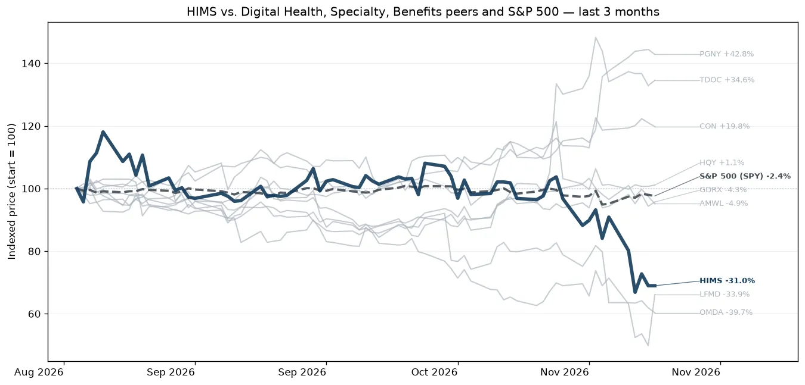
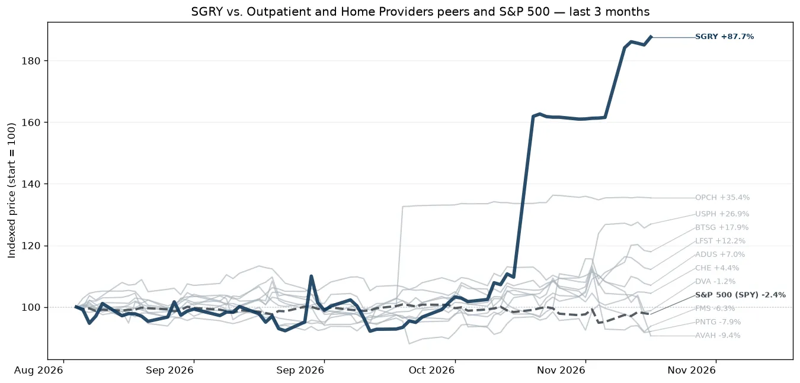
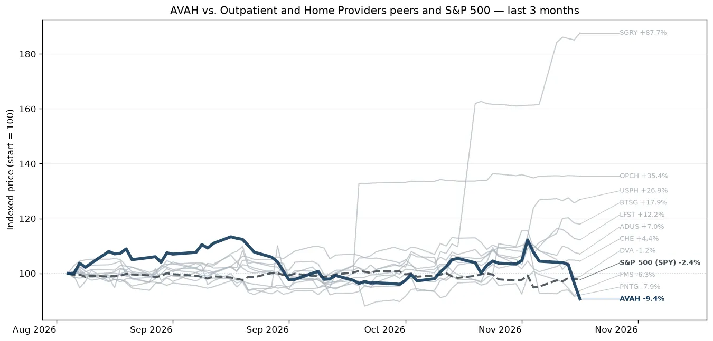

# Healthcare Digest

<strong>Week of November 16, 2026</strong>Market data through: November 13, 2026Narrative created: November 16, 2026

Weekly review of healthcare services, technology, distribution, and diagnostic company performance, changes, earnings activity, and strategy narrative.

## In the News

<nav class="strategy-narrative-links" aria-label="Strategy narrative sections">
<ul>
<li><a href="#strategy-executive-summary-1-cms-turns-first-half-2027-medicaid-work-checks-into-a-shadow-eligibility-period">1. CMS turns first-half 2027 Medicaid work checks into a shadow eligibility period</a></li>
<li><a href="#strategy-executive-summary-2-a-rival-bid-raises-the-price-and-closing-obligations-for-surgery-partners">2. A rival bid raises the price and closing obligations for Surgery Partners</a></li>
<li><a href="#strategy-executive-summary-3-cms-extends-the-home-health-and-hospice-entry-freeze-while-letting-incumbents-add-locations">3. CMS extends the home-health and hospice entry freeze while letting incumbents add locations</a></li>
<li><a href="#strategy-executive-summary-4-federal-prior-authorization-testing-shifts-the-risk-from-apis-to-end-to-end-workflow">4. Federal prior-authorization testing shifts the risk from APIs to end-to-end workflow</a></li>
<li><a href="#strategy-executive-summary-5-p3-s-margin-recovery-still-leaves-a-financing-problem">5. P3’s margin recovery still leaves a financing problem</a></li>
</ul>
</nav>

<h3 id="executive-summary">Executive Summary</h3>
- CMS offered states a hold-harmless period through June 30, 2027, delaying Medicaid work-requirement coverage losses while preserving eligibility assessments and systems implementation. ([CMS, *Optional Hold Harmless Period for Community Engagement Implementation*, November 13, 2026](https://www.medicaid.gov/Federal-Policy-Guidance/Downloads/smd26006.pdf))
- HealthSpan raised its Surgery Partners offer to $25 per share and accepted stronger closing obligations after a competing proposal, increasing both the value and closing probability of the national ambulatory-surgery platform. ([SEC, *Surgery Partners Form 8-K*, November 9, 2026](https://www.sec.gov/Archives/edgar/data/1638833/000110465926124243/tm2629312d1_8k.htm))
- CMS extended the nationwide hospice and home-health enrollment moratoria for six months but allowed enrolled operators to add locations, shifting the policy’s competitive advantage toward incumbent expansion.
- Federal prior-authorization policy moved from technical specifications to production-like workflow testing, creating near-term integration work for payers, EHRs and intermediaries without providing a compliance safe harbor. ([ONC, *ONC and CMS Launch Industry Electronic Prior Authorization Testing Initiative*, November 12, 2026](https://healthit.gov/news/onc-and-cms-launch-industry-electronic-prior-authorization-testing-initiative/))
- Overall environment: modestly improved for payers, providers and health technology because Medicaid coverage disruption was deferred and implementation demand increased, although entry restrictions and P3’s financing exposure show continued pressure on smaller operators.

<h3 id="strategy-executive-summary-1-cms-turns-first-half-2027-medicaid-work-checks-into-a-shadow-eligibility-period">1. CMS turns first-half 2027 Medicaid work checks into a shadow eligibility period</h3>

**What happened**

States may suspend Medicaid eligibility denials and disenrollments tied solely to community-engagement noncompliance through June 30, 2027. They must still assess qualifying activities, deemed compliance and exclusions for relevant applications and renewals beginning January 1. CMS will exclude cases handled under an approved mitigation plan from PERM, Medicaid Eligibility Quality Control and other beneficiary-eligibility audit errors. States seeking the option from January 1 should notify CMS by December 11. ([CMS, *Optional Hold Harmless Period for Community Engagement Implementation*, November 13, 2026](https://www.medicaid.gov/Federal-Policy-Guidance/Downloads/smd26006.pdf))

**Implication**

The policy defers the first wave of work-related coverage losses, supporting Medicaid MCO membership and reducing near-term uncompensated-care exposure for providers. It does not reduce implementation scope. States still need data matching, exclusion logic, notices, caseworker workflows and auditable eligibility decisions.

January through June becomes a production testing period in states adopting the option. Eligibility vendors gain additional time to correct system defects, while MCOs and providers retain more opportunity to intervene before adverse determinations. Variation will remain high because states can decline the option or use it for a shorter period.

**Watch next**

State mitigation-plan decisions by December 11 and whether CMS litigation or additional guidance changes the July 1 enforcement threshold.

---

<h3 id="strategy-executive-summary-2-a-rival-bid-raises-the-price-and-closing-obligations-for-surgery-partners">2. A rival bid raises the price and closing obligations for Surgery Partners</h3>

**What happened**

HealthSpan Partners increased its offer for Surgery Partners to $25 per share, lifting enterprise value from approximately $5.7 billion to as much as $6.0 billion after Surgery Partners received an unsolicited competing proposal. The amendment adds a 10% annualized ticking fee after March 1, 2027, capped at $1.61 per share, and removes the materiality limit from HealthSpan’s obligation to take actions needed to resolve antitrust impediments. The termination fee increased to approximately $149.1 million. ([SEC, *Surgery Partners Form 8-K*, November 9, 2026](https://www.sec.gov/Archives/edgar/data/1638833/000110465926124243/tm2629312d1_8k.htm))

Surgery Partners also reported 6.0% same-facility revenue growth, driven by 5.8% higher revenue per case and only 0.2% case growth. ([SEC, *Surgery Partners Third Quarter 2026 Results*, November 9, 2026](https://www.sec.gov/Archives/edgar/data/1638833/000163883326000089/exhibit991q32026earningsre.htm))

**Implication**

The amendment strengthens last week’s thesis that scaled ASC networks have become scarce strategic assets for health systems. Competing interest raised the purchase price despite limited underlying volume growth, indicating that geographic reach, physician relationships and site-of-care positioning carry substantial option value.

The expanded regulatory covenant improves closing certainty but may require HealthSpan to accept divestitures or operating restrictions. Payers should assess concentration and reimbursement exposure in markets where Surgery Partners overlaps with Bon Secours Mercy Health.

**Watch next**

The identity of the rival bidder, the proxy filing and any antitrust remedy affecting local ASC ownership or contracting.

---

<h3 id="strategy-executive-summary-3-cms-extends-the-home-health-and-hospice-entry-freeze-while-letting-incumbents-add-locations">3. CMS extends the home-health and hospice entry freeze while letting incumbents add locations</h3>

**What happened**

CMS extended nationwide moratoria on initial Medicare enrollment of home-health agencies and hospices, including certain changes in majority ownership, for another six months. Unlike the May moratoria, currently enrolled organizations may now add practice locations. CMS said an October California operation produced 145 revocations involving providers associated with more than $703 million in Medicare and Medicaid payments. ([CMS, *CMS Extends and Modifies Nationwide Freeze on New Medicare Hospice and Home Health Enrollment*, November 12, 2026](https://www.cms.gov/newsroom/press-releases/cms-extends-modifies-nationwide-freeze-new-medicare-hospice-home-health-enrollment-six-months-combat); [Federal Register, *Extension and Modification of the Nationwide Temporary Moratorium on Enrollment of Hospices*, November 16, 2026](https://public-inspection.federalregister.gov/2026-23242.pdf))

**Implication**

The extension adds a market-structure effect to last week’s retroactive-revocation policy. Greenfield Medicare entry and some control transactions remain blocked, while established operators can expand through additional locations. Scaled incumbents therefore gain a six-month advantage in recruiting clinicians, entering adjacent service areas and negotiating payer relationships.

The ownership restriction may also complicate acquisitions structured around new billing enrollments or majority-control changes. Diligence must address enrollment continuity, managing personnel and whether a transaction falls within the moratorium rather than treating provider numbers as routine closing items.

**Watch next**

Access indicators in rural markets, further payment suspensions and whether CMS extends or narrows the moratoria again in May 2027.

---

<h3 id="strategy-executive-summary-4-federal-prior-authorization-testing-shifts-the-risk-from-apis-to-end-to-end-workflow">4. Federal prior-authorization testing shifts the risk from APIs to end-to-end workflow</h3>

**What happened**

ONC and CMS launched voluntary 10- to 12-week testing sprints for payers, providers, EHR developers and intermediaries using production-like environments. Testing will cover the Da Vinci Coverage Requirements Discovery, Documentation Templates and Rules, and Prior Authorization Support implementation guides. MITRE will support recruitment and coordination, while Drummond Group will operate the FHIRplace testing environment. Organizations must express interest by November 20; participation does not constitute certification or a CMS compliance determination. ([ONC, *ONC and CMS Launch Industry Electronic Prior Authorization Testing Initiative*, November 12, 2026](https://healthit.gov/news/onc-and-cms-launch-industry-electronic-prior-authorization-testing-initiative/))

**Implication**

The initiative recognizes that standards conformance does not ensure an operational authorization. The remaining failure points sit between organizations: coverage-rule discovery, clinical-document generation, identity matching, attachments, exception handling and status reconciliation.

That increases demand for workflow orchestration, test data, monitoring and implementation services around payer and EHR APIs. Clearinghouses and interoperability vendors can capture work that neither payer cores nor EHRs manage alone. Voluntary testing may reduce deployment risk, but organizations remain responsible for compliance and cannot treat participation as a safe harbor.

**Watch next**

The first-round participants, selected clinical use cases and whether sprint findings become formal implementation guidance or change enforcement expectations.

---

<h3 id="strategy-executive-summary-5-p3-s-margin-recovery-still-leaves-a-financing-problem">5. P3’s margin recovery still leaves a financing problem</h3>

**What happened**

P3 Health reported third-quarter adjusted EBITDA of $20.9 million versus a $45.9 million loss a year earlier. Medical margin reached $43.9 million, or $140 per member per month, but fell to $35.0 million and $111 PMPM after excluding payer settlements and prior-year development. At-risk membership declined 9% to approximately 105,000 following network and payer rationalization. ([SEC, *P3 Health Partners Third Quarter 2026 Results*, November 9, 2026](https://www.sec.gov/Archives/edgar/data/1832511/000183251126000045/piii-20261109xexx991.htm))

P3 nevertheless reported $43.9 million of unrestricted cash, a $190.6 million working-capital deficit and $90.1 million of nine-month operating cash use, concluding that substantial doubt remains about its ability to continue as a going concern. ([SEC, *P3 Health Partners Form 10-Q*, November 9, 2026](https://www.sec.gov/Archives/edgar/data/1832511/000183251126000046/piii-20260930.htm))

**Implication**

The result strengthens the case that selective payer and provider contraction can repair value-based-care unit economics. It weakens the assumption that positive adjusted EBITDA resolves the sector’s capital problem. Settlement timing, preferred obligations, debt maturities and claims funding can still overwhelm reported operating improvement.

Health-plan and physician partners should treat liquidity as a service-continuity and counterparty risk. Smaller enablement platforms may need refinancing, asset sales or strategic capital before their improved medical margins convert into sustainable cash generation.

**Watch next**

P3’s capital-raising or refinancing plan and recurring 2027 medical margin after prior-period benefits fall away.

<h3 id="what-to-watch-for">What to Watch For</h3>

- November 20, 2026: Organizations must express interest in the first ONC-CMS electronic prior-authorization testing round. ([ONC, *ONC and CMS Launch Industry Electronic Prior Authorization Testing Initiative*, November 12, 2026](https://healthit.gov/news/onc-and-cms-launch-industry-electronic-prior-authorization-testing-initiative/))
- December 7, 2026: Medicare annual enrollment ends, providing the first firm membership read after 2027 benefit and Stars changes. ([CMS, *Medicare Advantage and Medicare Prescription Drug Programs Expected to Remain Stable in 2027*, October 2026](https://www.cms.gov/newsroom/press-releases/medicare-advantage-medicare-prescription-drug-programs-expected-remain-stable-2027))
- December 11, 2026: States intending to use the Medicaid work-requirement hold-harmless option from January 1 are asked to notify CMS. ([CMS, *Optional Hold Harmless Period for Community Engagement Implementation*, November 13, 2026](https://www.medicaid.gov/Federal-Policy-Guidance/Downloads/smd26006.pdf))
- December 15, 2026: Comments close on CMS’s proposed MA provider-directory and Part D PBM accountability rule. ([Federal Register, *CMS-4214-P*, October 20, 2026](https://public-inspection.federalregister.gov/2026-21420.pdf))

<h3 id="bottom-line">Bottom Line</h3>

CMS’s Medicaid hold-harmless option is the week’s most important economic change because it defers first-half 2027 coverage losses while preserving the full eligibility-technology build. State implementation choices and resulting MCO membership variation need the closest attention. The December 11 notification date is the next event most likely to determine how much coverage and provider-cash exposure moves from January into the second half of 2027.

## Recent Earnings Highlights

Companies covered in this section:
<ul class="section-jump-list">
<li><a href="#earnings-hims">Hims &amp; Hers (HIMS)</a></li>
<li><a href="#earnings-sgry">Surgery Partners (SGRY)</a></li>
<li><a href="#earnings-avah">Aveanna Healthcare (AVAH)</a></li>
</ul>
<h3 id="earnings-hims">Hims &amp; Hers (HIMS) -29.9% Last 3m</h3>

Hims &amp; Hers, launched in 2017, is a telehealth platform that connects patients and healthcare providers to offer treatment options for specialties like erectile dysfunction, hair loss, skin care, mental health, and weight loss. Its offerings include generic, branded, and compounded prescription drugs as well as over-the-counter medicines, cosmetics, and supplements. The platform, which has more than 2 million subscribers, is available in all 50 states and certain European markets like the UK. It includes provider networks, electronic medical records, cloud pharmacy fulfillment, and personalization capabilities. Hims does not take insurance and only accepts payments directly from customers.

**Reported:** November 9, 2026 · [Google Finance earnings page](https://www.google.com/finance/quote/HIMS:NYSE?tab=earnings&hl=en)

#### Reported Results

Q3 2026: EPS $0.03 vs. $0.15 est. (-81.97%); revenue $890.37M vs. $892.77M est. (-0.27%)

#### Earnings Call Summary

Hims & Hers reported Q3 2026 revenue of $890 million, a 49% year-over-year increase, driven by strong growth domestically and globally. However, subscribers grew 13% year-over-year to 2.8 million but declined sequentially by 100,000 due to a deliberate reduction in domestic weight loss marketing spend and international brand migrations.

#### At a Glance

- **Hims Reports Revenue and EPS Miss:** Hims &amp; Hers Health Inc reported a Q3 2026 revenue of $890.37 million, slightly missing the estimated $892.77 million, and a reported adjusted EPS of -$0.14 which fell short of the estimated $0.154.
- **Subscribers Growth with Sequential Drop:** While total subscribers grew 13% year-over-year to nearly 2.8 million, they declined by 100,000 sequentially from the prior quarter due to a deliberate pullback in domestic weight loss marketing.
- **Full-Year EBITDA Outlook Reduced:** The company narrowed and tightened its full-year 2026 revenue guidance to $3.13-$3.15 billion, but notably reduced its adjusted EBITDA guidance to $257-$277 million due to aggressive pricing and marketing investments.
- **Gross Margins Experience Significant Compression:** Gross margin dropped significantly to 57% in Q3 2026 compared to 74% in Q3 2025, heavily impacted by a product mix shifting toward lower-margin branded weight-loss treatments.
- **Strong Acceleration in International Revenue:** Revenue outside the United States surged, more than quadrupling year-over-year to $233 million, prompting management to raise its 2026 international revenue expectations to at least $650 million.
- **Market Tumbles Following Profitability Concerns:** Shares of Hims &amp; Hers tumbled over 18% on Tuesday following the earnings announcement as investors reacted to the surprise net loss and margin pressures.

#### Key Moments from the Call

- **22m 34s — Sequential Net Subscriber Decline:** The platform experienced a sequential drop of 100,000 net subscribers quarter-over-quarter down to 2.8 million. This contraction may rattle investors, though management explained it was a calculated trade-off resulting from a deliberate pause in domestic weight loss marketing outlays and near-term volatility from international brand consolidation efforts.
- **24m 0s — Expanded Lilly and Novo Brand Assortment:** Investors will be pleased by the newly announced agreement to distribute Eli Lilly's GLP-1 medications, Zepbound and Foundayo. Combined with Novo Nordisk's Wegovy and future plans for CagriSema, this multi-brand strategy creates a comprehensive metabolic health portfolio to drive customer acquisition and lift long-term platform volumes.
- **26m 23s — Gross Margin Hit from Branded Mix:** Q3 gross margins fell sharply by 7 percentage points sequentially to 57%. This contraction represents a negative deviation for investors, driven by a mix shift toward the international business scaling lower-margin branded weight loss therapies, although management anticipates declines will moderate as product mixes stabilize.
- **32m 19s — Guidance Reduction for Full-Year EBITDA:** Investors will face disappointment as the company lowered its full-year 2026 adjusted EBITDA guidance range to $257 million–$277 million. This reduction stems from an $18 million weight loss revenue deferral alongside aggressive upfront marketing investments and strategic pricing actions in the UK and Germany ahead of peak peak-season Q1 acquisition.

<h3 id="earnings-sgry">Surgery Partners (SGRY) +79.3% Last 3m</h3>

Surgery Partners Inc is a healthcare services company with an integrated outpatient delivery model focused on providing quality, cost-effective solutions for surgical and related ancillary care in support of both patients and physicians. It has one reportable segment: Surgical Facilities, which includes the operation of ASCs, surgical hospitals, anesthesia services, and multi-specialty physician practices, which earn revenues from contracts with patients in which the performance obligations are to provide health care services.

**Reported:** November 9, 2026 · [Google Finance earnings page](https://www.google.com/finance/quote/SGRY:NASDAQ?tab=earnings&hl=en)

#### Reported Results

Q3 2026: EPS $0.16 vs. $0.13 est. (+25.77%); revenue $815.30M vs. $814.70M est. (+0.07%)

#### Earnings Call Summary

Surgery Partners announced a definitive agreement to sell its interests in the Idaho Falls market, including Mountain View Hospital and Idaho Falls Community Hospital, to Intermountain Health. This transaction represents the vast majority of planned portfolio optimization to sharpen focus on core short-stay surgical facilities and strengthen the balance sheet.

#### At a Glance

- **Surgery Partners Outperforms on Bottom Line:** Surgery Partners reported an adjusted EPS of $0.16, significantly beating the estimated $0.127, while quarterly revenue reached $815.30 million, matching expectations with a slight edge over the estimated $814.70 million.
- **Strong Growth in Core KPIs:** Same-facility revenues grew 6.0% year-over-year, driven primarily by a 5.8% increase in revenue per case, which rose to $5,125 from $4,946 in the previous year&#x27;s quarter.
- **Forward Guidance Suspended Amid Merger:** In light of its pending $25.00 per share cash takeout transaction with HealthSpan Partners, Surgery Partners will no longer provide forward-looking guidance or host earnings conference calls.
- **Asset Divestiture Drags Top Line:** Total consolidated revenue experienced a mild 0.8% year-over-year decline due to the complete divestiture of its Idaho Falls hospital facilities to Intermountain Health in September.
- **HealthSpan Deal Faces Competitive Bids:** The company amended its merger agreement with HealthSpan Partners to a $25.00 per share valuation following an unsolicited competing offer, which reports indicate originated from UnitedHealth.

#### Key Moments from the Call

- **4m 3.680000000000007s — Acuity Gains and Same-Facility Rate Growth:** Same-facility net revenue increased 5%, with 4.8% coming from rate increases driven by a strategic shift toward complex, high-acuity procedures. Double-digit expansion in orthopedics, spine, and vascular cases offset volume moderation, while the initial revenue contribution of new physician cohorts increased by 16%.
- **6m 48.670000000000016s — Missing the 2026 Annual M&A Investment Target:** Management explicitly stated that the company will not reach its annual M&A capital deployment target of $200 million in 2026. The reduction stems from an deliberate focus on divesting non-core assets and optimizing the existing platform, though targeted acquisitions are still projected before year-end.
- **9m 19.690000000000055s — Payer Mix Shifts to Higher Government Reimbursements:** Commercial payer mix moderated by approximately 350 basis points year-over-year to 49% of net revenue, shifting toward higher government payments. This dynamic was primarily isolated to larger surgical hospitals and was fully anticipated within full-year guidance, rather than signaling a deterioration in patient demand.
- **12m 21.269999999999982s — Idaho Falls Market Divestiture for $795 Million:** Surgery Partners signed agreements to sell its Idaho Falls assets to Intermountain Health for $795 million in gross proceeds. This strategic pivot simplifies operations by exiting capital-intensive acute care services, eliminating inpatient pediatric business, and reducing overall balance sheet net leverage by roughly 0.3 turns.

<h3 id="earnings-avah">Aveanna Healthcare (AVAH) -6.7% Last 3m</h3>

Aveanna Healthcare Holdings Inc is a diversified home care platform that provides care to medically complex, high-cost patient populations. It directly addresses the pressing challenges facing the U.S. healthcare system by providing safe, high-quality care in the home. The firm provides its services through three segments: Private Duty Services (PDS); Home Health &amp; Hospice (HHH); and Medical Solutions (MS). The Private Duty Services segment generates the majority of revenue, which includes private duty skilled nursing services, non-clinical and personal care services, and pediatric therapy services, and is principally reimbursed by Medicaid and Medicaid MCO.

**Reported:** November 12, 2026 · [Google Finance earnings page](https://www.google.com/finance/quote/AVAH:NASDAQ?tab=earnings&hl=en)

#### Reported Results

Q3 2026: EPS $0.23 vs. $0.21 est. (+10.90%); revenue $695.54M vs. $680.62M est. (+2.19%)

#### Earnings Call Summary

Aveanna Healthcare reported Q3 2026 revenue of $695.5 million, an 11.8% increase year-over-year, and adjusted EBITDA of $100.1 million, up 25% year-over-year. This performance was driven by an improved rate and volume environment, along with continued operational efficiencies and successful alignment with preferred payers across all three operating segments.

#### At a Glance

- **Aveanna Healthcare Misses EPS But Beats Revenue:** Aveanna Healthcare reported a reported adjusted EPS of $0.2, missing the estimated adjusted EPS of $0.207, while reported revenue reached $695.54 million, beating the estimated $680.62 million.
- **Segment Growth Drives Strong Operational Volume:** The company achieved broad-based growth across all three reporting segments, highlighted by a 15.6% revenue increase in Home Health &amp; Hospice and a 10.2% volume increase in Private Duty Services hours.
- **Full-Year 2026 Financial Guidance Raised:** Management increased its full-year 2026 revenue outlook to greater than $2.695 billion, up from the previous target of greater than $2.68 billion, citing strong organic momentum and improved rate visibility.
- **Adjusted EBITDA Surges on Operational Leverage:** Adjusted EBITDA for the third quarter rose 25.0% year-over-year to $100.1 million, driven by cost discipline and a 31.0% reduction in corporate expenses.
- **Payer Mix Optimizes via Preferred Agreements:** Aveanna expanded its preferred payer agreements to cover 65% of Private Duty Services managed care volumes, up from 57% at the end of 2025, to improve reimbursement rates.
- **Deleveraging Targets Reconfirmed Amid Debt Hurdles:** The company reported total indebtedness of $1.52 billion but reconfirmed its long-term strategic target to achieve sub-3x net leverage by 2027 through free cash flow generation.

#### Key Moments from the Call

- **0m 0s — Sequential Q4 Outlook Clarification:** Analysts probed a potential sequential decline implied by the Q4 guidance. Management clarified that Q4 will face standard holiday seasonality and reminded investors that Q4 2025 included an extra operational week, masking true sequential growth patterns.
- **12m 21s — Full-Year 2026 Guidance Raised:** Aveanna raised its full-year 2026 outlook to revenue above $2.695 billion and adjusted EBITDA above $374 million. This beat-and-raise trajectory, backed by solid Q3 performance, signals robust operational momentum and sustained patient demand to investors.
- **13m 21s — Long-Term Growth Targets Upgraded:** Management increased long-term core organic growth rate expectations due to successful preferred payer execution. PDS long-term growth was upgraded to 5%-6% (up from 3%-5%), while Home Health and Hospice was raised to 8%-10% (up from 5%-7%).
- **25m 56s — California Reimbursement Structure Disconnect:** Investors may monitor ongoing negotiations regarding California's $60 million PDN rate investment. While the state views it as a temporary supplemental payment for early 2027, Aveanna is aggressively lobbying to make it permanent before committing to long-term caregiver wage increases.

## Upcoming Earnings

### Outpatient and Home Providers

<table class="sortable"><thead><tr><th class="sortable-heading" data-column="0" data-type="text">Company</th><th class="sortable-heading" data-column="1" data-type="text">Ticker</th><th class="sortable-heading" data-column="2" data-type="text">Date</th><th class="sortable-heading" data-column="3" data-type="number">Market cap</th><th class="sortable-heading" data-column="4" data-type="number">3m Return</th><th class="sortable-heading" data-column="5" data-type="number">12m Return</th></tr></thead><tbody><tr><td class="text" data-sort="surgery partners" style=""><a href="#earnings-sgry">Surgery Partners</a></td><td class="text text" data-sort="sgry" style=""><a href="https://www.google.com/finance/quote/SGRY:NASDAQ?hl=en" target="_blank" rel="noopener">SGRY</a></td><td class="text" data-sort="2026-11-16" style="">November 16, 2026</td><td class="" data-sort="2991184015.1600003" style="">$3.0B</td><td class="" data-sort="0.793080505655356" style="background:#1a7a3c;color:#ffffff;">+79.3%</td><td class="" data-sort="0.7637434554973823" style="background:#1a7a3c;color:#ffffff;">+76.4%</td></tr></tbody></table>

