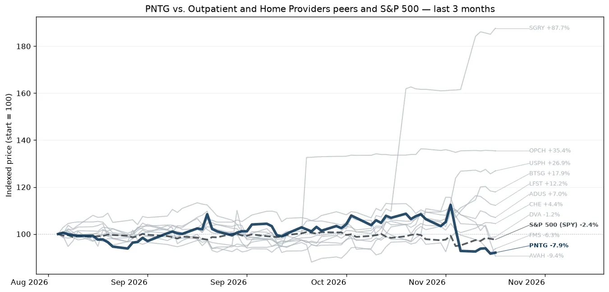
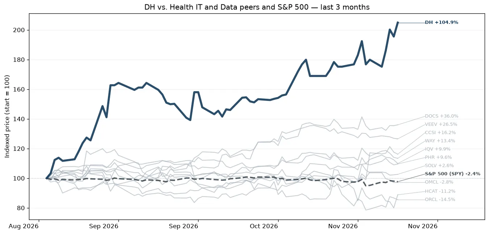

# Healthcare Digest

<strong>Week of November 16, 2026</strong>Market data through: November 13, 2026Narrative created: November 9, 2026

Weekly review of healthcare services, technology, distribution, and diagnostic company performance, changes, earnings activity, and strategy narrative.

## In the News

No strategy narrative is available for this week.

## Recent Earnings Highlights

Companies covered in this section:
<ul class="section-jump-list">
<li><a href="#earnings-hims">Hims &amp; Hers (HIMS)</a></li>
<li><a href="#earnings-sgry">Surgery Partners (SGRY)</a></li>
<li><a href="#earnings-avah">Aveanna Healthcare (AVAH)</a></li>
<li><a href="#earnings-pntg">Pennant Group (PNTG)</a></li>
<li><a href="#earnings-dh">Definitive Healthcare (DH)</a></li>
</ul>
<h3 id="earnings-hims">Hims &amp; Hers (HIMS) -29.9% Last 3m</h3>

Hims &amp; Hers, launched in 2017, is a telehealth platform that connects patients and healthcare providers to offer treatment options for specialties like erectile dysfunction, hair loss, skin care, mental health, and weight loss. Its offerings include generic, branded, and compounded prescription drugs as well as over-the-counter medicines, cosmetics, and supplements. The platform, which has more than 2 million subscribers, is available in all 50 states and certain European markets like the UK. It includes provider networks, electronic medical records, cloud pharmacy fulfillment, and personalization capabilities. Hims does not take insurance and only accepts payments directly from customers.

**Reported:** November 9, 2026 · [Google Finance earnings page](https://www.google.com/finance/quote/HIMS:NYSE?tab=earnings&hl=en)

#### Reported Results

Q3 2026: EPS $0.03 vs. $0.15 est. (-81.97%); revenue $890.37M vs. $892.77M est. (-0.27%)

#### Earnings Call Summary

Hims & Hers Health reported Q3 2026 revenue up 49% year-over-year to $890 million, marking its second consecutive quarter of accelerating top-line growth. Revenue excluded $18 million in deferred weight loss membership revenue, which will be recognized in Q4 2026. Subscribership grew 13% year-over-year to 2.8 million users.

#### At a Glance

- **Hims &amp; Hers Misses Financial Targets:** For Q3 2026, Hims &amp; Hers Health reported an Adjusted EPS of -$0.14, missing the estimated $0.154, and posted revenue of $890.37 million, which slightly missed the estimated $892.77 million.
- **Subscribers Shrink Sequentially Despite Expansion:** Total subscribers grew 13% year-over-year to 2.8 million, but experienced a sequential decline of 100,000 users from the previous quarter due to a deliberate pullback in domestic weight loss marketing.
- **Full-Year Guidance Cut for EBITDA:** The company narrowed its full-year 2026 revenue guidance to a range of $3.13 billion to $3.15 billion, but lowered its full-year Adjusted EBITDA forecast to $257 million to $277 million due to strategic international investments and membership revenue deferrals.
- **Gross Margins Contract Under Pressure:** Gross margin dropped significantly to 57% from 74% in the year-ago period, primarily compressed by the scaling of lower-margin branded weight loss products and expanding international operations.
- **Stock Plummets Post Earnings Report:** Following the earnings release, the company&#x27;s stock experienced a sharp selloff, tumbling approximately 17% as investors reacted negatively to the wider quarterly net loss and declining margins.
- **International Business Run-Rate Surges High:** Rest of the World revenues surged 320.7% year-over-year to $233.3 million, putting the international business on track to surpass a $1 billion revenue run-rate in 2027.

#### Key Moments from the Call

- **22m 34s — Subscribers Decline Sequentially via Marketing Pullback:** Subscribers dropped by 100,000 sequentially to 2.8 million. Investors will note that this headwinds-driven decline was a deliberate strategic choice; management intentionally paced domestic weight loss marketing to introduce structural offerings and broader medication assortments ahead of peak seasonal interest in January.
- **32m 19s — Lowered Full-Year Adjusted EBITDA Guidance:** Management reduced its full-year 2026 adjusted EBITDA guidance range to $257M–$277M. This reduction may disappoint short-term investors, as it stems from heavy pre-Q1 marketing investments to scale the Hims & Hers brands globally, aggressive strategic pricing moves in the U.K. and Germany, and an $20 million membership revenue deferral into 2027.
- **41m 33s — Peptides Category Expansion and In-House Production:** The company will launch its Peptides+ offering later this month, expanding its focus on holistic lifestyle care. To maintain quality control over unstable raw supply chains, Hims & Hers will manufacture active pharmaceutical ingredients in-house at its Menlo Park facility, differentiating its platform on clinical safety oversight.
- **45m 47s — Expanded Weight Loss Footprint with Eli Lilly:** Hims & Hers announced a major strategic agreement with Eli Lilly to expand consumer access to branded GLP-1 medications, including Zepbound and Foundayo. This multi-brand portfolio strategy alongside existing partner Novo Nordisk positions the company to capture broader customer segments and significantly accelerate transaction volumes.

<h3 id="earnings-sgry">Surgery Partners (SGRY) +79.3% Last 3m</h3>

Surgery Partners Inc is a healthcare services company with an integrated outpatient delivery model focused on providing quality, cost-effective solutions for surgical and related ancillary care in support of both patients and physicians. It has one reportable segment: Surgical Facilities, which includes the operation of ASCs, surgical hospitals, anesthesia services, and multi-specialty physician practices, which earn revenues from contracts with patients in which the performance obligations are to provide health care services.

**Reported:** November 9, 2026 · [Google Finance earnings page](https://www.google.com/finance/quote/SGRY:NASDAQ?tab=earnings&hl=en)

#### Reported Results

Q3 2026: EPS $0.16 vs. $0.13 est. (+25.77%); revenue $815.30M vs. $814.70M est. (+0.07%)

#### Earnings Call Summary

Surgery Partners announced a definitive agreement to sell its interests in the Idaho Falls market, including Mountain View Hospital and Idaho Falls Community Hospital, to Intermountain Health. This transaction represents the vast majority of planned portfolio optimization to sharpen focus on core short-stay surgical facilities and strengthen the balance sheet.

#### At a Glance

- **Mixed Top-Line Results for Q3:** Surgery Partners Inc reported a reported adjusted EPS of -$0.16, missing the estimated adjusted EPS of 0.127, while quarterly revenue reached $815.30 million, marginally beating the expected estimate of $814,698,720.
- **Strong Same-Facility KPI Growth Continues:** Same-facility revenues increased by 6.0% year-over-year, driven by a 5.8% increase in revenue per case and a 0.2% increase in same-facility case volumes.
- **Forward Guidance Suspended Amid Merger:** In light of its pending transaction with HealthSpan Partners, Surgery Partners has suspended its practice of providing forward-looking financial guidance and will not host future earnings calls.
- **Merger Agreement Terms Boosted Significantly:** The company announced an amendment to its merger agreement with HealthSpan Partners, increasing the cash consideration to $25.00 per share, which represents an enterprise value of approximately $6.0 billion.
- **Idaho Divestiture Pressures Revenue Growth:** Total quarterly revenue decreased 0.8% year-over-year primarily due to the impact of the successful divestiture of the company&#x27;s interests in Idaho Falls facilities completed in September 2026.

#### Key Moments from the Call

- **4m 3.680000000000007s — Acuity Gains and Same-Facility Rate Growth:** Same-facility net revenue increased 5%, with 4.8% coming from rate increases driven by a strategic shift toward complex, high-acuity procedures. Double-digit expansion in orthopedics, spine, and vascular cases offset volume moderation, while the initial revenue contribution of new physician cohorts increased by 16%.
- **6m 48.670000000000016s — Missing the 2026 Annual M&A Investment Target:** Management explicitly stated that the company will not reach its annual M&A capital deployment target of $200 million in 2026. The reduction stems from an deliberate focus on divesting non-core assets and optimizing the existing platform, though targeted acquisitions are still projected before year-end.
- **9m 19.690000000000055s — Payer Mix Shifts to Higher Government Reimbursements:** Commercial payer mix moderated by approximately 350 basis points year-over-year to 49% of net revenue, shifting toward higher government payments. This dynamic was primarily isolated to larger surgical hospitals and was fully anticipated within full-year guidance, rather than signaling a deterioration in patient demand.
- **12m 21.269999999999982s — Idaho Falls Market Divestiture for $795 Million:** Surgery Partners signed agreements to sell its Idaho Falls assets to Intermountain Health for $795 million in gross proceeds. This strategic pivot simplifies operations by exiting capital-intensive acute care services, eliminating inpatient pediatric business, and reducing overall balance sheet net leverage by roughly 0.3 turns.

<h3 id="earnings-avah">Aveanna Healthcare (AVAH) -6.7% Last 3m</h3>

Aveanna Healthcare Holdings Inc is a diversified home care platform that provides care to medically complex, high-cost patient populations. It directly addresses the pressing challenges facing the U.S. healthcare system by providing safe, high-quality care in the home. The firm provides its services through three segments: Private Duty Services (PDS); Home Health &amp; Hospice (HHH); and Medical Solutions (MS). The Private Duty Services segment generates the majority of revenue, which includes private duty skilled nursing services, non-clinical and personal care services, and pediatric therapy services, and is principally reimbursed by Medicaid and Medicaid MCO.

**Reported:** November 12, 2026 · [Google Finance earnings page](https://www.google.com/finance/quote/AVAH:NASDAQ?tab=earnings&hl=en)

#### Reported Results

Q3 2026: EPS $0.23 vs. $0.21 est. (+10.90%); revenue $695.54M vs. $680.62M est. (+2.19%)

#### Earnings Call Summary

Aveanna Healthcare reported strong Q3 2026 results, with revenue increasing 11.8% year-over-year to $695.5 million and adjusted EBITDA growing 25% to $100.1 million. Performance was driven by solid organic growth across all three operating segments, improvements in clinical and financial outcomes, and continued operational efficiencies.

#### At a Glance

- **Aveanna Misses EPS, Beats Revenue Estimates:** Aveanna Healthcare reported Q3 2026 adjusted EPS of $0.2, missing the estimated $0.207, while its reported revenue of $695.54 million beat the consensus estimate of $680.62 million.
- **Strong Volume and Segment Growth Achieved:** The company experienced an 11.8% year-over-year revenue increase driven by growth across all business lines, including a 15.6% jump in Home Health and Hospice alongside 13 million hours of care provided in Private Duty Services.
- **Full Year 2026 Guidance Upwardly Revised:** Management increased its full-year 2026 outlook, now expecting total revenue to exceed $2.695 billion and adjusted EBITDA to surpass $374 million.
- **Preferred Payer Strategy Drives Efficiencies:** CEO Jeff Shaner noted that directing caregiver capacity toward preferred payers willing to offer enhanced reimbursement rates substantially improved hiring, retention, and overall operational margins.
- **Strong Cash Generation Helps Deleveraging Goals:** Year-to-date free cash flow rose to $141.2 million, supporting the firm&#x27;s strategic goal of achieving sub-3x net leverage by 2027 despite carrying $1.52 billion in total debt.
- **Shares Decline Despite Higher Outlook:** Despite beating revenue expectations and increasing full-year guidance, Aveanna&#x27;s shares fell 6.88% in early trading as investors weighed near-term seasonal headwinds against the quarterly operational beat.

#### Key Moments from the Call

- **11m 16s — Full-Year 2026 Guidance Raised:** Aveanna raised its full-year 2026 financial guidance to project revenue over $2.695 billion and adjusted EBITDA over $374 million, pleasing investors by demonstrating sustained organic demand, a strong pricing environment, and high operational execution across all core segments.
- **16m 51s — Home Health Growth Acceleration:** The Home Health segment delivered impressive volume growth of 24% and episodic admission growth of 19.6%. This significantly outperformed long-range targets due to a successful shift to an 80% episodic mix, accelerating margin expansion and improving clinical outcomes.
- **25m 56s — California Reimbursement Clarity Shift:** Management revealed that California's planned 2027 PDN funding is currently structured as a temporary supplemental payment rather than a permanent base rate increase. This will delay planned base wage hikes for local nurses, introducing near-term labor and volume friction in that state.
- **40m 11s — Sequential Q4 Outlook Clarification:** Analysts focused on an implied sequential step-down in Q4 guidance. Management explained this is due to traditional holiday seasonality and the lapping of a 14th extra week in Q4 2025, reassuring investors that the core run-rate remains robust.

<h3 id="earnings-pntg">Pennant Group (PNTG) -8.3% Last 3m</h3>

Pennant Group Inc is engaged in providing healthcare services to patients of all ages, including the growing senior population, in the United States. It operates in multiple lines of business including home health, hospice, and senior living which includes the company&#x27;s assisted living, independent living, and memory care communities across Arizona, California, Colorado, Idaho, Montana, Nevada, Oklahoma, Oregon, Texas, Utah, Washington, Wisconsin, and Wyoming. It operates in two segments; home health and hospice services and senior living services. The company generates majority of its revenue from home health and hospice services segment, which includes its home health, hospice and home care businesses.

**Reported:** November 12, 2026 · [Google Finance earnings page](https://www.google.com/finance/quote/PNTG:NASDAQ?tab=earnings&hl=en)

#### Earnings Call Summary

The Pennant Group reported strong Q3 2026 results, with revenue up 32% year-over-year to $302.3 million, adjusted EBITDA up 42.4% to $24.7 million, and adjusted EPS increasing 16.7% to $0.35. Operations saw significant expansion, serving roughly 40% more home health patients, 35% more hospice patients, and 10% more senior living residents year-over-year.

#### At a Glance

- **Pennant Group Beats Revenue Estimates:** Pennant Group reported Q3 2026 revenue of $302,251,000, beating the estimated $299,467,000, while reported adjusted EPS came in at $0.26 compared to the estimated adjusted EPS of 0.354.
- **Strong Double-Digit Patient Volume Growth:** Home health admissions increased 39.4% and hospice admissions grew 31.8% year over year, showing significant volume expansion compared to historical baselines.
- **Full-Year Guidance Reaffirmed Comfortably:** Management reaffirmed its full-year guidance for 2026, indicating confidence in operational momentum despite facing short-term margin pressures.
- **Southeast Expansion Integrates Successfully:** The company completed key integration milestones for its Southeast expansion, transitioning 54 acquired locations to its internal electronic medical record system ahead of initial expectations.
- **Employee Benefits Pressure Margins:** Elevated employee benefit costs in self-funded plans acted as a clear headwind, introducing a margin drag equivalent to roughly 50 basis points of revenue.
- **Stock Declines Post Earnings Release:** The company&#x27;s stock fell over 9% following the earnings release, as investors absorbed leadership strain and occupancy pressures across specific senior living markets.

#### Key Moments from the Call

- **5m 16s — Full-Year Guidance Reaffirmed Despite Cost Pressures:** Management reaffirmed its full-year guidance, expressing confidence in operational momentum despite facing higher-than-anticipated self-funded employee benefits expenses. These elevated costs created 50 basis points of margin pressure organization-wide during Q3, and management has proactively incorporated similar elevated cost expectations into its fourth-quarter projections.
- **5m 16s — Home Health Final Rule Rate Impact:** The recently released Home Health Final Rule introduces a 2.1% net increase in the payment rate, translating to approximately 1.5% for Pennant's specific claims portfolio. While CEO Brent Guerisoli noted that any increase is a step forward, he emphasized it remains insufficient to adequately cover persistent high inflation and structural underfunding.
- **12m 25s — Senior Living Integration and Leadership Capacity Constraints:** Aggressive expansion in the Senior Living segment, including 16 community acquisitions since early last year, temporarily outpaced local leadership capacity in two specific markets. This bottleneck caused operational and occupancy drag in both newly transitioned and same-store communities, though management expects a Q4 recovery as local clusters stabilize.
- **26m 47s — Strategic Managed Care Expansion Opportunities:** While the newly acquired Southeast home health locations caused a 2.2% drop in segment revenue per episode due to lower regional Medicare wage indexes, management views the geographic expansion as a major long-term upside. The broader footprint enables Pennant to secure stronger, national managed-care contracts with network-narrowing commercial payers.

<h3 id="earnings-dh">Definitive Healthcare (DH) +104.9% Last 3m</h3>

Definitive Healthcare Corp is a provider of healthcare commercial intelligence. Its SaaS-based healthcare commercial intelligence platform is designed to provide comprehensive and accurate information on the healthcare ecosystem in the U.S. The platform uses deep analytics and data science to help customers develop data-driven strategic decisions, such as finding new markets to enter, building comprehensive go-to-market strategies, accessing tactical information to help target the right decision makers, and improving win rates with detailed contextual information. The company derives substantially all of its revenue from the sale of subscription fees for access to its platform and stand-ready support. Geographically, it derives a majority of its revenue from the United States.

**Reported:** November 12, 2026 · [Google Finance earnings page](https://www.google.com/finance/quote/DH:NASDAQ?tab=earnings&hl=en)

#### Earnings Call Summary

Definitive Healthcare reported Q2 2026 revenue of $55.2 million, a 9% year-over-year decline, which met its guided range. Non-GAAP EPS was $0.05, and adjusted EBITDA reached $14.6 million. The company's diversified and provider segments, representing over 60% of revenue, are leading the recovery, while the life sciences segment remains slower to return to growth.

#### At a Glance

- **Revenue Beats Expectations Despite Decline:** Definitive Healthcare reported Q3 2026 revenue of $54.65 million, slightly beating the estimated $54.58 million, while its Reported Adjusted EPS of $0 surpassed the expectations despite a 9% year-over-year revenue drop.
- **Customer Count Shrinks as Subscriptions Decline:** The company&#x27;s total customer base fell to approximately 2,120 from 2,400 a year earlier, and enterprise customers declined to 471 from 520, driven by a drop in legacy subscription renewals.
- **Forward Guidance Withheld Amid Buyout Proposal:** Definitive Healthcare has completely suspended its full-year and fourth-quarter financial outlook, rendering the pause on forward guidance its most significant operational shift.
- **Pending Going-Private Proposal from Advent:** The suspension of guidance and earnings calls follows a non-binding going-private acquisition proposal from Advent International and founder Jason Krantz received in September.
- **AI Turbo Platform Commences Select Testing:** Definitive Healthcare kicked off an initial pilot program for its AI-powered Turbo healthcare intelligence platform with select strategic customers, planning a broader release later this year.

#### Key Moments from the Call

- **20m 27s — Full-Year 2026 Revenue Guidance Tightened Lower:** Definitive Healthcare tightened its full-year 2026 revenue guidance to $220M–$222M due to weaker-than-anticipated traditional analytics bookings in professional services. This will disappoint investors seeking top-line acceleration, though confidence is supported by an upward revision to full-year adjusted EBITDA and profit margins.
- **23m 58s — AI Platform Turbo Launched via Pilot:** The introduction of Turbo, an AI-powered intelligence platform, will please investors looking for modern product innovation. While it carries no material revenue impact for 2026, it is strategically timed to improve customer retention during the upcoming peak December and January renewal periods.
- **26m 13s — Biopharma New Logo Growth Signals Stabilization:** The biopharma sector delivered its strongest new business quarter in three years outside of a typical Q4 peak. This, alongside key win-backs of past customers, signals that investments in high data quality are beginning to effectively counter macroeconomic headwinds in the pressured life sciences segment.
- **28m 1s — Remaining Performance Obligations Lower via Single-Year Shifts:** Total RPO declined 18% and current RPO fell 12% year-over-year, heavily impacted by customers shifting from multi-year commitments to single-year agreements. Management noted this environment-driven trend is normalizing, meaning structural multi-year locking is no longer a near-term critical dependency for stabilization.

## Upcoming Earnings

### Outpatient and Home Providers

<table class="sortable"><thead><tr><th class="sortable-heading" data-column="0" data-type="text">Company</th><th class="sortable-heading" data-column="1" data-type="text">Ticker</th><th class="sortable-heading" data-column="2" data-type="text">Date</th><th class="sortable-heading" data-column="3" data-type="number">Market cap</th><th class="sortable-heading" data-column="4" data-type="number">3m Return</th><th class="sortable-heading" data-column="5" data-type="number">12m Return</th></tr></thead><tbody><tr><td class="text" data-sort="surgery partners" style=""><a href="#earnings-sgry">Surgery Partners</a></td><td class="text text" data-sort="sgry" style=""><a href="https://www.google.com/finance/quote/SGRY:NASDAQ?hl=en" target="_blank" rel="noopener">SGRY</a></td><td class="text" data-sort="2026-11-16" style="">November 16, 2026</td><td class="" data-sort="2991184015.1600003" style="">$3.0B</td><td class="" data-sort="0.793080505655356" style="background:#1a7a3c;color:#ffffff;">+79.3%</td><td class="" data-sort="0.7637434554973823" style="background:#1a7a3c;color:#ffffff;">+76.4%</td></tr></tbody></table>

