# Life Sciences Digest

<strong>Week of November 9, 2026</strong>Market data through: November 6, 2026Narrative created: November 9, 2026

Weekly review of pharmaceutical, biotech, biologics, and medical-device company performance, changes, earnings activity, and strategy narrative.

## In the News

<nav class="strategy-narrative-links" aria-label="Strategy narrative sections">
<ul>
<li><a href="#strategy-executive-summary-1-elebsiran-plus-tobevibart-establishes-a-phase-3-path-toward-deep-hepatitis-delta-suppression">1. Elebsiran plus tobevibart establishes a Phase 3 path toward deep hepatitis delta suppression</a></li>
<li><a href="#strategy-executive-summary-2-early-tavr-reduces-heart-failure-events-in-selected-moderate-aortic-stenosis">2. Early TAVR reduces heart-failure events in selected moderate aortic stenosis</a></li>
<li><a href="#strategy-executive-summary-3-pelacarsen-and-ziltivekimab-show-that-biomarker-control-does-not-establish-cardiovascular-benefit">3. Pelacarsen and ziltivekimab show that biomarker control does not establish cardiovascular benefit</a></li>
<li><a href="#strategy-executive-summary-4-fda-advances-amt-130-as-confirmed-zolgensma-insertional-oncogenesis-raises-the-aav-safety-bar">4. FDA advances AMT-130 as confirmed Zolgensma insertional oncogenesis raises the AAV safety bar</a></li>
<li><a href="#strategy-executive-summary-5-cms-closes-a-formulation-route-around-medicare-negotiation">5. CMS closes a formulation route around Medicare negotiation</a></li>
</ul>
</nav>

<h3 id="executive-summary">Executive Summary</h3>
- Elebsiran plus tobevibart drove hepatitis delta virus below detection in 79% of Phase 3 participants, establishing a credible U.S. filing path despite an unusually weak delayed-treatment comparison. ([Vir Biotechnology, *Vir Biotechnology Announces Primary Endpoint Met in Pivotal Phase 3 ECLIPSE 1 Trial*, November 8, 2026](https://investors.vir.bio/news/news-details/2026/Vir-Biotechnology-Announces-Primary-Endpoint-Met-in-Pivotal-Phase-3-ECLIPSE-1-Trial-for-Elebsiran-and-Tobevibart-in-Chronic-Hepatitis-Delta/default.aspx))
- Edwards’ PROGRESS trial moves TAVR into selected moderate aortic stenosis, reducing death or heart-failure events by an absolute 7.2 percentage points without demonstrating a mortality benefit. ([New England Journal of Medicine, *TAVR in Patients with Moderate Aortic Stenosis with At-Risk Features*, November 2, 2026](https://www.nejm.org/doi/full/10.1056/NEJMoa2607326))
- Pelacarsen and ziltivekimab each changed its target biomarker substantially but produced hazard ratios near 1.00 for cardiovascular events, weakening two major prevention hypotheses.
- FDA simultaneously demonstrated flexibility and caution toward AAV gene therapy by accepting AMT-130 on externally controlled data from 12 patients while confirming Zolgensma-related insertional oncogenesis.
- CMS finalized a permanent negotiation framework that will group certain route-changing fixed combinations with their original products, reducing the economic value of formulation-based lifecycle extensions beginning in 2029. ([CMS, *Medicare Drug Price Negotiation Program Final Rule*, November 5, 2026](https://www.cms.gov/newsroom/fact-sheets/medicare-drug-price-negotiation-program-medicare-prescription-drug-benefit-program-final-rule-cms))

<h3 id="strategy-executive-summary-1-elebsiran-plus-tobevibart-establishes-a-phase-3-path-toward-deep-hepatitis-delta-suppression">1. Elebsiran plus tobevibart establishes a Phase 3 path toward deep hepatitis delta suppression</h3>

**What changed**

In the 124-patient ECLIPSE 1 trial, monthly elebsiran plus tobevibart produced undetectable hepatitis delta virus RNA and normalized ALT in 44% of participants at week 48, versus 0% in the delayed-treatment group at week 12. Seventy-nine percent achieved undetectable virus, and all met the broader virologic-response definition. One grade 3 treatment-related neutrophil decrease occurred, with no treatment discontinuations. ([Vir Biotechnology, *Vir Biotechnology Announces Primary Endpoint Met in Pivotal Phase 3 ECLIPSE 1 Trial*, November 8, 2026](https://investors.vir.bio/news/news-details/2026/Vir-Biotechnology-Announces-Primary-Endpoint-Met-in-Pivotal-Phase-3-ECLIPSE-1-Trial-for-Elebsiran-and-Tobevibart-in-Chronic-Hepatitis-Delta/default.aspx))

**What it tells us**

The result validates simultaneous suppression of hepatitis B surface-antigen production with siRNA and viral entry or particle clearance with an antibody. Deep suppression across cirrhotic and non-cirrhotic patients strengthens the regulatory case. The design compares different treatment durations rather than equal-time concurrent therapy, however, and the endpoints remain virologic and biochemical rather than decompensation, liver cancer or mortality.

Commercially, monthly administration could offer meaningful convenience. Global differentiation still depends on direct performance against bulevirtide.

**What to watch next**

ECLIPSE 2 and the head-to-head ECLIPSE 3 results, durability after treatment withdrawal and the planned mid-2027 FDA submission.

---

<h3 id="strategy-executive-summary-2-early-tavr-reduces-heart-failure-events-in-selected-moderate-aortic-stenosis">2. Early TAVR reduces heart-failure events in selected moderate aortic stenosis</h3>

**What changed**

PROGRESS randomized 744 patients with moderate aortic stenosis and at least one symptom or structural risk feature to Edwards’ balloon-expandable TAVR or surveillance. At two years, death or a heart-failure event occurred in 16.7% versus 23.9%, an absolute difference of 7.2 percentage points. Heart-failure events fell from 19.0% to 10.8%, while mortality was 8.4% with TAVR and 7.3% with surveillance. More than half the surveillance group underwent valve replacement during follow-up. ([American College of Cardiology, *PROGRESS: TAVR Superior to Clinical Surveillance in Patients With Moderate AS*, November 2, 2026](https://www.acc.org/Latest-in-Cardiology/Articles/2026/11/01/00/11/mon-1240pm-progress-tct-2026); [New England Journal of Medicine, *TAVR in Patients with Moderate Aortic Stenosis with At-Risk Features*, November 2, 2026](https://www.nejm.org/doi/full/10.1056/NEJMoa2607326))

**What it tells us**

PROGRESS supports earlier intervention for a selected, predominantly symptomatic population whose disease frequently progresses within two years. The benefit is morbidity reduction and improved health status, not longer survival. That distinction matters when weighing procedural risk, valve durability and cost.

Commercial significance could be substantial because moderate disease is outside the current U.S. indication. Edwards gains first-mover evidence, although broader category expansion would also benefit competing TAVR manufacturers.

**What to watch next**

FDA label strategy, guideline changes, reimbursement and whether longer follow-up shows durability or a mortality difference.

---

<h3 id="strategy-executive-summary-3-pelacarsen-and-ziltivekimab-show-that-biomarker-control-does-not-establish-cardiovascular-benefit">3. Pelacarsen and ziltivekimab show that biomarker control does not establish cardiovascular benefit</h3>

**What changed**

Detailed Lp(a)HORIZON results showed that pelacarsen lowered lipoprotein(a) by approximately 78%, yet cardiovascular events occurred in 12.3% of treated patients and 12.1% of controls (hazard ratio 1.02). Even among patients with baseline Lp(a) of at least 90 mg/dL, event rates were identical at 12.3% (hazard ratio 1.00). ([New England Journal of Medicine, *Pelacarsen and Cardiovascular Outcomes in Patients with High Lipoprotein(a)*, November 7, 2026](https://www.nejm.org/doi/full/10.1056/NEJMoa2610159))

ZEUS produced the same disconnect: ziltivekimab inhibited interleukin-6 and lowered inflammatory markers but did not reduce cardiovascular events in patients with atherosclerosis and chronic kidney disease (hazard ratio 0.99). ([New England Journal of Medicine, *Interleukin-6 Inhibition with Ziltivekimab for Atherosclerotic Disease*, November 7, 2026](https://www.nejm.org/doi/full/10.1056/NEJMoa2612126))

**What it tells us**

The new data resolve whether obvious subgroups could rescue either program: none did. Pelacarsen’s failure weakens, without refuting, the broader Lp(a)-lowering thesis because competing siRNAs may achieve different depth, duration or biology. ZEUS similarly tests one antibody in a severely ill population rather than disproving cardiovascular inflammation as a target.

Both results raise the commercial evidentiary bar: biomarker magnitude cannot substitute for outcomes trials.

**What to watch next**

Event data for olpasiran and lepodisiran, and analyses explaining why genetic risk associations failed to translate pharmacologically.

---

<h3 id="strategy-executive-summary-4-fda-advances-amt-130-as-confirmed-zolgensma-insertional-oncogenesis-raises-the-aav-safety-bar">4. FDA advances AMT-130 as confirmed Zolgensma insertional oncogenesis raises the AAV safety bar</h3>

**What changed**

FDA accepted uniQure’s AMT-130 Huntington’s disease BLA for accelerated approval and set May 1, 2027 as the target decision date. The application relies on 36-month results from 12 high-dose patients compared with an external control. At 48 months, the 12-patient cUHDRS analysis was not statistically significant, although total functional capacity favored treatment nominally; a randomized 200-patient confirmatory trial is planned. ([uniQure, *uniQure Announces Third Quarter 2026 Financial Results and Provides Company Update*, November 4, 2026](https://uniqure.gcs-web.com/news-releases/news-release-details/uniqure-announces-third-quarter-2026-financial-results-and))

Separately, FDA confirmed two Zolgensma tumor cases in which vector DNA integrated near or within the GLI1 oncogene. The agency extended the identified neoplasia risk to Itvisma, which uses the same vector and construct, while maintaining that both products’ benefits outweigh their risks. ([FDA, *FDA Investigating Serious Risk of Malignancy Linked to Zolgensma Gene Therapy*, November 6, 2026](https://www.fda.gov/vaccines-blood-biologics/safety-availability-biologics/fda-investigating-serious-risk-malignancy-linked-zolgensma-gene-therapy))

**What it tells us**

BLA acceptance confirms regulatory willingness to consider sparse, externally controlled evidence in fatal neurodegeneration; it does not resolve AMT-130’s efficacy uncertainty. The Zolgensma findings convert insertional oncogenesis from a theoretical label risk into a demonstrated product-related event. The appropriate read-through is stricter construct-specific integration analysis and long-term surveillance, rather than a class-wide conclusion about all AAV therapies.

**What to watch next**

A potential AMT-130 advisory committee, FDA action on Zolgensma labeling and tumor-monitoring requirements across related programs.

---

<h3 id="strategy-executive-summary-5-cms-closes-a-formulation-route-around-medicare-negotiation">5. CMS closes a formulation route around Medicare negotiation</h3>

**What changed**

CMS finalized rules governing Medicare drug-price negotiation for prices effective in 2029 and beyond. When products from the same application holder share an active ingredient and an added component creates a new formulation enabling another administration route, CMS will generally aggregate them as one qualifying single-source drug. CMS explicitly cited products combining an active ingredient with hyaluronidase as an example. The rule takes effect December 5, 2026. ([CMS, *Medicare Drug Price Negotiation Program and Medicare Prescription Drug Benefit Program Final Rule*, November 5, 2026](https://www.cms.gov/newsroom/fact-sheets/medicare-drug-price-negotiation-program-medicare-prescription-drug-benefit-program-final-rule-cms))

**What it tells us**

The final rule reduces the ability to protect economics by shifting an established infused biologic into a subcutaneous fixed combination shortly before negotiation. Convenience, chair-time savings and improved adherence retain clinical and competitive value, but the new formulation may inherit the original product’s maximum fair price exposure.

The policy favors lifecycle strategies that demonstrate additional clinical benefit, reach a distinct population or introduce a genuinely new molecule. It also makes negotiation timing more important in decisions to license formulation technology or fund route-switching trials.

**What to watch next**

CMS’s February 1, 2027 selection of up to 20 Part B and Part D drugs for the 2029 cycle and manufacturers’ responses to the aggregation policy.

<h3 id="what-to-watch-for">What to Watch For</h3>

- November 14, 2026: FDA target decision on ivonescimab plus chemotherapy in post-TKI EGFR-mutated lung cancer. ([Summit Therapeutics, *Summit Therapeutics Reports Third Quarter 2026 Financial Results and Operational Progress*, November 4, 2026](https://smmttx.com/news/press-releases/news-details/2026/Summit-Therapeutics-Reports-Financial-Results-and-Operational-Progress-for-the-Third-Quarter-and-Nine-Months-Ended-September-30-2026/default.aspx))
- November 15, 2026: Amylyx presents detailed Phase 3 LUCIDITY results for avexitide in post-bariatric hypoglycemia. ([Amylyx, *Amylyx Pharmaceuticals to Host Investor Event at ObesityWeek 2026*, November 4, 2026](https://investors.amylyx.com/news-releases/news-release-details/amylyx-pharmaceuticals-host-investor-event-obesityweekr-2026))
- November 22, 2026: FDA target decision on molgramostim for autoimmune pulmonary alveolar proteinosis. ([Savara, *FDA Extends Review Period for the Molgramostim BLA*, April 15, 2026](https://investors.savarapharma.com/news/news-details/2026/Savara-Announces-the-U-S--Food--Drug-Administration-FDA-Has-Extended-the-Review-Period-for-the-Molgramostim-Inhalation-Solution-Molgramostim-Biologics-License-Application-BLA-in-Autoimmune-Pulmonary-Alveolar-Proteinosis-Autoimmune-PAP/default.aspx))
- November 27, 2026: Comments close on FDA’s individualized genome-editing draft guidance. ([Federal Register, *Individualized Human Genome Editing Products Draft Guidance Notice*, October 28, 2026](https://www.federalregister.gov/documents/2026/10/28/2026-21954/individualized-human-genome-editing-products-considerations-for-bla-submission-and-postapproval))
- December 5, 2026: CMS’s permanent Medicare negotiation rule becomes effective. ([CMS, *Medicare Drug Price Negotiation Program Final Rule*, November 5, 2026](https://www.cms.gov/newsroom/fact-sheets/medicare-drug-price-negotiation-program-medicare-prescription-drug-benefit-program-final-rule-cms))

<h3 id="bottom-line">Bottom Line</h3>

The week expanded treatment boundaries in moderate aortic stenosis and hepatitis delta while sharply narrowing confidence in biomarker-led cardiovascular development. FDA’s November 14 ivonescimab decision is the next major test: approval would show how much regulatory weight progression-free survival can carry when overall survival misses statistical significance.

## Recent Earnings Highlights

Companies covered in this section:
<ul class="section-jump-list">
<li><a href="#earnings-amgn">Amgen (AMGN)</a></li>
<li><a href="#earnings-nvo">Novo Nordisk (NVO)</a></li>
<li><a href="#earnings-pfe">Pfizer (PFE)</a></li>
<li><a href="#earnings-vrtx">Vertex (VRTX)</a></li>
<li><a href="#earnings-mrna">Moderna (MRNA)</a></li>
<li><a href="#earnings-ew">Edwards LifeSciences (EW)</a></li>
<li><a href="#earnings-bdx">Becton Dickinson (BDX)</a></li>
<li><a href="#earnings-ste">STERIS (STE)</a></li>
<li><a href="#earnings-uthr">United Therapeutics (UTHR)</a></li>
<li><a href="#earnings-vtrs">Viatris (VTRS)</a></li>
<li><a href="#earnings-zbh">Zimmer Biomet (ZBH)</a></li>
<li><a href="#earnings-nbix">Neurocrine Biosciences (NBIX)</a></li>
<li><a href="#earnings-bmrn">BioMarin Pharmaceutical (BMRN)</a></li>
<li><a href="#earnings-podd">Insulet (PODD)</a></li>
<li><a href="#earnings-gmed">Globus Medical (GMED)</a></li>
<li><a href="#earnings-krys">Krystal Biotech (KRYS)</a></li>
<li><a href="#earnings-cgon">CG Oncology (CGON)</a></li>
<li><a href="#earnings-ions">Ionis Pharmaceuticals (IONS)</a></li>
<li><a href="#earnings-acad">Acadia Pharmaceuticals (ACAD)</a></li>
<li><a href="#earnings-rxrx">Recursion Pharmaceuticals (RXRX)</a></li>
<li><a href="#earnings-srpt">Sarepta (SRPT)</a></li>
<li><a href="#earnings-insp">Inspire Medical Systems (INSP)</a></li>
</ul>
<h3 id="earnings-amgn">Amgen (AMGN) +12.0% Last 3m</h3>

Amgen is a leader in biotechnology-based human therapeutics. Flagship drugs include red blood cell boosters Epogen and Aranesp, immune system boosters Neupogen and Neulasta, and Enbrel and Otezla for inflammatory diseases. Amgen introduced its first cancer therapeutic, Vectibix, in 2006 and markets bone-strengthening drugs Prolia/Xgeva (approved 2010) and Evenity (2019). The acquisition of Onyx Pharmaceuticals bolstered the firm&#x27;s therapeutic oncology portfolio with Kyprolis, which has been further strengthened with the launch of new drugs in blood cancers (Blincyto) and solid tumors (Imdelltra). The 2023 Horizon acquisition brought several rare-disease drugs, including thyroid eye disease drug Tepezza. Amgen also has a growing biosimilar portfolio.

**Reported:** November 3, 2026 · [Google Finance earnings page](https://www.google.com/finance/quote/AMGN:NASDAQ?tab=earnings&hl=en)

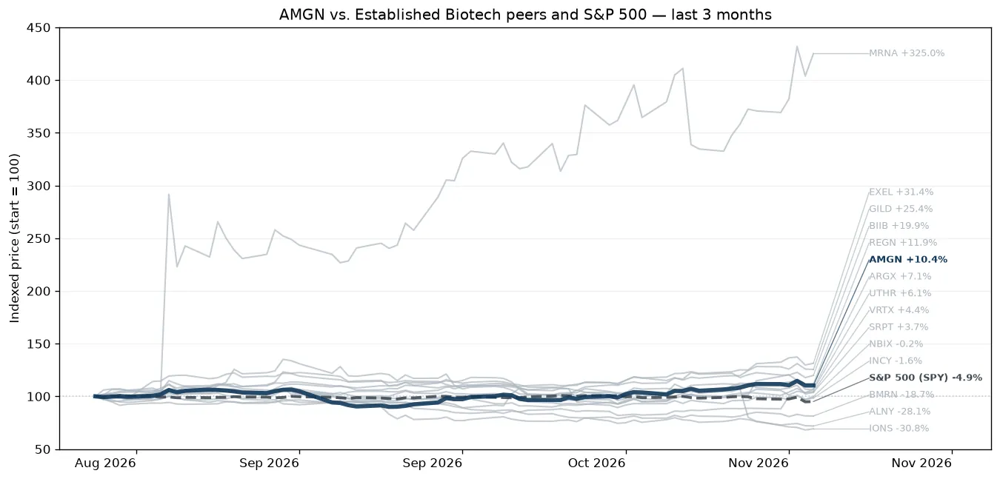

#### Reported Results

Q3 2026: EPS $6.45 vs. $5.78 est. (+11.55%); revenue $10.37B vs. $10.06B est. (+3.01%)

#### Earnings Call Summary

Amgen reported strong Q3 2026 financial results, with total revenues increasing 8% year-over-year to $10.4 billion. Six key growth drivers grew 27% year-over-year, accounting for over 70% of product sales. The company achieved $3.7 billion in free cash flow, expanded R&D investments by 11% year-over-year, and invested $600 million in capital expenditures.

#### At a Glance

- **Amgen Beats Earnings and Revenue Estimates:** Amgen reported a GAAP diluted EPS of $7.08, significantly beating the estimated adjusted EPS of $5.782, while total revenue reached $10.365 billion, exceeding the estimated $10.061 billion.
- **Strong Double-Digit Key Product Growth:** A total of 17 individual medicines achieved double-digit sales growth during the quarter, with six key growth drivers surging 27% year-over-year to account for over 70% of total product sales.
- **Full-Year Guidance Safely Raised Upward:** Management increased its full-year 2026 outlook, raising the projected total revenue range to $38.9 billion–$39.7 billion and non-GAAP EPS expectations to $22.90–$23.70.
- **Robust Progress Across Clinical Pipelines:** The quarter was highlighted by positive Phase 3 clinical trial readouts for IMDELLTRA in small cell lung cancer, TEZSPIRE in eosinophilic esophagitis, and dazodalibep in Sjögren&#x27;s disease.
- **Investor Profit-Taking Post-Release Action:** Despite the strong beat and raised guidance numbers, Amgen&#x27;s stock dipped roughly 1.36% in after-hours trading as investors took a more cautious stance following the report.

#### Key Moments from the Call

- **16m 25s — IMDELLTRA Frontline Survival Unprecedented:** Phase III data for IMDELLTRA in first-line maintenance small cell lung cancer demonstrated an unprecedented median overall survival of 21.1 months, captivating oncologists. Management anticipates rapid clinical adoption and swift regulatory filings, opening a major earlier-line market opportunity comprising 23,000 U.S. patients.
- **20m 56s — Sjögren's Disease Phase III Breakthrough:** Dazodalibep achieved statistically significant and durable improvements in systemic Sjögren's disease during Phase III trials, showing efficacy as early as week four. As the first therapeutic to show such durable efficacy in this setting, it positions Amgen as a pioneer in an under-penetrated, competitive market with critical readouts pending.
- **24m 16s — MariTide Dosing and Commercial Profile:** Management highlighted MariTide as a unique monthly or less frequent obesity therapy with transient, short-lived side effects despite its long half-life. Amgen is expanding manufacturing capacity and preparing for a potential commercial launch, focusing heavily on patient-friendly auto-injectors and multi-disease clinical endpoints to secure robust global reimbursement.
- **28m 13s — Full-Year 2026 Guidance Raised:** Amgen lifted its 2026 revenue guidance to $38.9B–$39.7B and non-GAAP EPS to $22.90–$23.70, reflecting robust business execution and commercial growth. It also projected stable operating margins into 2027, reassuring investors of strong ongoing financial discipline and sustained top- and bottom-line momentum.

<h3 id="earnings-nvo">Novo Nordisk (NVO) -14.7% Last 3m</h3>

With roughly one-third of the global branded diabetes treatment market, Novo Nordisk is the world&#x27;s leading provider of diabetes care products. Based in Denmark, the company manufactures and markets a variety of human and modern insulins for patients with diabetes, as well as injectable and oral GLP-1 therapies, across its obesity and diabetes care segment. Novo also has a rare disease segment (contributing less than 10% of revenue) that specializes in protein therapies for hemophilia and other disorders.

**Reported:** November 4, 2026 · [Google Finance earnings page](https://www.google.com/finance/quote/NVO:NYSE?tab=earnings&hl=en)

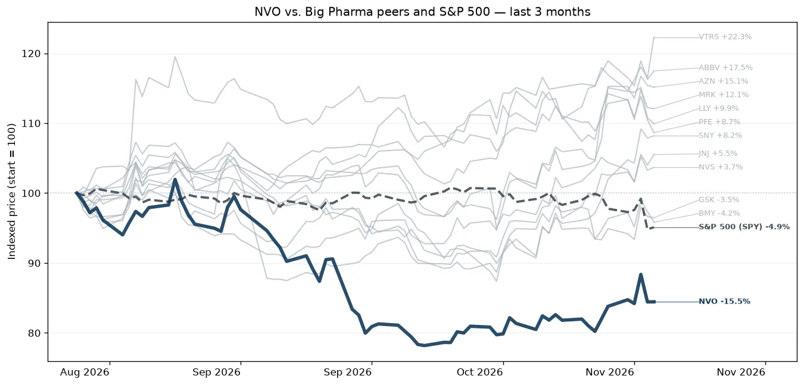

#### Reported Results

Q3 2026: EPS $5.79 vs. $4.62 est. (+25.31%); revenue $79.20B vs. $73.63B est. (+7.56%)

#### Earnings Call Summary

Novo Nordisk achieved 4% adjusted sales growth in Q3 2026 to DKK 79.2 billion, driven by robust GLP-1 volume performance in obesity and diabetes. Adjusted operating profit rose 27% to DKK 32 billion, benefiting from a favorable comparison base following massive transformation costs in Q3 2025, which was partially offset by DKK 3.5 billion in one-time expenses.

#### At a Glance

- **Novo Nordisk Beats Financial Estimates:** The company reported an adjusted EPS of 3.79, missing the estimated 4.621, while reported revenue reached 79.195 billion, beating the estimated 73.627 billion.
- **Obesity Care Volumes Drive Growth:** Obesity care sales expanded 22% during the quarter, heavily driven by the massive rollout and strong adoption of the oral Wegovy pill format.
- **Full Year 2026 Guidance Raised:** Management upgraded its full-year adjusted sales and operating profit growth projections to a range of -2% to +2% at constant exchange rates.
- **Wegovy Pill Shines Internationally:** The newly introduced Wegovy pill generated 5.39 billion Danish kroner in Q3 sales, blowing past market expectations and expanding into eight distinct markets.
- **Impairments Impact Reported Profits:** Novo Nordisk absorbed 8.7 billion Danish kroner in non-cash impairment charges linked to unsuccessful drug trials and manufacturing adjustments.
- **Market Reacts Positively to Results:** Following the stronger-than-expected top-line performance and improved outlook, the company&#x27;s shares jumped by as much as 6.7% in early trading.

#### Key Moments from the Call

- **9m 50s — U.S. Bridge Program Insulates Sequential Volume Expansion:** Wegovy pill saw a 20% sequential volume spike in the U.S., which was predominantly driven by the Medicare Bridge program contributing 60,000 weekly prescriptions. Management acknowledged that outside of this Bridge program, the broader anti-obesity market trended relatively flat between May and October due to standard seasonality.
- **12m 55s — CagriSema Outperforms Tirzepatide in Head-to-Head Trial:** In the Phase III REIMAGINE 5 trial for Type 2 diabetes, CagriSema 1 mg demonstrated superior weight loss of 12.4% compared to 9.1% for tirzepatide 5 mg, while maintaining non-inferior blood sugar control. This strong data expands the evidence base for its highly competitive efficacy profile ahead of potential upcoming launches.
- **20m 3s — Strong GLP-1 Volume Recovery Drives Full-Year Guidance Raise:** Novo Nordisk posted better-than-expected sales and operating profits for the first nine months, turning around patient volumes by adding 1.3 million patients in Q3 alone. This robust category growth across diabetes and obesity allowed management to step up their 2026 full-year outlook for both sales and adjusted operating profit.
- **25m 2s — CFO Transition Announced Alongside Future Innovation Roadmaps:** CFO Karsten Munk Knudsen will step down at the end of 2026 after 27 years with the firm, to be succeeded by Galderma CFO Luigi La Corte. Meanwhile, leadership highlighted that global commercial rollouts for major upcoming innovations, Frehemgo and CagriSema, are on track for 2027 to sustain long-term pipeline value.

<h3 id="earnings-pfe">Pfizer (PFE) +9.8% Last 3m</h3>

Pfizer is one of the world&#x27;s largest pharmaceutical firms, with annual sales of roughly $60 billion. While it historically sold many types of healthcare products and chemicals, now prescription drugs and vaccines account for the majority of sales. Top sellers include pneumococcal vaccine Prevnar 13 and cardiology drugs Vyndamax and Eliquis. Pfizer sells these products globally, with international sales representing 40% of total sales. Within international sales, emerging markets are a major contributor.

**Reported:** November 3, 2026 · [Google Finance earnings page](https://www.google.com/finance/quote/PFE:NYSE?tab=earnings&hl=en)

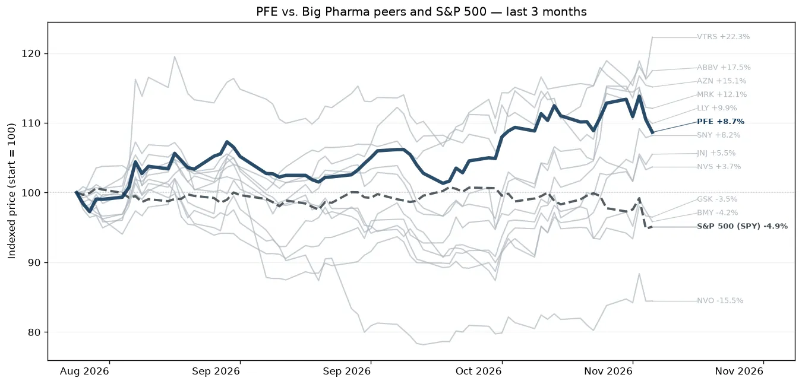

#### Reported Results

Q3 2026: EPS $0.87 vs. $0.74 est. (+18.26%); revenue $16.58B vs. $15.86B est. (+4.54%)

#### Earnings Call Summary

Pfizer reported strong Q3 2026 results, highlighted by 32% operational revenue growth for launched and acquired products. The company raised its full-year 2026 revenue guidance midpoint to $63 billion and narrowed adjusted diluted EPS guidance to $2.95–$3.05, demonstrating commercial momentum and effective cost discipline.

#### At a Glance

- **Pfizer Beats Estimates on Top Line:** Pfizer reported a Q3 2026 revenue of $16.583 billion, beating the estimated $15.863 billion, while reported adjusted EPS came in at $0.56 compared to the estimated $0.736.
- **New Products Fuel Non-COVID Growth:** Revenues from launched and acquired products surged 32% operationally to $3.8 billion, leading a 7% operational growth in Pfizer&#x27;s non-COVID product portfolio.
- **Full Year Guidance Raised Significantly:** Pfizer raised its full-year 2026 revenue guidance by $1.5 billion at the midpoint to a range of $62.0 to $64.0 billion and lifted its adjusted diluted EPS guidance to $2.95 to $3.05.
- **Productivity Programs On Track:** The company remains on track to deliver nearly all of its anticipated $7.2 billion in net cost savings by the end of 2026, with an additional $2.5 billion targeted for 2027 to 2029.
- **COVID Franchise Continues to Decline:** Paxlovid revenue plummeted 63% and Comirnaty sales dropped 29% due to lower global infection rates, though the declines were successfully mitigated by non-COVID segments.
- **Pipeline Advances Core Growth Drivers:** Management highlighted extensive pipeline execution including a second positive Phase 3 win for Elrexfio in multiple myeloma and planning for 10 Phase 3 trials in its obesity portfolio.

#### Key Moments from the Call

- **4m 49s — Strategic Obesity Pipeline Acceleration:** Pfizer outlined a major clinical push for its obesity portfolio with 10 Phase III trials planned for 2026, including a monthly GLP-1 peptide switch study, targeting a first regulatory approval in 2028 to penetrate the massive chronic weight management market.
- **13m 11s — Phased Net Cost Savings Expansion:** Management confirmed achievement of its initial $7.2 billion cost-reduction program by year-end 2026 and introduced a secondary phase to capture $2.5 billion in additional savings through 2029, directly addressing investor concerns regarding margin protection ahead of impending patent cliffs.
- **15m 36s — Full-Year 2026 Guidance Increase:** Pfizer raised its full-year 2026 revenue guidance by $1.5 billion at the midpoint to $62B–$64B and boosted adjusted EPS guidance to $2.95–$3.05, signaling robust commercial outperformance and financial confidence despite absorbing a $0.10 Innovent transaction charge.
- **64m 29s — Disconnection Between Internal and Street Forecasts:** Executives defended their long-term high single-digit revenue CAGR target for 2028–2033 by pointing out significant undervaluation in consensus models for core products like Nurtec and Elrexfio, asserting that the market is severely mismodeling Pfizer's true commercial potential.

<h3 id="earnings-vrtx">Vertex (VRTX) +10.3% Last 3m</h3>

Vertex Pharmaceuticals is a global biotechnology company that discovers and develops small-molecule drugs for the treatment of serious diseases. Its key drugs are Kalydeco, Orkambi, Symdeko, and Trikafta/Kaftrio, and Alyftrek for cystic fibrosis, where Vertex therapies remain the standard of care globally. Vertex is focused on diversifying its portfolio through Casgevy (gene-editing therapy for beta thalassemia and sickle-cell disease), Journavx (non-opioid pain drug for moderate-to-severe acute pain), and Palsonify (for acromegaly). Additionally, Vertex is evaluating small-molecule inhibitors of APOL1-mediated kidney diseases, cell therapies to deliver a functional cure for type 1 diabetes, povetacicept (for IgA nephropathy).

**Reported:** November 2, 2026 · [Google Finance earnings page](https://www.google.com/finance/quote/VRTX:NASDAQ?tab=earnings&hl=en)

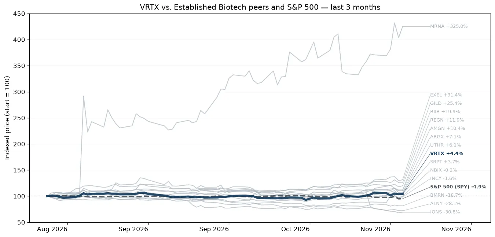

#### Reported Results

Q3 2026: EPS $4.76 vs. $4.78 est. (-0.50%); revenue $3.44B vs. $3.43B est. (+0.17%)

#### Earnings Call Summary

Vertex Pharmaceuticals reported Q3 2026 revenue of $3.44B, a 12% increase year-over-year, driven by balanced growth across U.S. and international markets. Non-GAAP net income reached $1.21B with non-GAAP EPS at $4.76. Full-year 2026 revenue guidance was raised to a range of $13.15B to $13.25B.

#### At a Glance

- **Vertex Beats Revenue, Misses EPS Estimates:** Vertex Pharmaceuticals reported a reported revenue of $3.44 billion, marginally beating the estimated revenue of $3.435 billion, while reported adjusted EPS came in at $2.56, missing the estimated adjusted EPS of 4.784.
- **Cystic Fibrosis Franchise Shows Growth:** The company&#x27;s core Cystic Fibrosis (CF) franchise generated $3.27 billion in third-quarter revenues, marking an 8% increase year over year, led by strong global uptake of newer portfolios.
- **Full-Year 2026 Revenue Guidance Lifted:** Vertex raised its full-year 2026 total revenue guidance to a range of $13.15 billion to $13.25 billion from its previous forecast of $13.1 billion to $13.2 billion, primarily driven by the inclusion of the newly acquired Crinetics business.
- **Crinetics Acquisition Deepens Rare Portfolio:** The company successfully completed its $9.0 billion net cash acquisition of Crinetics Pharmaceuticals in September, adding PALSONIFY for acromegaly as its fourth commercial pillar.
- **New Products Fuel Diversification Strategy:** CASGEVY revenues grew 30% sequentially to reach $99 million, while the newly launched acute pain medicine JOURNAVX brought in $58 million, signaling steady progress outside the core CF line.
- **Profitability Squeezed by Rising Expenses:** Non-GAAP operating expense guidance was increased to approximately $6 billion due to Crinetics integration costs, adding pressure to operating margins and driving a negative post-earnings stock reaction.

#### Key Moments from the Call

- **27m 42s — Raised Full-Year 2026 Revenue Guidance:** Vertex raised its full-year 2026 revenue guidance to $13.15B–$13.25B, reflecting the inclusion of $40M–$50M from the newly acquired Crinetics Pharmaceuticals. This revision provides investors with enhanced certainty regarding commercial momentum and top-line expansion across multiple disease areas.
- **28m 40s — Operating Expense Guidance Increased to $6B:** Full-year non-GAAP operating expense guidance was adjusted upward to approximately $6B, a change driven entirely by $250M in Crinetics integration and operating costs. Investors will closely monitor how these rising near-term costs translate into strategic execution and long-term commercial efficiency.
- **31m 52s — Confidence Ahead of Povetacicept PDUFA Date:** Management minimized concerns regarding an anonymous citizen petition questioning povetacicept's clinical monitoring, reinforcing readiness for the November 30 PDUFA date. Backed by solid clinical safety data, the upcoming regulatory decision serves as a high-impact catalyst for establishing Vertex's fifth commercial renal pillar.
- **34m 38s — AMPLITUDE Interim Analysis Focuses on eGFR:** Management confirmed that a clinical win for the upcoming early 2027 AMPLITUDE phase II/III interim analysis of inaxaplin will depend on eGFR slope statistical significance. This alignment with the FDA clarifies the regulatory path forward for accelerated approval, focusing investor attention directly on renal function metrics.

<h3 id="earnings-mrna">Moderna (MRNA) +329.6% Last 3m</h3>

Moderna is a commercial-stage biotech that was founded in 2010 and had its initial public offering in 2018. The firm&#x27;s mRNA technology was rapidly validated with its covid vaccine, which was authorized in the United States in December 2020. Moderna had 25 mRNA development candidates in clinical studies as of March 2026. Programs span a wide range of therapeutic areas, including infectious disease, oncology, cardiovascular disease, and rare genetic diseases.

**Reported:** November 6, 2026 · [Google Finance earnings page](https://www.google.com/finance/quote/MRNA:NASDAQ?tab=earnings&hl=en)

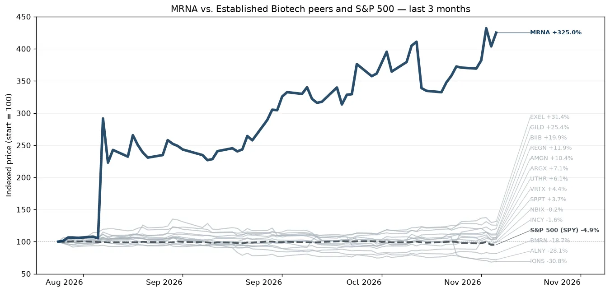

#### Reported Results

Q3 2026: EPS $0.38 vs. -$1.35 est. (+128.12%); revenue $1.31B vs. $890.89M est. (+47.38%)

#### Earnings Call Summary

Moderna delivered a strong third quarter with $1.3 billion in revenue, up 29% year-over-year, driven by increased COVID-19 vaccine sales and higher-than-expected commercial demand across both U.S. and international markets. Operational performance was strong, yielding a net income of $200 million for the quarter.

#### At a Glance

- **Moderna Smashes Estimates with Surprise Profit:** Moderna reported Q3 2026 Adjusted EPS of $0.38, significantly beating the estimated loss of $1.351, while revenue reached $1,313,000,000 against expectations of $890,888,800.
- **Net Product Sales Surge Globally:** Net product sales rose 30.8% year-over-year to $1.27 billion, primarily driven by stronger international COVID-19 vaccine uptake and strategic government partnerships compared to previous seasonal quarters.
- **Full-Year Revenue Guidance Hiked Significantly:** Moderna increased its full-year 2026 expected revenue growth to a range of 15% to 25%, substantially higher than its previous outlook of up to 10% growth.
- **Strategic Pivot and Regulatory Approvals:** The company advanced its pipeline diversification beyond COVID-19 by securing U.S. FDA approval for mFLUSIVA, marking its fifth approved product globally.
- **Aggressive Expense Reductions Boost Margins:** Research and development expenses fell 27% to $583 million as late-stage trials wound down, helping the firm swing back to quarterly profitability with a 9.9% operating margin.
- **Positive Clinical Milestones in Oncology:** Moderna highlighted successful Phase 3 trial data for its individualized melanoma therapy, intismeran, which demonstrated a 42% risk reduction in cancer recurrence or death.

#### Key Moments from the Call

- **6m 50s — Significant 2026 Revenue and Cash Guidance Increase:** Moderna raised its full-year 2026 revenue growth outlook to 15%–25%, far exceeding its prior flat-to-10% projection. Driven by robust international expansion and stable U.S. demand, this top-line surge combined with lower operational expenses lifted year-end cash projections to $8.1B–$8.3B, highly reassuring investors.
- **15m 50s — Norovirus Late-Stage Clinical Program Halted:** Moderna decided not to enroll an additional winter cohort for its norovirus vaccine candidate (mRNA-1403) after the Phase III trial missed early success statistical criteria at an interim analysis. Management is pivoting to regulatory consultations to evaluate the asset's future, causing disappointment regarding the near-term pipeline pipeline timeline.
- **18m 14s — Stellar Phase III Intismeran Cancer Vaccine Results:** The company reported positive Phase III INTerpath-001 trial data for intismeran, revealing a 42% reduction in melanoma recurrence or death when combined with Keytruda. This first-ever positive Phase III for an individualized cancer vaccine significantly shifts long-term growth sentiment favorably, with a BLA filing planned this year.
- **28m 56s — Renal Cell Carcinoma Phase II Interim Near:** Analysts heavily focused on the event-driven Phase II readout for intismeran in renal cell carcinoma expected late this year or early next. Management expressed high confidence based on overlapping low tumor mutational burden spectra with melanoma, though noted regulatory filing path decisions will be strictly data-dependent.

<h3 id="earnings-ew">Edwards LifeSciences (EW) +13.8% Last 3m</h3>

Spun off from Baxter International in 2000, Edwards Lifesciences designs, manufactures, and markets a range of medical devices and equipment for advanced stages of structural heart disease. It has established itself as a leader across key products, including surgical tissue heart valves, transcatheter aortic valves, and transcatheter mitral and tricuspid valve technologies. The firm derives about 60% of its total sales from outside the US.

**Reported:** November 4, 2026 · [Google Finance earnings page](https://www.google.com/finance/quote/EW:NYSE?tab=earnings&hl=en)

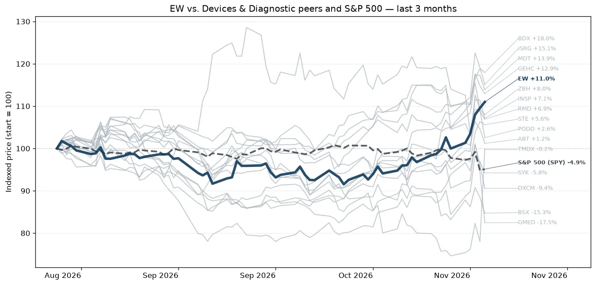

#### Reported Results

Q3 2026: EPS $0.80 vs. $0.74 est. (+8.62%); revenue $1.72B vs. $1.68B est. (+2.31%)

#### Earnings Call Summary

Edwards Lifesciences delivered strong Q3 2026 sales of $1.72 billion, up 11.2% year-over-year, driven by its structural heart portfolio. This included robust global performance across both its Transcatheter Aortic Valve Replacement (TAVR) and Transcatheter Mitral and Tricuspid Therapies (TMTT) segments, exceeding overall company expectations.

#### At a Glance

- **Edwards Lifesciences Tops Revenue Estimates:** The company reported an Adjusted EPS of $0.53 and a total revenue of $1,715,500,000, outperforming the estimated quarterly revenue of $1,676,789,060 but missing the estimated Adjusted EPS of $0.737 due to an asset impairment.
- **TAVR and TMTT Drive Growth:** Global Transcatheter Aortic Valve Replacement (TAVR) sales grew 8.8% on a constant currency basis to $1.2 billion, while Transcatheter Mitral and Tricuspid Therapies (TMTT) sales surged 45.6% to $207 million.
- **Full-Year 2026 Guidance Upgraded:** Following strong third-quarter momentum, management raised its full-year 2026 constant-currency sales growth outlook to approximately 11.5% and adjusted EPS guidance to a range of $2.97 to $3.05.
- **Impairments Impact GAAP Financial Results:** GAAP diluted EPS fell to $0.53 primarily due to a $220.2 million impairment charge related to intangible and long-lived research and development assets.
- **Clinical Milestone Achievements Boost Outlook:** Edwards Lifesciences achieved five therapy approvals and presented two practice-changing clinical data sets, including the PROGRESS trial for moderate aortic stenosis, during the quarter.

#### Key Moments from the Call

- **2m 58s — Full-Year Guidance Increased on Strong Execution:** Edwards Lifesciences surprised investors positively by exceeding financial expectations and raising its full-year 2026 total company sales guidance to ~11.5% and adjusted EPS growth to 18% at the midpoint.
- **9m 54s — Strong Data Sets Expand Addressable Market:** The presentation of the PROGRESS and ACTIVATE clinical trials suggests that the moderate aortic stenosis patient opportunity is double the size of the severe population, offering massive long-term market expansion potential.
- **15m 37s — Massive TMTT Growth Reorients Portfolio:** TMTT posted an outstanding 45.6% revenue jump, prompting management to boost full-year segment guidance to $780M–$790M. This accelerates confidence in the timeline to hit $2 billion in segment sales by 2030.
- **34m 4s — TAVR Segment Shifts Driver to Volume:** Management signaled that TAVR's future growth will rely on market expansion and procedure volume rather than share gains, as previous competitive benefits in Europe have fully annualized, indicating stabilized global market share.

<h3 id="earnings-bdx">Becton Dickinson (BDX) +19.8% Last 3m</h3>

Following the separation of the life science segment, Becton Dickinson operates in four business units. Medical essentials (35% of total sales) includes the legacy medical surgical unit, which sells catheters, syringes, and infection prevention products. Connected care (24%) core products include the Alaris infusion pump, Pyxis dispensing system, and pharmacy automation platforms. Biopharma systems (13%) produces prefillable syringes and autoinjectors. Interventional (29%) is composed of the surgery, peripheral vascular, and urology segments. More than 60% of revenue comes from the United States.

**Reported:** November 5, 2026 · [Google Finance earnings page](https://www.google.com/finance/quote/BDX:NYSE?tab=earnings&hl=en)

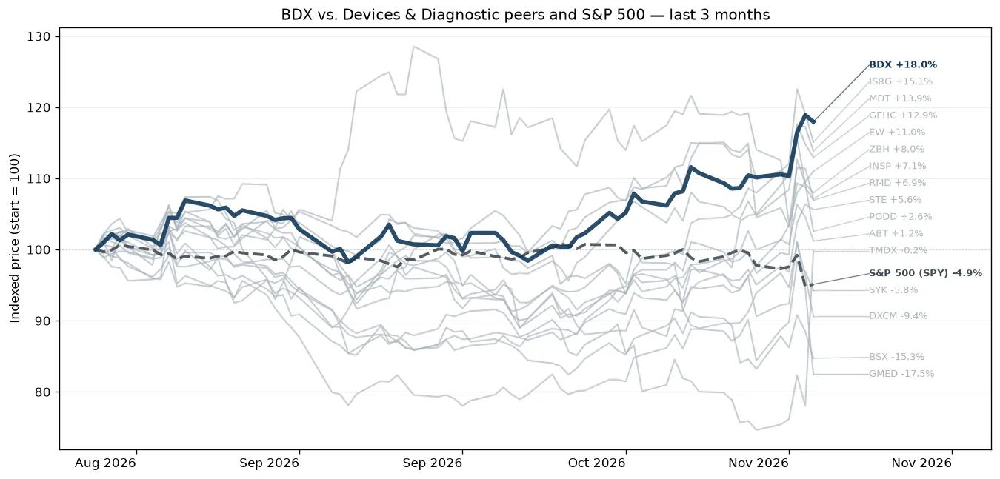

#### Reported Results

Q4 2026: EPS $4.15 vs. $4.07 est. (+2.02%); revenue $5.27B vs. $5.11B est. (+3.14%)

#### Earnings Call Summary

Becton, Dickinson and Company reported strong Q4 fiscal 2026 results with revenue of $5.3 billion, up 5.6% year-over-year. Adjusted EPS rose 27.3% to $4.15, coming in ahead of internal expectations. Full-year revenue reached $19.5 billion, representing a 3.9% increase, while full-year adjusted EPS grew 6.7% to $12.70.

#### At a Glance

- **BD Exceeds Revenue and EPS Expectations:** Becton, Dickinson and Company delivered a top-line beat for fiscal Q4 2026, reporting revenue of $5.274 billion against estimates of approximately $5.113 billion and adjusted EPS of $4.15, handily outperforming the estimated $4.068.
- **Operational Efficiencies Expand Gross Margin:** The company&#x27;s performance on core industry KPIs showed major acceleration with adjusted gross margins expanding 180 basis points year-over-year to 56.8% in Q4, supported by its BD Excellence productivity program.
- **Fiscal 2027 Outlook Details Growth Targets:** Management issued fiscal 2027 guidance projecting low single-digit revenue growth and an adjusted diluted EPS range of $13.10 to $13.30, factoring in a 200 to 250 basis point headwind from prior-year capital comparisons.
- **Key Innovation Platforms Generate Double-Digit Increases:** Growth was driven by broad-based performance in its recurring medtech platforms, with advanced patient monitoring, PureWick, advanced tissue regeneration, biologic drug delivery, and pharmacy automation achieving double-digit revenue gains.
- **US Partnership Strengthens Domestic Manufacturing:** BD secured a milestone partnership with the US government involving a multi-year manufacturing investment plan that provides potential relief from Section 232 tariffs on covered medical supplies.

#### Key Moments from the Call

- **32m 40s — Alaris and APM Dynamic Weighs on Q1:** Management projected Q1 fiscal 2027 revenue growth to sit at the low end of their range, primarily due to an acute 250 basis points headwind from the Alaris comparison. They also took a conservative approach to APM revenue to account for a systems cutover integration, though ultimate demand remains robust.
- **44m 9s — U.S. Tariff Agreement Offers Future Upside:** BD's current fiscal 2027 guidance assumes tariff impacts line up evenly with fiscal 2026, leaving out any potential benefits from the government partnership. If Section 232 tariffs are finalized and enacted, the company's agreed exemptions will represent pure financial upside to the communicated baseline strategy.
- **49m 55s — Biologics Momentum Anchored by High Win Rates:** The company reported high win rates for upcoming novel molecules and biosimilars within its biologics franchise, heavily driven by past capacity expansions. Furthermore, vaccine headwind declines decelerated to 11% in Q4 and are projected to entirely dissipate in fiscal 2027, clearing the way for sustained, unencumbered growth.
- **53m 53s — AI Technology Deployed to Drive Efficiencies:** BD details a multipronged AI expansion, seeing a 100% attachment rate for its new Incada AI platform on Pyxis placements. Internally, the company is deploying the Cognite platform across manufacturing facilities to optimize supply chain execution and is revamping commercial talent acquisition with behavioral analytics software.

<h3 id="earnings-ste">STERIS (STE) +6.2% Last 3m</h3>

Steris is an Ireland-domiciled medical technology company focused on sterilization services and infection prevention. The company is the global leader in contract sterilization services, ensuring the safe delivery of single-use and implantable medical equipment to hospitals around the world. Steris also sells sterilizers, washer-disinfectors, and other decontamination equipment and supplies for use by care provider facilities and in biopharma manufacturing sites. Domiciled in the United States before its inversion to Ireland, the firm derives approximately 70% of its revenue from Healthcare Services, 20% from Applied Sterilization Technologies, or AST, and 10% from life sciences services after the divestment of its dental products business.

**Reported:** November 5, 2026 · [Google Finance earnings page](https://www.google.com/finance/quote/STE:NYSE?tab=earnings&hl=en)

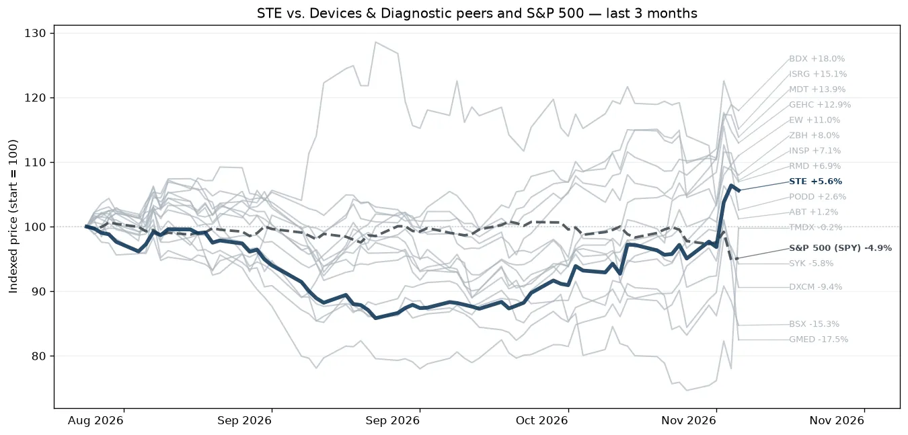

#### Reported Results

Q2 2027: EPS $2.94 vs. $2.68 est. (+9.83%); revenue $1.59B vs. $1.56B est. (+1.76%)

#### Earnings Call Summary

STERIS reported total Q2 2027 as-reported revenue growth of 9% to $1.6 billion, with constant currency organic revenue up 8%. Adjusted gross margin expanded 100 basis points to 45.3%, heavily aided by a $20 million tariff refund. Adjusted EPS rose 19% to $2.94.

#### At a Glance

- **STERIS Beats Top and Bottom Lines:** STERIS reported fiscal Q2 2027 revenue of $1.59 billion, beating the estimated $1.56 billion, and delivered an adjusted diluted EPS of $2.94 which exceeded the projected $2.68.
- **Strong Organic Growth and Margins:** The company achieved 8% constant-currency organic revenue growth driven by volume and pricing, alongside a record 44.4% operating margin in its Life Sciences segment.
- **Full Year Guidance Raised Significantly:** STERIS raised its fiscal 2027 adjusted EPS guidance to a range of $11.35 to $11.55 from the previous range of $11.10 to $11.30, reflecting Q2 outperformance and lower interest costs.
- **Tariff Refunds Boost Profitability:** Adjusted gross margin and EBIT margins were expanded by 130 basis points due to a pre-tax benefit of approximately $20 million in tariff refunds received during the quarter.
- **Strategic Acquisition and Restructuring Announced:** STERIS entered into a definitive agreement to acquire Xodus Medical and initiated a restructuring plan projected to deliver $9 million in annualized savings.

#### Key Moments from the Call

- **11m 2s — Guidance Revisions for Core Segments:** Investors will appreciate the raised full-year EPS guidance and the robust growth outlook boost for Life Sciences to 9%-10%. However, the slight reduction in Applied Sterilization Technologies (AST) growth guidance to 6%-7% reflects persistent near-term volume caution.
- **13m 32s — Xodus Medical Acquisition Announced:** The agreement to acquire Xodus Medical creates a direct clinical sales footprint inside the operating room. This expands STERIS's high-margin, single-use consumable offering, boosting recurring revenue with expected top- and bottom-line accretion upon closing.
- **25m 45s — End of Customer Destocking in AST:** Management confirmed that customer inventory destocking has concluded, washing out in Q2. Performance inflected positively in September and October, signaling a return to normalized, more predictable volume growth over the second half of fiscal 2027.
- **28m 19s — Strategic Operational Restructuring Shifts:** The introduction of a new restructuring plan targets network optimization, notably eliminating a single-use urology scope and consolidating sterility assurance production. This highlights proactive, aggressive portfolio pruning to address underlying network cost inflation.

<h3 id="earnings-uthr">United Therapeutics (UTHR) +4.3% Last 3m</h3>

United Therapeutics Corp specializes in drug development for pulmonary arterial hypertension (PAH), a rare and progressive disease marked by abnormally high blood pressure in the arteries of the lungs. The company&#x27;s therapies for PAH largely focus on the prostacyclin pathway, and many of its treatments are based on the same molecule, treprostinil. The company markets and sells the following commercial therapies in the United States to treat PAH: Tyvaso DPI (treprostinil) Inhalation Powder, Remodulin Injection, Orenitram (treprostinil) Extended-Release Tablets, Adcirca (tadalafil) Tablets, and Unituxin. It derives maximum revenue from the sale of Tyvaso DPI. Geographically, the company operates in United States and Rest of the World, of which United States generates majority of the revenue.

**Reported:** November 4, 2026 · [Google Finance earnings page](https://www.google.com/finance/quote/UTHR:NASDAQ?tab=earnings&hl=en)

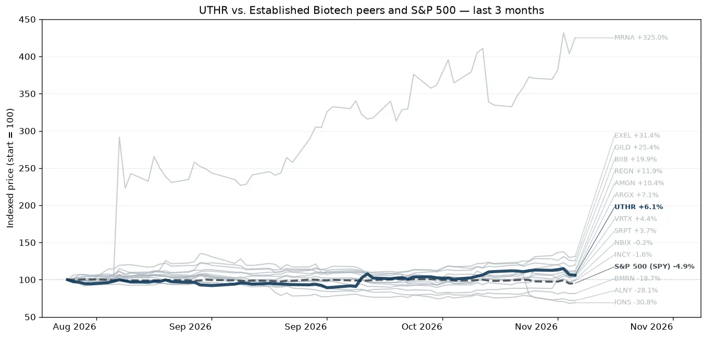

#### Reported Results

Q3 2026: EPS $5.71 vs. $6.34 est. (-9.97%); revenue $832.50M vs. $781.14M est. (+6.57%)

#### Earnings Call Summary

United Therapeutics delivered record performance for Q3 2026, achieving record total revenue of $833 million and record Tyvaso revenue of $504 million. Growth was driven by robust underlying demand, improved patient metrics, higher dosing adoption with the 80 microgram cartridge, and consistent month-to-month sales execution.

#### At a Glance

- **Mixed Results Reveal Revenue Beat:** United Therapeutics reported a top-line revenue beat of $832,500,000 against the estimated $781,140,770, but missed its bottom-line target with a reported adjusted EPS of $5.71 compared to the estimated 6.342.
- **Tyvaso Drives Commercial Outperformance:** The company achieved record Tyvaso franchise revenue of $504 million, fueled by strong patient demand and a 13% growth in Tyvaso DPI sales.
- **Inhaler Timeline Pushed to 2027:** Management updated its forward timeline by delaying the regulatory NDA submission for its soft mist inhaler to 2027 in order to gather additional FDA-requested data.
- **Acquisition Expenses Impact Profits:** Net profit and margins were significantly pressured by a $130 million one-time, nondeductible research and development charge resulting from the acquisition of Thymmune Therapeutics.
- **Liquidia Legal Settlement Clears Runway:** A favorable legal settlement with competitor Liquidia protects the high-margin PH-ILD market for Tyvaso, providing long-term market clarity and a largely uncontested expansion pathway.
- **Board Approves Massive Capital Return:** Reflecting strong cash generation, the Board of Directors approved a new $2.0 billion share repurchase authorization through October 21, 2027.

#### Key Moments from the Call

- **7m 12s — Tyvaso Reaches Record $504 Million Revenue:** Tyvaso delivered a record-breaking $504 million in revenue, driving total corporate revenue to a historic $833 million. This performance beats the estimated revenue of $781.14 million, validating management's recent commercial investments and expanded field force strategy.
- **8m 52s — Favorable YUTREPIA Settlement Clear Runway:** A legal settlement legally bars Liquidia's YUTREPIA from marketing to or promoting within the PH-ILD indication. This eliminates near-term branded competition and secures Tyvaso a long, uncontested trajectory to capture the under-penetrated market.
- **16m 33s — Soft Mist Inhaler FDA Filing Delayed to 2027:** Discussions with the FDA revealed that additional data generation is required for the soft mist inhaler application. Consequently, the planned year-end 2026 NDA submission has been delayed to 2027, temporarily clouding near-term product launch timelines.
- **19m 24s — Ralinepag API Supplier Hits Compliance Headwind:** The API manufacturer for ralinepag was issued an FDA Official Action Indicated (OAI) status. While United Therapeutics is pursuing fallback options, this compliance issue risks disrupting the drug's upcoming June 24, 2027 PDUFA date if remediation stalls.

<h3 id="earnings-vtrs">Viatris (VTRS) +21.2% Last 3m</h3>

Viatris was formed in November 2020 through the combination of Upjohn, a wholly owned subsidiary of Pfizer that specialized in off-patent drugs, and Mylan, a global pharmaceutical manufacturer that focused on generic and specialty drugs. By joining forces, Viatris became one of the largest generic drug manufacturers in the world, servicing over 165 countries. Generics (commoditized and complex) and biosimilars make up one-third of Viatris&#x27; total sales. The remaining sales are derived from its portfolio of legacy products, including Lipitor, Norvasc, Lyrica, and Viagra.

**Reported:** November 5, 2026 · [Google Finance earnings page](https://www.google.com/finance/quote/VTRS:NASDAQ?tab=earnings&hl=en)

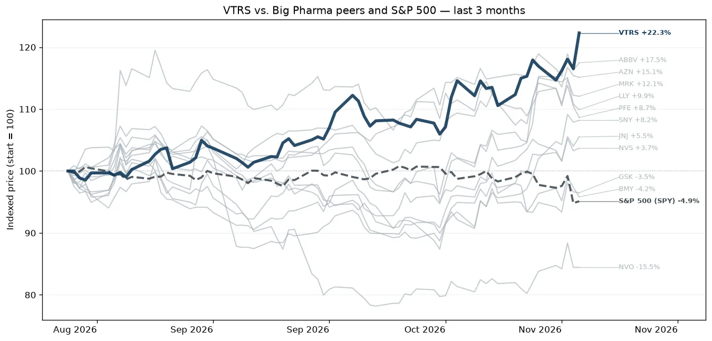

#### Reported Results

Q3 2026: EPS $0.71 vs. $0.64 est. (+11.28%); revenue $3.75B vs. $3.79B est. (-1.03%)

#### Earnings Call Summary

Viatris delivered solid Q3 2026 performance with total revenues of $3.75 billion, adjusted EBITDA of $1.2 billion, and adjusted EPS of $0.71 per share. For the first nine months, total revenues grew 2%, adjusted EBITDA increased 6%, and adjusted EPS grew 8% operationally year-over-year, prompting management to raise full-year guidance midpoints.

#### At a Glance

- **Viatris Reports Mixed Q3 Results:** Viatris reported a U.S. GAAP diluted loss per share of -$0.28, missing the estimated adjusted EPS of $0.638, while Q3 reported revenue reached $3.75 billion, slightly missing expectations of $3.79 billion.
- **Segment Performance Reveals Changing Drivers:** The generics segment experienced its first quarterly decline with revenues down 3% year-over-year to $1.3 billion, whereas branded medicines grew modestly, buoyed by a 10% increase in Greater China sales.
- **Full-Year Guidance Lifted Across Midpoints:** The company raised the midpoints of its full-year 2026 guidance, targeting total revenues between $14.70 billion and $14.90 billion and an updated adjusted EPS range of $2.56 to $2.63.
- **Production Halted at Indian Facility:** Viatris voluntarily suspended manufacturing activities at its oral solid dose facility in Nashik, India, for remediation following an FDA classification, which is expected to reduce Q4 revenues by approximately $100 million.
- **Strategic Acquisition Accelerates Innovative Strategy:** Management highlighted the planned acquisition of Pacira BioSciences, expected to close by the end of November 2026, which is projected to expand its U.S. innovative medicines business past $1 billion in revenue.
- **Strong Cash Flows Boost Returns:** Viatris generated $814 million in free cash flow during the quarter, allowing the company to return a total of $717 million to shareholders year-to-date through dividends and share buybacks.

#### Key Moments from the Call

- **13m 28s — Manufacturing Facility Supply Headwinds:** Supply constraints stemming from ongoing remediation and a voluntary production suspension at the Nashik facility created a $100 million revenue headwind in Q3. This pressure is expected to continue into Q4, flattening European growth and resulting in low single-digit declines in emerging markets.
- **15m 28s — Full-Year 2026 Guidance Raise:** Viatris raised its full-year 2026 financial guidance across all key metrics due to strong year-to-date execution, forecasting operational growth of approximately 2% for total revenues, 6% for adjusted EBITDA, and 8% for adjusted EPS at the midpoint, ahead of its prior guidance ranges.
- **17m 45s — Strategic Pacira BioSciences Acquisition:** The announced tender offer for Pacira BioSciences is expected to close in November 2026, creating immediate accretion to all 2027 financial guidance metrics. It bridges commercial and R&D synergies to maximize the launches of non-opioid pain portfolios like fast-acting meloxicam.
- **32m 19s — Estradiol Patch Demand Surge:** The transdermal women's health franchise is seeing massive, multi-year tailwinds following the removal of the FDA black box warning and increased GLP-1 usage. Viatris shifted manufacturing to 24/7 operations, expecting to reach 1.5 million women in 2026 and an additional million in 2027.

<h3 id="earnings-zbh">Zimmer Biomet (ZBH) +9.4% Last 3m</h3>

Zimmer Biomet designs, manufactures, and markets orthopedic reconstructive implants as well as supplies and surgical equipment for orthopedic surgery. With the acquisitions of Centerpulse in 2003 and Biomet in 2015, Zimmer holds the leading share of the reconstructive market in the United States, Europe, and Japan. Roughly two-thirds of total revenue is derived from sales of large joints; another fourth comes from extremities, trauma, sports medicine, and related surgical products. The company has assembled a wide array of robotic platforms, and it spun out its dental and spine businesses in 2022.

**Reported:** November 4, 2026 · [Google Finance earnings page](https://www.google.com/finance/quote/ZBH:NYSE?tab=earnings&hl=en)

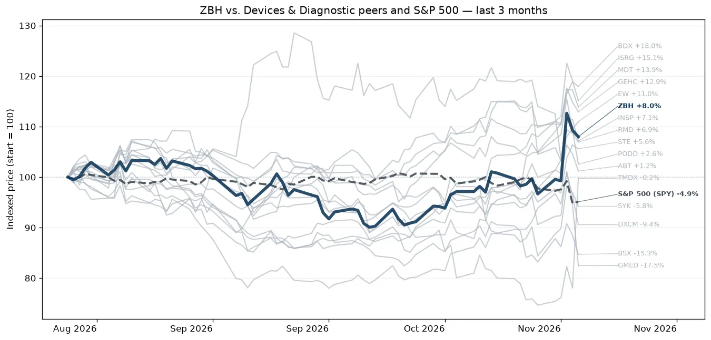

#### Reported Results

Q3 2026: EPS $1.90 vs. $1.88 est. (+0.99%); revenue $2.06B vs. $2.04B est. (+1.13%)

#### Earnings Call Summary

Zmer Biomet delivered Q3 2026 total net sales of $2.063 billion, showing 3.1% reported and 3.7% constant currency growth year-over-year. Performance was driven by upper single-digit growth in hips and S.E.T., and teen growth in technology, data, bone cement, and surgical, offsetting expected challenges in China and the U.S. knee business.

#### At a Glance

- **Zimmer Biomet Outperforms Financial Expectations:** Zimmer Biomet reported third-quarter 2026 adjusted EPS of $1.90, beating the consensus estimate of $1.88, while net revenue reached $2.063 billion, outpacing expectations of $2.040 billion.
- **Strong Segments Offset Knee Weakness:** The company&#x27;s Technology and Data, Bone Cement and Surgical segment jumped 13.0%, and Hips rose 7.0%, successfully offsetting a 2.6% decline in its core Knee business.
- **Full-Year 2026 Guidance Upgraded:** Management raised its full-year 2026 adjusted EPS guidance to a range of $8.50 to $8.60 and lifted its organic constant-currency sales growth outlook to 3.0%-3.5%.
- **Strategic Push into Surgical Robotics:** Zimmer Biomet is increasing its focus on digital tools and robotics, highlighted by recent commercial agreements with THINK Surgical and Paragon 28, along with the planned launch of the Monogram surgical robot.
- **China Distributor Consolidation Headwinds Remain:** Constant-currency revenue growth rose 3.7%, though performance continued to face pressure from distributor network consolidation efforts in China.

#### Key Moments from the Call

- **7m 14s — U.S. Knee Headwinds and Sales Reorganization:** Constant currency knee sales declined 2.6% due to intense market competition and a planned U.S. sales force transition. However, the transition is nearing its halfway mark with healthy single-digit sales rep turnover, and the negative China headwinds are set to anniversary in January 2027.
- **8m 22s — Monogram FDA Submission Pulled Forward:** Management announced that the FDA 510(k) filing for the Monogram robotic platform is significantly ahead of schedule. The company now targets a surgeon-guided, fully autonomous launch in the first half of 2027 rather than 2028, unlocking a major competitive catalyst much earlier than anticipated.
- **9m 32s — Portfolio Diversification Validated:** Two-thirds of the business grew at upper single-digit or double-digit rates, proving the company's successful pivot away from being solely a knee company. Foot and ankle acquisition Paragon 28 grew over 18%, presenting a solid blueprint for high-growth, margin-accretive future M&A strategies.
- **10m 44s — Raised Full-Year 2026 Guidance:** Zimmer Biomet increased its full-year 2026 guidance, boosting organic constant currency growth to 3.0%-3.5% and adjusted EPS to $8.50-$8.60. This reflects consecutive strong quarters, providing confidence that the company will hit higher financial targets despite known near-term headwind pressures.

<h3 id="earnings-nbix">Neurocrine Biosciences (NBIX) +0.7% Last 3m</h3>

Neurocrine Biosciences Inc is a biopharmaceutical firm focused on the research, development, and commercialization of treatments for neurological, psychiatric, endocrine, and immunological disorders. Its portfolio includes therapies for conditions such as tardive dyskinesia, chorea associated with Huntington&#x27;s disease, classic congenital adrenal hyperplasia due to 21-hydroxylase deficiency, and treatments for endometriosis and uterine fibroids. The company also maintains a pipeline of drug candidates in various stages of clinical and preclinical development across its therapeutic areas, including small molecules, peptides, proteins, antibodies, conjugates, and gene therapies. It derives revenue from the sale of its pharmaceutical products.

**Reported:** November 2, 2026 · [Google Finance earnings page](https://www.google.com/finance/quote/NBIX:NASDAQ?tab=earnings&hl=en)

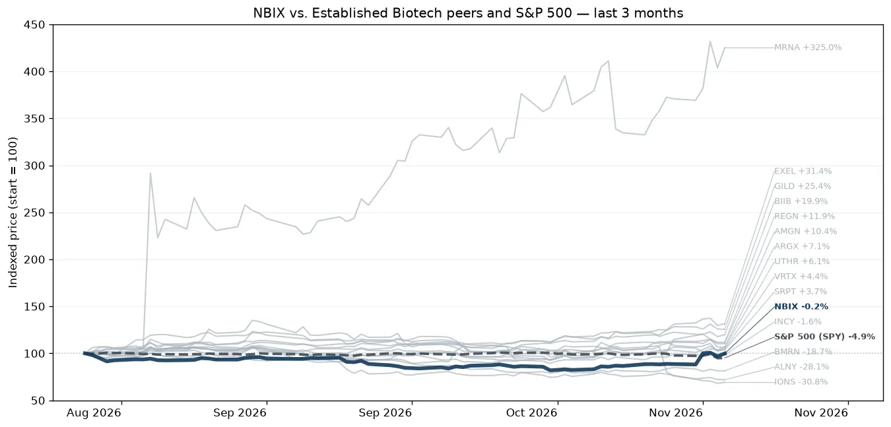

#### Reported Results

Q3 2026: EPS $3.29 vs. $2.75 est. (+19.83%); revenue $1.12B vs. $1.04B est. (+7.57%)

#### Earnings Call Summary

expand_less

#### At a Glance

- **Revenue Beats While EPS Misses Estimates:** Neurocrine Biosciences reported a top-line revenue of $1,122,700,000 for Q3 2026, beating the analyst consensus estimate of $1,043,717,210; however, reported adjusted EPS of $1.96 missed the expected $2.746 estimate.
- **Flagship Commercial Products Fuel Key KPIs:** The company&#x27;s core asset, INGREZZA, recorded net product sales of $801 million representing 17% year-over-year growth, while CRENESSITY crossed a milestone of $211 million in quarterly sales.
- **Management Elevates Full Year Sales Guidance:** Following strong quarterly performance, management raised its full-year 2026 INGREZZA net product sales guidance to a range of $2.9 billion to $2.925 billion, up from its previous projection of $2.825 billion to $2.875 billion.
- **Soleno Acquisition Expands Rare Disease Portfolio:** Newly acquired VYKAT XR generated $107 million in net product sales during its first full quarter under Neurocrine ownership, assisting the company in its strategic shift toward multi-product diversification.
- **Positive Market Reaction to Earnings Report:** Shares of Neurocrine jumped over 6% in after-hours trading following the announcement due to strong commercial product demand and the upwardly revised product sales guidance.

#### Key Moments from the Call

- **13m 40s — Ingreza Guidance Raised:** Strong underlying demand and record prescription volume led Neurocrine to increase full-year Ingreza sales guidance to $2.9 billion–$2.925 billion, pleasing investors with continued high-teens prescription growth despite an expected Q4 reversal of a $20 million order timing benefit.
- **15m 25s — Quinacidy Reaches Milestone:** Quinacidy surpassed $200 million in quarterly revenue for the first time, securing over 15% of the classic CAH market. This rapid uptake validates Neurocrine's commercial strategy to establish the drug as a foundational standard of care.
- **21m 42s — Pipeline Expansion in Obesity and Alzheimer's:** Neurocrine expanded its clinical footprint by initiating a Phase II study for NBI 567 in Alzheimer's disease and a Phase I study for NVIP 1968 in obesity. These advancements position the company for a catalyst-heavy 2027.
- **24m 57s — Vicod XR Safety Profile and Growth Outlook:** Responding to analyst questions regarding media coverage of post-marketing safety reports, management acknowledged that external events might delay near-term Vicod XR growth. However, they reassured investors of their strong long-term conviction and planned a 2027 study in complex health cases.

<h3 id="earnings-bmrn">BioMarin Pharmaceutical (BMRN) -12.2% Last 3m</h3>

BioMarin is a global biotechnology company focused on developing and commercializing therapies for rare genetic diseases. BioMarin specializes in enzyme replacement therapies, gene therapies, and other advanced treatments designed to address complex genetic disorders. The company has eight approved therapies for conditions including achondroplasia, phenylketonuria, hemophilia, and mucopolysaccharidosis. BioMarin has an expanding, yet relatively early-stage, pipeline of treatments in development across skeletal conditions and enzyme therapies.

**Reported:** November 2, 2026 · [Google Finance earnings page](https://www.google.com/finance/quote/BMRN:NASDAQ?tab=earnings&hl=en)

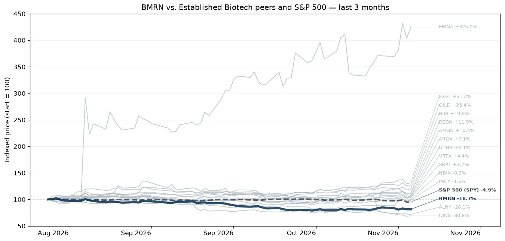

#### Reported Results

Q3 2026: EPS $0.23 vs. -$0.11 est. (+304.81%); revenue $1.02B vs. $1.02B est. (+0.22%)

#### Earnings Call Summary

BioMarin reported strong Q3 2026 results, delivering 32% year-over-year revenue growth and surpassing $1 billion in quarterly revenue for the first time. The metabolic conditions business expanded 44% year-over-year, driven by robust contributions from newly acquired assets Galafold ($152 million) and Pombiliti + Opfolda ($49 million), alongside accelerated cost synergies ahead of schedule.

#### At a Glance

- **BioMarin Reports Revenue Beat:** BioMarin reported Q3 2026 revenue of $1.025 billion, beating the estimated $1.022 billion, while reported adjusted EPS came in at -$0.63 compared to the estimated -$0.112.
- **Metabolic Portfolio Drives Strong Growth:** Total revenues increased 32% year-over-year, driven by a 44% increase in the Metabolic Conditions segment to $744 million, which marked the first full quarter of contributions from Galafold and Pombiliti + Opfolda.
- **Full-Year 2026 Guidance Lowered:** Management lowered its full-year 2026 revenue guidance to a range of $3.8 billion to $3.9 billion, citing a $70 million international order deferral and geopolitical disruptions.
- **Voxzogo Revenue Up but Delayed:** Voxzogo revenue grew 12% year-over-year to $245 million with a 17% global increase in treated children, though short-term performance was impacted by delayed international orders shifted to the fourth quarter.
- **Shares Decline Following Guidance Cuts:** Despite achieving its first billion-dollar revenue quarter, BioMarin shares dropped over 5% in after-hours trading as investors reacted to the lowered full-year outlook and transaction charges.

#### Key Moments from the Call

- **24m 21s — Full-Year 2026 Financial Guidance Revised Downward:** Management lowered its total revenue and EPS guidance ranges due to a single international customer deferring $70 million in orders into late Q4/Q1 2027 and increased liquidity disruptions from the Middle East conflict, disappointing investors despite strong underlying commercial demand.
- **28m 44s — Accelerated Amicus Cost Synergies Boost Accretion Timeline:** Management pleased investors by pulling forward the integration accretion timeline, tracking toward net-positive calendar year accretion for 2026 and within nine months post-close, driven by synergies running ahead of the original one-year schedule.
- **30m 58s — Competitive Supply Shortages Fuel Pompe Switch Upside:** Pombiliti + Opfolda patient numbers grew 69% year-over-year, gaining an unexpected near-term commercial boost in Europe as the company released additional supply to pick up substantial new patient starts leaving constrained competitor therapies.
- **39m 43s — BMN 333 Next-Gen CNP Superiority Strategy Questioned:** Analysts heavily pressed management on the clinical strategy and powering for the upcoming phase II BMN 333 readout next year, questioning how the asset will demonstrate definitive growth velocity superiority over core blockbuster Voxzogo.

<h3 id="earnings-podd">Insulet (PODD) +3.8% Last 3m</h3>

Insulet was founded in 2000 with the goal of making continuous subcutaneous insulin infusion therapy for diabetes easier to use. The result was the Omnipod system, which consists of a small disposable insulin infusion device that can be operated through a smartphone to control dosage. Since the Omnipod was approved by the US Food and Drug Administration in 2005, more than 600,000 insulin-dependent diabetic patients are using it worldwide.

**Reported:** November 4, 2026 · [Google Finance earnings page](https://www.google.com/finance/quote/PODD:NASDAQ?tab=earnings&hl=en)

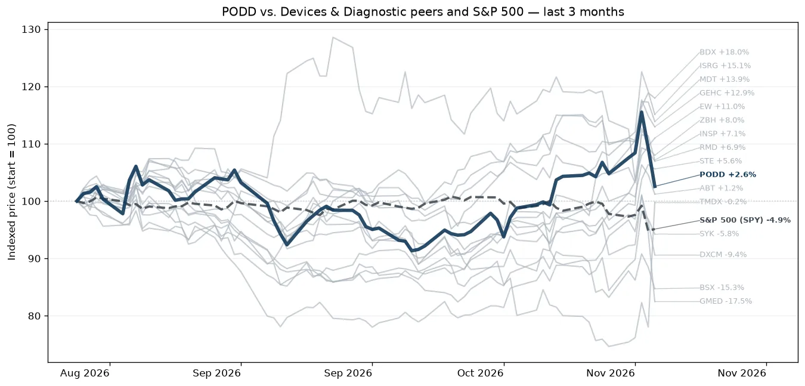

#### Reported Results

Q3 2026: EPS $1.99 vs. $1.59 est. (+25.35%); revenue $842.00M vs. $832.64M est. (+1.12%)

#### Earnings Call Summary

Insulet achieved Q3 2026 revenue of $842 million, up nearly 20% year-over-year, with 15% growth in the U.S. and 33% internationally, matching or exceeding guidance. The global customer base grew over 20%, establishing a strong recurring revenue foundation, while global new customer starts increased low single digits in the quarter.

#### At a Glance

- **Insulet Beats EPS and Revenue Estimates:** Insulet reported a reported adjusted EPS of $2.03, outperforming the estimated $1.588, and achieved reported revenue of $842.0 million compared to the expected $832.6 million.
- **Strong Growth Across Core Metrics:** The global customer base grew over 20% year-over-year to surpass 600,000 customers, and the adjusted gross margin expanded 200 basis points to a record 74.2% due to manufacturing efficiencies.
- **Narrowed Full Year 2026 Guidance:** The company narrowed its full-year 2026 constant-currency revenue growth guidance to 21%-22% and lifted its adjusted operating margin expansion outlook to approximately 150 basis points.
- **Massive Share Repurchase Program Authorized:** Insulet&#x27;s board approved a $1 billion increase to its share repurchase authorization, with plans to deploy approximately $400 million during the fourth quarter of 2026.
- **Cautious Outlook Cooled Investor Reaction:** Despite the strong earnings beat, early premarket stock movement was a modest 3.06% gain as investors reacted to a more conservative growth framework signaled for 2027.

#### Key Moments from the Call

- **25m 5s — Full-Year 2026 Guidance Top-End Refinement:** Insulet narrowed its full-year 2026 total company revenue growth guidance to 21%-22% constant currency, capturing strong year-to-date execution. Adjusted operating margin expansion expectations were set at approximately 150 basis points for the full year, supporting an anticipated adjusted EPS growth of more than 30%.
- **29m 38s — 2027 Conservative Financial Framework Outlook Shift:** Management adopted a more conservative approach for 2027, forecasting total company growth modestly below the previous mid-teens framework. This deceleration reflects a more measured outlook for U.S. market growth amid new competition, combined with a tougher prior-year comparison and fading price-mix tailwinds internationally.
- **49m 24s — U.S. Operational Changes and Sample Governance:** To address recent type 2 diabetes customer attrition, the company tightened governance surrounding its sampling program by requiring active prescriptions before distribution. Sales force compensation structures were revised to directly incentivize customer retention along alongside new customer starts to stabilize early-stage platform adherence.
- **57m 47s — Simultaneous Global Omnipod 6 Launch Strategy:** Insulet confirmed the submission of its second and final 510(k) for Omnipod 6, planning a simultaneous commercial rollout in both U.S. and international markets during 2027. The launch features dual-market synchronization, phone control capabilities outside the U.S., and advanced clinical algorithm upgrades showing a 40% reduction in required manual boluses.

<h3 id="earnings-gmed">Globus Medical (GMED) -13.7% Last 3m</h3>

Globus Medical Inc is a medical device company that develops and provides healthcare products and solutions to hospitals, physicians, and surgical centers. The firm&#x27;s products are organized into two categories: musculoskeletal solutions, which include medical devices and instruments used mostly for spinal and orthopedic procedures, and enabling technologies, which include computer systems developed for enhancing surgical capabilities. The vast majority of the company&#x27;s revenue is generated from musculoskeletal solutions products, and more than half of the revenue is earned in the United States. It also has its presence internationally.

**Reported:** November 5, 2026 · [Google Finance earnings page](https://www.google.com/finance/quote/GMED:NYSE?tab=earnings&hl=en)

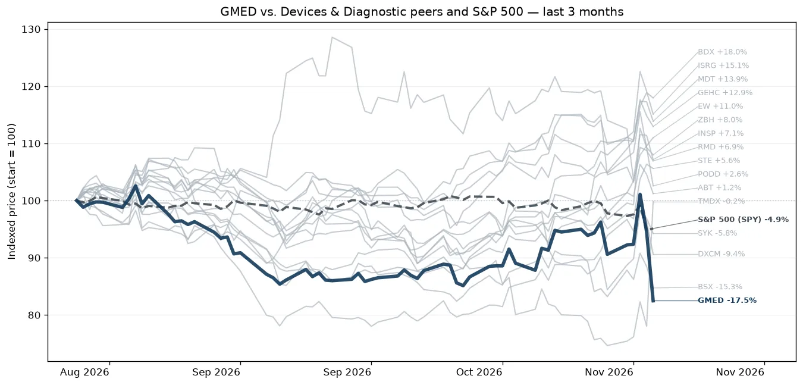

#### Reported Results

Q3 2026: EPS $1.23 vs. $1.20 est. (+2.77%); revenue $763.72M vs. $792.46M est. (-3.63%)

#### Earnings Call Summary

Globus Medical reported Q3 2026 revenue of $763.7M, a 0.7% decrease as reported and 0.5% decrease on a constant currency basis, missing estimated revenue of $792.5M. The decline reflects rightsizing at Nevro, delayed product launches in U.S. Spine, and lower competitive recruiting contributions, though non-GAAP EPS grew 4% to $1.23, beating the $1.197 estimate.

#### At a Glance

- **Globus Medical Misses Top-Line Estimates:** Globus Medical reported a Q3 2026 adjusted EPS of $1.04, missing the estimated $1.197, while reported revenue of $763.72 million also fell short of the estimated $792.46 million.
- **Enabling Technologies Achieves High Growth:** Enabling Technologies revenue surged 24.3% year-over-year to $34.86 million, beating the average analyst estimate of $27.46 million, driven by strong robotic unit deployments.
- **Management Downgrades Full-Year Revenue Guidance:** The company adjusted its full-year 2026 revenue guidance downward to $3.09 billion from its previous $3.18 billion to $3.22 billion range, while maintaining its non-GAAP EPS projection of $4.95 to $5.05.
- **Nevro Segment Substantially Drags Performance:** Revenue from the Nevro business fell 25.7% year-over-year to $73.7 million, presenting a persistent headwind as field sales rightsizing and recovery timeline delays continue.
- **Product Launches Delayed Until 2027:** Key highly-anticipated product pipelines, including the SCRIPT line and XLIF Prone Solution, faced launch delays that pushed material growth contributions out to 2027.
- **Robust Cash Flow Prompts Buyback Expansion:** Despite near-term growth hurdles, Globus Medical achieved a record free cash flow of $225 million and authorized an additional $500 million for share repurchases.

#### Key Moments from the Call

- **7m 10s — FDA Warning Letter Formally Closed:** The FDA formally closed the July 2024 EGPS robotic warning letter during Q3 following successful administrative corrective action steps. This resolves a key compliance overhang regarding complaint handling tracking, reassuring investors and customers that patient safety was never compromised.
- **21m 35s — Shift in Capital Acquisition Model Impacting Revenue:** While capital units deployed surged 45% year-over-year, management noted a deliberate structural transition toward flexible rental and leasing options. This shift limits immediate upfront top-line hardware revenue recognition in Q4 2026, though it builds a highly predictable recurring implant and service stream for 2027.
- **26m 35s — Expanded $500M Share Repurchase Authorization:** The Board of Directors authorized an additional $500M for the share repurchase program, following $142.9M repurchased in Q3. This expansion signals strong executive confidence in long-term earnings, robust cash generation prowess, and an active defensive posture while market valuations remain depressed.
- **28m 29s — Full-Year 2026 Revenue Guidance Cut:** Globus Medical lowered its full-year 2026 revenue guidance to $3.09B from the previous range of $3.18B to $3.22B. The revision stems from short-term top-line pressure within the Nevro business and delayed timeline benefits from newly launched spine products, disappointing investors looking for near-term momentum.

<h3 id="earnings-krys">Krystal Biotech (KRYS) -7.8% Last 3m</h3>

Krystal Biotech Inc is an integrated, commercial-stage biotechnology company focused on the discovery, development, manufacturing, and commercialization of genetic medicines to treat diseases with high unmet medical needs. The company uses its patented HSV-1-based gene therapy platform to create vectors that deliver therapeutic transgenes to target cells. It possesses exclusive rights to develop, manufacture, and commercialize VYJUVEK internationally. The company operates as one operating segment focused on pharmaceutical products and manufactures, markets, and sells VYJUVEK in the United States and markets and sells VYJUVEK in the European Union, and Japan.

**Reported:** November 2, 2026 · [Google Finance earnings page](https://www.google.com/finance/quote/KRYS:NASDAQ?tab=earnings&hl=en)

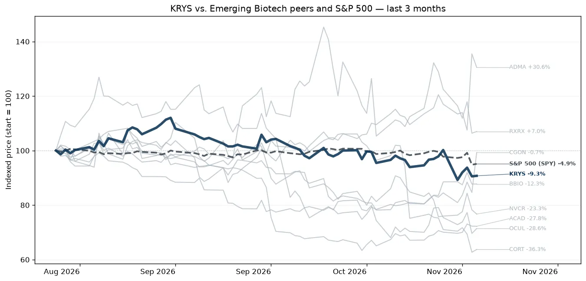

#### Reported Results

Q3 2026: EPS $2.05 vs. $1.92 est. (+6.88%); revenue $127.34M vs. $126.54M est. (+0.63%)

#### Earnings Call Summary

Krystal Biotech delivered strong Q3 2026 results with global VYJUVEK revenue reaching $127.3 million, a 30% increase year-over-year from $97.8 million. Diluted EPS was reported at $2.05, and the company concluded September with $1.2 billion in cash and investments. The board also authorized a share repurchase program of up to $400 million over two years.

#### At a Glance

- **Krystal Biotech Tops Earnings Estimates:** Krystal Biotech reported a reported revenue of $127,341,000, beating the estimated revenue of $126,540,390, while its reported EPS reached $2.05, outperforming the consensus estimate.
- **VYJUVEK Sales Drive Growth Higher:** VYJUVEK net product revenue surged 30% year-over-year to $127.3 million, supported by sustained U.S. adoption and initial international launches.
- **Spending Revised Down and Repurchases Authorized:** Management lowered its full-year non-GAAP R&amp;D and SG&amp;A expense guidance to $155M–$165M and authorized a new $400 million share repurchase program over the next two years.
- **Pipeline Delays Push Expectations Out:** Clinical readouts for key pipeline programs, including KB801 and KB803, have been pushed into 2027 due to stringent trial eligibility and enrollment challenges.
- **Stock Declines Despite Financial Beat:** Krystal Biotech stock fell over 3% to 5% following the announcement as investors shifted focus toward future growth velocity and pipeline timelines over the current quarter&#x27;s beat.
- **International Launches Impact Gross Margin:** Gross margin for the quarter edged down slightly to 94% from 96% in the prior year, reflecting international rollouts that haven&#x27;t yet benefited from U.S. manufacturing improvements.

#### Key Moments from the Call

- **3m 41s — Strategic Share Repurchase Program:** Management pleased investors by authorizing a $400 million share repurchase program over the next two years, signaling strong confidence in the company's long-term intrinsic value and capitalizing on a robust $1.2 billion cash reserve.
- **10m 59s — Impressive Gorlin Syndrome Efficacy:** KB113 pilot data will delight investors by showing a robust anti-tumor response in Gorlin syndrome. Substantial regression in non-injected lesions provides key proof of a systemic abscopal effect, enabling positive development pathway discussions with the FDA.
- **14m 45s — Clinical Readout Delays Across Pipeline:** Investors will face delayed clinical timelines as top-line results for the KB803 registrational study, KB801 in NK, and interim data for KB407 in cystic fibrosis have all been pushed out to 2027 due to slow enrollment, strict screening criteria, and protocol updates.
- **21m 54s — FY2026 Expense Guidance Revised Downward:** Krystal Biotech lowered its full-year non-GAAP R&D and SG&A guidance to $155 million-$165 million from the prior $175 million-$195 million range, demonstrating strong cost controls that support bottom-line profitability.

<h3 id="earnings-cgon">CG Oncology (CGON) +1.2% Last 3m</h3>

CG Oncology Inc is a late-stage clinical biopharmaceutical company focused on developing and commercializing its product candidate, cretostimogene grenadenorepvec, for patients with bladder cancer. The company&#x27;s candidate, cretostimogene grenadenorepvec, is a targeted oncolytic intravesically delivered immunotherapy agent that is in two phase three trials (one high-risk BCG unresponsive NMIBC trial and one intermediate-risk NMIBC trial) and a phase two clinical study with a checkpoint inhibitor for high-risk BCG unresponsive NMIBC disease.

**Reported:** November 6, 2026 · [Google Finance earnings page](https://www.google.com/finance/quote/CGON:NASDAQ?tab=earnings&hl=en)

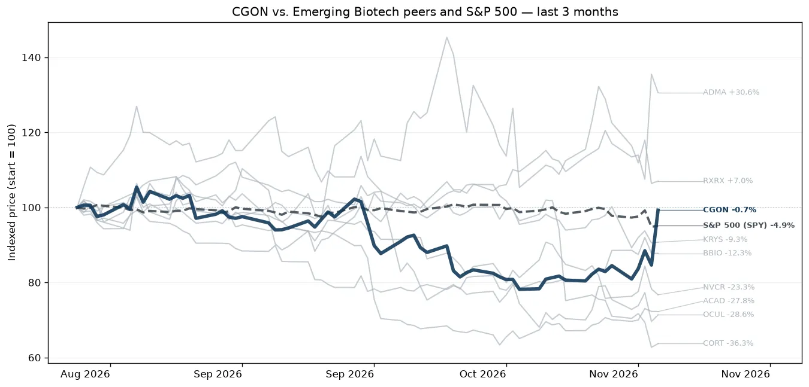

#### Reported Results

Q3 2026: EPS -$0.64 vs. -$0.81 est. (+20.95%); revenue $1.60M vs. $534.48K est. (+200.10%)

#### At a Glance

- **CG Oncology Outperforms Q3 Expectations:** CG Oncology reported a Q3 2026 Adjusted EPS of -$0.64, beating estimates by $0.17, while reported revenue of $1,604,000 significantly surpassed expectations of $534,480.
- **Clinical Spending Escalates Pipeline Progress:** Research and development expenses rose by $11.3 million year-over-year to $39.2 million, driven by higher external clinical trial and chemistry, manufacturing, and controls (CMC) costs for cretostimogene.
- **Crucial Regulatory Milestones Near Completion:** The company expects to complete its Biologics License Application (BLA) submission for cretostimogene in BCG-unresponsive non-muscle-invasive bladder cancer (NMIBC) in the fourth quarter of 2026.
- **Substantial Cash Runway Until 2029:** CG Oncology concluded the quarter with $984.5 million in cash, cash equivalents, and marketable securities, which is projected to fully fund company operations through 2029.
- **Strong Market Performance Following Release:** The earnings beat and imminent clinical catalysts triggered robust buying interest, causing shares to gain over 5% and reach an intraday high of $80.03.

<h3 id="earnings-ions">Ionis Pharmaceuticals (IONS) -30.3% Last 3m</h3>

Ionis Pharmaceuticals is the leading developer of antisense technology to discover and develop novel drugs. Its broad clinical and preclinical pipeline targets a wide variety of diseases, with an emphasis on cardiovascular, metabolic, neurological, and rare diseases. Ionis and Biogen brought Spinraza to market in 2016 as a treatment for spinal muscular atrophy, and Biogen launched ALS drug Qalsody in 2023. Ionis brought two additional drugs to market via its cardiovascular-focused subsidiary Akcea, including ATTR amyloidosis drug Tegsedi (2018) and cardiology drug Waylivra (Europe, 2019). Ionis and AstraZeneca launched polyneuropathy drug Wainua in 2024. Ionis marked its first two independent launches in 2025 for Tryngolza (for FCS) and Dawnzera (for HAE).

**Reported:** November 9, 2026 · [Google Finance earnings page](https://www.google.com/finance/quote/IONS:NASDAQ?tab=earnings&hl=en)

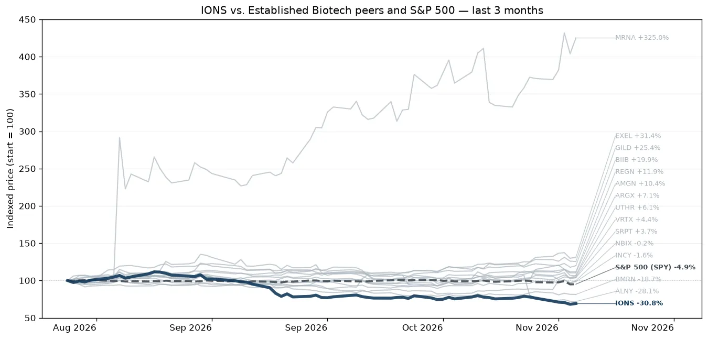

#### Reported Results

Q3 2026: EPS -$0.40 vs. -$0.93 est. (+56.81%); revenue $243.00M vs. $184.38M est. (+31.80%)

#### Earnings Call Summary

expand_less

#### At a Glance

- **Ionis Beats Revenue and EPS Estimates:** Ionis Pharmaceuticals reported a reported revenue of $243 million, outperforming the estimated $184.38 million, while its adjusted EPS came in at $0.00 compared to the projected loss of $0.934.
- **Commercial Revenue Driven by DAWNZERA:** Total commercial revenue grew 18% year-over-year to $136 million, led primarily by strong DAWNZERA product sales, while total net product sales hit $48 million compared to $33 million in the prior year period.
- **TRYNGOLZA Revenue Guidance Cut Severely:** Management slashed full-year 2026 revenue guidance for its flagship drug TRYNGOLZA by over 50% to approximately $50 million, though overall full-year company revenue expectations were maintained at $875 million to $900 million.
- **Pipeline Disappointments Pressure the Stock:** Despite solid financial results, investor sentiment has been impacted by recent clinical setbacks, including the late-stage failure of the partnered heart drug pelacarsen with Novartis.
- **Strong Cash Runway Maintained:** Ionis closed the quarter with $1.9 billion in cash and short-term investments, reaffirming its projection to end the year with over $1.6 billion and keeping the company on its path toward cash-flow breakeven by 2028.

#### Key Moments from the Call

- **11m 9s — Tringolza Guidance Reduction:** Management cut full-year 2026 revenue expectations for newly launched Tringolza to ~$50 million. While fundamentals and clinical efficacy are strong, the launch faces friction as physicians take time to adopt a new treatment paradigm and navigate medical exception processes before formal payer coverage is broadly implemented.
- **27m 28s — Partner Pipeline Delivery:** Despite two recent Phase 3 disappointments, the partner pipeline yielded the U.S. and Japan approval of Hepsago, a positive Phase 3 interim readout for Cefaxorcin in IgA nephropathy with potential 2027 U.S. approval, and positive Phase 3 top-line results for Olesnerfen in FUS-ALS.
- **28m 46s — Donzera Sales Momentum Increases:** Donzera continues to act as a primary commercial growth driver, achieving $37 million in Q3 product sales, marking a sequential increase of approximately 40%. Adoption is driven by market share capture in HAE prophylaxis from switching patients as well as treatment-naive individuals.
- **43m 34s — Positive Cash Flow Timeline Delayed:** Due to recent Phase 3 pipeline setbacks and the slower-than-anticipated commercial launch ramp for Tringolza, Ionis pushed its projected timeline to achieve sustained positive cash flow out by one year, moving the target from 2028 to 2029.

<h3 id="earnings-acad">Acadia Pharmaceuticals (ACAD) -27.3% Last 3m</h3>

Acadia Pharmaceuticals Inc is a biopharmaceutical company focused on turning scientific promise into making a difference for underserved neurological and rare disease communities around the world. It has two franchises in neurological and rare diseases. Its neurological disease franchise is anchored by the commercial product NUPLAZID (pimavanserin), which is the first and only drug approved by the U.S. FDA for the treatment of hallucinations and delusions associated with Parkinson&#x27;s disease psychosis (PDP). Its rare disease is anchored by the commercial product DAYBUE, which is the first and only drug approved for the treatment of Rett syndrome. Its clinical-stage development efforts are focused on Alzheimer&#x27;s disease psychosis, Lewy Body Dementia psychosis, and multiple other programs.

**Reported:** November 4, 2026 · [Google Finance earnings page](https://www.google.com/finance/quote/ACAD:NASDAQ?tab=earnings&hl=en)

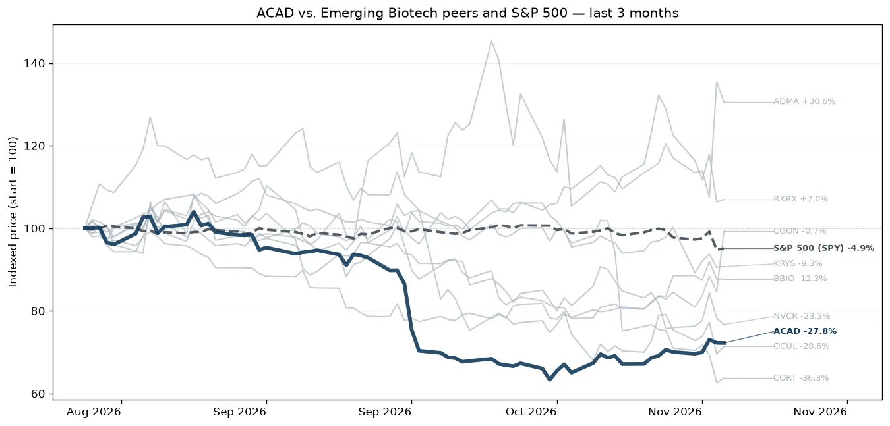

#### Reported Results

Q3 2026: EPS $0.31 vs. $0.18 est. (+69.86%); revenue $342.29M vs. $334.03M est. (+2.47%)

#### Earnings Call Summary

ACADIA Pharmaceuticals delivered Q3 2026 total revenues of $342.29 million, beating estimates of $334.03 million and growing 22% year-over-year on an adjusted basis. Reported EPS of $0.31 beat estimates of $0.183. Cash reserves stood at $976 million at the end of the quarter.

#### At a Glance

- **Acadia Exceeds EPS and Revenue Estimates:** ACADIA Pharmaceuticals reported a reported adjusted EPS of $0.31, beating the estimated adjusted EPS of $0.183, while reported revenue reached $342.29 million, surpassing the estimated $334.03 million.
- **Strong Commercial Growth Across Key Drugs:** The company&#x27;s core products showed robust commercial performance, with DAYBUE net sales climbing 39% year-over-year to a record $140 million and NUPLAZID net sales rising 12% to $202 million on an adjusted basis.
- **DAYBUE Guidance Lifted on Strong Outlook:** Management raised full-year 2026 global net sales guidance for DAYBUE to a range of $505 million to $520 million and narrowed its total revenue expectations to between $1.265 billion and $1.295 billion.
- **Mixed Clinical Trial Results for Remlifanserin:** The Phase II RADIANT study of remlifanserin for Alzheimer&#x27;s disease psychosis narrowly missed its primary endpoint, but because it showed an efficacy signal at the 60-milligram dose, the clinical program is advancing to Phase III.
- **International Expansion Moat and Patent Wins:** Acadia successfully expanded into Europe by launching DAYBU in Germany during early October and received a U.S. patent notice of allowance for weight-banded dosing, which extends formulation exclusivity through March 2041.

#### Key Moments from the Call

- **3m 42s — DAYBUE Exclusivity Extension to 2041:** A new USPTO patent allowance for weight-banded dosing extends DAYBUE's U.S. exclusivity runway to March 2041. This long-term defense shields a core growth driver, comforting investors concerned about near-term revenue cliffs.
- **4m 42s — Remlifanserin Phase II Efficacy Miss:** Remlifanserin narrowly missed statistical significance on its primary endpoint in the Phase II RADIANT study for Alzheimer's disease psychosis (p=0.0603). While management remains confident and is proceeding to Phase III with the 60 mg dose, the baseline miss injects regulatory risk into an anticipated $4 billion pipeline franchise.
- **10m 8s — DAYBUE STIX Re-engages Discontinued Patients:** The commercial launch of DAYBUE STIX has converted over 50% of the U.S. patient base and unlocked new growth via patient restarts. Over 80% of patients who previously discontinued treatment have yet to retry the therapy, presenting a large runway for customer acquisition.
- **22m 59s — Phase III Trial Optimization Plans:** To maximize Phase III success for remlifanserin, ACADIA will drop the ineffective 30 mg dose arm and implement key operational changes. These include increasing the utilization of centralized raters and performing statistical modifications to target patients with higher disease severity.

<h3 id="earnings-rxrx">Recursion Pharmaceuticals (RXRX) +9.3% Last 3m</h3>

Recursion Pharmaceuticals Inc is a clinical-stage biotechnology company. The company is decoding biology by integrating technological innovations across biology, chemistry, automation, data science, and engineering, with the goal of radically improving the lives of patients and industrializing drug discovery. Geographically, the company operates in United States, United Kingdom, and Others. It derives maximum revenue from United States.

**Reported:** November 3, 2026 · [Google Finance earnings page](https://www.google.com/finance/quote/RXRX:NASDAQ?tab=earnings&hl=en)

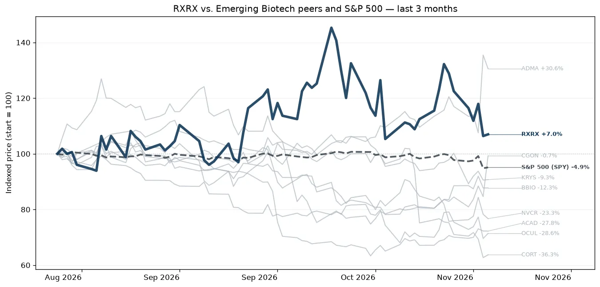

#### Reported Results

Q3 2026: EPS -$0.22 vs. -$0.23 est. (+3.86%); revenue $18.55M vs. $14.81M est. (+25.25%)

#### Earnings Call Summary

Recursion Pharmaceuticals highlighted early clinical success from its AI platform, including positive data for REC-4881 in Familial Adenomatous Polyposis (FAP) showing deep polyp reductions. Additionally, REC-1245 achieved partial responses in heavily pretreated cancer patients. The AI engine also guided Sanofi's optioning of a first-in-class oral inflammatory disease candidate.

#### At a Glance

- **Recursion Beats Revenue Expectations Handily:** Recursion reported a reported revenue of $18.552 million, beating the estimated revenue of $14.811 million, while reported adjusted EPS came in at -$0.22, beating the estimated -$0.229 loss.
- **Sanofi Milestone Drives Top-Line Growth:** Operating revenues rose 262.3% year-over-year to over $18 million, heavily propelled by a $10 million milestone payment from partner Sanofi.
- **Cash Runway Extended Until 2029:** Following a $200 million oversubscribed financing round, the company extended its cash runway into 2029 and lowered its 2026 cash operating expense guidance to under $375 million.
- **Pipeline Updates Support Long-Term Catalysts:** Clinical assets REC-4881 and REC-1245 demonstrated positive safety profiles and encouraging efficacy data, with a registrational study for REC-4881 targeted for the second half of 2027.
- **Strategic Leadership and Operational Changes:** The company appointed pharmaceutical industry veteran Fred Hassan as the new Chair of the Board, effective October 31, 2026.

#### Key Moments from the Call

- **6m 20s — Favorable Financial Adjustments and Runway Extension:** Recursion extended its cash runway into 2029 via a $200 million capital raise and lower operating costs. Full-year 2026 cash OPEX guidance was cut to <$375 million, representing a 40% reduction from 2024 pro forma levels, with further cuts to <$360 million projected for 2027, pleasing investors focused on capital efficiency.
- **13m 40s — Encouraging REC-4881 Data and Registrational Timeline:** Updated phase II TUPELO data for REC-4881 in FAP showed an 87% reduction in total polyp burden at 12 weeks, with significant upper and lower GI activity. The company announced plans to target the initiation of a registrational study in the second half of 2027 following ongoing alignment discussions with the FDA.
- **68m 56s — Promising REC-1245 Efficacy in Advanced Tumors:** Dose escalation data for REC-1245 yielded a 91.7% disease control rate and three partial responses at active doses in a heavily pretreated patient population. Recursion selected the well-tolerated 45 mg daily dose for enrollment in expansion cohorts, including an endometrial cancer monotherapy cohort expecting preliminary data in late 2027.
- **75m 41s — Strong Partner Momentum and Milestone Inflows:** Management highlighted robust partnership validation, generating over $100 million from nine progress milestones with Sanofi and Roche since 2024. Total cash inflows reached $535 million. Sanofi's recent option trigger provides an immediate $10 million payment, reinforcing the commercial validity and repeatability of Recursion's AI discovery engine.

<h3 id="earnings-srpt">Sarepta (SRPT) +6.2% Last 3m</h3>

Sarepta Therapeutics Inc is a commercial-stage biopharmaceutical company focused on the discovery and development of RNA-targeted therapies, gene therapies, and other genetic medicines for rare diseases, particularly neuromuscular disorders. The company has developed approved treatments for Duchenne muscular dystrophy, including EXONDYS 51, VYONDYS 53, AMONDYS 45, and ELEVIDYS, and is advancing additional therapeutic candidates for neuromuscular and other rare diseases. The company operates in one segment: discovering, developing, manufacturing, and delivering therapies to patients with rare diseases.

**Reported:** November 5, 2026 · [Google Finance earnings page](https://www.google.com/finance/quote/SRPT:NASDAQ?tab=earnings&hl=en)

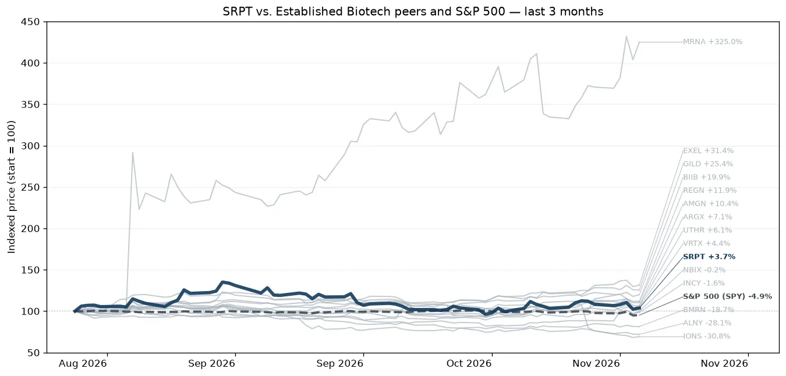

#### Reported Results

Q3 2026: EPS $0.13 vs. $0.36 est. (-63.62%); revenue $381.35M vs. $351.06M est. (+8.63%)

#### Earnings Call Summary

Sarepta raised the low end of its 2026 total net product revenue guidance by $50M, narrowing the range to $1.25B–$1.3B, driven by stable ELEVIDYS enrollment forms and strong PMO franchise metrics. Full-year non-GAAP R&D and SG&A expense guidance was narrowed to $800M–$825M, reflecting ongoing operating discipline.

#### At a Glance

- **Sarepta Tops Revenue But Misses EPS:** Sarepta Therapeutics reported a Q3 2026 adjusted EPS of -$0.27, missing the estimated $0.357, while reported revenue reached $381.35 million, beating expectations of $351.06 million.
- **Franchise Revenues Stabilize Past Performance:** Net product revenue reached $323.8 million, driven by $240.3 million from the PMO exon-skipping franchise and $83.5 million from ELEVIDYS, which demonstrated stable quarter-over-quarter demand indicators.
- **Sarepta Low-End Guidance Lifted:** Management narrowed full-year 2026 product revenue guidance to $1.25 billion–$1.30 billion, raising the lower end by $50 million due to robust PMO franchise execution.
- **Pipeline Catalyst Readouts Looming:** The company expects multiple ascending dose clinical readouts for its DM1 and FSHD programs by late 2026 as it prepares for Phase 3 development.
- **ENVISION Trial Terminated Permanently:** Management confirmed it will not restart the ENVISION study for non-ambulatory patients due to technical and operational hurdles, pivoting instead toward alternative safety studies.
- **Manufacturing Charges Impact Margins:** Product revenue gross margin fell to 59% for the quarter, significantly weighed down by a 19 percentage point impact from take-or-pay manufacturing charges.

#### Key Moments from the Call

- **3m 56s — Narrowed Guidance and Revenue Stabilization:** Management raised the low end of 2026 product revenue guidance to $1.25B–$1.3B and lowered the expense ceiling, pleasing investors by establishing a reliable financial floor based on PMO strength and stable ELEVIDYS enrollment activity.
- **16m 7s — Imminent siRNA Pipeline Catalysts:** Upcoming MAD data for DM1 and FSHD represent high-stakes catalysts. Rationale for potential best-in-class profiles includes achieving nuclear target knockdown, which is critical to convincing investors following mixed competitor results in the space.
- **24m 33s — ENVISION Trial Termination:** Terminating the ENVISION trial shifts the operational path for non-ambulatory ELEVIDYS expansion entirely to ENDEAVOR Cohort eight. Investors will look to Q1 2027 regulatory discussions as the definitive benchmark for the non-ambulatory opportunity.
- **56m 40s — Exon 51 Market Competition Outlook:** Sarepta downplayed immediate threats from anticipated January 2027 competition in the exon 51 space, reassuring investors that a decade of real-world safety data and complex reimbursement onboarding will buffer any commercial market share decay until late 2027.

<h3 id="earnings-insp">Inspire Medical Systems (INSP) +6.3% Last 3m</h3>

Inspire Medical Systems Inc operates as a medical technology company. It focuses on the development and commercialization of minimally invasive solutions for patients with obstructive sleep apnea (OSA). It offers Inspire system, a neurostimulation technology that provides a safe and effective treatment for moderate to severe obstructive sleep apnea. The firm has operating footprints in the United States and All other countries wherein, it generates a majority of its revenue from the United States. Its segment revenues are derived from the sales of its product, the Inspire system, to hospitals and ambulatory surgery centers in the U.S. and in selected countries in Europe and the Asia Pacific region.

**Reported:** November 2, 2026 · [Google Finance earnings page](https://www.google.com/finance/quote/INSP:NYSE?tab=earnings&hl=en)

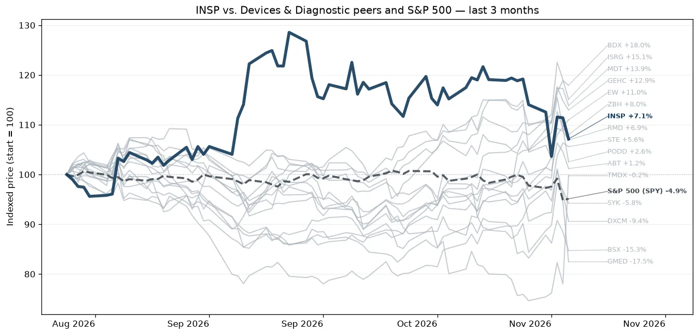

#### Reported Results

Q3 2026: EPS $0.14 vs. $0.09 est. (+54.07%); revenue $206.70M vs. $204.31M est. (+1.17%)

#### Earnings Call Summary

Inspire Medical Systems reported Q3 2026 revenue of $206.7M, down 7.9% year-over-year but up 3% sequentially, with adjusted EPS of $0.14. Performance was driven by stronger-than-expected results in the U.S., which offset high single-digit revenue underperformance and temporary destocking in Germany.

#### At a Glance

- **Inspire Medical Beats Q2 Estimates:** Inspire Medical Systems reported Q2 2026 adjusted EPS of $0.01, significantly beating the estimated loss of $0.245 per share, while reported revenue reached $200.58 million, ahead of the $194.61 million consensus estimate.
- **Gross Margins Expand Despite Contraction:** Quarterly revenue fell 7.6% year-over-year due to coding and reimbursement disruptions, but gross margin expanded by 150 basis points to 85.5% thanks to a higher product mix of the Inspire V system.
- **Full-Year 2026 Outlook Upgraded:** Management raised its 2026 full-year revenue guidance to a range of $835 million to $875 million and boosted full-year adjusted EPS expectations to a range of $1.05 to $1.45.
- **Project Horizon Growth Initiative Launched:** The company introduced Project Horizon, a strategic optimization plan designed to streamline the supply chain and organizational structure to unlock $30 million in annualized growth investment capacity.
- **International Markets Fuel Diverse Growth:** Inspire experienced strong step-up performance in its international markets, driven by geographic expansion in continental Europe and boosted by new countrywide reimbursement coverage in France.

#### Key Moments from the Call

- **8m 46s — Strategic Funding Reallocation via Project Horizon:** Through organizational optimization and consolidated production in Project Horizon, Inspire unlocked $30M in annualized growth investment capacity. These funds are being deployed into clinical evidence expansion, 40 support roles in high-potential growth markets, and targeted cardiology referral networks.
- **15m 38s — Preliminary 2027 Revenue Growth Guidance Provided:** Management project low single-digit revenue growth for 2027. Investors may view this initial outlook as conservative given the lapping of a major $120M coding headwind, but management noted it reflects changed market dynamics, competitor entry, and pending finalized reimbursement rules.
- **32m 37s — International Business Facing Temporary Headwinds:** International revenue fell 9% in Q3 due to destocking activities in Germany, marking a shift from double-digit growth in early 2026. Management expects partial recovery in Q4, forecasting international revenue to be roughly flat year-over-year.
- **43m 31s — Inspire VI Next-Generation Technology Timeline:** Management revealed that Inspire VI, which features automated sleep detection via a firmware upgrade to Inspire V, is undergoing clinical validation. The company is actively communicating with the FDA, targeting a PMA submission timeline in 2027.

## Upcoming Earnings

### Established Biotech

<table class="sortable"><thead><tr><th class="sortable-heading" data-column="0" data-type="text">Company</th><th class="sortable-heading" data-column="1" data-type="text">Ticker</th><th class="sortable-heading" data-column="2" data-type="text">Date</th><th class="sortable-heading" data-column="3" data-type="number">Market cap</th><th class="sortable-heading" data-column="4" data-type="number">3m Return</th><th class="sortable-heading" data-column="5" data-type="number">12m Return</th></tr></thead><tbody><tr><td class="text" data-sort="ionis pharmaceuticals" style=""><a href="#earnings-ions">Ionis Pharmaceuticals</a></td><td class="text text" data-sort="ions" style=""><a href="https://www.google.com/finance/quote/IONS:NASDAQ?hl=en" target="_blank" rel="noopener">IONS</a></td><td class="text" data-sort="2026-11-11" style="">November 11, 2026</td><td class="" data-sort="6550985973.240001" style="">$6.6B</td><td class="" data-sort="-0.30304101838755304" style="background:#c0302f;color:#ffffff;">-30.3%</td><td class="" data-sort="-0.46403806934058456" style="background:#c0302f;color:#ffffff;">-46.4%</td></tr></tbody></table>

### Emerging Biotech

<table class="sortable"><thead><tr><th class="sortable-heading" data-column="0" data-type="text">Company</th><th class="sortable-heading" data-column="1" data-type="text">Ticker</th><th class="sortable-heading" data-column="2" data-type="text">Date</th><th class="sortable-heading" data-column="3" data-type="number">Market cap</th><th class="sortable-heading" data-column="4" data-type="number">3m Return</th><th class="sortable-heading" data-column="5" data-type="number">12m Return</th></tr></thead><tbody><tr><td class="text" data-sort="cg oncology" style=""><a href="#earnings-cgon">CG Oncology</a></td><td class="text text" data-sort="cgon" style=""><a href="https://www.google.com/finance/quote/CGON:NASDAQ?hl=en" target="_blank" rel="noopener">CGON</a></td><td class="text" data-sort="2026-11-12" style="">November 12, 2026</td><td class="" data-sort="6735782096.25" style="">$6.7B</td><td class="" data-sort="0.01185086551264991" style="background:#d6ecd4;color:#111820;">+1.2%</td><td class="" data-sort="0.915070564516129" style="background:#1a7a3c;color:#ffffff;">+91.5%</td></tr><tr><td class="text" data-sort="ocular therapeutix" style="">Ocular therapeutix</td><td class="text text" data-sort="ocul" style=""><a href="https://www.google.com/finance/quote/OCUL:NASDAQ?hl=en" target="_blank" rel="noopener">OCUL</a></td><td class="text" data-sort="2026-11-09" style="">November 9, 2026</td><td class="" data-sort="1448366649.46" style="">$1.4B</td><td class="" data-sort="-0.28237214363438523" style="background:#c0302f;color:#ffffff;">-28.2%</td><td class="" data-sort="-0.3921658986175115" style="background:#ee8483;color:#111820;">-39.2%</td></tr></tbody></table>

