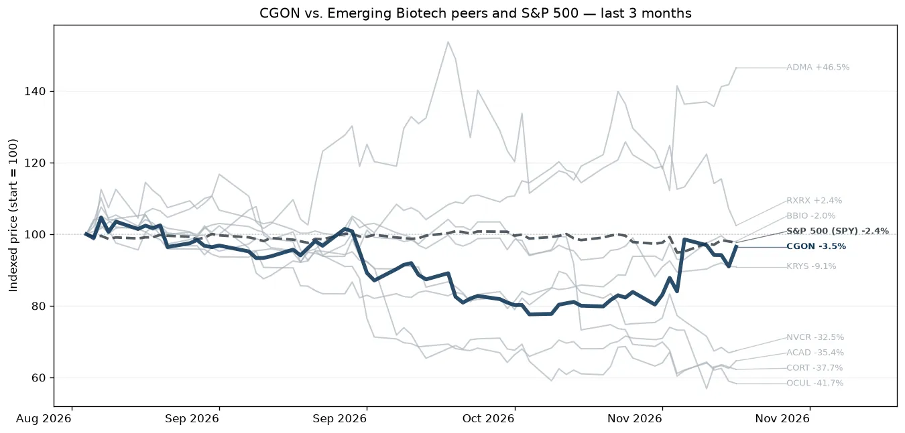
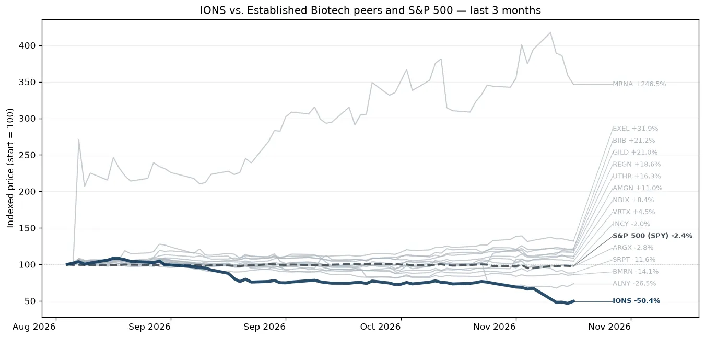

# Life Sciences Digest

<strong>Week of November 16, 2026</strong>Market data through: November 13, 2026Narrative created: November 9, 2026

Weekly review of pharmaceutical, biotech, biologics, and medical-device company performance, changes, earnings activity, and strategy narrative.

## In the News

No strategy narrative is available for this week.

## Recent Earnings Highlights

Companies covered in this section:
<ul class="section-jump-list">
<li><a href="#earnings-cgon">CG Oncology (CGON)</a></li>
<li><a href="#earnings-ions">Ionis Pharmaceuticals (IONS)</a></li>
</ul>
<h3 id="earnings-cgon">CG Oncology (CGON) -0.8% Last 3m</h3>

CG Oncology Inc is a late-stage clinical biopharmaceutical company focused on developing and commercializing its product candidate, cretostimogene grenadenorepvec, for patients with bladder cancer. The company&#x27;s candidate, cretostimogene grenadenorepvec, is a targeted oncolytic intravesically delivered immunotherapy agent that is in two phase three trials (one high-risk BCG unresponsive NMIBC trial and one intermediate-risk NMIBC trial) and a phase two clinical study with a checkpoint inhibitor for high-risk BCG unresponsive NMIBC disease.

**Reported:** November 12, 2026 · [Google Finance earnings page](https://www.google.com/finance/quote/CGON:NASDAQ?tab=earnings&hl=en)

#### At a Glance

- **CG Oncology Outperforms Financial Estimates:** The company reported an Adjusted EPS loss of $0.64, outperforming the estimated loss of $0.81, and delivered total revenue of $1.60 million, beating the estimated $0.53 million.
- **R&amp;D Spending Rises Amid Pipeline Expansion:** Research and development expenses increased 41% year-over-year to $39.22 million, reflecting intensified clinical trial activity for its oncology pipeline compared to past periods.
- **Substantial Funding Expected Through 2029:** The company highlighted a strong cash runway, with $984.5 million in cash, cash equivalents, and marketable securities, which is projected to fund its clinical operations through 2029.
- **Major Regulatory Submission Planned for Q4:** CG Oncology expects to complete its Biologics License Application (BLA) submission for cretostimogene in BCG-unresponsive non-muscle-invasive bladder cancer (NMIBC) in the fourth quarter of 2026.
- **Imminent Clinical Trial Data Readouts Anticipated:** Topline Phase 3 data from the PIVOT-006 trial are expected in November 2026, followed by 12-month data cohorts from BOND-003 and CORE-008 trials in December 2026.
- **Positive Market Reaction Pushes Shares Higher:** Following the better-than-expected financial metrics and upcoming catalyst confirmations, investor enthusiasm drove the stock price higher, hitting an intraday peak of $80.03.

<h3 id="earnings-ions">Ionis Pharmaceuticals (IONS) -49.2% Last 3m</h3>

Ionis Pharmaceuticals is the leading developer of antisense technology to discover and develop novel drugs. Its broad clinical and preclinical pipeline targets a wide variety of diseases, with an emphasis on cardiovascular, metabolic, neurological, and rare diseases. Ionis and Biogen brought Spinraza to market in 2016 as a treatment for spinal muscular atrophy, and Biogen launched ALS drug Qalsody in 2023. Ionis brought two additional drugs to market via its cardiovascular-focused subsidiary Akcea, including ATTR amyloidosis drug Tegsedi (2018) and cardiology drug Waylivra (Europe, 2019). Ionis and AstraZeneca launched polyneuropathy drug Wainua in 2024. Ionis marked its first two independent launches in 2025 for Tryngolza (for FCS) and Dawnzera (for HAE).

**Reported:** November 11, 2026 · [Google Finance earnings page](https://www.google.com/finance/quote/IONS:NASDAQ?tab=earnings&hl=en)

#### Earnings Call Summary

Ionis reported strong financial results for Q3 2026, with revenue reaching $243 million, marking a 55% year-over-year increase compared to the same period last year (excluding a prior one-time payment). Commercial revenue grew 18% year-over-year to $136 million, outpacing R&D revenue, driven primarily by strong momentum from DAWNZERA product sales.

#### At a Glance

- **Ionis Beats EPS and Revenue Estimates:** Ionis Pharmaceuticals reported a reported adjusted EPS of $0 and a reported revenue of $242,721,000, strongly beating estimated adjusted EPS of -$0.934 and estimated revenue of $184,375,930.
- **Commercial Revenue Driven by DAWNZERA Growth:** Total commercial revenue reached $136 million for the quarter, up 18% year-over-year, heavily supported by DAWNZERA product sales which brought in $37 million, up 40% from the previous quarter.
- **TRYNGOLZA Forecast Slashed While Reaffirming Guidance:** The company slashed full-year 2026 sales guidance for TRYNGOLZA to approximately $50 million due to a slower-than-expected launch ramp, though it maintained overall total revenue guidance of $875 million to $900 million.
- **Cash Flow Breakeven Target Pushed Back:** Management pushed its target timeline for sustained positive cash flow by one year from 2028 to 2029, citing the gradual TRYNGOLZA rollout and clinical Phase III disappointments in partnered programs.
- **Stock Plummets Amid Mixed Launch Progress:** Despite delivering a headline earnings beat, the stock plummeted nearly 28% as investors reacted with disappointment over commercial trial roadblocks and slower product adoption updates.

#### Key Moments from the Call

- **2m 20s — TRYNGOLZA FY2026 Guidance Cut:** Investors will be disappointed by Ionis lowering its full-year TRYNGOLZA revenue guidance to ~$50 million due to a slower launch ramp. While physician enthusiasm remains high, navigating a brand-new market, establishing payer coverage policies, and executing early medical exceptions are taking more time than the company initially projected.
- **18m 59s — Strong Q3 Financial Growth:** Ionis delivered a solid revenue beat, reporting $243 million against estimates of $184.4 million, representing 55% organic year-over-year growth. This top-line strength, alongside an EPS miss that was much narrower than projected, showcases strong underlying commercial momentum and a valuable financial amplification from partnered program milestones.
- **20m 8s — DAWNZERA Commercial Outperformance:** Investors will be pleased with DAWNZERA's substantial 40% sequential growth in Q3, generating $37 million in product sales. The launch is hitting its stride by capturing U.S. market share from therapy switches and expanding globally with a recent approval in Canada and positive reimbursement decisions across Europe.
- **35m 4s — Delayed Cash Flow Break-Even Timeline:** Management adjusted its expected timeline to reach sustained positive cash flow from 2028 out to 2029. This delay will frustrate investors as it stems directly from the slower commercial ramp of TRYNGOLZA alongside recent high-profile Phase III pipeline failures for eplontersen and pelacarsen, extending the company's capital investment phase.

